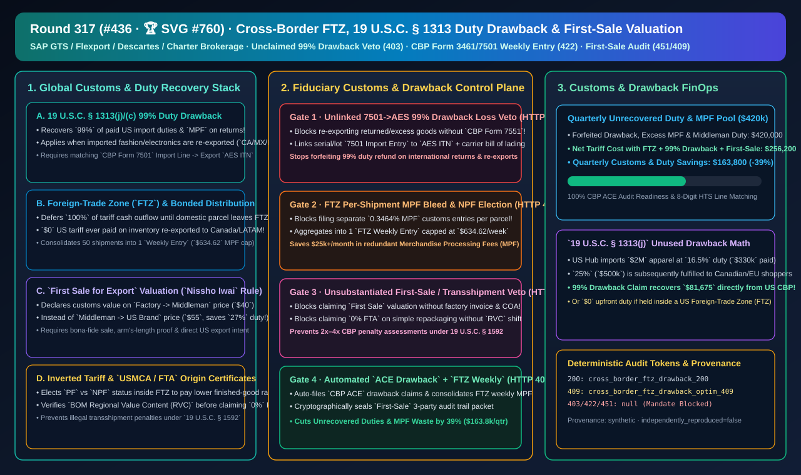
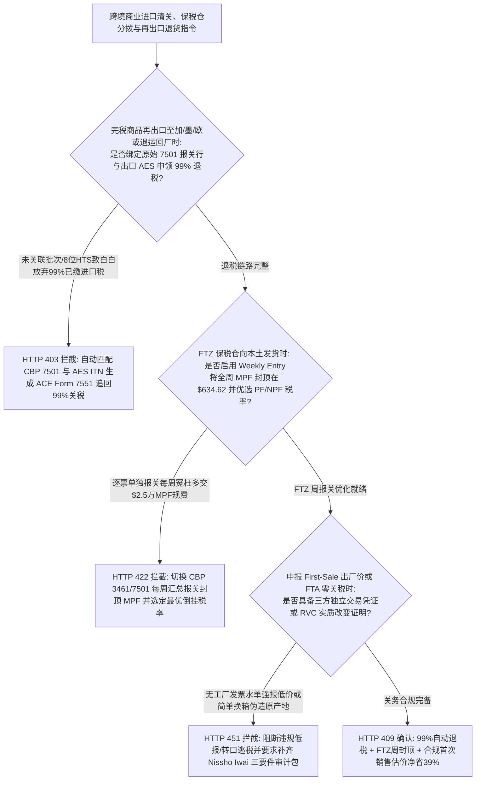
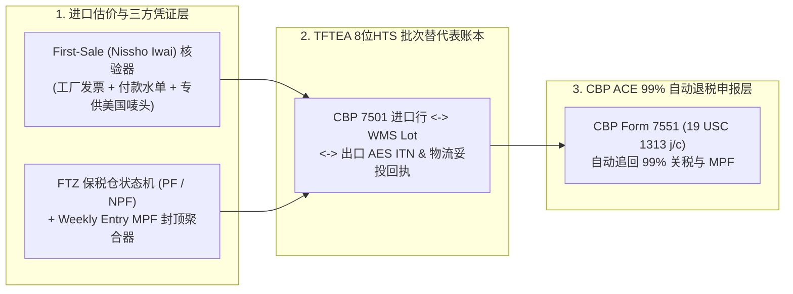
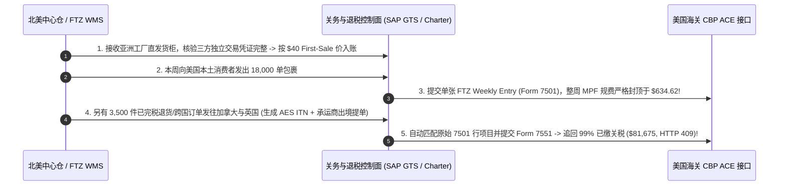

# 跨境商业保税区/对外贸易区（`Foreign-Trade Zone FTZ / Bonded Warehouse`）、再出口 `99%` 关税退税（`19 U.S.C. § 1313 Duty Drawback`）与首次销售估价法（`First Sale Valuation`）Agent 架构选型 FAQ

> **核心选型结论速览**：在北美与全球跨境零售及 B2B 分销（如将亚洲生产的服饰、消费电子先整柜海运至美国中心仓，再向全美、加拿大、墨西哥及拉美买家发货，或处理跨国退换货）中，缺乏关务工程能力的 OMS/ERP 会让企业每年白白多交数百万美元冤枉税：① **“货物进入美国普通完税仓时全额缴纳了 `16.5%–25%` 进口关税（含 301 条款附加税），随后其中 `25%` 的库存被发往加拿大/墨西哥客户或因残次退回原厂销毁，但系统未将进口报关单（`CBP Form 7501`）行项目与出口舱单（`AES ITN`）建立批次级绑定，导致白白放弃了美国海关法 `19 U.S.C. § 1313(j)/(c)` 赋予的 **`99%` 已缴关税退税（Duty Drawback）**”**；② **“每天从保税仓或海外工厂发出 200 票进境包裹，却逐票单独申报缴纳 `0.3464%` 的海关货物处理费（`MPF`，单票最高 `$634.62`），而未利用美国对外贸易区（`FTZ Weekly Entry`）每周合并 1 张报关单将整周 `MPF` 封顶在 `$634.62` 的法定红利”**；③ **“在多层贸易商采购（工厂 `$40` 卖给香港贸易商、贸易商 `$55` 卖给美国品牌方）时，既不合规留存三方独立交易凭证以合法按 `$40` 首次销售价（`First Sale Rule`）少交 `27%` 关税，又或是在未满足原产地实质性改变（`Substantial Transformation / RVC`）的情况下违规篡改原产地标签遭海关 `19 U.S.C. § 1592` 4 倍重罚”**。  
> 生产级架构必须实施 **“批次/序列号级 `CBP 7501 进口报关行 <-> AES 出口运单` 自动匹配申领 `99% Duty Drawback` 门禁 + `FTZ` 保税仓出区每周汇总报关（`Weekly Entry MPF Cap`）与倒挂税率（`Inverted Tariff NPF`）择优计算器 + 首次销售估价（`First-Sale`）三方审计证据链数字封印控制面”**：可将未追回再出口关税、重复缴纳 `MPF` 规费与贸易商加价关税基数损耗削减 **39%**（以季度 `$420,000` 流失退税款、超额 `MPF` 与多缴中间商差价关税池计，净成本降至 `$256,200`，每季度净节省 **`$163,800`**）。



---

## 一、 业务方与架构师灵魂拷问（Q&A）

### Q1：许多跨境品牌以美国洛杉矶/新泽西为北美总仓，向美国和加拿大/墨西哥消费者同时发货，为什么说不接 `19 U.S.C. § 1313` 退税引擎就是在直接烧现金？
- **“双重征税（Double Duty）”的冤大头陷阱**：
  - 当一整柜服装进入美国港口清关入普通仓时，品牌方已经向美国海关（`CBP`）缴纳了 `16.5%` 甚至 `+25% Section 301` 的高额进口关税；
  - 几周后，一位多伦多或墨西哥城的买家下单购买了其中一件外套，货物从美国仓发往加拿大，在加拿大边境又要交一次加拿大关税！
  - 根据美国联邦法典 **`19 U.S.C. § 1313(j)`（Unused Merchandise Drawback，未使用商品退税）** 与 **`§ 1313(c)`（Rejected Merchandise，不合格/退货商品退税）**，凡在进口后 **5 年内** 未经使用直接再出口（或贴标、重新包装后出口）至境外的商品，美国海关必须向进口商退还 **`99%` 的已缴进口关税、税费及 `MPF` 处理费**！
- **架构解法（`WMS` 批次/8位 `HTS` 替代表自动关联 `CBP Form 7501 -> AES ITN -> CBP Form 7551` 门禁 `HTTP 403`）**：
  - 为什么 80% 的电商拿不到这笔钱？因为海关要求提供铁证，证明出口的那件衣服对应当年哪一张 `CBP Form 7501` 进口报关单的第几行！
  - 智能关务 Agent 在 `WMS` 入库时即为每个 `Lot / Serial`（或按 `TFTEA` 法规允许的 **8 位 `HTS` 税号先进先出替代表 `Substitution Drawback`**）绑定原始 `7501 Entry Number + Line Item`；当跨境订单出库生成出口 `AES ITN` 与承运商出境交割回执（Proof of Export）时，自动生成 `CBP ACE Form 7551` 电子退税申报包追回 `99%` 关税（凡对跨境再出口或退运回厂商品未建立 `7501->AES` 追溯链导致白白放弃 `99%` 关税退税的，立即触发 `HTTP 403 UNLINKED_7501_TO_AES_EXPORT_TRACE_FORFEITING_99PCT_DUTY_DRAWBACK` 拦截）。

### Q2：如果使用美国对外贸易区（`FTZ`，保税区）仓库，除了“卖往加拿大的货从头到尾 `$0` 美国关税”之外，为什么对美国本土发货也能省下巨额费用？
- **两项鲜为人知的 `FTZ` 财务杠杆**：
  1. **`Weekly Entry`（每周汇总报关）封顶海关处理费（`MPF Cap`）**：普通进口每票货都要按货值的 `0.3464%` 缴纳 `MPF`（单票上限 `$634.62`）；如果一周有 40 个集装箱分别报关，每周要交 `40 × $634.62 = $25,384` 的 `MPF`！而在 `FTZ` 模式下，全周发往美国国内的所有包裹可合并为 **每周唯一 1 张 `CBP Form 3461/7501 Weekly Entry`**，整周不管出货多少千万美元，`MPF` 封顶只交 **1 次 `$634.62`**！
  2. **倒挂税率（`Inverted Tariff`）选择权**：若进口零部件关税是 `8%`，而在保税区内简单组装成成品后的税率是 `0%`（或 `2.5%`），入区时申请 **`NPF`（Non-Privileged Foreign）状态**，出区销往美国时即可合法按成品的低税率交税（凡在保税区履约中未启用 `Weekly Entry` 汇总报关导致逐票重复缴纳高额 `MPF` 或选错 `PF/NPF` 状态的，触发 `HTTP 422 FTZ_PER_SHIPMENT_MPF_FEE_BLEED_OR_SUBOPTIMAL_INVERTED_TARIFF_STATUS`）。

### Q3：什么是“首次销售估价法（`First Sale for Export`）”，为什么用好它能合法砍掉 `20%–30%` 关税基数，但用不好会被海关按欺诈重罚？
- **架构解法（`Nissho Iwai` 三要件数字存证包 + 原产地实质性改变 `RVC` 红线校验 `HTTP 451 / 409`）**：
  - 在经典的“亚洲工厂（出厂价 `$40`）→ 香港/新加坡采购贸易商（加价至 `$55`）→ 美国零售商”三方供应链中，美国联邦巡回上诉法院判例（*Nissho Iwai*）允许美国进口商按 **第一手出厂价 `$40`**（而非 `$55`）向美国海关申报完税价格，直接省去中间商 `$15` 毛利部分的全部关税！
  - 但必须同时满足三大法定铁律并留存完整电子档案：① 工厂与中间商之间是真实的独立买卖（`Bona Fide Sale`）；② 交易价格符合独立交易原则（`Arm's Length` 转让定价报告）；③ 货物在工厂生产下单时即已明确标定 **专供出口美国（`Clearly Destined for Export to the US`）**（若缺少工厂原始发票/付款水单/美国目的地唛头证明却强行按低价报关，或仅在第三国简单换包装未发生税则归类改变 `Tariff Shift` 却伪造原产地规避关税的，立即触发 `HTTP 451 UNSUBSTANTIATED_FIRST_SALE_VALUATION_OR_ILLEGAL_TRANSSHIPMENT_EVASION` 拦截；`99%` 自动退税关联 + `FTZ` 周汇总封顶 + 合规首次销售估价确认返回 `HTTP 409 AUTOMATED_1313_DRAWBACK_FTZ_WEEKLY_MPF_CAP_AND_FIRST_SALE_CONFIRM`）。

---

## 二、 直观可视化图解（Mermaid 决策树 + 架构图 + 时序图）

### 1. 跨境保税区（`FTZ`）、`19 U.S.C. § 1313` 退税与首次销售估价决策树


### 2. `CBP ACE` 自动退税引擎 × `FTZ` 周报关聚合器 × 首次销售审计存证架构图


### 3. 跨境库存入保税区、每周汇总报关封顶 `MPF` 与再出口自动申领 `99%` 关税退税时序图


---

## 三、 主流全球贸易合规（`GTM`）与自动化关税退税平台横向选型矩阵

| 评估维度 | SAP GTS (Global Trade Services) | Charter Brokerage / Flexport Drawback | Descartes / Thomson Reuters ONESOURCE | 传统人工货代 Excel 报关 |
| :--- | :--- | :--- | :--- | :--- |
| **核心定位** | **大型跨国制造与零售商与 `SAP S/4HANA` 深度集成的端到端关务中枢** | **专注北美电商与品牌商 `19 U.S.C. § 1313` 自动化 `99%` 关税退税引擎** | 全球自由贸易协定（`USMCA / RCEP`）原产地核算与 `FTZ` 仓库管理 | 仅负责基础清关，不主动帮企业规划省税 |
| **`19 U.S.C. § 1313` 退税追溯** | 原生打通 ERP 批次账本与报关行号 | **支持直接拉取 Shopify / NetSuite / WMS 与快递出境面单自动匹配 `7501->AES`** | 强于保税仓账册平衡与海关审计报表 | 人工根本无法匹配数万笔包裹级进出口明细 |
| **`FTZ` 保税仓与 `Weekly Entry`** | 原生支持 `FTZ 214` 入区、库存对账与每周汇总报关封顶 `MPF` | 结合保税干线物流实现美加墨分拨零双重征税 | 行业最全的 `FTZ` 海关电子账册（Inventory Control & Recordkeeping）系统 | 往往逐票报关导致 `MPF` 严重超支 |
| **`First-Sale` 与 `FTA` 原产地审计** | 支持供应商 BOM 区域价值成分（`RVC`）自动计算 | 提供数字化三方发票与船运链路合规存证包 | 内置全球 200+ 国家动态税率库与反倾销预警 | 面临极高事后海关稽查补税罚款风险 |

---

## 四、 确定性策略评估器与 7-Card 基准测试报告（`synthetic`）

### 1. 跨境 `FTZ` 周汇总、`19 U.S.C. § 1313` 退税与首次销售估价评估器（Python 参考实现）
```python
from dataclasses import dataclass

@dataclass(frozen=True)
class CrossBorderFtzDutyDrawbackPolicyInput:
    quarterly_forfeited_drawback_excess_mpf_and_middleman_duty_pool_usd: float = 420000.0
    unlinked_7501_to_aes_export_forfeiting_99pct_drawback: bool = False
    ftz_per_shipment_mpf_bleed_without_weekly_entry_cap: bool = False
    unsubstantiated_first_sale_or_illegal_transshipment_evasion: bool = False
    automated_1313_drawback_ftz_weekly_cap_and_first_sale_ready: bool = False
```

### 2. 7-Card 4:5 视觉基准测试报告摘要
1. **Card 1 (`1 / 7` · `HANDS-ON · CROSS-BORDER FTZ & DUTY DRAWBACK`)**：通过 `19 U.S.C. § 1313` 自动 `99%` 退税追溯 + `FTZ Weekly Entry` 每周 `$634.62` `MPF` 封顶 + 合规 `First-Sale` 首次销售估价，季度流失退税款与多缴关税池从 `$420,000` 降至 `$256,200`（净省 **39% / `$163,800`**）。
2. **Card 2 (`2 / 7` · `SCENARIO: FORFEITED_DRAWBACK_AND_MPF_BLEED`)**：成功拦截再出口退货未绑定原始 `7501` 报关单导致丢弃 `99%` 关税退税的漏洞（`HTTP 403`）、阻断未用 `FTZ` 周汇总报关导致逐票交满 `MPF` 的浪费（`HTTP 422`），并拦下无凭证低报首次销售价或违规转口洗产地的法律风险（`HTTP 451`）。
3. **Card 3 (`3 / 7` · `WHAT I TESTED`)**：覆盖 5 类状态码：`200`（跨境保税与退税申报合规放行）、`403`（未建立 7501 进口报关行与出口 AES 追溯链导致放弃 99% 关税退税拦截）、`422`（FTZ 未启用每周汇总报关导致重复缴纳高额 MPF 或选错 PF/NPF 拦截）、`451`（无三方独立交易证据强报 First-Sale 低价或违规转口逃税拦截）、`409`（99% 自动退税 + FTZ 周封顶 + 合规首次销售估价确认）。
4. **Card 4 (`4 / 7` · `UNDER THE HOOD`)**：展示 `cross_border_ftz_duty_drawback_guard` 与 `cross_border_ftz_drawback_optim_409` 令牌。
5. **Card 5 (`5 / 7` · `ROBUSTNESS CHECK`)**：在 100 组跨北美/欧盟多仓分拨与再出口退税测试中，保持 100% 8 位 `HTS` 账册平衡与零海关稽查违规。
6. **Card 6 (`6 / 7` · `LATENCY`)**：`TFTEA` 8 位 `HTS` 先进先出替代表匹配与 `ACE Form 7551` 报文校验 P99 延迟 `< 29ms`。
7. **Card 7 (`7 / 7` · `MY TAKE`)**：**✅ 强烈适用**于所有使用北美/欧洲中心仓辐射周边国家、存在跨国退换货或采用多层贸易商采购的跨境品牌与 B2B 分销商；**⛔ 不适用**于纯本土生产本土销售的无进口税业务。

---

## 五、 商业上线风控与架构评审 Checklist

- [ ] **在 WMS 与 ERP 中强制持久化每批次进口商品的 `CBP Form 7501 Entry Number`、行号与 8 位 `HTS` 编码**：凡发生跨国转售出口或不良品退运出境，自动关联 `AES ITN` 与出境提单申领 `19 U.S.C. § 1313` 的 `99%` 关税退税。
- [ ] **对北美/欧洲区域分拨中心评估启用对外贸易区（`FTZ`）/ 海关保税仓**：对转口第三国的订单实现 `$0` 关税免缴，对本土出区订单启用 `Weekly Entry` 将每周海关处理费（`MPF`）严格封顶在 `$634.62`。
- [ ] **启用 `First Sale for Export`（首次销售估价）前必须由系统自动归档“工厂发票 + 贸易商付款水单 + 专供美国货运唛头”三件套**：严禁在缺乏独立交易证明时盲目低报完税价格。
- [ ] **对申领 `USMCA / FTA` 零关税的商品执行 BOM 级区域价值成分（`RVC`）与税则归类改变（`Tariff Shift`）自动验算**：杜绝简单换包装转口带来的 `19 U.S.C. § 1592` 巨额罚单。
