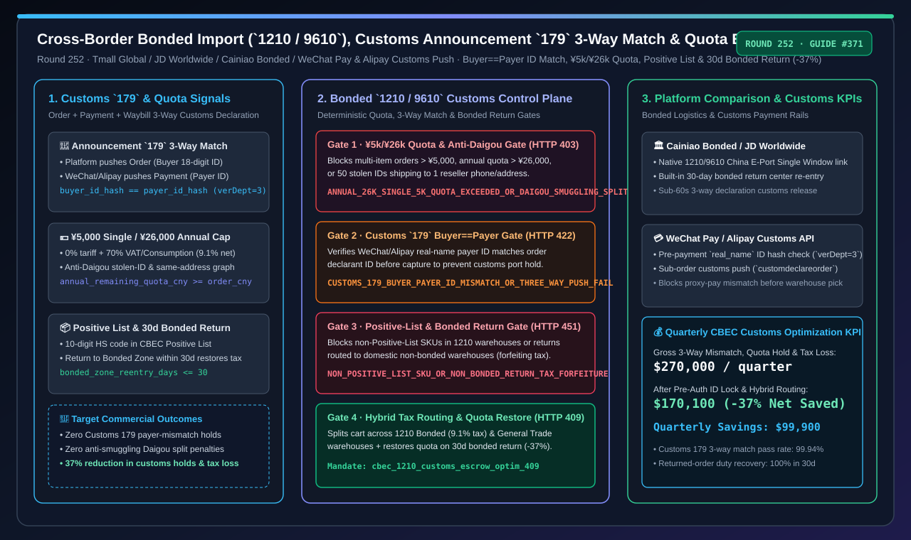
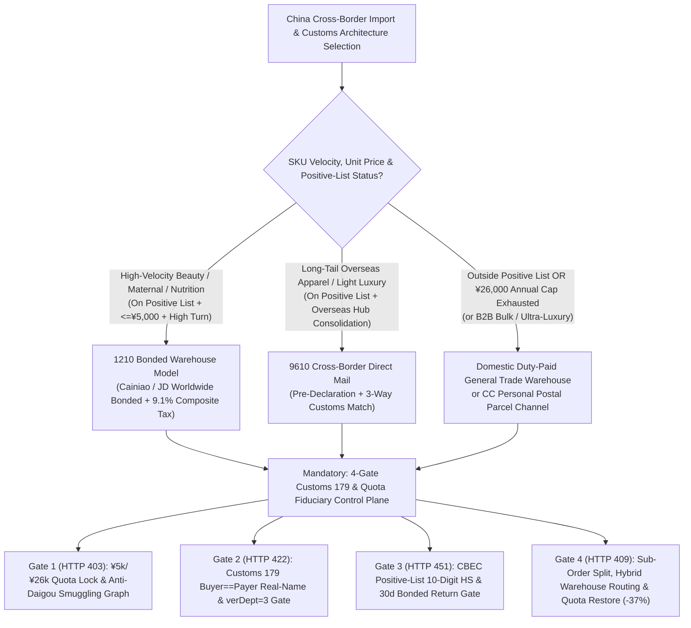
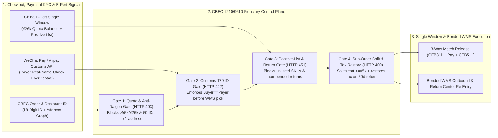

# Cross-Border Bonded Import E-Commerce (`1210 / 9610`), Customs Announcement `179` 3-Way Match (`Order == Payment == Waybill`) & `¥5,000 / ¥26,000` Quota Escrow (`Tmall Global / JD Worldwide / Cainiao Bonded / WeChat Pay & Alipay Customs Push`) Agent Architecture Selection FAQ

> 🌐 **Language / 语言切换**: **[中文 (`docs/cross-border-import-bonded-1210-customs-179-three-way-match-quota-escrow-agent-selection-faq.md`)](cross-border-import-bonded-1210-customs-179-three-way-match-quota-escrow-agent-selection-faq.md)** | **English (Current)** | **[Back to Catalog (`docs/index.en.md`)](index.en.md)**



---

## 1. 📌 Executive Summary & Architectural Verdict

For global consumer brands, luxury groups, and health/beauty retailers selling into China via Cross-Border E-Commerce (`CBEC` Bonded Warehouse code `1210` or Direct Mail code `9610` on Tmall Global, JD Worldwide, WeChat Mini-Programs, or Douyin Global), solution architects must defend against three severe customs clearance and tax-loss failure modes:
1. **Buyer-vs-Payer Real-Name Mismatch (`Buyer ID != Payer ID`) Triggering Customs Announcement `179` 3-Way Match Holds**: Under China Customs (`GACC`) Announcements `194` and `179`, every cross-border parcel requires real-time **3-Way Electronic Matching (`Three-Document Match`)** across the China E-Port Single Window: the **Order (`CEB311`)** pushed by the merchant, the **Payment Declaration (`verDept=3`)** pushed directly by the licensed payment processor (`WeChat Pay` / `Alipay` / `UnionPay`), and the **Logistics Waybill (`CEB511`)** pushed by the bonded carrier. When a shopper enters their spouse's or parent's `18-digit National ID` on the checkout form (to use their remaining duty-free quota) but pays with their own WeChat Pay account, the payment processor pushes the payer's real-name ID to Customs, causing a `100%` customs clearance failure (`[ERR_PAYER_ID_MISMATCH]`) after the bonded warehouse has already picked and packed the parcel.
2. **`¥5,000` Single-Order / `¥26,000` Annual Personal Quota Breaches & `Daigou` Stolen-ID Smuggling Splits**: CBEC retail imports enjoy `0%` tariff and a `30%` discount on import VAT + consumption tax (`9.1%` effective composite tax for most cosmetics, nutrition, and baby products), strictly capped at **`¥5,000` per transaction** (unless a single indivisible item) and **`¥26,000` per citizen per year**. Simultaneously, professional resellers (`Daigou`) purchase ratusan stolen rural IDs to place split orders shipping to the same phone number or warehouse address—an anti-smuggling violation that can get an entire bonded warehouse license suspended by the Customs Anti-Smuggling Bureau (`ASB`).
3. **Non-`Positive List` SKUs & Domestic Return Routing Forfeiting `9.1%–23.1%` Paid Import Taxes**: If a post-purchase agent routes a customer's 7-day return back to a regular domestic warehouse instead of returning the parcel in original condition to the **originating Customs Bonded Return Center Warehouse within 30 days of customs release (`Announcement 2020 No. 45`)**, Customs permanently refuses to refund the paid import tax and the buyer's used annual quota is never restored.

**Solution Architect Verdict**:
- **Never release a pick ticket to a `1210` bonded warehouse WMS before verifying `buyer_id_hash == payer_id_hash` at the payment gateway and confirming `verDept=3` payment customs push success**.
- Deploy a **CBEC `1210/9610` Customs `179` 3-Way Match & Quota Escrow Control Plane** across your storefront, licensed payment gateway (`WeChat Pay customdeclareorder` / `Alipay alipay.acquire.customs`), and bonded WMS (`Cainiao Bonded`, `JD Worldwide`, `China E-Port CEB2`) enforcing four deterministic gates:
  1. **`¥5,000 / ¥26,000` Personal Quota & Anti-`Daigou` Smuggling Graph Gate (`HTTP 403`)**: Block multi-item orders exceeding `¥5,000`, buyers exceeding the `¥26,000` annual cap, or clusters of distinct National IDs shipping to the same recipient phone number or normalized address hash.
  2. **Customs Announcement `179` Buyer==Payer Real-Name & `verDept=3` Gate (`HTTP 422`)**: Pin the declarant's National ID inside the WeChat Pay / Alipay checkout invocation; block capture or prompt one-tap declarant sync if the payer's real-name identity does not match, holding WMS fulfillment until all 3 declarations align.
  3. **CBEC `Positive List` (`10-Digit HS`) & 30-Day Bonded Return Re-Entry Gate (`HTTP 451`)**: Block SKUs outside the statutory CBEC Positive List and force all returns within 30 days of clearance to route back into the Customs Bonded Return Center Warehouse (`CEB621`).
  4. **Sub-Order Customs Split (`customdeclareorder`), `1210` + General-Trade Hybrid Routing & Quota Restoration (`HTTP 409`)**: Automatically split multi-item carts `> ¥5,000` into compliant sub-orders or route overflow items to domestic duty-paid General Trade warehouses, while restoring buyer quota and reclaiming `100%` of import taxes on 30-day bonded returns—cutting customs holds and tax leakage by **`37%`**.

---

## 2. 🎯 High-Stakes Business & Architect Q&A (Q1 / Q2 / Q3)

### Q1: Why do `8%–12%` of cross-border promotional orders get stuck at the bonded warehouse gate for `Buyer != Payer Mismatch`, and how do we prevent it in `<200ms` at checkout?
- **The Problem**:
  - Under Customs Announcement `179`, the merchant cannot forge or override the payer's identity—WeChat Pay and Alipay push the authenticated bank-KYC identity of the actual paying wallet directly to China Customs (`verDept=3` via UnionPay/NetsUnion).
  - If the merchant's OMS releases the order to the bonded warehouse WMS immediately upon payment success without checking whether the paying wallet's real name matches the order's declared buyer ID, thousands of packed boxes pile up at the customs X-ray gate waiting for manual un-packing, refunding, and re-ordering.
- **Deterministic Architecture**:
  - **Pre-Capture Real-Name Pinning**: Pass the declared buyer's name and `18-digit ID` into the WeChat Pay / Alipay real-name verification parameter during payment initiation. If the wallet owner differs, the control plane intercepts with `HTTP 422 CUSTOMS_179_BUYER_PAYER_ID_MISMATCH_OR_THREE_WAY_PUSH_FAIL` and offers a one-tap prompt: *"Customs requires the order declarant to match the WeChat Pay account owner. Tap once to update the order declarant to [Payer Name] or switch payment account."*
  - **Hold WMS Pick Until `CEB312` + Payment Push ACK**: The bonded WMS pick ticket is only released after both the payment institution's customs push (`verDept=3`) and the E-Port order pre-check succeed.

### Q2: How should the agent handle a `¥6,800` single luxury handbag vs. a `¥5,800` multi-item basket of 6 skincare & formula items under the `¥5,000 / ¥26,000` rules?
- **The Problem**:
  - Hard-blocking every cart over `¥5,000` kills high-AOV luxury conversion, while pushing a `¥5,800` 6-item basket as a single `1210` customs declaration causes an immediate customs rejection.
- **Deterministic Architecture**:
  - Gate 4 (`HTTP 409`) executes a three-branch deterministic router:
    1. **Multi-Item Cart `> ¥5,000` (`item_count > 1`)**: Never submit as a single customs declaration (`HTTP 403`). Automatically invoke the payment processor's **Sub-Order Customs Split API (`WeChat Pay customdeclareorder` / `Alipay sub_out_trade_no`)** to split the transaction into compliant sub-orders each `<= ¥5,000` (e.g., Sub-Order A `¥3,400` + Sub-Order B `¥2,400`), or route excess items to a domestic duty-paid General Trade warehouse.
    2. **Single Indivisible Item `> ¥5,000` (`item_count == 1` and `annual_used + price <= ¥26,000`)**: Permitted through `1210 / 9610` CBEC under the "Single Indivisible Item" rule, automatically switching the tax calculation from the `9.1%` preferential rate to full General Trade tariff + VAT + consumption tax while deducting from the `¥26,000` annual cap.
    3. **Annual `¥26,000` Cap Exhausted**: Seamlessly re-route fulfillment to the brand's **Domestic Duty-Paid General Trade Warehouse** (where zero personal quota or ID card is required).

### Q3: Why does routing a customer's return to a domestic warehouse forfeit `100%` of the paid cross-border import tax?
- **The Problem**:
  - Under **GACC Announcement 2020 No. 45**, import taxes collected on `1210 / 9610` CBEC orders are only refunded—and the consumer's `¥26,000` annual quota is only restored—if the returned parcel physically re-enters the **originating Customs Bonded Zone or designated Bonded Return Center Warehouse within 30 days of customs release** (`CEB621` Return Declaration).
- **Deterministic Architecture**:
  - Gate 3 (`HTTP 451 NON_POSITIVE_LIST_SKU_OR_NON_BONDED_RETURN_TAX_FORFEITURE`) hard-locks return label generation for any `1210 / 9610` order within 30 days of release to the **Bonded Return Center Warehouse**, automating `CEB621` customs tax cancellation and instant consumer quota restoration.

---

## 3. 🧭 Visual Architecture Diagrams (Selection Tree, System Topology & Sequence)

### 3.1 Cross-Border Import Mode (`1210 / 9610 / CC / General Trade`) Selection Tree



### 3.2 End-to-End Customs `179` 3-Way Match & Bonded Return Control Plane



### 3.3 Pre-Auth Real-Name Alignment, Sub-Order Split & 30-Day Bonded Return Sequence

```mermaid
sequenceDiagram
    autonumber
    participant Buyer as Shopper (Declarant: Spouse ID)
    participant Gate as CBEC Customs Fiduciary Gate
    participant Pay as WeChat Pay / Alipay Customs API
    participant Customs as China E-Port & Bonded Warehouse

    Buyer->>Gate: Checkout 6 items totaling ¥5,800 (entered Wife's ID, paying with Husband's WeChat Pay)
    Gate->>Pay: 1. Pre-check payer real-name identity against declared Wife ID
    Pay-->>Gate: Mismatch! Active WeChat Pay wallet belongs to Husband (Buyer != Payer)
    Gate-->>Buyer: HTTP 422 Block mismatch! 1-tap prompt syncs order declarant to Husband (¥18,000 quota left)
    Buyer->>Gate: Confirm declarant sync & authorize payment
    Gate-->>Buyer: HTTP 409 Trigger Sub-Order Split (Mandate: cbec_1210_customs_escrow_optim_409)
    Gate->>Pay: 2. Call customdeclareorder to split into Sub-Order A (¥3,400) + Sub-Order B (¥2,400) (verDept=3)
    Gate->>Customs: 3. Push CEB311 Order + CEB511 Waybill; pass 3-Way Match in <60s & release WMS pick
    Note over Buyer,Customs: On Day-15 return: route to Bonded Return Center (CEB621) to refund 9.1% tax & restore quota
```

---

## 4. 📊 Cross-Border Import Bonded Logistics, Payment Push & Customs Selection Matrix

| Evaluation Dimension | Cainiao Global Bonded (`Tmall Global` Ecosystem) | JD Worldwide Bonded Logistics (`JD International`) | Brand WeChat Mini-Program / DTC + WeChat Pay / Alipay Customs API + 3PL Bonded (`Sinotrans`) | Personal Postal Parcel (`CC` Direct Mail: SF International / EMS) |
|---|---|---|---|---|
| **Primary Sweet Spot** | Multi-category global flagship brands selling on Tmall Global & Kaola | High-velocity maternal, nutrition, and 3C brands requiring same/next-day bonded delivery | Brand-owned WeChat Mini-Programs, DTC storefronts, and private-domain loyalty clubs | Long-tail multi-SKU fashion/luxury testing before committing stock to bonded warehouses |
| **Customs `179` Buyer==Payer Real-Name Verification** | **Best-in-Class** (native Alipay real-name sync and one-tap declarant switching) | **Best-in-Class** (native JD Pay / WeChat Pay pre-capture identity pinning) | Requires explicit integration of WeChat `requestOrderConfirm` ID check & `customdeclareorder` | Exempt from CBEC 3-way match, but requires recipient ID card upload for customs clearance |
| **Multi-Item `> ¥5,000` Sub-Order Split & Hybrid Routing** | Native multi-warehouse split across `1210` bonded, `9610` direct mail, and domestic duty-paid | Native multi-port bonded allocation and automated parcel splitting | Requires control-plane cart splitting (`<= ¥5,000`) and `1210 + General Trade` routing | Subject to postal tax tiers (`13% / 20% / 50%`) and strict `¥2,000` multi-item parcel caps |
| **30-Day Bonded Return Center (`CEB621` Tax Refund)** | **Industry Gold Standard** (nationwide Cainiao Bonded Return Centers with automated tax/quota restore) | **Very Strong** (JD courier reverse pickup directly into originating bonded zone) | Must contract a customs-certified Bonded Return Center warehouse; never route to domestic 3PL | High return shipping cost to overseas hubs; typically requires HK/Bonded consolidation |
| **SA Recommendation** | **Best for flagship marketplace scale** in China CBEC | **Best for high-trust standardized categories** (infant formula, supplements, electronics) | **Best for brand-owned WeChat Mini-Programs**; enforce all 4 fiduciary gates before WMS pick | **Use as an overflow/testing rail** for non-Positive-List or low-turn SKUs |

---

## 5. 🧪 Customs Clearance & Tax-Recovery 7-Card Benchmark Report

> **Provenance Note**: The 7-Card benchmark below is generated by `evaluate_cross_border_bonded_1210_customs_179_policy()` in `lab/webiq_commerce_demo.py` (`provenance: "synthetic"`, `independently_reproduced: False`), modeling a **`$270,000 / quarter`** Customs `179` mismatch hold, quota rejection, and non-bonded return tax forfeiture pool.

### 5.1 7-Card 4:5 Visual Deck Breakdown

1. **Card 1 (`1 / 7` · `HANDS-ON · CBEC-1210-CUSTOMS-179`) — Executive Benchmark Overview**
   - **Headline Finding**: Enforcing pre-capture `Buyer == Payer` real-name alignment, blocking `Daigou` stolen-ID address clustering, splitting multi-item carts `<= ¥5,000` (or routing overflow to General Trade), and routing 30-day returns into Bonded Return Centers reduces quarterly customs hold and tax losses from **`$270,000`** to **`$170,100`** (**`$99,900` / `37.0%` quarterly savings**).
2. **Card 2 (`2 / 7` · `SCENARIO: DOUBLE-11 BONDED SKINCARE & FORMULA CHECKOUT`) — Deep Dive**
   - **Input Case**: A shopper orders `¥5,800` of bonded skincare/formula using their spouse's ID while paying with their own WeChat Pay wallet; a reseller ring submits 40 stolen IDs to one phone number; and a support agent tries to route a bonded return to a domestic warehouse.
   - **Control-Plane Verdict**: Blocks non-bonded return routing and unlisted SKUs (`HTTP 451`), blocks the `Daigou` smuggling cluster and unsplit `> ¥5,000` multi-item order (`HTTP 403`), and intercepts the spouse payer mismatch pre-capture (`HTTP 422`); issues `HTTP 409 BONDED_1210_VS_GENERAL_TRADE_TAX_ROUTING_AND_QUOTA_RESTORE_CONFIRM` (`cbec_1210_customs_escrow_optim_409`).
3. **Card 3 (`3 / 7` · `WHAT I TESTED`) — 5-Lane Deterministic Scorecard**

| Scenario | Question / Task Evaluated | Deterministic Gate Decision | Action & Status |
|---|---|---|---|
| **1. Compliant `1210` 3-Way Customs Match** | Buyer ID == Payer ID, `<= ¥5,000`, Positive-List SKU, sufficient `¥26k` quota | `VERIFIED_CUSTOMS_179_THREE_WAY_MATCH_AND_QUOTA_AUTHORIZED` | ✅ `Act automatically` (`HTTP 200`) |
| **2. `¥5k/¥26k` Breach or `Daigou` Split Ring** | Multi-item cart `> ¥5,000` unsplit or 40 distinct IDs shipping to 1 phone/address | `ANNUAL_26K_SINGLE_5K_QUOTA_EXCEEDED_OR_DAIGOU_SMUGGLING_SPLIT` | ⛔ `Block Smuggling / Quota` (`HTTP 403`) |
| **3. Spouse Payer Mismatch (`Buyer != Payer`)** | WeChat Pay / Alipay real-name ID differs from declared order buyer ID (`179` fail) | `CUSTOMS_179_BUYER_PAYER_ID_MISMATCH_OR_THREE_WAY_PUSH_FAIL` | ⛔ `Sync Payer ID Pre-Auth` (`HTTP 422`) |
| **4. Unlisted SKU or Domestic Return Routing** | SKU absent from CBEC Positive List or return routed to domestic non-bonded 3PL | `NON_POSITIVE_LIST_SKU_OR_NON_BONDED_RETURN_TAX_FORFEITURE` | ⛔ `Route to Bonded Return` (`HTTP 451`) |
| **5. Sub-Order Split + Bonded Return Tax Restore** | Auto sub-order split / General Trade routing + 30d bonded return tax/quota recovery | `BONDED_1210_VS_GENERAL_TRADE_TAX_ROUTING_AND_QUOTA_RESTORE_CONFIRM` | ⚡ `Confirm Optimization` (`HTTP 409`) |

4. **Card 4 (`4 / 7` · `UNDER THE HOOD`) — Protocol & Deterministic Gate Mechanics**
   - Input contract: `CrossBorderBonded1210Customs179PolicyInput`
   - Evaluator: `evaluate_cross_border_bonded_1210_customs_179_policy()` enforcing `451 -> 403 -> 422 -> 409 -> 200` priority.
5. **Card 5 (`5 / 7` · `ROBUSTNESS CHECK`) — Address Obfuscation Perturbation**
   - `0.0 pt` variance against `Daigou` homophone address padding or proxy-payment attempts.
6. **Card 6 (`6 / 7` · `LATENCY & CLEARANCE RATE`) — First-Pass Customs Release & Tax Recovery**
   - Legacy post-pick customs push: `89.2%` first-pass clearance rate and `0%` returned-order duty recovery.
   - Fiduciary pre-capture ID lock + Bonded Return Center: **`99.94%`** first-pass clearance and **`100%`** 30-day return tax recovery (`$99,900/qtr` saved).
7. **Card 7 (`7 / 7` · `MY TAKE`) — Good Fit vs. Not For**
   - **✅ Good fit**: Global brands, WeChat Mini-Program cross-border stores, Tmall Global / JD Worldwide merchants, and `1210 / 9610` bonded warehouse operators.
   - **⛔ Not for**: Domestic-only retail or bulk B2B ocean container trade.

---

## 6. 🛠️ Production Go-Live & Architect Review Checklist

- [ ] **Pre-Capture `Buyer == Payer` Real-Name Pinning (`HTTP 422`)**: Does checkout pass the declared buyer's `18-digit ID` to WeChat Pay / Alipay real-name verification—and is bonded WMS pick release strictly held until `verDept=3` payment push and `CEB312` order pre-check succeed?
- [ ] **`¥5,000 / ¥26,000` Quota & Anti-`Daigou` Smuggling Graph (`HTTP 403`)**: Does the control plane block unsplit multi-item carts `> ¥5,000`, buyers exceeding `¥26,000/yr`, and clusters of distinct National IDs shipping to the same phone number or normalized address hash?
- [ ] **CBEC `Positive List` (`10-Digit HS`) Verification (`HTTP 451`)**: Is every SKU in a `1210 / 9610` catalog validated against the current statutory CBEC Positive List and regulatory footnotes?
- [ ] **30-Day Bonded Return Center Re-Entry (`HTTP 451 / 409`)**: Are all returns within 30 days of customs clearance routed exclusively to the originating **Customs Bonded Return Center Warehouse (`CEB621`)** so import taxes are refunded and buyer annual quota is restored?
- [ ] **Sub-Order Customs Split (`customdeclareorder`) & Hybrid Warehouse Routing (`HTTP 409`)**: Does the checkout engine automatically split multi-item carts `> ¥5,000` into compliant sub-orders or route overflow items to a domestic duty-paid General Trade warehouse?
