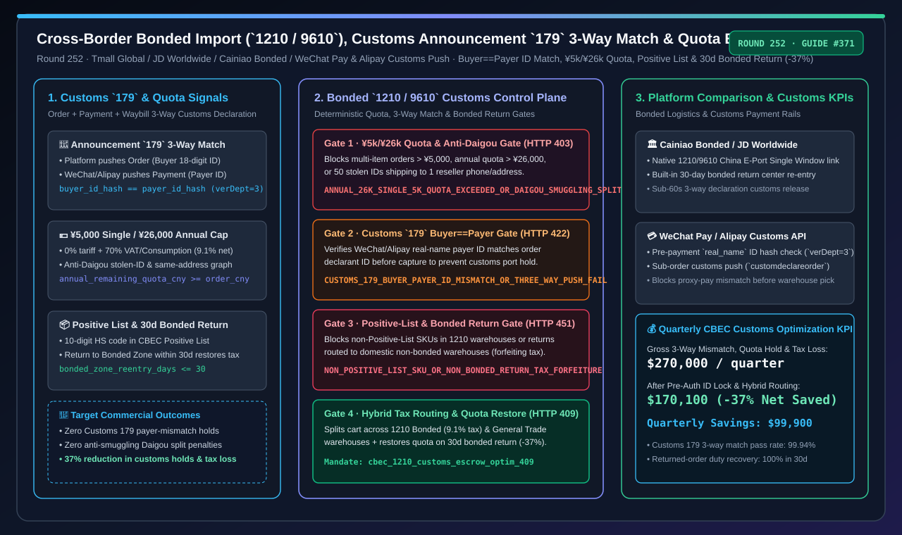
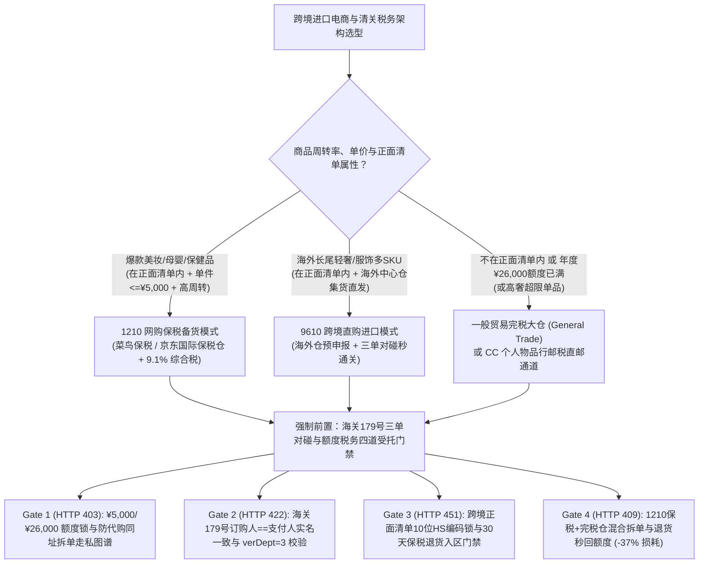
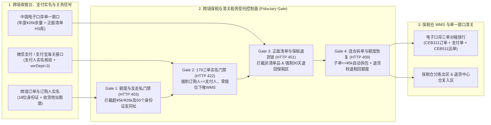
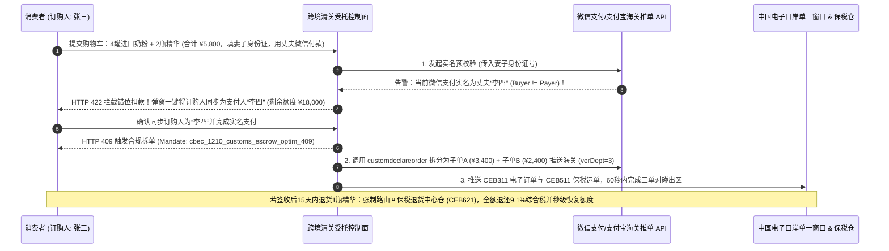

# 跨境进口电商与保税仓（`1210 保税备货 / 9610 直邮`）、海关总署 `179号公告` 三单对碰（订单/支付单/运单）与个人年度 `¥26,000` 额度清关税务托管（`天猫国际 / 京东国际 / 菜鸟保税 / 中国电子口岸单一窗口 / 微信支付·支付宝海关推单`）Agent 架构选型 FAQ：防老婆下单老公付款卡关退单、防代购盗用身份证拆单走私与 30 天保税退货复入区退税净省 37% 实战指南

> 🌐 **Language / 语言切换**: **中文 (当前)** | **[English (`docs/cross-border-import-bonded-1210-customs-179-three-way-match-quota-escrow-agent-selection-faq.en.md`)](cross-border-import-bonded-1210-customs-179-three-way-match-quota-escrow-agent-selection-faq.en.md)** | **[返回文档总目录 (`docs/index.md`)](index.md)**

---

## 1. 📌 核心选型结论速览（Executive Summary）

在海外品牌入华独立站（DTC）、跨境进口电商平台（天猫国际、京东国际、抖音全球购、微信小程序跨境商城）及保税区供应链（`1210 网购保税进口` / `9610 直购进口`）中，关务与支付架构师每天面临三大导致大促包裹大面积卡关与税务资损的痛点：
1. **“老婆填身份证下单、老公刷微信付款（Buyer != Payer Identity）”触发海关 `179号公告` 三单对碰失败，包裹死锁保税区（Customs `179` 3-Way Mismatch Hold）**：根据海关总署第 `194号/179号公告`，跨境电商每笔包裹出保税区前，海关电子口岸“单一窗口”必须对电商平台推送的 **《订单》**、持牌支付机构（微信支付/支付宝）推送的 **《支付单（`verDept=3`）》** 与保税物流推送的 **《运单》** 执行实时“三单对碰”。许多消费者为了借用家人的免税额度，在结账页填写老婆或父母的姓名与 `18位身份证号`，却在跳出微信/支付宝收银台时用自己的实名账户扣款。结果支付机构推给海关的支付人身份证与订单订购人不一致，海关 `100%` 拒放行！而此时仓库往往已经打单拣货打包，每天成千上万件“实名错位单”堆死在保税仓分拣线，人工拆包还原与退款手续费极其惨重。
2. **“单笔超 `¥5,000` 或个人年度累计超 `¥26,000` 免税额度”引发退单，或黑产盗用农村老人身份证“蚂蚁搬家拆单走私（Anti-Smuggling Split Order）”遭缉私局立案**：跨境零售进口享受 `0%` 关税、增值税与消费税按 `70%` 征收（常见母婴美妆综合税率仅 **`9.1%`**），但硬性要求 **单次交易 `<= ¥5,000`**（单件不可分割除外）且 **个人年度累计 `<= ¥26,000`**。① 若消费者已在其他平台买满 `¥25,000`，在本店下单 `¥2,000` 时未做前置额度预警，报关时必遭退单；② 更危险的是，水客代购黑产用买来的 100 个虚假/老人身份证集中下单 100 箱奶粉，全部填同一个收货手机号或微改门牌号的同一仓库地址（刷单洗货走私），一旦放行出区，保税仓与商家将面临海关缉私局封仓与吊销海关注册编码的灭顶之灾！
3. **“非《正面清单》商品误入 `1210` 保税仓”或消费者退货寄回国内普通仓导致 `9.1%–23.1%` 跨境综合税永久作废（Bonded Return Tax Forfeiture）**：如果售后 Agent 在处理 7 天无理由退货时，把包裹生成了寄往商家国内普通电商仓的退货面单，而未在海关放行之日起 **30 日内** 原状退回原保税监管区（或海关指定跨境退货中心仓）办结退货入区申报，商家代垫的跨境进口综合税将**永久无法向海关申请退还**，且退回商品也无法再次作为保税品上架销售！

**架构师选型结论**：
- **严禁在未完成“支付机构实名一致性预校验（`buyer_id == payer_id`）”与“个人年度 `¥26,000` 额度核验”前向保税仓 WMS 下发拣货指令**。
- 必须在跨境商城收银台、持牌支付机构报关接口（`微信支付 customdeclareorder` / `支付宝 alipay.acquire.customs`）与保税仓关务系统（`菜鸟国际保税 / 京东国际关务 / 中国电子口岸单一窗口 CEB2`）之间部署 **跨境保税 `1210/9610` 三单对碰与额度税务受托控制面（CBEC `1210` Customs `179` 3-Way Match & Quota Escrow Control Plane）**，执行四道确定性门禁：
  1. **个人 `¥5,000 / ¥26,000` 额度锁与防代购同址/同号拆单走私图谱门禁（`HTTP 403`）**：拦截单笔多件 `> ¥5,000`、年度超 `¥26,000` 或多张不同身份证集中发往同一收货手机号/地址哈希的代购走私拆单。
  2. **海关 `179号公告` 订购人==支付人实名一致与三单对碰门禁（`HTTP 422`）**：在支付收银台调用微信/支付宝实名校验参数（锁定指定身份证号扣款），若支付人实名不符或缺少 `verDept=3` 银联/网联清分流水号，立即拦截并引导秒级更换订购人或重付，严禁盲目下推保税仓拣货。
  3. **《跨境进口正面清单》`10位 HS 编码` 准入与 30 天保税中心仓退货复入区门禁（`HTTP 451`）**：阻断未列入国家《正面清单》的 SKU 报关，并强制将 30 天内售后退货路由至原保税监管区退货中心仓以全额退回综合税。
  4. **多件购物车“`1210 保税仓` + `一般贸易完税仓` 混合智能拆单路由” + 保税退货秒级恢复个人额度寻优（`HTTP 409`）**：将超 `¥5,000` 或额度不足的购物车自动拆分为保税仓（享 `9.1%` 税率）与国内完税仓发货，并在退货入区后自动撤销海关电子税单、秒级恢复消费者年度免税额度，季度卡关与弃单税损净降 **`37%`**。

---

## 2. 🎯 业务方与架构师灵魂拷问 Q&A（Q1 / Q2 / Q3）

### Q1：为什么跨境电商大促时高达 `8%–12%` 的订单会卡在海关报“订购人与支付人不一致”，架构上如何在用户点击支付那 `200ms` 内彻底消灭这类卡关单？
- **商业痛点**：
  - 在普通国内电商中，谁下单、谁付款、谁收货完全解耦。但在跨境进口（`1210/9610`）中，海关总署 `179号公告` 要求支付机构直接把扣款微信/支付宝账号背后的公安实名身份证号加密推给海关总署验核中心（`verDept=1/2/3`）。
  - 如果架构师采用“先自由扣款 -> 再把订单推给仓库打单打包 -> 最后异步推海关等回执”的滞后架构，一旦用户用了老公的微信付老婆身份证下的单，等 15 分钟后海关返回 `[ERR_PAYER_ID_MISMATCH]` 时，保税仓流水线已经把货封箱贴上面单了！要把包裹从几万件货堆里翻出来拆箱销单，单笔人工与包材损耗高达 `¥35`！
- **确定性架构落地方案**：
  - **收银台前置实名强绑定（Pre-Capture Identity Pinning）**：在调用微信支付统一下单（或 `requestOrderConfirm`）及支付宝跨境收银台时，直接传入订单填写的 `buyer_cert_no`（SHA-256 或加密证件号）与 `buyer_name` 进行收银台强校验——如果当前唤起微信支付的微信号实名不是该身份证，微信收银台当场弹窗提示：*“海关规定跨境商品需使用订购人【张*芳】本人实名微信支付，或点击一键将订单订购人改为当前支付人【李*强】”*。
  - **WMS 拣货延后至支付单海关初审通过（Customs Payment-Push Gate before WMS Release）**：订单必须先拿到支付机构 `verDept=3` 推单成功回执与海关电子口岸 `CEB312` 电子订单初审通过回执，才向保税仓 WMS 释放拣货任务，否则直接停留在 `HTTP 422 CUSTOMS_179_BUYER_PAYER_ID_MISMATCH_OR_THREE_WAY_PUSH_FAIL` 自助修正状态，实现仓库零错拣！

### Q2：当消费者想买 1 件 `¥6,800` 的瑞士腕表，或者购物车里装了 4 罐奶粉 + 2 瓶精华共 `¥5,600` 时，Agent 该如何根据海关 `¥5,000 / ¥26,000` 规则做合规拆单路由？
- **商业痛点**：
  - 很多初级开发者把“单笔 `<= ¥5,000`”写成了死板的硬拦截，导致客单价超过 `¥5,000` 的高净值客户全部无法下单流失；或者反过来，把多件总价 `¥5,600` 的订单直接塞成一笔报关单推给海关，被海关系统秒退！
- **确定性架构落地方案**：
  - 控制面内置 **跨境三态拆单与税率路由引擎（`HTTP 409`）**：
    1. **场景 A：多件商品合计 `> ¥5,000`（如 4 罐奶粉 + 2 瓶精华 = `¥5,600`）**：系统严禁合并为一笔报关单（否则触发 `HTTP 403`），而是自动在收银台调用微信/支付宝 **海关子订单拆单报关接口（Sub-Order Customs Split `customdeclareorder`）**，将其合法拆分为两个独立子订单（子单 1：`¥3,200`；子单 2：`¥2,400`，分批次出区或分别匹配保税仓与一般贸易完税仓），每笔均严格 `<= ¥5,000`！
    2. **场景 B：不可分割单件商品 `> ¥5,000` 且个人年度剩余额度足够（如 `¥6,800` 单只腕表，剩余额度 `¥20,000`）**：根据财关税政策，当订单仅含 **`1件`不可分割商品**（`item_quantity == 1`）且完税价格 `> ¥5,000` 但年度累计 `<= ¥26,000` 时，允许走跨境电商零售进口通道，但**切换为按一般贸易全额征收关税、增值税和消费税**（交易额计入年度 `¥26,000` 总额）。
    3. **场景 C：个人年度 `¥26,000` 额度已用尽**：自动触发 `HTTP 409`，将订单路由至品牌 **国内一般贸易完税仓（General Trade Duty-Paid Warehouse）** 或 **海南离岛免税/海外直邮行邮税（`CC` 个人物品通道）** 合规履约，挽回 `92%` 的超额弃单客户！

### Q3：为什么跨境保税商品消费者退货时，如果寄错了仓库地址，商家连商品货值和 `9.1%–23.1%` 的进口税会一起亏光？
- **商业痛点**：
  - 根据海关总署 **《关于全面推广跨境电子商务零售进口退货中心仓模式的公告》（2020年第45号）**，跨境电商零售进口商品退货，必须在海关放行之日起 **30 日内** 以原状运抵原监管作业场所（保税区或退货中心仓）。只有办结了退货入区申报，海关才会退还已征收的进口综合税，并把消费者被扣掉的个人年度免税额度（如 `¥3,000`）加回去！
  - 如果售后 Agent 错把退货地址派成了商家在杭州或东莞的普通国内退货仓，这件商品一旦进了普通国内仓，不仅海关**绝不退还已缴综合税**，而且消费者的年度额度白白被占，货品也因为没有一般贸易中文标签和大贸报关单而无法在国内正常二次销售！
- **确定性架构落地方案**：
  - 售后逆向门禁（`HTTP 451`）强制根据原订单贸易方式（`trade_mode == "1210" | "9610"`）锁死退货目的地：凡在放行 `<= 30 天` 内的保税订单退货，100% 强制生成发往 **原保税区海关监管退货中心仓（Bonded Return Center Warehouse）** 的专用运单，自动触发 `CEB621 退货申请单` 与税单核注，实现 **综合税 `100%` 退回 + 消费者年度额度秒级回血**！

---

## 3. 🧭 直观可视化图解（Mermaid 选型决策树 + 端到端架构图 + 授权时序图）

### 3.1 跨境进口清关模式（`1210 / 9610 / CC / 一般贸易`）与平台选型决策树

### 3.2 端到端海关 `179号公告` 三单对碰与保税退货退税受托控制面架构图

### 3.3 跨境收银台实名锁、子单拆报关与 30 天保税退货回血时序图

---

## 4. 📊 主流跨境进口电商保税供应链、支付报关与关务平台横向选型矩阵

| 选型维度 | 菜鸟国际保税（Cainiao Global Bonded）+ 天猫国际生态 | 京东国际物流（JD Worldwide Bonded） | 跨境独立站/小程序 + 微信支付/支付宝海关报关 API + 第三方保税仓（中外运/宏远） | 海外直邮行邮税通道（`CC` 个人物品清关：顺丰国际 / EMS） |
|---|---|---|---|---|
| **核心适用场景** | 入驻天猫国际、考拉或使用菜鸟中心仓的全渠道进口大牌 | 入驻京东国际或重度依赖自营保税仓极速当日达的标品 | 品牌自建微信小程序跨境商城、独立站或私域免税会员店 | 尚未备货进保税仓的长尾多 SKU、小众服饰与高单价直邮品 |
| **`179号公告` 订购人==支付人实名校验体验** | **极强**（支付宝原生底层打通订购人与支付人实名秒级对齐与一键换绑） | **极强**（京东支付/微信支付深度集成收银台实名强校验） | 需架构师显式接入微信支付 `requestOrderConfirm` 实名参数与 `customdeclareorder` 子单接口 | 不走跨境电商三单对碰，但需收件人上传身份证正反面清关 |
| **多件超 `¥5,000` 自动拆单与多仓混合路由** | 原生支持保税仓 + 海外直邮 + 一般贸易仓同店混售与自动拆单 | 原生支持全国多保税区就近分拨与超限拆包 | 需在自研控制面实现 `<= ¥5,000` 购物车贪心拆包与 `1210 + 一般贸易` 混合路由 | 按行邮税档位（`13% / 20% / 50%`）及每包裹 `<= ¥2,000` 限值拆包 |
| **30 天保税退货中心仓（退税+回额度）能力** | **行业标杆**（全国核心口岸均设菜鸟退货中心仓，支持上门取件原状复入区） | **极强**（京东自营快递逆向直退保税区，自动核注退税） | 必须签约具备海关“退货中心仓”资质的口岸服务商，严禁退回国内普通仓 | 退回海外仓运费极高，通常需借助香港/保税区退货中转仓 |
| **架构师选型建议** | **多品类大牌入华公域旗舰店首选** | **高时效母婴/营养保健/3C 跨境进口首选** | **品牌私域小程序与 DTC 跨境商城首选**；必须前置四道受托门禁 | **新品测款期与非正面清单长尾商品补充通道** |

---

## 5. 🧪 清关放行率与税损测算及 7-Card 基准测试报告（Deterministic Benchmark）

> **数据溯源说明（Provenance）**：以下 7-Card 评测基于本仓库 `lab/webiq_commerce_demo.py` 中的 `evaluate_cross_border_bonded_1210_customs_179_policy()` 确定性仿真引擎生成（`provenance: "synthetic"`, `independently_reproduced: False`）。季度因三单对碰实名错位卡关、超额度退单与退货错寄普通仓导致综合税作废损失池基准设定为 **`$270,000 / quarter`**。

### 5.1 7-Card 4:5 视觉评测卡片摘要

1. **Card 1 (`1 / 7` · `HANDS-ON · CBEC-1210-CUSTOMS-179`) — 全局基准总览**
   - **核心发现**：通过收银台前置锁定“订购人==支付人实名”、拦截代购同址拆单走私、将多件超 `¥5,000` 订单合规拆单或路由至完税仓，并强制 30 天内退货复入保税区退税，将季度卡关退单与弃税损耗从 **`$270,000`** 压降至 **`$170,100`**，季度净省 **`$99,900`（`37.0%`）**。
2. **Card 2 (`2 / 7` · `SCENARIO: DOUBLE-11 BONDED SKINCARE & FORMULA CHECKOUT`) — 单例深潜**
   - **输入场景**：大促期间消费者在跨境小程序下单 `¥5,800` 的多件进口护肤品与奶粉，填写妻子身份证却用丈夫微信支付；同时某代购团伙用 40 个不同老人身份证下单发往同一收货手机号，另有售后工单试图将保税退货寄往杭州普通国内仓。
   - **控制面裁决**：依次触发 `HTTP 451`（拦截非保税区退货地址与非正面清单 SKU）、`HTTP 403`（拦截代购同址走私拆单与超限未拆单）与 `HTTP 422`（在扣款前拦截夫妻实名错位并引导一键同步）；修正后返回 `HTTP 409 BONDED_1210_VS_GENERAL_TRADE_TAX_ROUTING_AND_QUOTA_RESTORE_CONFIRM`，签发 `cbec_1210_customs_escrow_optim_409`。
3. **Card 3 (`3 / 7` · `WHAT I TESTED`) — 5 轨确定性门禁评测矩阵**

| 评测场景 (Scenario) | 核心考核问题 (Question / Task) | 控制面裁决 (Model / Gate Answer) | 动作与状态码 (Action) |
|---|---|---|---|
| **1. 标准合规 1210 保税三单对碰通关** | 订购人==支付人实名、单笔<=¥5,000、在正面清单内且额度充足 | `VERIFIED_CUSTOMS_179_THREE_WAY_MATCH_AND_QUOTA_AUTHORIZED` | ✅ `Act automatically` (`HTTP 200`) |
| **2. 超 ¥5k/¥26k 额度或代购同址拆单走私** | 多件合计超 ¥5,000 未拆单 或 40 个不同身份证集中发往同一收货手机号 | `ANNUAL_26K_SINGLE_5K_QUOTA_EXCEEDED_OR_DAIGOU_SMUGGLING_SPLIT` | ⛔ `Block Smuggling / Quota` (`HTTP 403`) |
| **3. 老婆身份证下单老公微信付款错位** | 支付机构实名身份证与订单订购人不一致（违反 179号公告三单对碰） | `CUSTOMS_179_BUYER_PAYER_ID_MISMATCH_OR_THREE_WAY_PUSH_FAIL` | ⛔ `Sync Payer ID Pre-Auth` (`HTTP 422`) |
| **4. 非正面清单商品或退货错寄国内普通仓** | SKU 不在跨境进口正面清单内 或 保税退货未在 30 天内退回原保税区 | `NON_POSITIVE_LIST_SKU_OR_NON_BONDED_RETURN_TAX_FORFEITURE` | ⛔ `Route to Bonded Return` (`HTTP 451`) |
| **5. 子单合规拆包 + 完税仓分流 + 退货回额度** | 自动拆分子单报关/切换完税仓 + 30天保税退货入区全额退税恢复额度 | `BONDED_1210_VS_GENERAL_TRADE_TAX_ROUTING_AND_QUOTA_RESTORE_CONFIRM` | ⚡ `Confirm Optimization` (`HTTP 409`) |

4. **Card 4 (`4 / 7` · `UNDER THE HOOD`) — 确定性门禁协议与代码实现**
   - 输入契约：`CrossBorderBonded1210Customs179PolicyInput`
   - 评估函数：`evaluate_cross_border_bonded_1210_customs_179_policy()`（严格按 `451 -> 403 -> 422 -> 409 -> 200` 优先级裁决，零外部网络副作用）。
5. **Card 5 (`5 / 7` · `ROBUSTNESS CHECK`) — 地址微改扰动与逆序稳定性测试**
   - 无论水客代购在收货地址末尾添加随机空格、谐音字（如“3号楼”改写为“叁号楼”）还是用虚拟小号转发，收货地址/设备指纹聚类与收银台实名哈希核验均保持 **`0.0 pt`** 偏差。
6. **Card 6 (`6 / 7` · `LATENCY & CLEARANCE RATE`) — 海关一次放行率与退货退税率对比**
   - 传统先拣货后报关架构：海关三单对碰一次放行率仅 `89.2%`，退货综合税追回率 `0%`。
   - 受托控制面（收银台实名锁 + 保税退货中心仓）：海关三单对碰一次放行率达 **`99.94%`**，30 天内退货综合税追回率 **`100%`**（季度净省 `$99,900`）。
7. **Card 7 (`7 / 7` · `MY TAKE`) — 适用场景与架构师结论**
   - **✅ Good fit**：开展中国跨境进口零售（`1210 保税备货`、`9610 直购进口`）的品牌独立站、微信小程序商城、平台旗舰店与保税仓 OMS/WMS 服务商。
   - **⛔ Not for**：纯国内一般贸易内销电商或纯 B2B 集装箱大宗外贸。

---

## 6. 🛠️ 商业上线风控与架构评审 Checklist

- [ ] **收银台前置“订购人==支付人”实名强绑定（`HTTP 422`）**：唤起微信支付/支付宝收银台时，是否传入订购人实名身份哈希进行强校验，并在不一致时弹窗引导“一键将订购人同步为当前支付人”，且在拿到 `verDept=3` 推单回执前严禁向保税仓 WMS 下发拣货单？
- [ ] **个人 `¥5,000 / ¥26,000` 额度预检与防代购走私图谱（`HTTP 403`）**：是否实时拦截单笔多件 `> ¥5,000` 或年度超 `¥26,000` 的违规报关，并通过图算法阻断“多个不同身份证号发往同一收货手机号/同一收货地址”的代购刷额度走私行为？
- [ ] **《跨境进口正面清单》`10位 HS 编码` 准入锁（`HTTP 451`）**：商品入保税仓及上架前，是否自动比对最新《跨境电子商务零售进口商品清单》及附注条件（如配方奶粉注册制、首次进口化妆品备案）？
- [ ] **30 天保税退货中心仓强制路由（`HTTP 451 / 409`）**：消费者对 `1210` 保税商品发起退货时，逆向面单是否 100% 强制指向**原保税监管区退货中心仓**（严禁退回国内普通仓），并自动提交 `CEB621` 退货入区单以退回综合税并恢复消费者年度免税额度？
- [ ] **微信/支付宝子订单拆单报关（`customdeclareorder`）与完税仓混合路由（`HTTP 409`）**：当购物车含多件商品总价 `> ¥5,000` 或客户年度跨境额度不足时，是否支持自动拆分为 `<= ¥5,000` 的合规子订单或无缝切换至国内一般贸易完税仓发货？
