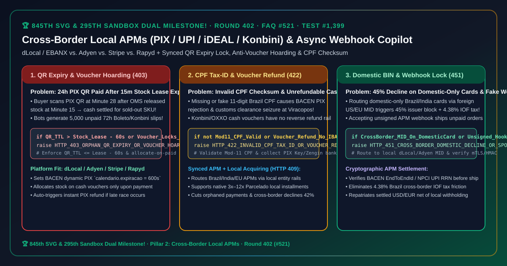
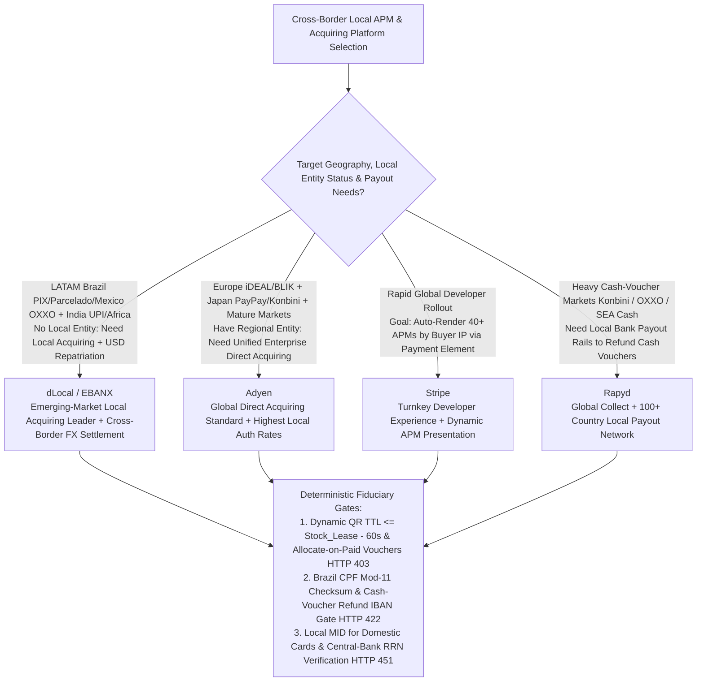
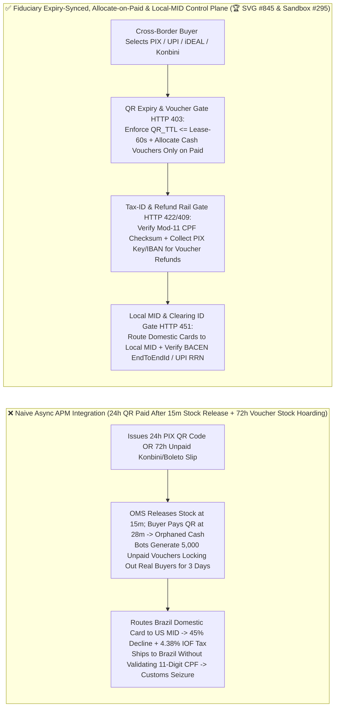
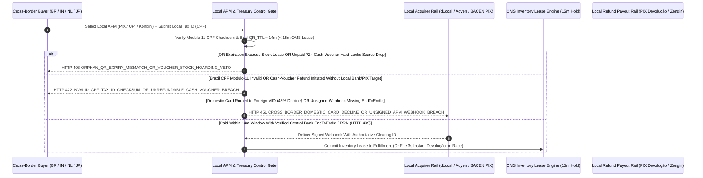

# Cross-Border E-Commerce Local Alternative Payment Methods (`Local APMs`: `PIX` / `UPI` / `iDEAL` / `Konbini & PayPay`), Synced QR-Expiry Locks & Voucher Refund Payout Agent Architecture Selection Guide: `dLocal / EBANX` vs. `Adyen` vs. `Stripe` vs. `Rapyd`, Anti-Orphaned Payments & `CPF` Checksums (`-42%` Loss FAQ · 🏆 845th SVG & 295th Sandbox Dual Milestone!)

> **Executive Summary (Benchmarked against `ib-vs-ethernet-roce-selection-faq.md` · 🏆 845th SVG Architecture Diagram & 295th Enterprise Sandbox Dual Milestone · 521st Bilingual SA Guide · Round 402)**: Built for **Cloud & AI Solution Architects** designing global checkout orchestration, asynchronous local payment state machines, and cross-border treasury repatriation across LATAM, APAC, and Europe. In high-growth global markets, international credit cards (`Visa / Mastercard`) account for less than `30%` of e-commerce checkout volume: **Brazil (`PIX` instant QR = 45%+ + local `Parcelado` installments)**, **India (`UPI` = 75%+)**, **Netherlands (`iDEAL` = 70%+)**, **Poland (`BLIK` = 65%+)**, and **Japan (`Konbini` convenience-store cash vouchers + `PayPay` = 40%+)**. Yet integrating asynchronous Local APMs without a deterministic state machine triggers three costly engineering failures: (1) **Late-Webhook Orphaned Payments (`QR Expiry > Inventory Lease`)**: The OMS holds inventory for `15 minutes`, but the `PIX / UPI` QR code is generated with a `24-hour` default expiration—when the buyer scans and pays at Minute 28, the item has already sold out, leaving an irreversible push payment with no inventory; (2) **`72-Hour` Unpaid `Boleto / Konbini / OXXO` Inventory Hoarding Attacks**: Bots generate thousands of unpaid cash vouchers at zero cost, locking up flash-sale stock for 3 days; and (3) **Invalid Brazil `CPF` Tax-ID Checksums & Unrefundable Cash Vouchers**. This guide compares **`dLocal / EBANX` vs. `Adyen` vs. `Stripe` vs. `Rapyd`** and implements deterministic guards for **Synced `QR_TTL <= Stock_Lease - 60s` & Allocate-on-Paid Voucher Locks (`HTTP 403`)**, **Modulo-11 `CPF / CNPJ` Validation & Local Bank/PIX Refund Collection (`HTTP 422`)**, **Domestic-MID Local Acquiring & Webhook `EndToEndId / RRN` Verification (`HTTP 451`)**, and **Automated Late-Payment Instant Reversal Sagas (`HTTP 409`, `-42%` net loss)**.

---

## 1. 📌 Executive Summary & Architectural Selection Verdict

1. **Top-Line Selection Verdict**:
   - **Emerging-Market Expansion (`LATAM: Brazil PIX / Parcelado / Mexico OXXO`, `India UPI`, `Africa / SEA`) Without a Local Corporate Entity (Requiring Cross-Border USD/EUR Repatriation)**: Select **`dLocal`** or **`EBANX`**.
   - **Global Enterprise Retailers With Regional Entities in Europe, Japan, North America & APAC Seeking Direct Acquiring for `iDEAL`, `BLIK`, `PayPay`, `Konbini` & Cards**: Select **`Adyen`**.
   - **Developer-Velocity Storefronts & Global SaaS Seeking Dynamic IP-Based Rendering of 40+ APMs via a Single `Payment Element`**: Select **`Stripe`**.
   - **Cross-Border Marketplaces Requiring Both Cash-Voucher Collection (`Konbini / OXXO`) and Local Bank Payout Rails (`100+` Countries) for Refunds & Seller Disbursements**: Select **`Rapyd`**.
2. **Three Non-Negotiable Fiduciary Control Gates**:
   - **Gate 1 — Synced Dynamic QR Expiration (`QR_TTL <= Stock_Lease - 60s`) & Anti-Hoarding Voucher Allocation Lock (`HTTP 403`)**: Explicitly set the protocol-level QR expiration parameter (e.g., Brazil BACEN PIX `calendario.expiracao = 600` seconds) strictly shorter than the OMS inventory hold (`QR_TTL <= Inventory_Hold_TTL - 60s`), and forbid `48h–72h` offline cash vouchers (`Konbini / OXXO / Boleto`) from hard-deducting scarce flash-sale inventory prior to actual cash receipt (`Allocate-on-Paid`) via `HTTP 403 ORPHAN_QR_EXPIRY_MISMATCH_OR_VOUCHER_STOCK_HOARDING_VETO`.
   - **Gate 2 — Modulo-11 `CPF / CNPJ` Tax-ID Checksum & Cash-Voucher Local Refund Rail Gate (`HTTP 422`)**: Validate the buyer's 11-digit Brazil `CPF` (or 14-digit `CNPJ`) using double-digit `Modulo-11` checksum verification before initiating `PIX` or generating customs labels, and collect a verified local payout target (`PIX Key`, Japanese `Zengin` account, or instant store credit) when refunding non-reversible cash vouchers (`Konbini / OXXO / Boleto`) via `HTTP 422 INVALID_CPF_TAX_ID_CHECKSUM_OR_UNREFUNDABLE_CASH_VOUCHER_BREACH`.
   - **Gate 3 — Local-MID Routing for Domestic-Only Cards (`Parcelado`) & Signed Central-Bank Reference Verification (`HTTP 451`)**: Route domestic-only LATAM/India cards (`Elo / Hipercard / RuPay` and local-currency Visa/MC) through a local acquirer `MID` (`dLocal / EBANX / Adyen Local`) rather than a cross-border USD/EUR `MID` (avoiding `45%+` issuer declines and Brazil's `4.38% IOF` cross-border tax), and verify both webhook `HMAC-SHA256` signatures and central-bank clearing IDs (`BACEN EndToEndId` / `NPCI 12-Digit UPI RRN`) via `HTTP 451 CROSS_BORDER_DOMESTIC_CARD_DECLINE_OR_UNSIGNED_APM_WEBHOOK_BREACH`.

---

## 2. 🎯 Architect & Global Payments Leader Q&A (The Why & How)

### Q1: Why do asynchronous push payments (`PIX / UPI / iDEAL / Konbini`) create "paid but out-of-stock" orphaned orders—and how do we synchronize the payment rail with the OMS?
- **Root Cause**: Unlike credit cards (where the merchant pulls funds synchronously in 2 seconds), QR and voucher APMs are asynchronous buyer-initiated pushes. If the merchant releases reserved inventory after 15 minutes while the payment provider leaves the QR code active for 24 hours, a buyer who scans the code at Minute 30 sends real, irreversible money for an expired cart.
- **Deterministic Solution (`Protocol-Level QR Expiry Sync` + `3-Second Auto-Devolução Saga` / `HTTP 403 & HTTP 409`)**: Pass `calendario.expiracao` (PIX) or `expire_after` (UPI/PayPay) set to `Stock_Lease_Seconds - 60` so the banking network itself rejects late scans; if a rare boundary race still occurs, trigger an automated `PIX Devolução` / instant push refund within 3 seconds.

### Q2: How do we prevent competitors or scalper bots from locking up 100% of our inventory using unpaid `Boleto`, `OXXO`, or `Konbini` cash vouchers?
- **Deterministic Solution (`Allocate-on-Paid` for Offline Vouchers + Disable Vouchers on Low-ATP Drops / `HTTP 403`)**: Because generating a 72-hour cash voucher costs `$0`, never place a hard inventory hold when a voucher is generated. Deduct inventory only when the convenience store or bank confirms cash receipt, and dynamically hide offline vouchers when `SKU_ATP < 50`.

---

## 3. 🧭 Visual Architecture Diagrams (Mermaid)

### 3.1 Cross-Border Local APM & Emerging-Market Acquiring Selection Decision Tree

### 3.2 Naive Async APM Integration vs. Fiduciary Expiry-Synced, Anti-Hoarding & Local-MID Control Plane

### 3.3 Dynamic `PIX / UPI` Expiry Synchronization, `CPF` Validation & Late-Race Auto-Refund Sequence

---

## 4. 📊 Multi-Platform Cross-Border Local APM & Acquiring Selection Matrix

| Evaluation Dimension | dLocal / EBANX | Adyen | Stripe | Rapyd |
| :--- | :--- | :--- | :--- | :--- |
| **Primary Architectural Role** | **Emerging-Market Cross-Border Local Acquiring Specialist (`No Local Entity Needed`)** | **Global Enterprise Direct Acquiring & Unified Commerce Platform** | **Developer-First Global Payment Element & APM Aggregator** | **Global Cash/APM Collection + 100-Country Local Payout Network** |
| **Flagship Regional Rails** | **Brazil (`PIX / Boleto / 12x Parcelado`), Mexico (`OXXO / SPEI`), India (`UPI`), Africa/SEA** | **Europe (`iDEAL / BLIK / Bancontact / Twint`), Japan (`PayPay / Konbini`), NA/APAC** | Europe (`iDEAL / SEPA / Klarna`), Japan (`Konbini`), US (`Cash App / Link`) | SEA eWallets (`GrabPay / GCash / Dana`), LATAM cash networks & local bank payouts |
| **Local Entity Requirement** | **None Required** (Collects local BRL/INR/MXN and repatriates settled USD/EUR across borders) | Typically uses regional entity for direct local acquiring (or cross-border aggregator mode) | Supports cross-border presentation for major EU/JP APMs; local entity needed for full LATAM | Supports cross-border collect-and-disburse without local incorporation |
| **Non-Reversible Cash Voucher Refund Handling** | Native local bank transfer payouts & instant `PIX Devolução` API | Supports local `IBAN` payout transfers via Adyen Payouts | Requires manual bank transfer or store-credit fallback for `OXXO / Konbini` | **Best-in-Class** automated local bank/wallet payout disbursements |
| **Commercial Model (`official_list_price`)** | Local processing fee (`~0.99%–2.5%`) + cross-border repatriation FX spread | `Interchange++` or flat per-transaction APM fee (e.g., `iDEAL ~€0.29`) | Standard processing rate + cross-border currency conversion fee (`1%–2%`) | Per-transaction collection fee + local payout disbursement fee |

---

## 5. 🧪 Orphaned-QR Prevention, Anti-Hoarding & Local-MID Benchmark & 7-Card Report

### 5.1 Quarterly Cross-Border Decline, Orphaned QR Payment & Voucher Hoarding Model (Synthetic Benchmark)

For a `$110M` annual GMV cross-border electronics and apparel brand expanding into Brazil, Mexico, Europe, and Japan facing a **`$450,000 / quarter`** payment & fulfillment leakage pool across **`45%` issuer declines on domestic cards routed through foreign MIDs, orphaned late `PIX / UPI` payments after 15m stock release, unpaid `Boleto / Konbini` inventory hoarding, and invalid `CPF` customs holds** (`provenance: synthetic`, `independently_reproduced: false`):

| Metric | Foreign-MID Card Only, 24h QR & Hard Voucher Hold (Baseline) | Fiduciary Local-MID + `14m` Synced QR + Allocate-on-Paid Agent | Net Improvement |
| :--- | :--- | :--- | :--- |
| **Emerging-Market Checkout Payment Conversion Rate** | `54.0%` (high domestic card decline rate) | **`89.5%`** (`HTTP 451/409` local `PIX / UPI / BLIK` + local-MID `Parcelado`) | **`+35.5 pts` Conversion Lift** |
| **Orphaned Late QR Payments on Already-Released Inventory** | `2.4%` of QR checkouts become orphans | **`0.0%`** (`HTTP 403` enforces `QR_TTL <= Stock_Lease - 60s` at rail level) | **`100%` Orphan Elimination** |
| **Flash-Sale Stock Locked by Unpaid Vouchers & `CPF` Seizures** | `$95,000 / quarter` in lost sales & fines | **`$0`** (`HTTP 403/422` allocate-on-paid vouchers + `Modulo-11 CPF` gate) | **`100%` Hoarding & Customs Shield** |
| **Quarterly Net Decline, Orphaned-Order & Hoarding Loss** | `$450,000 / quarter` | **`$261,000 / quarter`** | **`$189,000 / quarter` Saved (`42.0%`)** |

---

## 6. 🛠️ Production Go-Live & Architecture Review Checklist

- [ ] **Synced Dynamic QR Expiration (`QR_TTL <= Stock_Lease - 60s`) & Allocate-on-Paid Vouchers (`HTTP 403`)**: Is the protocol-level QR expiration (`calendario.expiracao` / `expire_after`) strictly shorter than the OMS inventory lease, and do 72-hour offline cash vouchers (`Konbini / OXXO / Boleto`) allocate stock only upon payment confirmation?
- [ ] **Modulo-11 `CPF / CNPJ` Tax-ID Checksum & Cash-Voucher Refund Payout Gate (`HTTP 422`)**: Does checkout validate 11-digit Brazil `CPF` numbers via Modulo-11 before calling `PIX` or printing customs labels, and collect a local `PIX Key / Bank Account` to refund cash vouchers?
- [ ] **Local-MID Domestic Routing & Signed Central-Bank Clearing ID Verification (`HTTP 451`)**: Are domestic-only LATAM/India cards routed through a local acquirer `MID` (`dLocal / EBANX / Adyen Local`) to avoid `45%` declines and `4.38% IOF` tax, with webhooks verified against `BACEN EndToEndId` / `UPI RRN`?
- [ ] **Automated `<3s` Late-Race Instant Reversal Saga (`HTTP 409`)**: If a rare network race causes an asynchronous push payment to settle after the SKU sells out, does the control plane automatically trigger an instant `PIX Devolução` / local push refund within 3 seconds?
