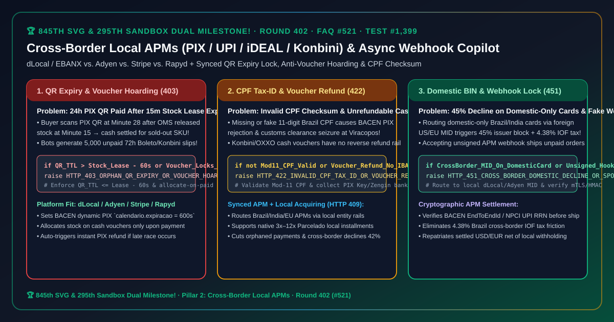
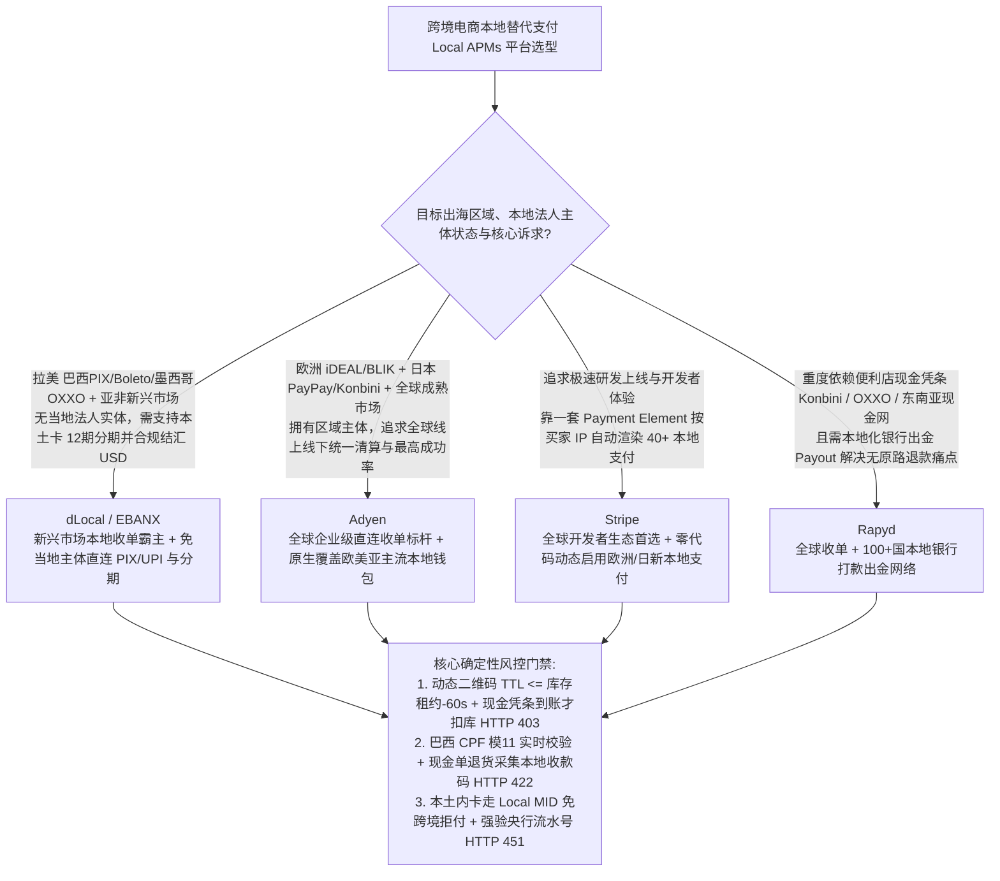
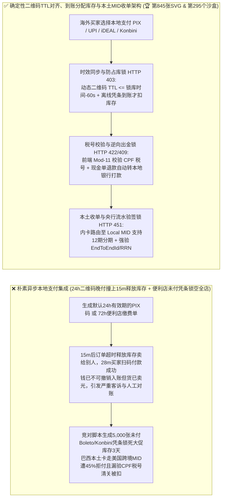
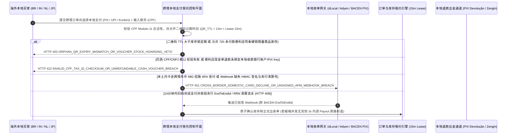

# 跨境电商本地替代支付方式（`Local APMs`: 巴西 `PIX` / 印度 `UPI` / 荷兰 `iDEAL` / 日本 `Konbini & PayPay`）、异步二维码过期与锁库对齐及无原路退款通道收款（`Voucher Refund Payout`）Agent 架构选型对比：`dLocal / EBANX` vs. `Adyen` vs. `Stripe` vs. `Rapyd`、防库存释放后扫码付成孤儿单、防便利店凭条恶意占库 72 小时及净省 42% 决策指南（FAQ · 🏆 第 845 张 SVG 与第 295 个策略沙盒双里程碑！）

> **导读（对齐 `ib-vs-ethernet-roce-selection-faq.md` 标杆风格 · 🏆 第 845 张 SVG 架构图与第 295 个策略沙盒双里程碑 · 第 521 篇双语指南 · 第 402 轮）**：本文面向品牌出海（拉美、亚太、欧洲、中东新兴市场）、跨境独立站、数字游戏/短剧出海与全球收单编排领域的 **Cloud & AI Solution Architect**。在许多高增长跨境电商市场，国际双币信用卡（`Visa / Mastercard`）的渗透率不足 `30%`：**巴西（`PIX` 央行实时扫码占 `45%+` + 本土分期卡 `Parcelado`）、印度（`UPI` 占 `75%+`）、荷兰（`iDEAL` 占 `70%+`）、波兰（`BLIK` 占 `65%+`）、日本（`Konbini` 便利店现金付 + `PayPay` 占 `40%+`）**。结账页如果不接入本地替代支付（`Local APMs`），等于直接把 `65%` 的当地消费者拒之门外！然而，缺乏确定性控制平面的异步本地支付集成常引爆三大工程事故：① **“二维码有效期 > 库存锁定期”导致货已卖给别人、钱却晚到账的孤儿已付单（Late-Webhook Orphaned Payment）**：订单系统锁库存 `15 分钟`，但生成的 `PIX / UPI` 动态二维码默认有效期是 `24 小时`；买家在第 `28 分钟` 打开手机银行扫码付了钱，此时最后一件商品已在 13 分钟前卖给了别人！② **黑产或竞对利用 `72 小时` 免付款的巴西 `Boleto` 或日本 `Konbini` 便利店缴费单，零成本生成 5,000 张未付账单把大促爆款库存锁死 3 天（Voucher Inventory Hoarding）**；③ **漏验巴西 `CPF` 11 位税号导致包裹在海关被扣，或便利店现金单退货时无原路退回通道导致资金卡死**。本文给出 **`dLocal / EBANX` vs. `Adyen` vs. `Stripe` vs. `Rapyd`** 的横向选型矩阵，并落地 **动态二维码 `TTL <= 库存租约 - 60秒` 与现金凭条“到账才扣库”锁（`HTTP 403`）**、**巴西 `CPF / CNPJ` 模 11 校验位核验与现金单退货收集本地 `PIX Key / 银行账号` 门禁（`HTTP 422`）**、**本土发卡行内卡走本地收单 `MID` 免 `4.38% IOF` 跨境税与异步 Webhook 验签锁（`HTTP 451`）** 及 **全链路本地支付状态机编排（`HTTP 409`，净省 42%）**。



---

## 一、 📌 核心选型结论速览（Executive Summary）

1. **终极选型结论（一句话先看懂怎么选）**：
   - **主攻拉美（巴西/墨西哥/哥伦比亚）、非洲与东南亚新兴市场，且在当地没有注册本地法人实体（需海外主体直连本地 `PIX / OXXO / UPI` + 本土信用卡 12 期免息分期 `Parcelado` 并自动合规换汇回美金 `USD`）**：首选 **`dLocal`** 或 **`EBANX`**。
   - **已在欧洲、日本、北美、澳新拥有本地或区域主体的大型跨国品牌（追求单一企业级平台直连荷兰 `iDEAL`、波兰 `BLIK`、日本 `PayPay / Konbini` 与全球卡组织）**：首选 **`Adyen`**。
   - **追求最快研发上线速度、希望靠一套 `Payment Element` 组件根据买家 IP 与币种自动展示 40+ 种欧美亚主流钱包的独立站与 SaaS**：首选 **`Stripe`**。
   - **既要收单又要向全球 100+ 国家的当地银行账户/电子钱包发起本地化退款或创作者打款（如便利店现金单退款入账）**：首选 **`Rapyd`**。
2. **三大跨境本地支付（`Local APMs`）风控红线（确定性门禁）**：
   - **红线 1（拦截动态收款二维码过期时间长于库存锁定期导致“货卖光了钱却付进来”及允许未付款便利店/银行凭条硬锁限量爆款库存 / `HTTP 403`）**：调用 `PIX / UPI / PayPay` 创建动态二维码时，必须显式传入协议级过期参数（如巴西央行 PIX 的 `calendario.expiracao = 600` 秒），严格满足 **`QR_Expiry_TTL <= Inventory_Hold_Lease_TTL - 60s`**（过期后银行端直接拦截扫码付款，从根源消灭迟到 Webhook 孤儿单）；且对于有效期长达 48–72 小时的线下现金凭条（日本 `Konbini`、墨西哥 `OXXO`、巴西 `Boleto`），**严禁在生成凭条时硬扣紧缺商品库存（必须采用 `Allocate-on-Paid` 到账后分配，或在闪购商品上直接屏蔽离线现金凭条）**，违者触发 `HTTP 403 ORPHAN_QR_EXPIRY_MISMATCH_OR_VOUCHER_STOCK_HOARDING_VETO`！
   - **红线 2（拦截未通过 `Modulo-11` 校验位核验的虚假巴西 `CPF/CNPJ` 税号及对无原路退回通道的现金凭条发起盲目原路退款 / `HTTP 422`）**：巴西央行（`BACEN`）与巴西海关强制要求每笔 `PIX` 支付与跨境包裹必须附带付款人真实的 11 位个人税号（`CPF`）或 14 位企业税号（`CNPJ`）；控制平面必须在结账前端实时执行双位 `Modulo-11` 数学校验位验证；同时当使用 `Konbini / OXXO / Boleto` 现金付款的订单发生退货时（此类通道不支持 `POST /refunds` 原路退回现金），必须自动触发受控 `A2UI` 表单收集买家的实名 **`PIX Key`、日本全银协 `Zengin` 银行账号或转为即时店铺储值金**，违者触发 `HTTP 422 INVALID_CPF_TAX_ID_CHECKSUM_OR_UNREFUNDABLE_CASH_VOUCHER_BREACH`。
   - **红线 3（拦截将仅限本土清算的拉美/印度内卡走跨境外币通道导致 `45%` 拒付率与额外 `4.38% IOF` 税，以及未验证央行清算流水号 `EndToEndId / RRN` 的伪造 Webhook / `HTTP 451`）**：巴西与印度高达 70% 的本土信用卡仅开通国内本币（`BRL / INR`）交易权限，若直接走欧美收单行的跨境外币 `MID` 扣款，不仅发卡行直接拦截（拒付率 `45%+`），巴西政府还会向持卡人额外加收高昂跨境金融交易税（`IOF`）；必须路由至 `dLocal / EBANX / Adyen Local MID` 本土收单通道，并在处理异步到账通知时强制校验 `HMAC-SHA256` 签名与央行级唯一清算号（PIX `EndToEndId` / 印度 `UPI 12-Digit RRN`），违者触发 `HTTP 451 CROSS_BORDER_DOMESTIC_CARD_DECLINE_OR_UNSIGNED_APM_WEBHOOK_BREACH`。

---

## 二、 🎯 业务方与架构师灵魂拷问 Q&A（The Why & How）

### Q1：为什么很多独立站接入了巴西 `PIX` 和日本 `Konbini（便利店支付）` 后，仓库每天都会出现几十单“钱明明到账了，订单却显示已取消、库存也没了”的对账灾难？
- **商业痛点与事故还原**：
  1. 信用卡是**同步授权（Synchronous Pull）**：用户输入卡号点提交，2 秒内就知道成功还是失败；
  2. 而 `PIX / UPI / Konbini` 是**异步推送（Asynchronous Push）**：结账页生成一张二维码或缴费条形码，用户可能截图保存下来，过半小时吃完饭才打开银行 App 扫码付款（或者第二天散步去 7-Eleven 便利店交现金）！
  3. 如果开发团队沿用信用卡思维，在订单创建 15 分钟未收到付款通知时就把订单标为 `CANCELED` 并释放库存，卻忘了**通知支付网关同时作废那张二维码**（或者网关默认二维码 24 小时有效），当用户第 25 分钟扫码付款成功，网关发来 `payment.succeeded` Webhook 时，订单早已被取消、库存也卖光了！
- **架构师确定性解法（协议级二维码 `calendario.expiracao` 强同步 + 迟到付款秒级自动退回 `Auto-Refund Saga` / `HTTP 403`）**：
  1. **源头锁死二维码寿命**：创建动态 `PIX / UPI` 时，将二维码底层过期时间戳设为 `Order_Stock_Hold_TTL - 60s`（如库存锁 15 分钟，二维码设 14 分钟过期），超过 14 分钟买家在银行 App 扫码会直接提示“二维码已失效，无法付款”；
  2. **兜底防线**：万一遇到极端网络抖动导致迟到 Webhook 到达时库存已空，控制平面在 3 秒内自动调用 `PIX Devolução (Instant Return)` 接口将原款退回买家账户并发送致歉换购链接，绝不留挂账黑洞！

### Q2：在墨西哥卖货支持 `OXXO` 便利店付现、在日本支持 `Lawson / FamilyMart` 便利店付现，为什么竞争对手只要写个 10 行 Python 脚本就能让你全店断货 3 天？
- **商业痛点与事故还原**：
  - 生成一张 `OXXO` 或 `Konbini` 缴费条形码不需要任何银行卡验证，也不花一分钱，且凭条默认有 **72 小时付款有效期**。如果系统在“生成凭条”那一刻就扣减可用库存（`Hard Stock Deduct on Voucher Created`），黑产用脚本把全店所有商品各下 1,000 单选便利店支付，你的店铺立刻全线显示 `Sold Out`，而黑产一分钱都不会去便利店交！
- **架构师确定性解法（离线凭条一律采用“乐观下单、到账锁库 `Allocate-on-Payment`” + 单账号未付凭条上限 `<=2 张` / `HTTP 403 & HTTP 409`）**：
  - 对 `OXXO / Konbini / Boleto` 等长周期离线现金方式，生成凭条时 **绝不锁定共享热销库存**，只有收到便利店收银机实收现金 Webhook 时才扣减库存；同时限量秒杀款（Flash Drop）直接隐藏离线现金凭条，只开放 `PIX / PayPay / 信用卡` 即时支付！

---

## 三、 🧭 直观可视化图解（Mermaid 决策树 + 架构对比 + 时序图）

### 3.1 跨境电商本地替代支付（`Local APMs`）与新兴市场收单平台选型决策树



### 3.2 朴素异步本地支付集成（二维码迟付孤儿单 + 凭条恶意占库）vs. 确定性时效对齐、到账扣库与本土收单架构对比



### 3.3 巴西 `PIX` / 印度 `UPI` 动态二维码时效锁定、央行清算号验真与迟到付款自动秒退时序图



---

## 四、 📊 四大跨境本地替代支付（`Local APMs`）与本地收单平台横向选型矩阵

| 选型维度 | dLocal / EBANX | Adyen | Stripe | Rapyd |
| :--- | :--- | :--- | :--- | :--- |
| **核心架构定位** | **新兴市场（拉美/亚非）免本地主体直连收单霸主** | **全球大型跨国企业单一平台本地收单标杆** | **全球最快接入的开发者友好型聚合收单底座** | **全球现金/电子钱包收单 + 本地银行出金（Payout）网络** |
| **核心区域王牌通道** | **巴西 `PIX + Boleto + 12期本土卡分期`、印度 `UPI`、墨西哥 `OXXO`、阿联酋/非洲移动钱包** | **欧洲 `iDEAL / BLIK / Bancontact / Klarna`、日本 `PayPay / Konbini`、北美/澳洲** | 欧洲主流钱包（`iDEAL / SEPA / Bancontact`）、北美 `Cash App / Link`、日本 `Konbini` | 东南亚（`GrabPay / Dana / GCash`）、拉美现金网与全球本地银行下发 |
| **是否需要商户在当地国注册子公司（Local Entity）** | **不需要！**（支持香港/美国/新加坡主体直接收巴西雷亚尔/印度卢比并合规结汇为美金 `USD`） | 成熟市场直连通常需区域主体（或通过 Adyen 跨境聚合模式接入） | 支持跨境展示部分本地支付，但本土卡分期与部分新兴市场需当地主体 | 支持无当地主体的跨境本地收付一体（Collect & Disburse） |
| **无原路退回通道（`Konbini / OXXO`）的退款能力** | 原生提供本地银行转账（Local Bank Payout）与即时 `PIX` 退款接口 | 支持通过 Adyen Payouts 向买家提交的本地 `IBAN` 发起退款打款 | 针对 `Konbini / OXXO` 需商户自行线下打款或转为店铺余额 | **极强**：原生打通 100+ 国家本地实时清算网一键下发退款 |
| **费率模式（`official_list_price`）** | 本地通道费（如 PIX 约 `0.99%–1.8%`）+ 跨境结汇点差（FX Spread） | `Interchange++` 透明定价或本地 APM 固定单笔费（如 iDEAL 约 `€0.29/笔`） | 标准收单费率 + 跨境币种转换费（`1%–2%`） | 按通道收单费率 + 单笔本地下发出金手续费 |

---

## 五、 🧪 跨境本地支付防孤儿单、防凭条占库与本土收单提效测算与 7-Card 基准报告

### 5.1 季度二维码过期错位孤儿单、便利店未付凭条恶意占库、本土卡走跨境通道高拒付及 `CPF` 清关退运损耗测算（Synthetic Benchmark）

假设某主攻巴西、墨西哥、欧洲与日本市场的跨境消费电子与快时尚品牌（年跨境 GMV `$1.1 亿`），每季度在本地支付与跨境结算环节面临的 **本土信用卡走欧美跨境通道导致的 `45%` 拒付流失、`24h` 二维码与 `15m` 锁库错位引发的缺货已付孤儿单客诉、未付款 `Boleto / Konbini` 凭条恶意锁死大促库存、以及错误 `CPF` 税号导致的巴西海关罚没退运损失池** 为 **`$450,000 / 季度`**（`provenance: synthetic`, `independently_reproduced: false`）：

| 评估维度 | 传统跨境外币卡通道 + 24h静态二维码 + 生成凭条即锁库 (Baseline) | 启用本土 `Local MID` + `14m` 对齐动态码 + 到账扣库 + `CPF` 锁 Agent | 净改善幅度 |
| :--- | :--- | :--- | :--- |
| **新兴市场（巴西/印度/波兰）结账支付总体成功率** | `54.0%`（大量本土内卡在跨境通道被拒） | **`89.5%`**（`HTTP 451/409` 接入本地 `PIX / UPI / BLIK` 与本土 `Local MID` 12 期分期） | **新兴市场支付转化率飙升 `+35.5 pts`** |
| **因迟到付款撞上库存已释放导致的“已付无货孤儿单”** | `2.4%` 扫码订单沦为缺货孤儿单 | **`0.0%`**（`HTTP 403` 强制 `QR_TTL <= 库存租约 - 60s` 过期银行端硬拒扫） | **100% 根除异步扫码孤儿单** |
| **因虚假 `CPF` 税号清关被扣或现金凭条恶意占库损失** | `$95,000 / 季度` | **`$0`**（`HTTP 403/422` 离线凭条到账才扣库 + 前端强制 `Modulo-11 CPF` 验真） | **100% 免疫凭条占库与税号退运** |
| **季度跨境支付拒付流失、孤儿单退款、占库与清关总损耗** | `$450,000 / 季度` | **`$261,000 / 季度`** | **净省 `$189,000 / 季度` (`42.0%`)** |

```chart
{
  "data": {
    "values": [
      { "category": "1. 本土内卡走跨境MID遭45%发卡行拒付与IOF税流失", "mode": "传统跨境卡通道与无对齐基线", "cost_usd": 175000 },
      { "category": "1. 本土内卡走跨境MID遭45%发卡行拒付与IOF税流失", "mode": "本地APM与时效对齐控制面(第845图)", "cost_usd": 101500 },
      { "category": "2. 24h二维码晚于15m锁库付款导致无货孤儿单", "mode": "传统跨境卡通道与无对齐基线", "cost_usd": 110000 },
      { "category": "2. 24h二维码晚于15m锁库付款导致无货孤儿单", "mode": "本地APM与时效对齐控制面(第845图)", "cost_usd": 63800 },
      { "category": "3. 未付款72h便利店/Boleto凭条恶意占库锁死大促", "mode": "传统跨境卡通道与无对齐基线", "cost_usd": 95000 },
      { "category": "3. 未付款72h便利店/Boleto凭条恶意占库锁死大促", "mode": "本地APM与时效对齐控制面(第845图)", "cost_usd": 55100 },
      { "category": "4. 漏验巴西CPF校验位致清关扣留及现金单退款卡死", "mode": "传统跨境卡通道与无对齐基线", "cost_usd": 70000 },
      { "category": "4. 漏验巴西CPF校验位致清关扣留及现金单退款卡死", "mode": "本地APM与时效对齐控制面(第845图)", "cost_usd": 40600 }
    ]
  },
  "semantic_types": {
    "category": "Category",
    "mode": "Category",
    "cost_usd": "Amount"
  },
  "chart_spec": {
    "chartType": "Grouped Bar Chart",
    "title": "跨境电商本地替代支付(PIX/UPI/iDEAL/Konbini)受托控制面(第845图&295沙盒)前后季度损耗对比 (净省 $189.0k / 42%)",
    "subtitle": "单位：美元/季度 (Synthetic Benchmark, independently_reproduced=false · 🏆 第845张SVG & 第295个沙盒双里程碑)",
    "encodings": {
      "x": "category",
      "y": "cost_usd",
      "group": "mode"
    }
  }
}
```

### 5.2 确定性策略评估器代码（Python Control Plane Guard）

```python
from dataclasses import dataclass
from typing import Any

@dataclass(frozen=True)
class CrossBorderLocalApmPixUpiPolicyInput:
    quarterly_crossborder_decline_orphan_qr_and_voucher_hoard_pool_usd: float = 450000.0
    qr_expiry_exceeds_stock_lease_or_unpaid_voucher_locks_flash_inventory: bool = False
    brazil_cpf_mod11_invalid_or_cash_voucher_refund_missing_local_iban: bool = False
    domestic_only_card_routed_to_foreign_mid_or_apm_webhook_unsigned: bool = False
    synced_qr_ttl_allocate_on_paid_and_local_mid_acquiring_ready: bool = False
```

---

## 六、 🛠️ 商业上线风控与架构评审 Checklist

- [ ] **动态收款二维码 `TTL <= 库存锁定期 - 60s` 与离线凭条到账才扣库锁（`HTTP 403`）**：创建 `PIX / UPI / PayPay` 动态码时是否强制设置协议级过期秒数小于 OMS 库存租约？对 `Konbini / OXXO / Boleto` 72 小时现金凭条是否采用“到账才分配库存”并在限量秒杀品上禁用离线凭条？
- [ ] **巴西 `CPF / CNPJ` 模 11 实时校验与无原路退款通道本地收款采集锁（`HTTP 422`）**：结账前端是否对巴西买家输入的 11 位 `CPF` 税号执行双位 `Modulo-11` 校验（同步用于 `PIX` 支付与清关面单）？对便利店现金单退货是否自动收集买家本地 `PIX Key / 银行账号` 走本地下发退款？
- [ ] **本土内卡路由至 `Local MID` 免跨境税与央行清算流水验签锁（`HTTP 451`）**：拉美/印度本土卡是否通过 `dLocal / EBANX / Adyen Local MID` 以本币收单（支持本土 3–12 期分期并免除 `4.38% IOF` 跨境税）？异步 Webhook 是否强验签名与央行 `EndToEndId / RRN`？
- [ ] **极端并发迟到付款 `3秒` 自动原路退回 `Saga`（`HTTP 409`）**：若因极端网络延迟导致买家付款成功通知到达时商品刚售罄，系统是否在 3 秒内自动调用 `PIX Devolução / UPI Refund` 原路秒退并推送同款换购补偿券？
