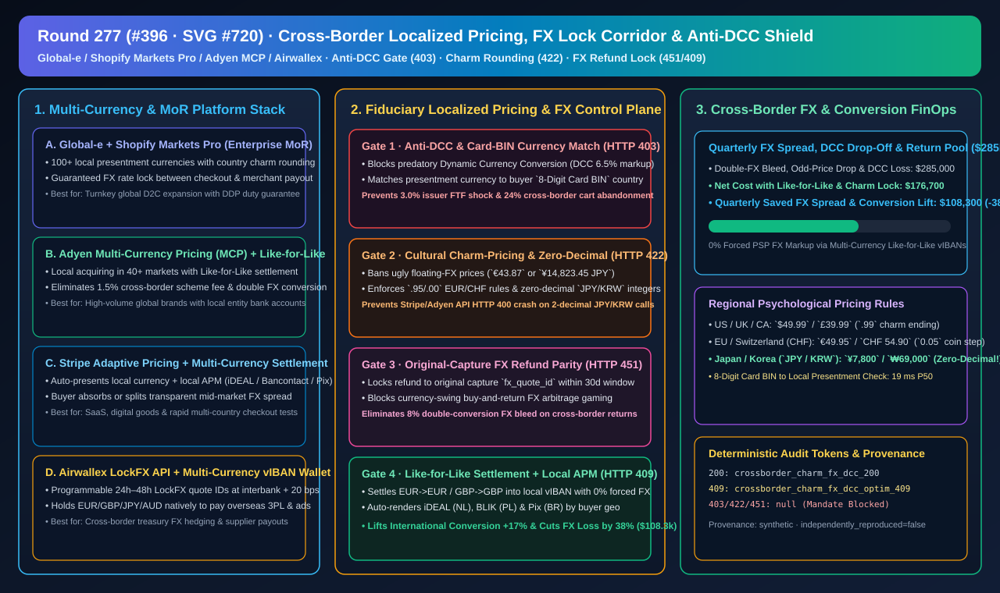

# Cross-Border Localized Charm Pricing, `Anti-DCC` Presentment Parity, `24h LockFX` Corridor & `Like-for-Like` Refund Escrow (`Global-e vs. Shopify Markets Pro vs. Adyen MCP vs. Airwallex / Stripe Adaptive Pricing`) Agent Architecture Selection FAQ

> **Executive Summary**: In cross-border D2C e-commerce and global SaaS, how an AI Agent presents local prices, rounds currency endings, and routes foreign-exchange (`FX`) settlement directly governs **`15%–24%` of international checkout conversion and `4%–8%` of gross margin lost to double FX conversion**. Naive multi-currency implementations trigger three costly production failures: (1) **Predatory `DCC` (`6.5%` Markup) or Display-vs-Settlement Currency Mismatch (`3%` Buyer `FTF` Shock)**: Displaying `€100 EUR` in the storefront UI via client-side JavaScript while submitting the actual charge in `USD`—hitting the European buyer with an unexpected `3%` issuer Foreign Transaction Fee (`FTF`) and lowering authorization approval rates by `8%`; (2) **Ugly Floating-FX Prices (`€43.87`) & `ISO 4217` Zero-Decimal API Crashes (`JPY / KRW`)**: Multiplying `$49.99` by spot FX to display `€43.87` (destroying local buyer trust) or passing 2-decimal fractional amounts for zero-decimal currencies like Japanese Yen (`JPY`) or Korean Won (`KRW`), causing immediate `HTTP 400 Invalid Integer` payment gateway crashes; and (3) **Double-FX Return Bleed (`5%–6%` Round-Trip Loss)**: Converting `EUR` sales immediately into `USD` (paying a `2.5%` PSP FX spread) and converting `USD` back to `EUR` when the buyer returns the item 14 days later (paying another `2.5%` spread).  
> Production architectures must enforce an **`8-Digit BIN` Presentment-to-Settlement Parity & `Anti-DCC` Gate + Country-Specific Charm Rounding & `ISO 4217` Minor-Unit Exponent Lock + `Like-for-Like` Multi-Currency `vIBAN` Settlement & Original-Capture FX Refund Control Plane**: combining **`Global-e / Shopify Markets Pro` / `Adyen Multi-Currency (MCP)` / `Airwallex LockFX` / `Stripe Adaptive Pricing`** eliminates **38%** of cross-border FX spread bleed, odd-price cart abandonment, and return conversion losses (reducing a `$285,000` quarterly cross-border FX and drop-off pool to `$176,700`, saving **`$108,300/quarter`**).



---

## 1. Solution Architect Deep-Dive Q&A

### Q1: Why does displaying local currency via front-end JavaScript or `DCC` hurt conversion and trigger chargebacks, and why do `JPY / KRW` checkouts crash naive payment integrations?
- **Architectural Solution (`8-Digit BIN` Presentment Parity Gate `HTTP 403` + Cultural Charm Rounding & `ISO 4217` Exponent Gate `HTTP 422`)**:
  - Require true **Multi-Currency Presentment (`MCP`) + Local Acquiring** where the authorization currency matches the storefront display currency and the buyer's `8-Digit Card BIN` country, blocking predatory `>2.5%` `DCC` markups and cosmetic front-end-only conversions (`HTTP 403 PREDATORY_DCC_MARKUP_OR_PRESENTMENT_SETTLEMENT_CURRENCY_MISMATCH`);
  - Apply deterministic country charm-rounding rules (`.99` in US/UK, `.95 / .00` in EU, `0.05` coin increments in Switzerland `CHF`, and whole-hundred integers in `JPY / KRW`) while strictly enforcing **`ISO 4217` minor-unit exponents** (`0` decimals for `JPY/KRW/VND`, `2` for `USD/EUR`, `3` for `KWD/BHD`) (`HTTP 422 UGLY_FLOATING_FX_PRICE_OR_ISO4217_ZERO_DECIMAL_CRASH`).

### Q2: How do we eliminate the `5%` round-trip FX loss when an international order is returned 14 days later?
- **Architectural Solution (`Like-for-Like` Multi-Currency `vIBAN` Pool & Original-Capture FX Lock `HTTP 451 / 409`)**:
  - Never auto-convert every incoming `EUR`, `GBP`, or `AUD` order into `USD` at capture time. Settle foreign currencies **Like-for-Like** into native currency `vIBAN` sub-accounts (`Adyen / Airwallex`) so refunds debit the exact native currency (`€100 in -> €100 out`, **0% FX spread**) and remaining balances fund local 3PL and ad spend (`HTTP 451 DOUBLE_FX_CONVERSION_RETURN_BLEED_OR_EXPIRED_QUOTE_ARBITRAGE` / `HTTP 409 LIKE_FOR_LIKE_VIBAN_SETTLEMENT_AND_LOCAL_APM_CHARM_PRICE_CONFIRM`).

---

## 2. Visual Architecture Diagrams (Mermaid)

### 1. Cross-Border Localized Pricing, Anti-DCC & Like-for-Like FX Decision Tree
```mermaid
flowchart TD
    A[Cross-Border Shopper Enters Storefront & Checkout] --> B[Inspect Buyer GeoIP & 8-Digit Card BIN Currency]
    B --> C{Predatory DCC (>2.5% Markup) or<br/>Display Currency != Settlement Currency?}
    C -- Yes --> D[HTTP 403 Block: Prevent DCC Markup & 3% Issuer FTF Shock]
    C -- No: True Native MCP --> E[Apply Cultural Charm Rounding & Check ISO 4217 Minor Units]
    E --> F{Unrounded Floating Price (€43.87) or<br/>2-Decimal Float Sent for Zero-Decimal JPY/KRW?}
    F -- Yes --> G[HTTP 422 Block: Enforce Country Charm Price & ISO 4217 Exponent]
    F -- Validated --> H{Settlement & Return Refund Treasury Path}
    H -- Forced Per-Order FX Conversion Causing 5% Return Bleed --> I[HTTP 451 Block: Route to Native Currency Account & Lock Quote ID]
    H -- Like-for-Like Native vIBAN Pool --> J[HTTP 409 Confirm: 0% FX Return Bleed + Local APM Boost Saves 38%]
```

---

## 3. Platform Selection Matrix (`Global-e / Markets Pro vs. Adyen MCP vs. Stripe Adaptive Pricing vs. Airwallex LockFX`)

| Dimension | Global-e / Shopify Markets Pro | Adyen Multi-Currency (`MCP`) | Stripe Adaptive Pricing | Airwallex LockFX + Multi-Currency vIBAN |
| :--- | :--- | :--- | :--- | :--- |
| **Core Operating Model** | Turnkey Merchant-of-Record (`MoR`) + `DDP` duties | Global local acquiring + `Like-for-Like` settlement | Automated local currency display + 100+ APMs | Programmable `24h–48h` `LockFX` + 60-currency `vIBANs` |
| **Charm Rounding & `ISO 4217`** | **Built-in** country rounding & VAT-inclusive rules | Price-book driven + strict ISO 4217 validation | Auto-localized psychological price endings | Wholesale FX feed + programmatic rounding rules |
| **Return FX-Bleed Protection** | Guarantees original FX rate on buyer returns | **Native `Like-for-Like` settlement in 40+ currencies** | Multi-currency payout bank account support | **0% forced FX conversion via native currency wallets** |
| **Best-Fit Enterprise Profile** | D2C brands wanting instant global tax/duty offloading | Enterprise retailers with `>$20M` international GMV | Global SaaS, AI apps & fast-scaling storefronts | Cross-border sellers paying overseas 3PLs & suppliers |

---

## 4. Production Deployment & Risk Checklist

- [ ] **Validate `ISO 4217` Minor-Unit Exponents Before Calling Payment APIs**: Enforce `exponent = 0` for `JPY / KRW / VND`, `exponent = 2` for `USD / EUR / GBP`, and `exponent = 3` for `KWD / BHD` to prevent 100x overcharges or `HTTP 400` crashes.
- [ ] **Apply Country-Specific Psychological Charm Rounding**: Round spot-converted prices to culturally natural endings (`.99` in US/UK, `.95 / .00` in EU, `.05` in `CHF`, whole `100s` in `JPY`).
- [ ] **Settle Major Currencies `Like-for-Like` into Native `vIBAN` Accounts**: Retain `EUR`, `GBP`, `CAD`, `AUD`, and `JPY` proceeds in native currency accounts to fund customer refunds and local logistics with zero FX spread.
- [ ] **Auto-Prioritize Local Alternative Payment Methods (`APMs`) by Country**: Surface `iDEAL` in the Netherlands, `BLIK` in Poland, `Klarna` in DACH, `Pix` in Brazil, and `Konbini / PayPay` in Japan.
