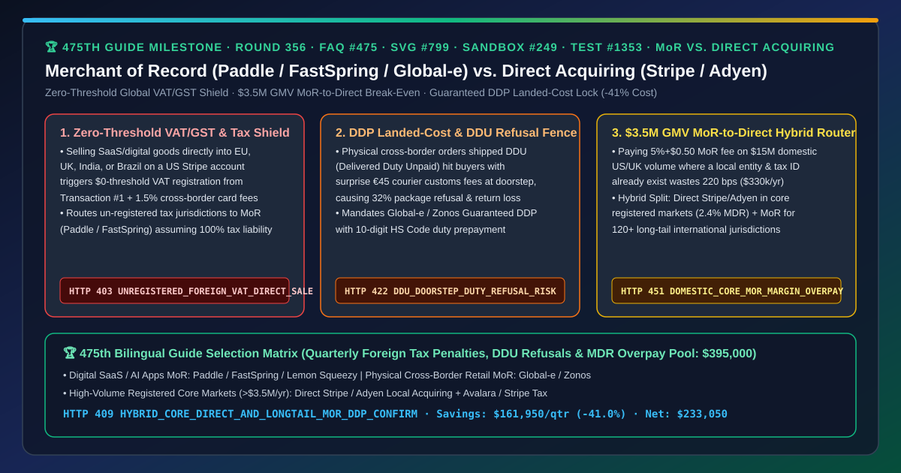
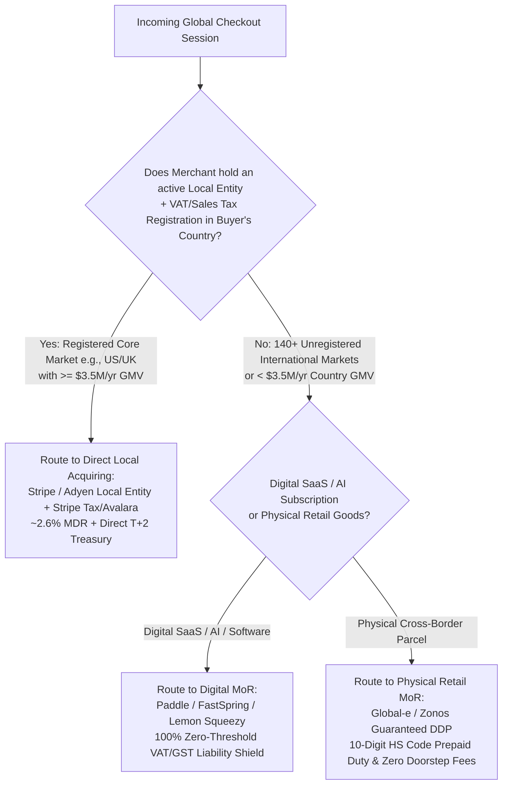
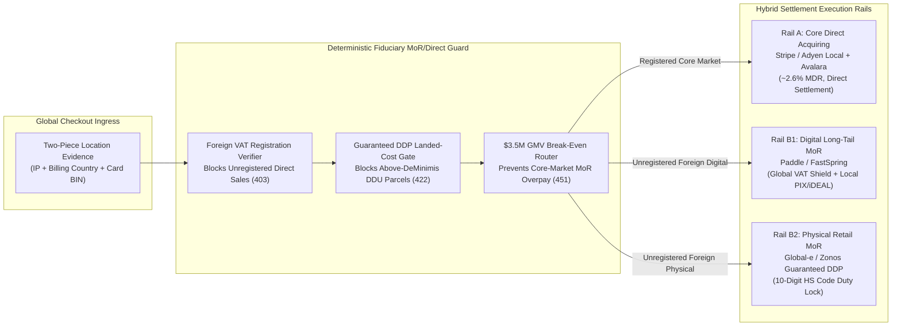

# 🏆 Cross-Border Merchant of Record (`MoR`: `Paddle / FastSpring / Global-e`) vs. Direct Local Acquiring (`Stripe / Adyen + Avalara` · 🏆 475th Bilingual Guide Milestone): Zero-Threshold Global `VAT / GST` Shield, Guaranteed `DDP` Landed-Cost Lock & `$3.5M GMV` Hybrid Routing (`-41%` Tax & MDR Loss)

> **Document Type**: Enterprise AI Solution Architect Selection FAQ (**`#475` 🏆 475th Bilingual Guide Milestone** · Round 356)  
> **Target Audience**: Global SaaS / AI Founders & CFOs, Cross-Border DTC E-Commerce Architects, Global Tax & Treasury Directors, and Cloud & AI Solution Architects  
> **Platforms Covered**: **Digital / SaaS MoR (`Paddle / FastSpring / Lemon Squeezy`)** vs. **Physical Retail Cross-Border MoR (`Global-e / Zonos`)** vs. **Direct Local Acquiring + Tax Engine (`Stripe / Adyen Local Acquiring + Stripe Tax / Avalara`)**  
> **Architecture Diagram**: [`assets/svg/799-cross-border-mor-paddle-globale-vs-stripe-direct-acquiring-2026-11-25.svg`](../assets/svg/799-cross-border-mor-paddle-globale-vs-stripe-direct-acquiring-2026-11-25.svg)

🌐 **Language / 语言切换**: **[中文 (`cross-border-merchant-of-record-mor-paddle-global-e-vs-stripe-direct-tax-acquiring-selection-faq.md`)](cross-border-merchant-of-record-mor-paddle-global-e-vs-stripe-direct-tax-acquiring-selection-faq.md)** | **English (Current)**

---

## 📌 1. Executive Summary

When an AI SaaS company or DTC retail brand sells across 150+ countries, the most consequential checkout architecture decision is **whether to process as the direct legal seller (`Direct Acquiring`) or delegate legal seller status to a Merchant of Record (`MoR` such as `Paddle`, `FastSpring`, or `Global-e`)**.  
Using a single domestic Stripe account to sell worldwide—or conversely, paying a `5% + $0.50` MoR fee on `$15M` of domestic core-market volume where the company already holds a local entity and tax ID—triggers three severe financial leaks:
1. **Zero-Threshold Foreign Digital `VAT / GST` Liability & `-14%` Cross-Border Card Declines (`Unregistered Foreign VAT Exposure`)**: The EU (`OSS`), UK, India, South Korea, and Australia enforce a **`$0` registration threshold for non-resident B2C digital/SaaS sellers**—meaning the very first `$20` subscription sold into Germany or the UK legally requires a local VAT registration and filing. Charging overseas buyers directly from a single US/SG merchant account without foreign tax registrations accrues `20%+` unremitted tax liabilities plus `+1.5%` cross-border card fees and `10%–18%` lower issuer approval rates.
2. **`32%` Doorstep Package Refusals on Unpaid-Duty (`DDU`) Cross-Border Shipments (`Doorstep Duty & Broker Fee Shock`)**: Shipping a `$180` physical order into Europe or Canada `DDU` (Delivered Duty Unpaid) causes DHL/FedEx to demand `€42` in duties plus a `€15` carrier advancement fee at the buyer's doorstep—leading `32%` of buyers to refuse delivery and stranding the merchant with round-trip air freight losses.
3. **Overpaying `220 bps` (`5%` MoR vs. `2.6%` Direct) in Registered Core Markets Above `$3.5M GMV` (`Domestic Core-Market MoR Bleed`)**: Once a merchant exceeds `$3.5M` annual GMV in a registered home/core market (e.g., US or UK) with an established legal entity and tax filing pipeline, routing that domestic traffic through a `5%` MoR wastes hundreds of thousands of dollars annually.

| Business Model & Regional Stage | Recommended Primary Choice | Architectural Boundary & Production Rule |
|---|---|---|
| **Global SaaS & AI Apps Selling into 100+ Unregistered Countries** | **Paddle / FastSpring / Lemon Squeezy (`Digital MoR`)** | Acts as the legal reseller on the buyer's invoice, absorbing `100%` of global `EU/UK VAT`, `India GST`, and US state sales tax registration, remittance, and audit liability while routing through local acquiring entities. |
| **Cross-Border Physical DTC Retail (`Apparel / Electronics / Home`)** | **Global-e / Zonos (`Physical Retail MoR & Guaranteed DDP`)** | Maps 10-digit `HS Codes` at checkout and guarantees **100% Delivered Duty Paid (`DDP`) landed cost**, eliminating doorstep carrier customs demands. |
| **Registered Core Markets with Local Entity & `> $3.5M/yr` GMV** | **Direct Stripe / Adyen Local Acquiring + Avalara / Stripe Tax** | Minimizes payment processing cost (`2.2%–2.9%` MDR) and retains direct `T+2` treasury control in jurisdictions where tax registrations are active. |
| **🏆 Gold-Standard Production Pattern (`Hybrid Core-Direct + Long-Tail MoR Router`)** | **Geo-Segmented Dual-Rail Checkout**: Route registered core markets (`US/UK`) directly to `Stripe / Adyen Local Acquiring`, and dynamically route the remaining 140+ unregistered international countries to `Paddle / Global-e MoR`. | Captures `2.6%` direct economics on core volume while achieving `100%` global tax immunity and local-acquiring approval uplift on international expansion (**`-41%` net cost**). |



---

## 🎯 2. Architect & Business Stakeholder Q&A (Q1–Q3)

### Q1: "We enabled `Stripe Tax` (or `Avalara`) on our US Stripe account—why does our tax counsel still say selling directly to EU, UK, and Indian consumers is non-compliant?"
- **The Critical Architectural Distinction (`Tax Calculator != Merchant of Record`)**:
  1. `Stripe Tax` and `Avalara` are **tax calculation and reporting engines**, *not* the legal seller of record. They can only collect German `19% MwSt` or UK `20% VAT` if **your company has already registered for a tax ID with those foreign tax authorities and files periodic returns**.
  2. For non-resident digital/SaaS sellers, the EU, UK, India, and 40+ other countries have **zero registration threshold (`$0`)**—even a single `$19/mo` consumer subscription triggers mandatory tax registration.
  3. By contrast, an **`MoR` (`Paddle / FastSpring`)** legally buys your license and resells it under *their* local tax IDs (`Paddle.com Market Ltd`), shifting `100%` of tax registration, filing, and audit liability off your balance sheet.
- **Architectural Solution**: Enforce a **Registered Tax Jurisdiction Whitelist Gate (`HTTP 403` Guard)**:
  - Maintain a deterministic set of jurisdictions where the company holds active tax registrations (`registered_direct_tax_countries = {"US", "CA"}`).
  - Any checkout session whose verified buyer country (`IP + Billing + Card BIN`) falls outside that whitelist is blocked from direct un-registered acquiring (`HTTP 403 UNREGISTERED_FOREIGN_VAT_JURISDICTION_DIRECT_SALE`) and routed to the `MoR` rail.

### Q2: Why do cross-border physical orders shipped `DDU` (Delivered Duty Unpaid) suffer a `30%+` refusal rate, and how does `Guaranteed DDP` fix it?
- **The Doorstep Customs Shock**: When an international order exceeds the destination country's customs *de minimis* threshold and ships `DDU`, the courier (DHL/UPS/FedEx) holds the parcel at customs and texts the buyer demanding import duty + `20%` VAT + a `$15–$25` carrier disbursement fee before delivery. Nearly a third of shoppers refuse the parcel, forcing the merchant to pay return air freight or abandon the inventory.
- **Architectural Solution**: Enforce **10-Digit `HS Code` Classification & Mandatory `Guaranteed DDP` Checkout (`HTTP 422` Guard)**:
  - Block any cross-border physical checkout above the destination *de minimis* threshold that lacks prepaid duty/tax (`HTTP 422 UNGUARANTEED_DDU_SHIPMENT_DOORSTEP_DUTY_REFUSAL_RISK`).
  - Use `Global-e / Zonos` to calculate and lock the exact 10-digit `HS Code` duty and import VAT at checkout under a **Guaranteed Landed Cost (`DDP`)** contract (where the MoR absorbs any customs reassessment variance).

### Q3: Where is the exact financial break-even point between paying `5% + $0.50` to an `MoR` vs. setting up local direct acquiring (`~2.6% + $0.30`)?
- **Quantitative Break-Even Analysis**:
  - Maintaining a foreign VAT/GST registration, fiscal representative, and quarterly/monthly tax filings costs **`$12,000–$35,000/yr per country/region`**.
  - Meanwhile, selling cross-border without a local entity incurs `+1.5%` international card fees, `+1.0%` FX spread, and `10%–18%` false declines—making raw cross-border direct acquiring *more expensive* than a `5%` MoR!
  - **The `$3.5M GMV` Rule of Thumb**: Below **`$3.5M/yr` GMV per country/region**, an `MoR` is cheaper and converts higher. Above **`$3.5M/yr` GMV** in a core market where the merchant already has a local entity and tax registration, continuing to pay `5%` to an MoR wastes `~220 bps` (`$77,000+/yr` per `$3.5M`) and triggers `HTTP 451 DOMESTIC_REGISTERED_MARKET_MOR_FEE_OVERPAY`.

---

## 🧭 3. Visual Architecture Diagrams (Mermaid Decision Tree + Hybrid Topology + Sequence)

### 3.1 Cross-Border `MoR` vs. Direct Acquiring Selection Tree



### 3.2 Geo-Segmented "Core-Direct + Long-Tail MoR" Architecture



### 3.3 Dynamic Geo-Routing & Guaranteed `DDP` Execution Sequence

```mermaid
sequenceDiagram
    autonumber
    participant Buyer as Shopper (Frankfurt, Germany)
    participant Agent as Checkout Orchestrator Agent
    participant Guard as Fiduciary MoR/Direct Guard
    participant Direct as US Domestic Stripe Account
    participant MoR as Paddle / Global-e (MoR)

    Buyer->>Agent: Initiate €240 checkout (Card BIN = DE, Shipping = Germany)
    Agent->>Guard: Evaluate Buyer_Country=DE against Registered_Tax_IDs={US}
    Note over Guard,Direct: Germany (EU) is not in Registered_Tax_IDs; block direct US acquiring to prevent EU VAT breach & cross-border decline (prevents HTTP 403)
    alt Digital SaaS / AI Subscription
        Guard->>MoR: Route to Paddle MoR (processes via Paddle EU entity + remits 19% German MwSt VAT)
    else Physical Cross-Border Order (€240 > €150 EU Customs De Minimis)
        Guard->>Guard: Block DDU unpaid-duty shipping option (prevents HTTP 422) & validate 10-digit HS Code
        Guard->>MoR: Route to Global-e Guaranteed DDP (locks exact duty + VAT at checkout)
    end
    MoR-->>Buyer: Render localized EUR checkout (SEPA / Klarna / Local Card acquiring)
    MoR-->>Agent: Emit single net B2B payout & self-billing invoice to merchant ERP (HTTP 200)
```

---

## 📊 4. Platform Comparison Matrix (`Paddle` vs. `FastSpring` vs. `Global-e` vs. `Stripe Direct` vs. `Adyen Direct`)

| Evaluation Dimension | Paddle (Digital MoR) | FastSpring (Digital MoR) | Global-e (Physical Retail MoR) | Stripe Direct + Stripe Tax | Adyen Local Acquiring + Avalara |
|---|---|---|---|---|---|
| **Supported Product Type** | SaaS, AI apps, digital downloads | SaaS, B2B software, digital media | **Physical cross-border e-commerce** | Digital & physical (requires merchant tax registrations) | Enterprise multi-entity omnichannel retail & SaaS |
| **Legal Seller Liability & Tax Audit Shield** | ⭐⭐⭐⭐⭐ (`100%` tax registration, filing & audit liability absorbed by Paddle) | ⭐⭐⭐⭐⭐ (`100%` global digital tax absorbed by FastSpring) | ⭐⭐⭐⭐⭐ (Acts as cross-border reseller; guarantees customs duty & import VAT) | ⭐⭐⭐ (Merchant remains legal seller on standard rails; must hold tax IDs) | ⭐⭐⭐ (Merchant's local subsidiaries remain legal sellers) |
| **Local Acquiring Uplift & Local APMs** | ⭐⭐⭐⭐⭐ (Multi-entity local routing + iDEAL, PIX, Alipay) | ⭐⭐⭐⭐⭐ (Strong global local cards & B2B invoicing) | ⭐⭐⭐⭐⭐ (100+ currencies & 150+ local APMs) | ⭐⭐⭐⭐ (High in home country; requires foreign entities for local acquiring) | ⭐⭐⭐⭐⭐ (Gold standard for multi-entity local acquiring) |
| **Physical Customs `HS Code` & `Guaranteed DDP`** | N/A (Digital only) | N/A (Digital only) | ⭐⭐⭐⭐⭐ (Industry leader in Guaranteed DDP landed cost) | ⭐⭐ (Does not broker physical customs clearance) | ⭐⭐ (Requires third-party Zonos / carrier DDP integration) |
| **Indicative Pricing (`official_list_price`)** | **`5.0% + $0.50 / tx`** (all-in acquiring, FX, tax & fraud) | **`~5.4%–5.9% + $0.50`** (custom volume tiers available) | **`~4.5%–6.5%`** (acquiring, FX hedging & DDP customs) | **`2.9% + $0.30`** + `1.5%` cross-border + `1%` FX + `0.5%` Stripe Tax | Interchange++ (**`1.2%–2.2%`** local) + Avalara annual license |

---

## 🧪 5. Deterministic Tax, Duty & Fee Evaluation (`7-Card Benchmark Summary` · 🏆 `#475` Milestone)

> **Provenance**: Figures below are generated by `evaluate_cross_border_mor_vs_direct_acquiring_policy` in `lab/webiq_commerce_demo.py` (`provenance: "synthetic"`, `independently_reproduced: False`), modeling a global SaaS & DTC brand with a **`$395,000.00` quarterly foreign VAT back-tax penalty, DDU doorstep package refusal, and domestic MoR fee overpay pool**.

| Scenario Case ID | Scenario Description | HTTP Status | Deterministic Decision | Quarterly Net Cost | Quarterly Savings |
|---|---|---|---|---|---|
| `CASE-MOR-200` | Unsegmented single-rail baseline without geo-routing between Direct and MoR | `HTTP 200` | `VERIFIED_CROSS_BORDER_MOR_AND_DIRECT_ROUTING_AUTHORIZED` | `$395,000.00` | `$0.00` |
| `CASE-MOR-403` | Direct acquiring used in an unregistered zero-threshold foreign `VAT / GST` country | `HTTP 403` | `UNREGISTERED_FOREIGN_VAT_JURISDICTION_DIRECT_SALE` | `$395,000.00` | `$0.00` (Blocks foreign tax breach) |
| `CASE-MOR-422` | Cross-border physical order above *de minimis* shipped `DDU` without prepaid duty | `HTTP 422` | `UNGUARANTEED_DDU_SHIPMENT_DOORSTEP_DUTY_REFUSAL_RISK` | `$395,000.00` | `$0.00` (Blocks 32% doorstep refusal) |
| `CASE-MOR-451` | Registered domestic core market (`>$3.5M GMV`) routed through `5%` MoR instead of Direct | `HTTP 451` | `DOMESTIC_REGISTERED_MARKET_MOR_FEE_OVERPAY` | `$395,000.00` | `$0.00` (Blocks 220 bps fee bleed) |
| `CASE-MOR-409` | **Hybrid Geo-Router (`Core Direct 2.6%` + `Long-Tail MoR` + `Guaranteed DDP`)** | `HTTP 409` | `HYBRID_CORE_DIRECT_AND_LONGTAIL_MOR_DDP_CONFIRM` | **`$233,050.00`** | **`$161,950.00` (`-41.0%`)** |

---

## 🛠️ 6. Production Go-Live & Architecture Review Checklist

- [ ] **Two-Evidence Location Check & Unregistered-Country `MoR` Routing (`HTTP 403` Prevention)**: Compare `IP_Country`, `Billing_Country`, and `Card_BIN_Country` at checkout; automatically route any jurisdiction where the company lacks an active tax registration to `Paddle / FastSpring` (digital) or `Global-e` (physical).
- [ ] **10-Digit `HS Code` & Mandatory `Guaranteed DDP` (`HTTP 422` Prevention)**: Require 10-digit `HS Codes` and country-of-origin metadata on all physical SKUs, and disable `DDU` shipping on cross-border orders exceeding destination customs *de minimis* thresholds.
- [ ] **`$3.5M GMV` Core-Market Graduation Router (`HTTP 451` Prevention)**: Route registered high-volume domestic/core markets (`> $3.5M/yr GMV`) directly to `Stripe / Adyen Local Acquiring + Avalara` to capture `~220 bps` in processing fee savings.
- [ ] **Single-Line B2B Self-Billing ERP Reconciliation**: Book international `MoR` payouts in the ERP general ledger as a single monthly B2B reseller receivable from `Paddle / Global-e` rather than maintaining 100+ foreign tax sub-ledgers.
