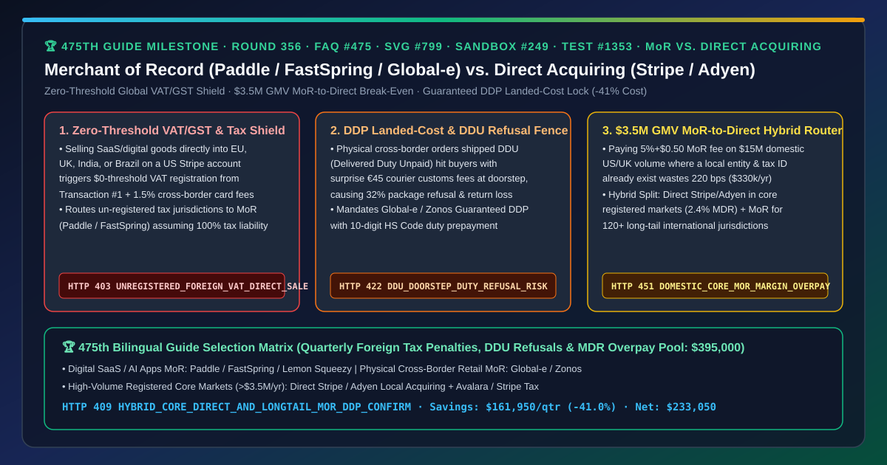
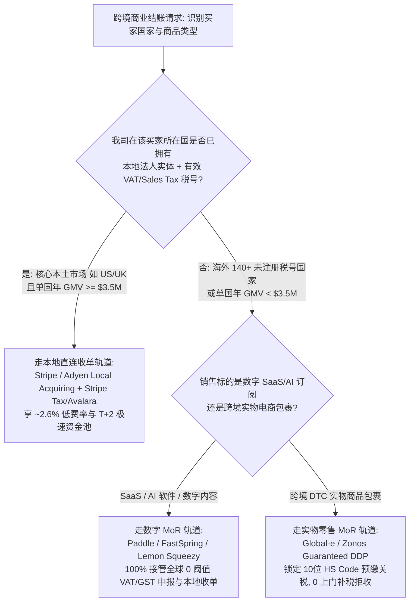
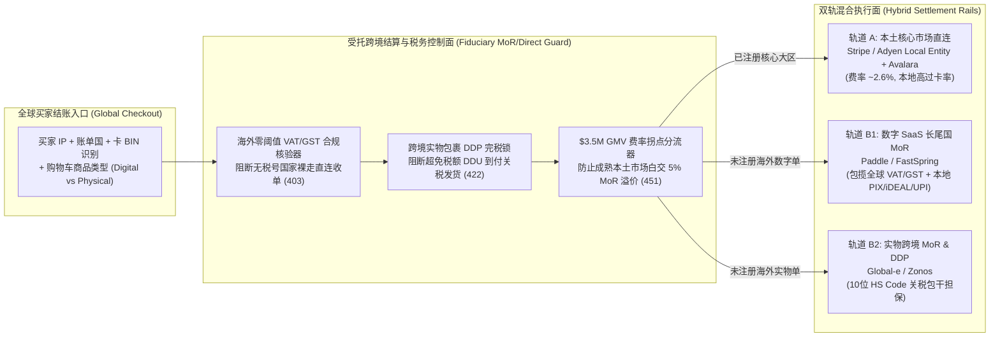
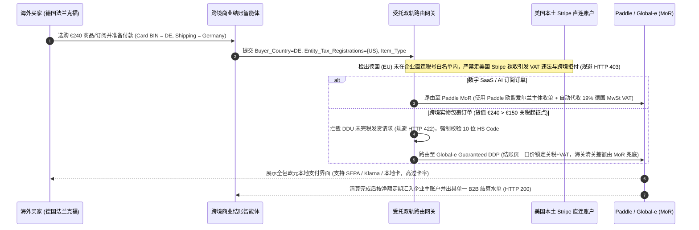

# 🏆 跨境商业名义商户（`Merchant of Record - MoR`: `Paddle / FastSpring / Global-e`）vs. 自建本地直连收单（`Direct Acquiring`: `Stripe / Adyen + Avalara` · 🏆 第 475 篇双语决策指南里程碑）选型对比：全球数字税（`VAT / GST`）零阈值合规免责、实物包裹完税交付（`Guaranteed DDP`）防拒收与 `$3.5M GMV` 双轨分流净省 41% 指南

> **文档类型**：企业级 AI Solution Architect 选型决策指南（Selection FAQ · **`#475` 🏆 第 475 篇双语决策指南里程碑** · Round 356）  
> **适用读者**：出海 SaaS / AI 应用创始人与 CFO、跨境 DTC 品牌独立站架构师、全球税务与资金结算总监  
> **核心覆盖模式与平台**：**数字/SaaS MoR（`Paddle / FastSpring / Lemon Squeezy`）** vs. **实物零售跨境 MoR（`Global-e / Zonos`）** vs. **本地实体直连收单 + 税务引擎（`Stripe Managed Payments / Adyen Local Acquiring + Stripe Tax / Avalara`）**  
> **关联架构图**：[`assets/svg/799-cross-border-mor-paddle-globale-vs-stripe-direct-acquiring-2026-11-25.svg`](../assets/svg/799-cross-border-mor-paddle-globale-vs-stripe-direct-acquiring-2026-11-25.svg)

🌐 **语言切换 / Language**: **中文 (当前)** | **[English (`cross-border-merchant-of-record-mor-paddle-global-e-vs-stripe-direct-tax-acquiring-selection-faq.en.md`)](cross-border-merchant-of-record-mor-paddle-global-e-vs-stripe-direct-tax-acquiring-selection-faq.en.md)**

---

## 📌 一、核心选型结论速览（Executive Summary）

当一家 AI SaaS 公司或跨境 DTC 零售品牌向全球 150 个国家/地区销售产品时，收银台背后有一个决定生死的顶层架构分野：**到底是由我们自己的公司主体直接作为收款方（`Direct Acquiring`），还是引入第三方名义商户（`Merchant of Record - MoR`，在法律上由 Paddle 或 Global-e 先买断商品再转售给终端买家）？**  
如果盲目用单一美国/香港或新加坡主体直连全球收款，或者反过来在已经年入数千万美元的本土成熟市场还全量交 `5%` 的 MoR 过路费，企业将踩中三大深坑：
1. **数字服务税（`Digital Services VAT / GST`）“第 1 笔订单即触发零阈值注册义务”与跨境卡拒付（`Unregistered Foreign VAT & Cross-Border Card Decline`）**：欧盟（EU OSS）、英国、印度、韩国、澳大利亚对非居民企业向当地消费者销售 SaaS/AI 订阅实行 **`$0` 免税额（从第 1 笔 `$20` 订单起就必须注册当地税号并申报增值税）**！用单一境外 Stripe 账号裸卖全球，不仅面临各国税务局高达 `20%+` 的补税与滞纳金，且跨境收单过卡率比本地收单低 **`10%–18%`**。
2. **实物跨境包裹采用未完税交付（`DDU - Delivered Duty Unpaid`），快递员上门收税导致 32% 买家当场拒收（`Doorstep Duty Shock & Package Refusal`）**：欧洲或加拿大买家在独立站付了 `$180` 买大衣，包裹到家门口时 DHL 突然要求补交 `€42` 关税 + `€15` 清关手续费；买家直接拒收包裹，商家白白赔掉往返国际空运费与弃件销毁费。
3. **在已设本地公司与税号的核心市场（如美国本土年销 `$15M`）继续全量走 `5% + $0.50` 的 MoR 通道，每年白送数十万美元毛利（`Core-Market MoR Overpay`）**：当单一国家年 GMV 超过 **`$3.5M`** 且已拥有本地主体与税号时，继续把本土流量塞给 MoR 会比直连 `Stripe / Adyen` 多付 **`200–250 bps`（`2%–2.5%`）** 的净通道溢价。

| 业务形态与区域阶段 | 推荐主选方案 | 适用边界与架构落地准则 |
|---|---|---|
| **全球 SaaS / AI 应用出海（覆盖 100+ 国家/地区，无海外税务团队）** | **Paddle / FastSpring / Lemon Squeezy (`Digital MoR`)** | 由 MoR 担任法律卖方，自动承担全球 `EU VAT / UK VAT / 印度 GST / 美国各州 Sales Tax` 的注册、计算、申报与审计责任，并提供全球本地主体收单。 |
| **跨境 DTC 实物电商（服装/3C/家居发往欧美日韩中东）** | **Global-e / Zonos (`Physical Retail MoR & Guaranteed DDP`)** | 结账页实时锁定 10 位 `HS Code` 关税与进口增值税，提供 **100% 完税价格包干担保（Guaranteed Landed Cost DDP）**，彻底消灭快递上门收税拒收。 |
| **年 GMV `> $3.5M` 且已拥有本地法人实体与税号的核心大区** | **Stripe / Adyen 本地直连收单 + Stripe Tax / Avalara** | 在本国/核心大区享受 `2.2%–2.9%` 低费率与完全自主的资金池控制权。 |
| **🏆 黄金生产架构（`Geo-Segmented Hybrid Direct + Long-Tail MoR Router`）** | **核心国直连 + 长尾国 MoR 双轨智能路由**：按买家 IP / 账单国（`BIN Country`）动态分流——已注册税号的 2–3 个核心国走 `Stripe/Adyen Direct`；其余 140+ 个未注册税号长尾国家自动路由至 `Paddle / Global-e MoR`。 | 兼顾核心大区的极致低费率与长尾国家的 100% 税务合规免责及本地收单高过卡率（季度净省 **41%**）。 |



---

## 🎯 二、业务方与架构师灵魂拷问 Q&A（Q1–Q3）

### Q1：“我们已经在 Stripe 里勾选开启了 `Stripe Tax`，为什么财务总监还是警告我们在欧洲、英国和印度卖 AI 订阅违法？”
- **极其普遍的认知误区**：很多工程师以为“开启 `Stripe Tax` 或 `Avalara` = 搞定了全球税务”。
- **残酷的法律区别**：
  1. **算税工具（Tax Calculation Engine）!= 名义商户（Merchant of Record）**：`Stripe Tax / Avalara` 只能帮你**算出**这笔德国订单该收 `19%` 的 VAT；但前提是**你自己的公司必须已经向德国/欧盟税务局申请了 `EU VAT OSS` 税号，并且每个季度由你自己的会计师向各国税局汇款报税**！
  2. 如果你在某国没有注册税号，你要么不敢在结账时代收税（事后被税局追缴 `19%–25%` 欠税+罚款），要么收了税却没税号可报（构成非法侵占税款罪）。
  3. 而 **`Paddle / FastSpring` 作为 `MoR`**，发票上的卖方抬头直接是 `Paddle.com Market Ltd`（拥有全球 100+ 辖区现成税号），税务局查账找的是 Paddle 而不是你。
- **架构解法**：在结账路由网关强制配置 **辖区税号注册白名单校验（`Registered Tax Jurisdiction Gate` · 防 `HTTP 403`）**：
  - 维护企业已持有有效税号并开通自动申报的法域集合 `Registered_Direct_Jurisdictions`（例如 `{US, CA}`）；
  - 当买家账单国与卡片发行国（`Card BIN Country`）不在该集合内（如 `DE, GB, IN, BR, JP`），严禁走未持牌的单一本国直连收单通道裸卖（拦截 `HTTP 403 UNREGISTERED_FOREIGN_VAT_JURISDICTION_DIRECT_SALE`），自动无感切流至 `Paddle / Global-e MoR` 轨道。

### Q2：实物跨境独立站如果用普通国际快递（`DDU` 到付关税）发货，为什么退货和弃件亏损会吞掉全部利润？`Global-e` 是怎么兜底的？
- **跨境物流痛点**：采用 `DDU (Delivered Duty Unpaid)` 模式时，结账页看似便宜（只收商品价+运费），但包裹抵达目的国海关时，快递公司会向收件人垫付关税并加收高昂的 **`$15–$25` 代垫手续费（Disbursement / Advancement Fee）**。超过 `30%` 的海外消费者面对送货上门时的意外收费直接选择拒收（Refusal），此时退运回始发国的运费往往比商品本身还贵！
- **架构解法**：强制执行 **10 位海关编码（`HS Code`）校验与 `Guaranteed DDP`（完税后交货）锁价门禁（防 `HTTP 422`）**：
  1. 凡是跨境实物订单且货值超过目的国免税额（`De Minimis Threshold`），严禁以无预收关税的 `DDU` 模式结账（拦截 `HTTP 422 UNGUARANTEED_DDU_SHIPMENT_DOORSTEP_DUTY_REFUSAL_RISK`）；
  2. 通过 `Global-e / Zonos` 在结账瞬间基于商品材质与原产国映射精确的 10 位 `HS Code`，实时锁定关税与进口 VAT 总额（一旦实际清关时海关征税高于预估，差额由 `Global-e` 承担担保），确保买家门口 **零额外付费签收**。

### Q3：什么时候该用 `MoR`（`5% + $0.50`），什么时候该切回直连 `Stripe / Adyen`（`~2.6% + $0.30`）？精确的财务拐点怎么算？
- **盈亏平衡精算公式（Break-Even Math）**：
  - 在单个法域维护本地子公司、注册增值税号、聘请当地会计师做月度/季度税务申报与年审，固定合规成本约为 **`$12,000–$35,000 / 年 / 国家`**；同时直连收单比 MoR 节省约 **`2.2%`（`220 bps`）** 的变动费率差。
  - 若没有本地主体而用境外主体强行直连，跨境卡附加费（`+1.5%`）+ 货币转换费（`+1.0%`）+ 发卡行对跨境交易的高拒付率损失（`-12%` 过卡率），综合隐性损耗高达 **`4.5%–6.0%`**，远高于 MoR 的 `5%`！
  - 因此：**单一法域年 GMV `< $1.5M–$3.5M` 或尚未设立本地法人实体时，`MoR` 综合净收益显著占优**；而当单一核心国（如美国本土）年 GMV **`>= $3.5M` 且已有本地实体与税号** 时，若仍全量走 MoR 则会造成每年数万美元的无谓费率透支（触发 `HTTP 451 DOMESTIC_REGISTERED_MARKET_MOR_FEE_OVERPAY`）。

---

## 🧭 三、直观可视化图解（Mermaid 选型决策树 + 混合路由架构图 + 时序图）

### 3.1 跨境商业 `MoR` vs. 直连收单（Direct Acquiring）选型决策树



### 3.2 “核心国直连 + 长尾国 MoR”智能双轨商业结算架构图



### 3.3 跨境双轨分流与完税（DDP）锁价时序图



---

## 📊 四、主流跨境 `MoR` 与直连收单方案横向选型矩阵

| 评估维度 | Paddle (Digital MoR) | FastSpring (Digital MoR) | Global-e (Physical Retail MoR) | Stripe Managed Payments / Direct + Stripe Tax | Adyen Local Acquiring + Avalara |
|---|---|---|---|---|---|
| **适用商品形态** | SaaS、AI 应用、软件下载、数字内容 | SaaS、B2B 软件、游戏与数字教育 | **实物跨境电商**（鞋服、美妆、3C、奢品） | 数字与实物通用（需自备核心国税号或部分开通托管） | 大型跨国零售、OTA 与多国本地实体集团 |
| **法律卖方身份与税务审计兜底** | ⭐⭐⭐⭐⭐（Paddle 作为法律卖方，100% 承担全球 VAT/GST 申报与稽查责任） | ⭐⭐⭐⭐⭐（FastSpring 作为法律卖方，全球税务全包） | ⭐⭐⭐⭐⭐（Global-e 作为跨境买断转售方，包揽海关关税与进口 VAT） | ⭐⭐⭐（标准模式下商户自身为法律卖方，需自行注册各国税号并报税） | ⭐⭐⭐（商户自身为各本地实体法律卖方） |
| **海外本地收单过卡率与本地钱包（APM）** | ⭐⭐⭐⭐⭐（内置美/英/欧多国本地收单行 + iDEAL/PIX/Alipay） | ⭐⭐⭐⭐⭐（支持全球多币种本地收单与 B2B 发票） | ⭐⭐⭐⭐⭐（支持 100+ 币种定价与 150+ 本地支付方式） | ⭐⭐⭐⭐（取决于商户在当地是否设有本地 Stripe 账户） | ⭐⭐⭐⭐⭐（行业顶级多国本地实体收单网络） |
| **实物海关编码（HS Code）与 DDP 包干** | 不适用（仅限数字非实物商品） | 不适用（仅限数字非实物商品） | ⭐⭐⭐⭐⭐（行业标杆，提供 Guaranteed DDP 完税包干） | ⭐⭐（不含实物海关清关与关税代垫） | ⭐⭐（需额外对接 Zonos / DHL DDP） |
| **参考费率结构（`official_list_price`）** | **`5.0% + $0.50 / 笔`**（含收单费、跨境费、税务合规与基础防欺诈） | 约 **`5.4%–5.9% + $0.50`**（大客户可谈阶梯折扣） | 约 **`4.5%–6.5%`**（含收单、汇兑管理与 DDP 清关服务） | 收单 **`2.9% + $0.30`** + 跨境卡 `+1.5%` + 汇兑 `+1%` + Stripe Tax `+0.5%` | Interchange++（本地卡低至 **`1.2%–2.2%`**）+ Avalara 年费 |

---

## 🧪 五、转化率/成本测算与 7-Card 基准测试报告（Deterministic Evaluation · 🏆 `#475` Milestone）

> **数据来源说明（Provenance）**：以下季度损益数据来自 `lab/webiq_commerce_demo.py` 中的确定性评估器 `evaluate_cross_border_mor_vs_direct_acquiring_policy`（`provenance: "synthetic"`, `independently_reproduced: False`），用于量化对比“单一账号盲目全球直连或全量无脑走 MoR”与“核心国直连 + 长尾国 MoR + 实物 Guaranteed DDP 双轨路由”的季度净损益。

### 5.1 基准测试场景输入与确定性状态码矩阵

- **设定场景**：某全球化 AI 软硬一体与 DTC 品牌每季度跨境与本土总营收 `$12M`，季度因海外未注册税号被追缴 `VAT/GST` 罚金与跨境卡低过卡率流失、实物包裹 `DDU` 到门拒收退运损失、以及在本土已注册核心市场多交 `5%` MoR 通道溢价的综合损耗池（`quarterly_foreign_vat_penalty_ddu_refusal_and_mor_overpay_pool_usd`）为 **`$395,000.00`**。

| 测试用例 ID | 场景描述 | 触发确定性状态码 | 决策枚举 (`decision`) | 季度净成本 (USD) | 季度净节省 (USD) |
|---|---|---|---|---|---|
| `CASE-MOR-200` | 全量单一模式运行（未做核心国/长尾国双轨分流） | `HTTP 200` | `VERIFIED_CROSS_BORDER_MOR_AND_DIRECT_ROUTING_AUTHORIZED` | `$395,000.00` | `$0.00` |
| `CASE-MOR-403` | 在未注册当地 `VAT/GST` 税号的海外法域使用单一本土直连账户裸卖数字订阅 | `HTTP 403` | `UNREGISTERED_FOREIGN_VAT_JURISDICTION_DIRECT_SALE` | `$395,000.00` | `$0.00` (阻断海外偷漏税与低过卡率) |
| `CASE-MOR-422` | 跨境实物订单超过目的国免税额仍按 `DDU` 未完税发货，引发买家门口拒收退运 | `HTTP 422` | `UNGUARANTEED_DDU_SHIPMENT_DOORSTEP_DUTY_REFUSAL_RISK` | `$395,000.00` | `$0.00` (阻断上门收税 32% 拒收) |
| `CASE-MOR-451` | 在年 GMV `> $3.5M` 且已持有本地实体与税号的核心本土市场继续全量支付 `5%` MoR 费率 | `HTTP 451` | `DOMESTIC_REGISTERED_MARKET_MOR_FEE_OVERPAY` | `$395,000.00` | `$0.00` (阻断核心市场 220bps 溢价浪费) |
| `CASE-MOR-409` | **启用核心国直连 (`2.6%`) + 海外长尾国 `Paddle / Global-e MoR` + `Guaranteed DDP`** | `HTTP 409` | `HYBRID_CORE_DIRECT_AND_LONGTAIL_MOR_DDP_CONFIRM` | **`$233,050.00`** | **`$161,950.00` (`-41.0%`)** |

### 5.2 核心确定性策略评估代码摘录

```python
@dataclass(frozen=True)
class CrossBorderMorVsDirectAcquiringPolicyInput:
    quarterly_foreign_vat_penalty_ddu_refusal_and_mor_overpay_pool_usd: float = 395000.0
    direct_sale_in_unregistered_foreign_vat_gst_jurisdiction: bool = False
    cross_border_physical_parcel_above_deminimis_shipped_ddu: bool = False
    registered_core_market_over_3_5m_gmv_routed_through_5pct_mor: bool = False
    hybrid_core_direct_and_longtail_mor_ddp_router_ready: bool = False
```

---

## 🛠️ 六、商业上线风控与架构评审 Checklist

- [ ] **双证据法域识别与未持牌国家自动切流 `MoR`（防 `HTTP 403`）**：在结账网关比对买家 `IP_Country`、`Billing_Address_Country` 与 `Card_BIN_Country`；凡是未在企业内部 `Registered_Tax_IDs` 台账中的海外国家，自动将收银台切换至 `Paddle / FastSpring`（数字）或 `Global-e`（实物），实现全球零税号违约。
- [ ] **实物跨境 100% 强制 `Guaranteed DDP` 完税结账（防 `HTTP 422`）**：为所有商品主数据补齐 10 位 `HS Code` 与原产国属性，对超过目的国免税额的跨境包裹关闭 `DDU` 选项，在结账时一次性预收关税与进口增值税。
- [ ] **`$3.5M GMV` 动态毕业分流机制（防 `HTTP 451`）**：当本国或单一重点国家年化交易额突破 `$3.5M` 且已完成当地实体与税号注册时，通过路由配置将该国流量平滑切回本地 `Stripe / Adyen Direct + Avalara`，立省 `200+ bps` 通道成本。
- [ ] **ERP 账务聚合简化**：对长尾 140 国 MoR 交易，在 ERP 总账中仅需按月对接 `Paddle / Global-e` 开具的单张 B2B 净额结算水单（Self-Billing Invoice），无需在总账建立上百个国家税码。
