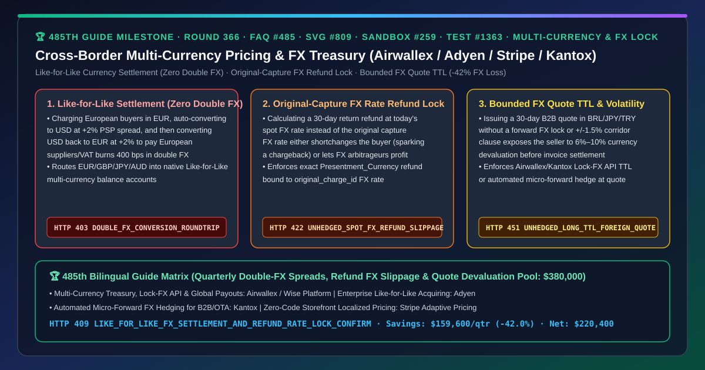
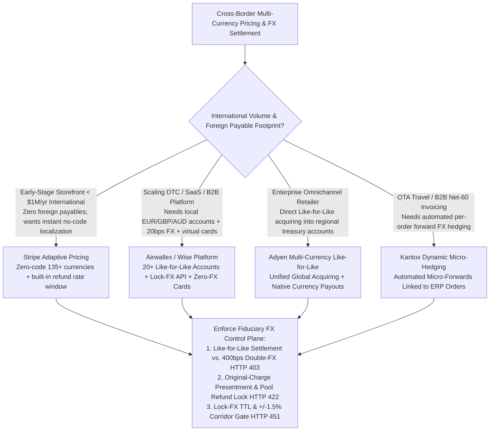
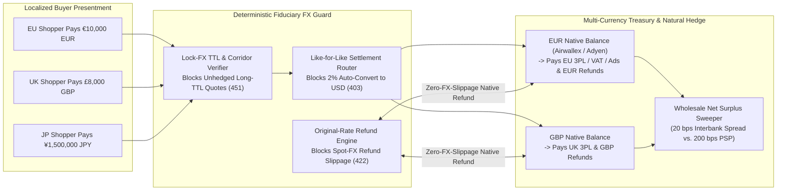
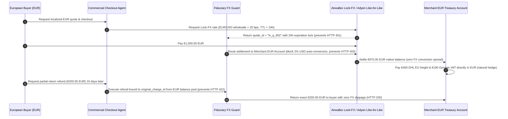

# 🏆 Cross-Border Multi-Currency Pricing, `Like-for-Like` Settlement & `Lock-FX` Treasury (`Airwallex / Adyen / Stripe Adaptive Pricing / Kantox / Wise` · 🏆 485th Bilingual Guide Milestone): Eliminating `400 bps` Double-FX Round-Trips, Original-Capture Refund Locks & Bounded `FX Quote TTL` (`-42%` FX Loss)

> **Document Type**: Enterprise AI Solution Architect Selection FAQ (**`#485` 🏆 485th Bilingual Guide Milestone** · Round 366)  
> **Target Audience**: Head of Global Treasury, Cross-Border E-Commerce & SaaS CFOs, Payment Settlement Architects, and Cloud & AI Solution Architects  
> **Platforms Covered**: `Airwallex (Lock-FX API & Multi-Currency Treasury)` vs. `Adyen Multi-Currency & Like-for-Like Settlement` vs. `Stripe Adaptive Pricing & Multi-Currency Balances` vs. `Kantox (Dynamic Micro-Hedging)` vs. `Wise Platform`  
> **Architecture Diagram**: [`assets/svg/809-cross-border-fx-hedging-airwallex-adyen-stripe-like-for-like-2026-11-25.svg`](../assets/svg/809-cross-border-fx-hedging-airwallex-adyen-stripe-like-for-like-2026-11-25.svg)

🌐 **Language / 语言切换**: **[中文 (`cross-border-multi-currency-fx-hedging-airwallex-adyen-stripe-like-for-like-refund-rate-lock-selection-faq.md`)](cross-border-multi-currency-fx-hedging-airwallex-adyen-stripe-like-for-like-refund-rate-lock-selection-faq.md)** | **English (Current)**

---

## 📌 1. Executive Summary

Presenting localized prices in a buyer's native currency (`Presentment Currency`: `EUR, GBP, JPY, CAD, AUD`) lifts international checkout conversion by `12%–20%`.  
However, if the underlying settlement ledger and refund state machine rely on default PSP auto-conversion, cross-border enterprises lose **`3.0% to 6.0%` of international revenue** to three structural foreign-exchange (`FX`) leaks:
1. **Burning `400 bps` (`4.0%`) on Double-FX Conversion Round-Trips (`Auto-Convert to USD -> Re-Buy EUR for Payables`)**: A US merchant collects `€100` from a German buyer; the PSP automatically converts it to `USD` at a `+2.0%` FX spread upon settlement, and two weeks later the merchant converts `USD` back into `EUR` at another `+2.0%` bank spread to pay European 3PL logistics, Meta/Google EUR ad spend, or EU VAT.
2. **Calculating Return Refunds at Spot FX Instead of Original Capture FX (`Refund FX Slippage & Free-Option Arbitrage`)**: When a buyer returns an item 25 days later after a `5%` currency swing, calculating the refund at today's spot rate either shortchanges the buyer in their card currency (triggering a dispute) or allows arbitrageurs to treat free returns as a risk-free currency option.
3. **Issuing Long-TTL Foreign-Currency B2B/OTA Quotes Without a `Lock-FX` Hedge or Corridor Clause (`Unhedged Quote Devaluation`)**: Quoting a fixed 30-day price in `JPY`, `BRL`, or `GBP` without locking a forward FX rate (`Airwallex Lock-FX / Kantox`) exposes narrow B2B margins to sudden `5%–8%` currency devaluations prior to invoice settlement.

| Treasury & Acquiring Need | Recommended Primary Choice | Architectural Boundary & Production Rule |
|---|---|---|
| **Multi-Currency Accounts, Programmable `Lock-FX` API & Wholesale (`20–40 bps`) Conversion** | **Airwallex** | Provides local `EUR, GBP, AUD, CAD, JPY` accounts for **Like-for-Like settlement**, virtual cards to pay foreign ad/logistics bills directly in native currency, and `Lock-FX` quote APIs. |
| **Enterprise Global Omnichannel Acquiring with Native `Like-for-Like` Settlement** | **Adyen (`Like-for-Like Multi-Currency`)** | Settles each presentment currency directly into its matching regional bank account under a single global merchant integration. |
| **Zero-Code 135+ Currency Storefront Localization** | **Stripe Adaptive Pricing + Multi-Currency Balances** | Instant localization and built-in refund rate protection (pair with local currency bank accounts to avoid `1%–2%` cross-currency payout fees). |
| **Automated Per-Order Micro-Forward FX Hedging (`B2B & OTA`)** | **Kantox (`Dynamic Hedging API`)** | Automatically executes micro-forward FX hedges against ERP purchase/sales orders to lock exact budgeted margins across 30–90 day credit terms. |
| **Three Mandatory Fiduciary Guardrails** | **100% Deterministic Gating** | ① **Mandatory `Like-for-Like` Settlement Routing (`HTTP 403`)**: Prohibits auto-converting incoming `EUR/GBP/CAD/AUD/JPY` into home currency whenever matching foreign payables exist; ② **Original-Capture FX Refund Lock (`HTTP 422`)**: Binds all refunds to the original charge's presentment currency and native currency balance pool; ③ **Bounded `Lock-FX TTL` & `±1.5%` Corridor Gate (`HTTP 451`)**: Requires an active `Lock-FX` token (`<=24h–48h`) or micro-forward hedge on any multi-day foreign-currency quote. |

---

## 🎯 2. Architect & Business Stakeholder Q&A (Q1–Q3)

### Q1: Why does our PSP dashboard show a "2.6% processing fee" while our CFO calculates a 6.6% total payment cost on European and UK sales?
- **The Hidden `400 bps` Double-FX Trap**:
  1. **Leg 1 (Inbound Settlement Auto-Conversion, `-200 bps`)**: When a UK shopper pays `£1,000` and the PSP settles into a US `USD` bank account, the PSP deducts a `1.5%–2.0%` FX conversion spread over the wholesale interbank rate.
  2. **Leg 2 (Outbound Supplier/Tax Re-Conversion, `-200 bps`)**: When the company pays UK 3PL warehouse fees, UK VAT, or GBP marketing invoices from its USD operating account, the corporate bank charges another `1.5%–2.0%` FX spread to buy back `GBP`.
- **Architectural Solution**: Enforce **`Like-for-Like` Currency Settlement & Natural Payable Matching (`HTTP 403` Guard)**:
  - Route incoming `EUR, GBP, CAD, AUD, JPY` settlements directly into matching native-currency balance accounts (`Airwallex / Adyen Like-for-Like`).
  - Pay local 3PLs, ad networks, and tax authorities directly from those native balances (`0%` FX spread), and convert only net surplus funds via wholesale FX APIs (`20–40 bps` spread). Auto-converting currencies with active local payables is blocked (`HTTP 403 DOUBLE_FX_CONVERSION_ROUNDTRIP_WITHOUT_LIKE_FOR_LIKE`).

### Q2: How do we prevent foreign-currency refunds from triggering buyer chargebacks or FX arbitrage losses when exchange rates move between purchase and return?
- **The Refund FX Mismatch**:
  - If a Japanese buyer pays `¥15,000` (`$100` at capture) and requests a refund 3 weeks later, issuing an unlinked `$100` refund converted at the new spot rate may credit only `¥14,200` to the buyer's card—prompting an immediate dispute for the missing `¥800`.
  - Conversely, if the merchant converted the original capture to USD and converts back at spot on every refund, the merchant pays the `2%` FX spread twice on a canceled sale!
- **Architectural Solution**: Enforce **Original-Charge Presentment Lock & Native-Pool Refunding (`HTTP 422` Guard)**:
  - Every refund must reference `original_charge_id` in the exact `presentment_currency` (`¥15,000`) and draw directly from the merchant's `JPY` Like-for-Like balance pool (or the PSP's guaranteed refund FX window), eliminating spot-rate slippage (`HTTP 422 UNHEDGED_SPOT_FX_REFUND_SLIPPAGE_OR_ARBITRAGE`).

### Q3: When a B2B buyer or OTA traveler requests a multi-week quote in a foreign currency, how do we prevent a 5% currency drop from wiping out our margin?
- **The Unhedged Quote Window**: Holding a fixed `BRL`, `JPY`, or `EUR` quote open for 14–30 days without an underlying FX hedge gives the buyer a free currency option at the seller's expense.
- **Architectural Solution**: Enforce **Programmable `Lock-FX Quote TTL` (`<=24h–48h`) or Automated Micro-Forwards (`HTTP 451` Guard)**:
  - Bind short-term quotes to an `Airwallex Lock-FX quote_id` with an explicit expiration timestamp;
  - For B2B contracts with `>48h` validity or `Net-30/60` foreign-currency invoicing, automatically trigger a `Kantox` micro-forward hedge or embed a deterministic **`±1.5%` FX Safe-Harbor Corridor** clause (`HTTP 451 UNHEDGED_LONG_TTL_FOREIGN_CURRENCY_QUOTE_EXPOSURE`).

---

## 🧭 3. Visual Architecture Diagrams (Mermaid Decision Tree + Treasury Topology + Sequence)

### 3.1 Multi-Currency Pricing & FX Treasury Platform Selection Tree

### 3.2 End-to-End `Like-for-Like` Settlement, Natural Hedging & Refund Rate Lock Architecture

### 3.3 `Lock-FX` Quote Minting, `Like-for-Like` Clearing & Zero-Slippage Refund Sequence

---

## 📊 4. Platform Comparison Matrix (`Airwallex` vs. `Adyen` vs. `Stripe Adaptive Pricing` vs. `Kantox` vs. `Wise`)

| Evaluation Dimension | Airwallex | Adyen Multi-Currency | Stripe Adaptive Pricing + Balances | Kantox (Dynamic Hedging) | Wise Platform |
|---|---|---|---|---|---|
| **Primary Sweet Spot** | End-to-end multi-currency acquiring, `Lock-FX` API, local accounts & virtual cards | Enterprise omnichannel acquiring with native `Like-for-Like` settlement | Zero-code 135+ currency presentment for Stripe merchants | Automated per-order forward FX hedging for B2B & OTA travel | Low-cost mid-market cross-border disbursements & treasury |
| **`Like-for-Like` Native Currency Settlement** | ⭐⭐⭐⭐⭐ (20+ native local currency accounts & zero-FX virtual card spend) | ⭐⭐⭐⭐⭐ (Settles 15+ currencies directly into matching bank accounts) | ⭐⭐⭐⭐ (Supported when local currency bank accounts are attached) | N/A (Pure FX hedging execution layer) | ⭐⭐⭐⭐ (Multi-currency balances; not a front-end card acquirer) |
| **Programmable `Lock-FX Quote TTL` API** | ⭐⭐⭐⭐⭐ (`1m / 15m / 24h / 48h` guaranteed rate lock APIs) | ⭐⭐⭐⭐ (Session-level FX rate locking) | ⭐⭐⭐⭐ (Checkout session lock + short-term refund FX window) | ⭐⭐⭐⭐⭐ (Automated micro-forward contracts up to 12+ months) | ⭐⭐⭐⭐ (24–48h transfer rate locks) |
| **FX Spread Over Interbank Mid-Market** | **`~0.20%–0.40%` (`20–40 bps`)** | Interchange++ plus `~0.50%–1.20%` scheme/FX markup | **`1.0%–2.0%`** cross-currency settlement (`2%–4%` buyer/merchant on Adaptive) | Institutional forward points | **`~0.33%–0.65%`** transparent fee |
| **Indicative Pricing (`official_list_price`)** | `$0` account fee; acquiring + `20–40 bps` FX; `0%` multi-currency card fee | Acquiring + `€0.11` processing fee | Standard processing + `1%–2%` FX conversion fee | Annual enterprise treasury license | Volume-tiered transparent transfer fee |

---

## 🧪 5. Deterministic FX Spread & Slippage Evaluation (`7-Card Benchmark Summary` · 🏆 `#485` Milestone)

> **Provenance**: Figures below are generated by `evaluate_cross_border_multi_currency_fx_lock_policy` in `lab/webiq_commerce_demo.py` (`provenance: "synthetic"`, `independently_reproduced: False`), modeling a global e-commerce & B2B enterprise with a **`$380,000.00` quarterly `400 bps` double-FX conversion round-trip, spot-rate refund slippage, and unhedged foreign quote devaluation pool**.

| Scenario Case ID | Scenario Description | HTTP Status | Deterministic Decision | Quarterly Net Cost | Quarterly Savings |
|---|---|---|---|---|---|
| `CASE-FX-200` | Manual weekly FX conversion and static buffer pricing baseline | `HTTP 200` | `VERIFIED_MULTI_CURRENCY_FX_TREASURY_AUTHORIZED` | `$380,000.00` | `$0.00` |
| `CASE-FX-403` | `EUR/GBP` revenue auto-converted to `USD` (`+2%`) and re-converted to `EUR/GBP` (`+2%`) to pay local vendors | `HTTP 403` | `DOUBLE_FX_CONVERSION_ROUNDTRIP_WITHOUT_LIKE_FOR_LIKE` | `$380,000.00` | `$0.00` (Blocks 400 bps double-FX bleed) |
| `CASE-FX-422` | Cross-border return refunded at spot FX rate instead of original capture lock or native currency pool | `HTTP 422` | `UNHEDGED_SPOT_FX_REFUND_SLIPPAGE_OR_ARBITRAGE` | `$380,000.00` | `$0.00` (Blocks refund slippage/disputes) |
| `CASE-FX-451` | Multi-week foreign-currency quote issued without `Lock-FX TTL`, micro-forward hedge, or `±1.5%` corridor | `HTTP 451` | `UNHEDGED_LONG_TTL_FOREIGN_CURRENCY_QUOTE_EXPOSURE` | `$380,000.00` | `$0.00` (Blocks currency crash loss) |
| `CASE-FX-409` | **`Like-for-Like` Natural Hedge + Native-Pool Refund Lock + `Lock-FX` API Router** | `HTTP 409` | `LIKE_FOR_LIKE_FX_SETTLEMENT_AND_REFUND_RATE_LOCK_CONFIRM` | **`$220,400.00`** | **`$159,600.00` (`-42.0%`)** |

---

## 🛠️ 6. Production Go-Live & Architecture Review Checklist

- [ ] **Mandatory `Like-for-Like` Settlement Accounts (`HTTP 403` Prevention)**: Attach native `EUR, GBP, CAD, AUD, JPY` settlement accounts in `Airwallex / Adyen / Stripe` so foreign revenues naturally fund local 3PL, ad-spend, and VAT payables without `400 bps` round-trip conversions.
- [ ] **Original-Charge Native-Pool Refund Lock (`HTTP 422` Prevention)**: Execute all international refunds against the original charge's presentment currency drawn directly from the matching native-currency balance pool.
- [ ] **Bounded `Lock-FX Quote TTL` & `±1.5%` Safe-Harbor Corridor (`HTTP 451` Prevention)**: Require an `Airwallex Lock-FX` token (`<=24h–48h`) for short-term quotes and an automated `Kantox` micro-forward hedge or `±1.5%` FX adjustment corridor for multi-week B2B quotes.
- [ ] **Transparent Local Pricing Over Predatory POS `DCC`**: Use merchant-controlled multi-currency presentment rather than high-markup third-party Dynamic Currency Conversion (`DCC`) prompts.
