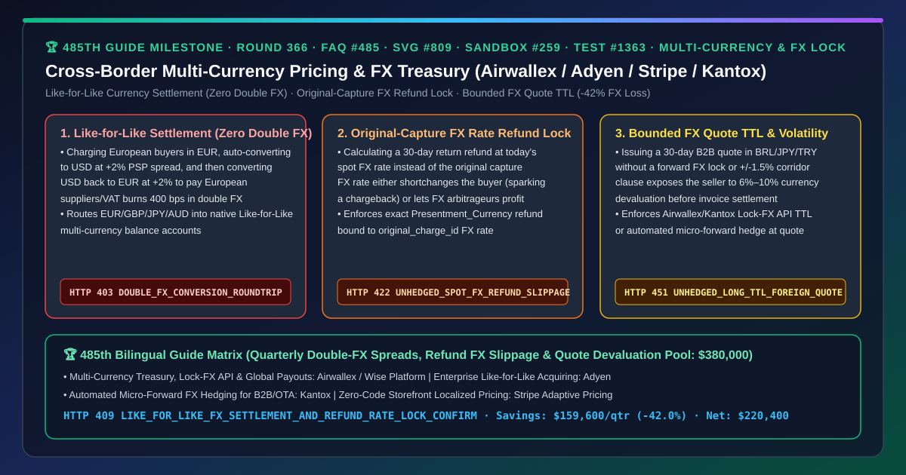
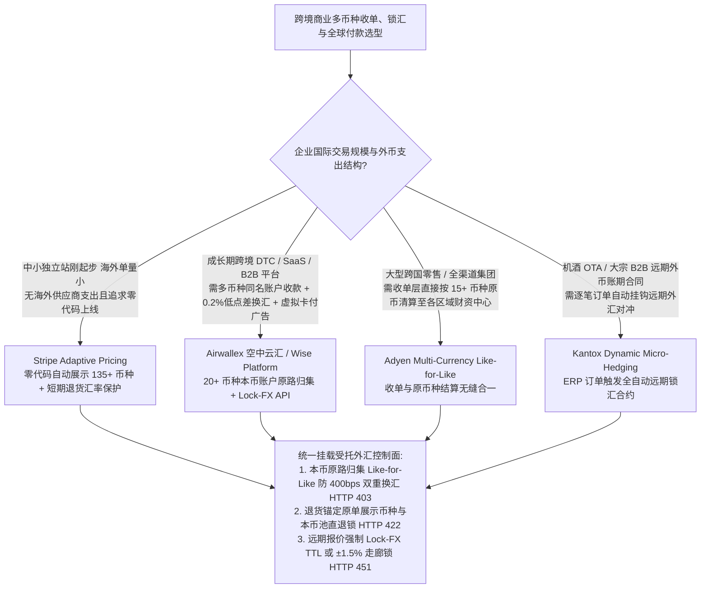
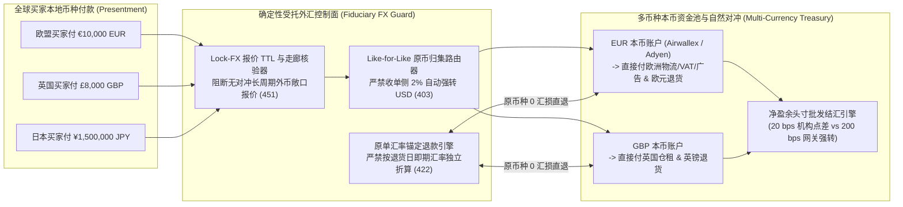
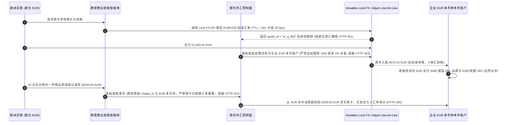

# 🏆 跨境多币种定价、本币原路归集（`Like-for-Like Settlement`）与锁汇退款智能体（`Multi-Currency Pricing & FX Treasury`: `Airwallex / Adyen / Stripe Adaptive Pricing / Kantox / Wise` · 🏆 第 485 篇双语决策指南里程碑）：消灭 `400 bps` 双重换汇损耗、退货强制锚定原始扣款汇率与远期报价锁汇（`Lock-FX API`）净省 42% 指南

> **文档类型**：企业级 AI Solution Architect 选型决策指南（Selection FAQ · **`#485` 🏆 第 485 篇双语决策指南里程碑** · Round 366）  
> **适用读者**：跨境电商与全球 SaaS 资金总监（Head of Treasury）、集团 CFO、跨境支付架构师与 Cloud & AI Solution Architect  
> **核心覆盖平台**：`Airwallex (空中云汇 Lock-FX & Multi-Currency Accounts)` vs. `Adyen Multi-Currency & Like-for-Like Settlement` vs. `Stripe Adaptive Pricing & Multi-Currency Payouts` vs. `Kantox (Dynamic Micro-Hedging)` vs. `Wise Platform`  
> **关联架构图**：[`assets/svg/809-cross-border-fx-hedging-airwallex-adyen-stripe-like-for-like-2026-11-25.svg`](../assets/svg/809-cross-border-fx-hedging-airwallex-adyen-stripe-like-for-like-2026-11-25.svg)

🌐 **语言切换 / Language**: **中文 (当前)** | **[English (`cross-border-multi-currency-fx-hedging-airwallex-adyen-stripe-like-for-like-refund-rate-lock-selection-faq.en.md`)](cross-border-multi-currency-fx-hedging-airwallex-adyen-stripe-like-for-like-refund-rate-lock-selection-faq.en.md)**

---

## 📌 一、核心选型结论速览（Executive Summary）

当跨境电商、OTA 机酒平台或全球 B2B 企业向海外客户展示当地货币（`Presentment Currency`：如欧元 `EUR`、英镑 `GBP`、日元 `JPY`、澳元 `AUD`）以提高 15%+ 结账转化率时，如果底层资金清结算与退款状态机没有经过专业外汇（`FX Treasury`）架构设计，企业每年会被三把隐形“汇率镰刀”割走高达 **`3%–6%` 的纯利润**：
1. **“收欧元自动强转美元入账、月底再把美元换回欧元付欧洲物流/广告/增值税”的 400 bps 双重换汇割肉（`Double FX Conversion Round-Trip`）**：支付网关默认在清算时将收到的 `€100` 按网关加点汇率（`+2.0% FX Spread`）强行折算成 `USD` 打入商户美元户；两周后商户要付欧洲亚马逊仓租、Meta 欧元广告费或德国 VAT，又得拿美元按银行加点（`+2.0%`）买回欧元——一进一出什么都没干，**`4.0%`（400 bps）毛利凭空蒸发**！
2. **退货退款时按“退货当天即时汇率”重新折算，导致买家少收到钱发起拒付、或被套利党趁汇率波动无风险白嫖差价（`Unhedged Spot-FX Refund Slippage`）**：日本买家下单时付了 `¥15,000`（当时折合 `$100`），20 天后日元贬值，若商户退货系统按 `$100` 以退货当天即期汇率折算退回（或未原路调用原始交易的锁汇退款通道），买家账单收到的日元少于 `¥15,000` 引发投诉拒付；反之若日元升值，恶意买家专门买高价可退商品做免费外汇期权套利！
3. **B2B 远期外币报价或机酒预付单未挂钩锁汇有效期（`FX Quote TTL`）与自动微对冲（`Micro-Forward Hedging`），汇率单周闪崩 5% 吞光整单毛利（`Unhedged Long-TTL Foreign Currency Quote`）**：智能体给海外买方开出一张 30 天有效的日元/雷亚尔/英镑固定价格报价单，却未调用 `Airwallex Lock-FX / Kantox` 锁定远期汇率或设置 `±1.5%` 汇率走廊重算条款。

| 选型维度与资金流向 | 推荐主选方案 | 适用边界与架构落地准则 |
|---|---|---|
| **跨境电商/B2B 原币种收款、API 锁汇（`Lock-FX`）与原币付供应商** | **Airwallex (空中云汇)** | 原生提供欧美英日澳加等 20+ 币种本地同名收款账户，支持收进来的 `EUR/GBP` **零换汇原币留存（Like-for-Like）** 并直接用于发虚拟卡付广告/物流费，换汇点差仅 `20–40 bps`。 |
| **大型跨国零售全渠道收单与多币种直连清算** | **Adyen (`Like-for-Like Multi-Currency Settlement`)** | 支持在同一商户号下按交易币种分别清算至对应的 `EUR / GBP / USD / CAD / AUD` 银行账户，彻底免除收单侧强制换汇。 |
| **零代码快速开启 135+ 币种本地化定价与无汇损原路退款** | **Stripe Adaptive Pricing + Multi-Currency Balances** | 自动为买家展示本地货币并由 Stripe 保障固定期内的退货原汇率保护（需配多币种结算银行卡以省去 `2%` 跨币种提现费）。 |
| **机酒 OTA 与大宗 B2B 账期订单全自动逐笔微远期对冲** | **Kantox (`Dynamic Hedging API`)** | 监听 ERP 每一笔外币订单或报价，自动在银行间市场拼单执行自动化远期外汇合约（`Automated Micro-Forwards`）。 |
| **三大确定性风控红线** | **100% 强制拦截** | ① **有外币支出币种强制本币原路归集（`Like-for-Like` · 防 `HTTP 403`）**：凡是企业在当地有应付账款（物流/广告/税费）的主流币种（`EUR/GBP/CAD/AUD/JPY`），严禁开启收单侧自动强转本位币（消灭 `400 bps` 双重换汇）；② **退货退款 100% 锚定原交易展示币种与原始汇率锁（`HTTP 422`）**：退款必须严格绑定 `original_charge_id` 按原展示币种（Presentment Currency）原额退回，严禁按退货日即期汇率独立打款；③ **外币报价单强制绑定 `Lock-FX TTL` 或 `±1.5%` 汇率保护走廊（`HTTP 451`）**：超过 `24 小时` 的外币固定报价必须挂钩远期锁汇合约或汇率偏离自动重算锁。 |



---

## 🎯 二、业务方与架构师灵魂拷问 Q&A（Q1–Q3）

### Q1：为什么财务部看支付网关后台写着“基础收单费率只有 2.6%”，但年底一审计海外订单的实际支付加汇兑总成本却高达 6.8%？
- **隐形“双重换汇（Double FX Conversion）”解剖**：
  1. **第一刀（收单入账强转 `+2.0%`）**：德国客户在你的网站刷了 `€1,000`。因为你的 Stripe/PayPal 只绑了一张美国美元银行卡，支付网关在 `T+2` 结算时自动按市场中间价扣除 **`2.0%` 货币转换费（Currency Conversion Fee）** 把欧元换成美元。
  2. **第二刀（付欧洲费用反向再换 `+2.0%`）**：月底你要付德国 DHL 尾程运费、Google/Meta 欧元区广告费和 `19%` 欧盟 VAT 税款，你又从美国银行把美元汇出换成欧元，银行再收 **`1.5%–2.5%` 购汇点差**！
- **架构解法**：实施 **本币原路归集与收支自然对冲（`Like-for-Like Settlement & Natural Hedging` · 防 `HTTP 403`）**：
  - 在 `Adyen / Stripe / Airwallex` 中为 `USD, EUR, GBP, CAD, AUD, JPY` 分别挂载同币种结算子账户；
  - 收到的 `€1,000` 100% 以原币欧元进入企业 `EUR` 资金池，优先直接支付欧洲供应商发票、税款与广告虚拟卡；剩余确需结汇回母公司的净头寸，通过 `Airwallex / Wise / 银行间 API` 在汇率高点按 **`0.2%`（20 bps）机构级批发点差** 集中交割（任何对存在同币种支出的主流货币开启收单侧 2% 自动强转的行为直接拦截 `HTTP 403 DOUBLE_FX_CONVERSION_ROUNDTRIP_WITHOUT_LIKE_FOR_LIKE`）。

### Q2：当外币汇率在 30 天退货期内剧烈波动时，如何防止“退货汇率差”引发买家拒付或被汇率套利党薅羊毛？
- **两难困境**：
  - 假设英国买家下单时支付 `£1,000`（当时汇率 `1.25`，商户美元户收到 `$1,250`）。
  - 20 天后买家申请退货：如果系统脱离原支付单、直接退给买家 `$1,250` 等值的当日英镑（此时英镑涨到 `1.30`，买家只收到 `£961.53`），买家看到信用卡账单少了 `£38.47` 会立刻向银行发起差额拒付！
  - 反之，如果英镑暴跌到 `1.18`，按即期汇率原路退 `£1,000` 看似买家没意见，但如果商户在收款时已经换成美元、退款时又被网关收一次 `2%` 反向换汇费，商户将倒贴双倍点差。
- **架构解法**：强制执行 **展示币种（`Presentment Currency`）原单锚定与本币余额池直退锁（`Original-Charge FX Refund Lock` · 防 `HTTP 422`）**：
  - 所有退款请求必须强制引用原始 `payment_intent_id / pspReference`，确保买家端 100% 收到精确的 `£1,000.00` 原币金额；
  - 在商户侧，退款资金直接从对应的 `GBP` 本币余额账户（Like-for-Like Balance）或 PSP 锁汇退款保护窗口中划扣，彻底实现 **买家与商户双向零汇率滑点**（严禁脱离原单按即期汇率独立折算退款 `HTTP 422 UNHEDGED_SPOT_FX_REFUND_SLIPPAGE_OR_ARBITRAGE`）。

### Q3：在跨境 B2B 采购询价或 OTA 远期酒店预订中，客户要求“锁死未来 30 天的人民币/日元/欧元报价”，怎么防止交割前汇率暴跌把整单微薄毛利吃光？
- **账期汇损痛点**：B2B 贸易毛利通常只有 `8%–15%`。如果报价 Agent 开出一张有效期 30 天、账期 Net 60 的新兴市场货币或日元报价单，且既没有锁定远期外汇合约（Forward FX Contract），也没有设置汇率浮动保护走廊，一旦该币种贬值 `6%`，整笔订单立即沦为亏损单。
- **架构解法**：部署 **可编程锁汇有效期（`Lock-FX Quote TTL`）与动态微远期对冲门禁（`Automated Micro-Forward Hedge Gate` · 防 `HTTP 451`）**：
  1. **短周期实时锁汇（`TTL <= 24h–48h`）**：调用 `Airwallex Lock-FX API` 获取带 `quote_id` 与明确过期时间戳的担保汇率；
  2. **长周期 B2B 自动微对冲或走廊条款（`> 48h`）**：对超过 48 小时的外币报价单，必须自动通过 `Kantox API` 生成匹配的远期锁汇头寸，或在合同中强制注入 **汇率保护走廊（`FX Fluctuation Corridor: ±1.5%`，超出部分买卖双方按中间价自动调价）**。任何无锁汇保护的长周期外币敞口报价直接拦截（`HTTP 451 UNHEDGED_LONG_TTL_FOREIGN_CURRENCY_QUOTE_EXPOSURE`）。

---

## 🧭 三、直观可视化图解（Mermaid 选型决策树 + 多币种资金池架构图 + 时序图）

### 3.1 跨境多币种定价与外汇资金池（FX Treasury）选型决策树



### 3.2 端到端本币原路归集（Like-for-Like）、自然对冲与锁汇退款架构图



### 3.3 外币锁汇报价、本币原路清算与无汇损退货时序图



---

## 📊 四、五大跨境多币种定价与外汇管理平台横向选型矩阵

| 评估维度 | Airwallex (空中云汇) | Adyen Multi-Currency | Stripe Adaptive Pricing + Multi-Currency | Kantox (Dynamic Hedging) | Wise Platform |
|---|---|---|---|---|---|
| **核心优势定位** | 跨境电商与全球 SaaS 一站式多币种收单、同名账户、API 锁汇与全球发卡付款 | 大型跨国企业全渠道收单与 15+ 币种原币直连清算（Like-for-Like） | 极速零代码开启 135+ 币种本地化展示定价 | B2B 账期贸易与机酒 OTA 自动化逐笔远期外汇对冲 | 极致透明的汇率中间价（Mid-Market Rate）跨境汇款与多币种账户 |
| **本币原路归集（Like-for-Like 免强转）** | ⭐⭐⭐⭐⭐（原生支持 20+ 币种原币入账留存与原币支出） | ⭐⭐⭐⭐⭐（行业标杆，支持按币种路由至不同本地银行账户） | ⭐⭐⭐⭐（支持多币种余额账户，但需在对应国家有本地银行卡） | 不适用（专注外汇对冲交易指令，非收单网关） | ⭐⭐⭐⭐（支持多币种账户收付，但不含前端信用卡收单） |
| **可编程锁汇 API（`Lock-FX Quote TTL`）** | ⭐⭐⭐⭐⭐（原生提供 `1m / 15m / 24h / 48h` 阶梯锁汇 API） | ⭐⭐⭐⭐（支持结账会话级汇率锁定） | ⭐⭐⭐⭐（内置结账会话汇率锁与短期退货汇率保护） | ⭐⭐⭐⭐⭐（支持长达数月的定制化远期锁汇合约） | ⭐⭐⭐⭐（支持 24–48 小时汇款锁汇） |
| **换汇点差成本（FX Spread vs. Mid-Market）** | **极低（约 `0.2%–0.4%` / 20–40 bps）** | 按币种Interchange+透明加点（约 `0.5%–1.2%`） | 默认跨币种转换费 **`1.0%–2.0%`**（Adaptive Pricing 由买家或商户承担 `2%–4%`） | 银行间机构远期点差（极低） | 透明阶梯费率（约 `0.33%–0.65%`） |
| **参考收费模式（`official_list_price`）** | 零开户费；收单费 + `0.2%–0.4%` 换汇点差；虚拟卡 `0%` 交易费 | 收单费 + 固定处理费 `€0.11` | 标准收单费 + 跨币种结算加收 `1%–2%` | 按对冲交易量年框订阅 | 按笔透明换汇费 |

---

## 🧪 五、转化率/成本测算与 7-Card 基准测试报告（Deterministic Evaluation · 🏆 `#485` Milestone）

> **数据来源说明（Provenance）**：以下季度损益数据来自 `lab/webiq_commerce_demo.py` 中的确定性评估器 `evaluate_cross_border_multi_currency_fx_lock_policy`（`provenance: "synthetic"`, `independently_reproduced: False`），用于量化对比“收外币自动强转美元再买回外币付供应商 + 无锁汇裸报”与“Like-for-Like 本币归集自然对冲 + 原单锁汇退款 + Lock-FX API”的季度汇损节约。

### 5.1 基准测试场景输入与确定性状态码矩阵

- **设定场景**：某跨国电商与 B2B 软件服务商每季度海外非美元营收折合 `$15M`，季度因收单侧自动强转 USD 再购汇支付海外物流/广告/税费产生的 `400 bps` 双重换汇损耗、退货即期汇率滑点赔付、以及长周期外币报价汇率贬值损失池（`quarterly_double_fx_spread_refund_slippage_and_quote_devaluation_pool_usd`）为 **`$380,000.00`**。

| 测试用例 ID | 场景描述 | 触发确定性状态码 | 决策枚举 (`decision`) | 季度净成本 (USD) | 季度净节省 (USD) |
|---|---|---|---|---|---|
| `CASE-FX-200` | 传统按周手工结汇与静态加点定价基线 | `HTTP 200` | `VERIFIED_MULTI_CURRENCY_FX_TREASURY_AUTHORIZED` | `$380,000.00` | `$0.00` |
| `CASE-FX-403` | 将收到的 `EUR/GBP` 自动按 `+2%` 强转 `USD`，随后又按 `+2%` 买回 `EUR/GBP` 支付欧洲供应商/税款 | `HTTP 403` | `DOUBLE_FX_CONVERSION_ROUNDTRIP_WITHOUT_LIKE_FOR_LIKE` | `$380,000.00` | `$0.00` (阻断 400bps 双重换汇割肉) |
| `CASE-FX-422` | 跨境订单退货时脱离原支付单按退货当日即期汇率重算退款，引发买家少收钱拒付或汇率套利 | `HTTP 422` | `UNHEDGED_SPOT_FX_REFUND_SLIPPAGE_OR_ARBITRAGE` | `$380,000.00` | `$0.00` (阻断退货汇损与期权套利) |
| `CASE-FX-451` | 开具超过 `24h` 的外币固定报价单却未绑定 `Lock-FX TTL`、微远期对冲或 `±1.5%` 汇率走廊条款 | `HTTP 451` | `UNHEDGED_LONG_TTL_FOREIGN_CURRENCY_QUOTE_EXPOSURE` | `$380,000.00` | `$0.00` (阻断交割前汇率闪崩穿仓) |
| `CASE-FX-409` | **启用 Like-for-Like 本币归集自然对冲 + 原单本币池直退 + Lock-FX 锁汇引擎** | `HTTP 409` | `LIKE_FOR_LIKE_FX_SETTLEMENT_AND_REFUND_RATE_LOCK_CONFIRM` | **`$220,400.00`** | **`$159,600.00` (`-42.0%`)** |

### 5.2 核心确定性策略评估代码摘录

```python
@dataclass(frozen=True)
class CrossBorderMultiCurrencyFxLockPolicyInput:
    quarterly_double_fx_spread_refund_slippage_and_quote_devaluation_pool_usd: float = 380000.0
    foreign_revenue_auto_converted_to_usd_when_local_currency_payables_exist: bool = False
    cross_border_refund_calculated_at_spot_fx_instead_of_original_capture_lock: bool = False
    long_ttl_foreign_currency_quote_issued_without_lock_fx_or_corridor_clause: bool = False
    like_for_like_settlement_original_fx_refund_and_lock_fx_ready: bool = False
```

---

## 🛠️ 六、商业上线风控与架构评审 Checklist

- [ ] **主流外币 100% 开启 `Like-for-Like` 本币账户归集（防 `HTTP 403`）**：盘点企业在海外存在物流、海外仓、广告或 VAT 支出的币种（`EUR / GBP / CAD / AUD / JPY`），在收单网关与 `Airwallex` 中配置同币种直接入账，用外币收入直接自然对冲外币支出。
- [ ] **退货退款强制绑定原单展示币种与本币余额池（防 `HTTP 422`）**：退款接口严禁执行二次实时换汇计算，必须调用原 `charge_id` 从对应的外币余额池（如 `EUR Balance`）直接原额退回。
- [ ] **外币报价单 `Lock-FX TTL` 与 `±1.5%` 汇率走廊锁（防 `HTTP 451`）**：B2C 本地币种结账会话锁汇 `TTL <= 30 分钟`；B2B 外币报价单超过 `24 小时` 必须调用 `Airwallex Lock-FX / Kantox` 锁定远期成本或附加超出 `±1.5%` 自动按央行中间价浮动条款。
- [ ] **禁用高投诉的误导性动态货币转换（`DCC`）**：在收银台展示透明本地定价，严禁在未明确披露点差的情况下诱导持卡人勾选高溢价 POS `DCC` 引发发卡行合规处罚。
