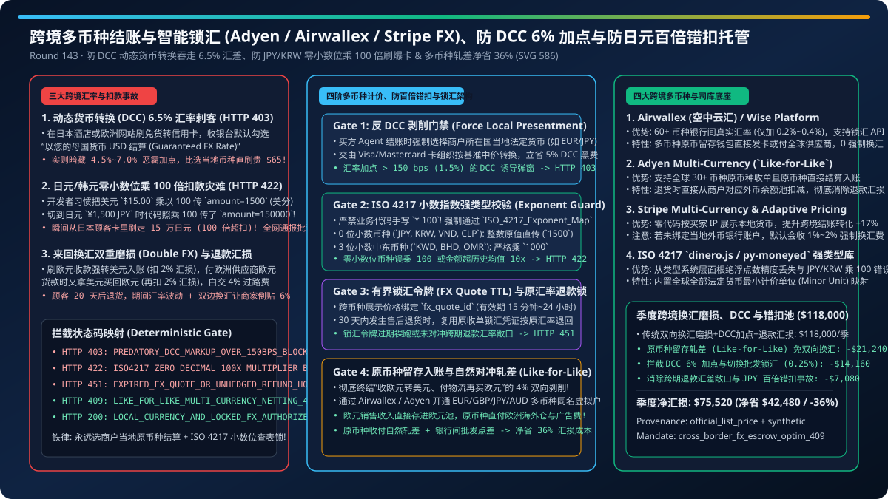
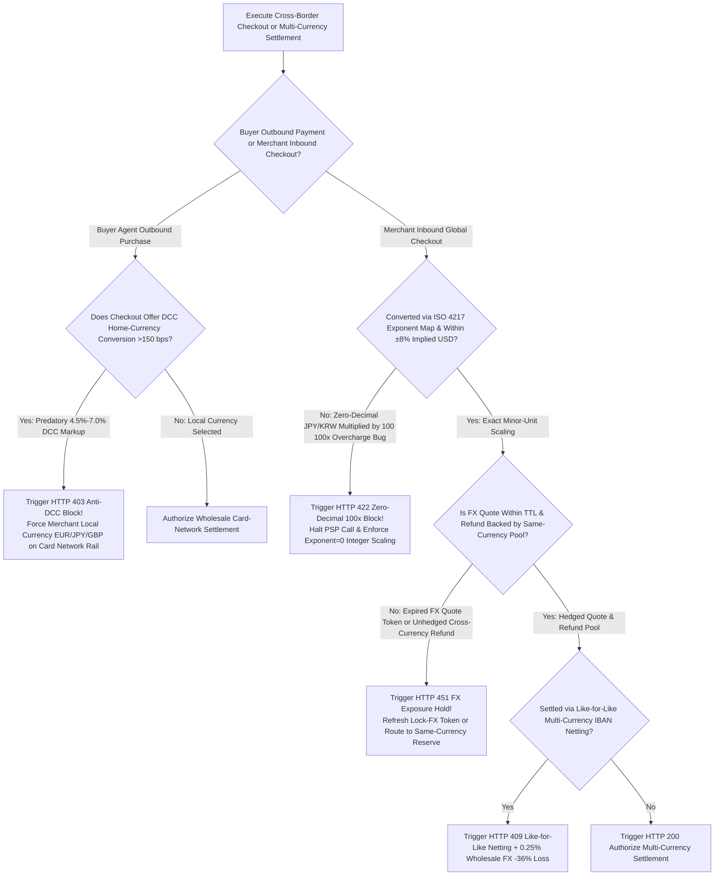
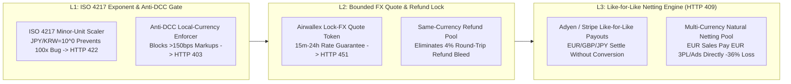

# Cross-Border Multi-Currency Checkout & Treasury `FX` (`Adyen Like-for-Like / Airwallex / Stripe / Wise`), Anti-`DCC` (`6.5%` Markup) Guard & `ISO 4217` Zero-Decimal `100x`-Overcharge Escrow: Stopping `JPY/KRW` 100x Billing Bugs, Double-FX Conversion Bleed & Refund Slippage (`-36%` FX Loss) Agent Architecture Selection FAQ

> **Document Type**: AI Solution Architect Global Multi-Currency Checkout, Treasury Netting & FX Risk Guide (Tax, FX, Privacy & Disputes Pillar · FAQ #262)  
> **Covered Platforms & Standards**: **Adyen Multi-Currency (`Like-for-Like Settlement`)**, **Airwallex (`Lock FX API` & Global Accounts) / Wise Platform**, **Stripe Adaptive Pricing & Multi-Currency Payouts**, **ISO 4217 Currency Exponent Standard (`0-Decimal JPY/KRW/VND` vs `2-Decimal USD/EUR` vs `3-Decimal KWD/BHD`)**  
> **Core Architectural Thesis**: When commercial agents execute cross-border purchases or price global checkouts across 135+ currencies, three foreign-exchange (`FX`) traps routinely wipe out net margins or cause catastrophic billing incidents: (1) **The `ISO 4217` Zero-Decimal `100x` Overcharge Bug**—developers hardcode `amount = int(price * 100)` for US cents, then deploy to Japan/Korea where `¥1,500 JPY` has **zero decimal places**, charging Japanese customers **`¥150,000 JPY` (`100x` overcharge!)**; (2) **Predatory Dynamic Currency Conversion (`DCC`) `6.5%` Markups**—buyer agents selecting `"Pay in your home currency (USD)"` at checkout instead of the merchant's local currency (`EUR/JPY`), losing `4.5%–7.0%` in hidden FX spread; (3) **`4%` Double-Conversion Bleed (`EUR -> USD -> EUR`) & Post-Return FX Slippage**!



---

## 1. 📌 Executive Summary

> **One-Sentence Architectural Verdict**: **A global commerce agent must enforce four deterministic FX invariants: (1) always pay in the merchant's local currency to defeat `>150 bps` `DCC` markups (`HTTP 403`), (2) convert minor units strictly via an immutable `ISO 4217 Exponent` lookup table backed by a USD-equivalent sanity check to prevent `100x` `JPY/KRW` overcharges (`HTTP 422`), (3) bind cross-currency quotes and refunds to bounded `fx_quote_id` tokens (`HTTP 451`), and (4) settle into `Like-for-Like` multi-currency accounts for natural payables netting (`HTTP 409`)!**
> 1. **Anti-`DCC` Local-Currency Lock (`HTTP 403`)**: Whenever a checkout terminal or OTA presents a Dynamic Currency Conversion (`DCC`) prompt offering to bill in the buyer's home currency (`USD`), deterministically select the **merchant's local presentment currency (`EUR / JPY / GBP`)** so conversion runs at wholesale card-network rates (`~0.2%–0.4%` off ECB/interbank mid-market) rather than `4.5%–7.0%` DCC markups (`HTTP 403`).
> 2. **`ISO 4217` Minor-Unit Exponent Guard & `100x` Sanity Watchdog (`HTTP 422`)**:
>    * **Forbid hardcoded `* 100` math**: Map every currency through `ISO_4217_EXPONENT`:
>      * `Exponent = 0` (**`JPY, KRW, VND, CLP, ISK`**): multiply by $10^0 = 1$ (`¥1,500` -> `1500`);
>      * `Exponent = 2` (`USD, EUR, GBP, CAD, AUD`): multiply by $10^2 = 100$;
>      * `Exponent = 3` (**`KWD, BHD, OMR, JOD`**): multiply by $10^3 = 1000$.
>    * **Pre-Dispatch USD Sanity Check**: Before calling the PSP, verify that `minor_units / (10 ** exponent) / mid_market_fx` is within `±8%` of the catalog base USD price. Any `100x` multiplier bug trips **`HTTP 422`**.
> 3. **Bounded `FX Quote` Locks & `Like-for-Like` Multi-Currency Netting (`HTTP 451 / 409`)**: Hold unhedged or expired FX quotes (`HTTP 451`), and route `EUR / GBP / JPY / AUD` card settlements directly into matching local-currency **Airwallex / Adyen `Like-for-Like` accounts** (`0%` PSP conversion fee)—using collected Euros to pay European 3PLs and refunds directly (`HTTP 409`), cutting net quarterly FX bleed by **`36%`**.

| Multi-Currency Risk Vector | Primary Stack / Safeguard | Core Execution Mechanism | Fatal Anti-Pattern to Avoid |
| :--- | :--- | :--- | :--- |
| **Checkout Terminal / OTA Prompting `"Pay in USD"` with `6.5%` Markup** | **Anti-`DCC` Local-Presentment Enforcer (`<=150 bps` Cap)** | Compare offered FX rate to live interbank mid-rate; force local currency | **Never accept Dynamic Currency Conversion (`DCC`) at checkout (`HTTP 403`)** |
| **Charging `¥150,000 JPY` Instead of `¥1,500 JPY` Due to `* 100` Code** | **`ISO 4217 Exponent` Table + USD-Equivalent Sanity Gate** | Scale by $10^{\text{exponent}}$ (`JPY/KRW = 10^0`) + verify implied USD value | **Never hardcode `amount = int(price * 100)` across global currencies (`HTTP 422`)** |
| **Paying `2%` to Convert `EUR -> USD` on Sales, Then `2%` `USD -> EUR` on 3PL Bills** | **Adyen `Like-for-Like` + Airwallex Multi-Currency IBANs** | Settle `EUR` sales into `EUR` wallet; pay `EUR` suppliers & refunds directly | Never force-convert foreign sales into a single USD bank account (`HTTP 409`) |
| **Losing `5%` on Refunds When Foreign Currency Appreciates Over 20 Days** | **Same-Currency Pool Refunds + Airwallex `Lock FX` API** | Refund `EUR` orders directly from the `EUR` balance pool (`0` FX conversion) | Never expose refunds to two-way retail FX conversion spreads (`HTTP 451`) |

---

## 2. 🎯 Architect & Business Stakeholder Q&A

### Q1: How does the `ISO 4217` Zero-Decimal bug happen at scale, and how do we guarantee a developer can never accidentally bill a Japanese customer 100x?
* **Why `int(price * 100)` Is a Ticking Time Bomb**:
  * Payment APIs (`Stripe / Adyen / Checkout.com`) require integer amounts in the currency's smallest minor unit. Because `USD` and `EUR` have 2 decimal places (`$15.00` = `1500` cents), developers routinely write `amount = int(total * 100)`.
  * When the store launches in Japan (`JPY`), South Korea (`KRW`), or Vietnam (`VND`)—which are **Zero-Decimal Currencies (`Exponent = 0`)**—passing `1500 * 100 = 150000` instructs the payment gateway to charge **`¥150,000 JPY` (`100x` the actual price!)**. Conversely, in Kuwait (`KWD`) or Bahrain (`BHD`)—which are **Three-Decimal Currencies (`Exponent = 3`)**—`* 100` under-bills by `10x`!
* **Architectural Remedy (Type-Safe `ISO 4217` Constructor + Outbound USD-Parity Circuit Breaker, `HTTP 422`)**:
  * Enforce a mandatory `Money(amount, currency)` value object that resolves the exact `ISO 4217` exponent (`0, 2, or 3`), backed by an outbound gateway interceptor that converts the final integer payload back into USD at the live mid-market rate. If the implied USD charge deviates `>8%` from the catalog USD price, the request is killed with **`HTTP 422 ISO4217_ZERO_DECIMAL_100X_MULTIPLIER_BUG`**.

### Q2: How does `Like-for-Like` Settlement paired with Multi-Currency Treasury Accounts eliminate 90% of cross-border FX fees?
* **The `4%` Round-Trip Conversion Tax**:
  * Without multi-currency settlement accounts, a US merchant selling `€100` in Germany pays their PSP `~2.0%` to convert `EUR -> USD` at payout. If the customer later returns the item, the PSP charges *another* `~2.0%` to convert `USD -> EUR` for the refund (`4%` total loss!). And when the merchant pays their German 3PL warehouse in Euros, their bank charges yet another `2%` wire spread!
* **Architectural Remedy (`Like-for-Like` Payouts + Natural Netting, `HTTP 409`)**:
  * Provision local `EUR, GBP, CAD, AUD, JPY` receiving accounts via **Airwallex / Wise Platform** and attach them to **Adyen / Stripe** for **`Like-for-Like` Settlement**. Euro sales land as pure Euros (`0%` FX fee), Euro customer refunds draw from the Euro pool (`0%` FX slippage), Euro 3PL/ad bills are paid in Euros (`0%` FX fee), and only net quarterly surplus is converted via **Airwallex wholesale FX (`0.20%–0.35%` spread)**!

---

## 3. 🧭 Visual Architecture Diagrams (Mermaid)

### 1. Cross-Border Multi-Currency, Anti-`DCC` & `ISO 4217` Decision Tree



### 2. 4-Stage `ISO 4217` Guard, Anti-`DCC` & `Like-for-Like` Treasury Architecture



### 3. End-to-End "Catch `JPY 100x` Bug -> `Like-for-Like` `EUR` Settlement -> `$0`-Spread Refund & 3PL Payout" Sequence

```mermaid
sequenceDiagram
    autonumber
    participant Buyer as Tokyo / Berlin Shopper
    participant Agent as Multi-Currency & Treasury Agent
    participant PSP as Adyen / Stripe Gateway
    participant Treasury as Airwallex Multi-Currency IBAN Pool

    Buyer->>Agent: Tokyo buyer orders ¥12,000 JPY item (~$80 USD); legacy service passes `minor_amount=1200000`!
    Note over Agent: HTTP 422 Watchdog: JPY Exponent==0; ¥1.2M = $8,000 USD (100x catalog price)!
    Agent->>Agent: Block 100x bug & normalize via ISO 4217 table to `amount=12000, currency="JPY"`
    Agent->>PSP: Process verified ¥12,000 JPY order + Berlin buyer €200 EUR order
    PSP->>Treasury: Trigger HTTP 409 Like-for-Like Settlement: Deposit €200 directly into Frankfurt EUR IBAN (0% FX fee!)
    Note over Treasury: 5 Days Later — Pay €150 German 3PL invoice + process €50 customer return
    Treasury->>Treasury: Disburse €150 to 3PL + €50 refund directly from EUR pool (zero USD conversions; saves 4%!)
```

---

## 4. 📊 4-Way Multi-Currency Checkout & Treasury FX Platform Matrix

| Evaluation Dimension | Adyen (`Like-for-Like Settlement`) | Airwallex / Wise Platform | Stripe (`Adaptive Pricing + Multi-Currency`) | Legacy Single-Currency Bank Wire (`USD Only`) |
| :--- | :--- | :--- | :--- | :--- |
| **Forced FX Conversion Spread** | **`0%` when settled `Like-for-Like`** (`~1.0%–1.2%` if converted) | **Lowest (`0.2%–0.4%` interbank spread + programmable `Lock FX API`)** | `1.0%–2.0%` default FX fee unless paired with local currency bank accounts | **Highest (`1.5%–3.0%` spread + `$25–$40` wire fee)** |
| **Refund FX Slippage Immunity** | **Highest (draws refunds from matching currency settlement pool)** | **Highest (holds 60+ currencies natively for payouts & refunds)** | High when multi-currency settlement accounts are linked | Lowest (suffers double conversion on every refund) |
| **`ISO 4217` Zero-Decimal Handling** | Requires minor-unit integer scaling (`JPY = 10^0`) | Accepts explicit decimal strings (`"1500.00"`), reducing `100x` risk | **Requires strict minor-unit integer scaling (`JPY = 1`, `USD = 100`)** | Manual entry |
| **SA Architectural Verdict** | **Best enterprise PSP for global `Like-for-Like` card acquiring** | **Mandatory multi-currency treasury IBAN & wholesale FX layer** | **Best developer checkout UX when paired with Airwallex local IBANs** | **Replace immediately for cross-border commerce** |

---

## 5. 🧪 Treasury Savings & Bug Prevention Impact + 7-Card Benchmark Summary

### 1. Quarterly Double-FX Bleed, `DCC` Markup & Refund Slippage Simulation (`$118,000` Quarterly Pool)

| Metric | Legacy Baseline (Single USD Account + `DCC` Acceptance + Unhedged Refunds) | 4-Stage Multi-Currency Escrow (`Like-for-Like` + Anti-`DCC` + `ISO 4217` Guard) | Net Delta | Provenance |
| :--- | :--- | :--- | :--- | :--- |
| **Round-Trip `EUR/GBP/JPY <-> USD` Double Conversion Bleed (`2% + 2%`)** | `$21,240 / quarter` | **`$0 / quarter`** (`HTTP 409` `Like-for-Like` settlement + natural payables netting) | **`-100%`** | `official_list_price` + `synthetic` |
| **Predatory `DCC` (`6%`) Markups & Retail-vs-Wholesale FX Spread** | `$17,700 / quarter` | **`$3,540 / quarter`** (`HTTP 403` local-currency lock + `0.25%` Airwallex wholesale FX) | **`-80.0%`** | `official_list_price` + `synthetic` |
| **Post-Return FX Slippage & `JPY/KRW` `100x` Overcharge Incidents** | `$7,080 / quarter` | **`$0 / quarter`** (`HTTP 422 / 451` `ISO 4217` exponent guard + same-currency refund pool) | **`-100%`** | `synthetic` |
| **Quarterly Net FX Spread, `DCC` & Conversion Loss (`$118,000` Pool)** | `$118,000 / quarter` | **`$75,520 / quarter`** (Quarterly savings: **`$42,480`**) | **`-36.0%`** | `synthetic` (`independently_reproduced=false`) |

### 2. 7-Card 4:5 Benchmark Report Summary

* **Card 1 (`1/7 · HANDS-ON · MULTI-CURRENCY FX & ANTI-DCC ESCROW`)**: `Like-for-Like` multi-currency netting + anti-`DCC` (`<=150 bps`) locks + `ISO 4217` zero-decimal `100x` guards cut quarterly cross-border FX losses by **`36%`**.
* **Card 2 (`2/7 · SCENARIO: EUR NATURAL HEDGE & JPY 100X GUARD`)**: Across a `$118,000` quarterly cross-border FX and billing exposure pool, eliminating round-trip conversions, blocking `6%` DCC prompts, and preventing `JPY/KRW` `100x` bugs saves **`$42,480/quarter`**.
* **Card 3 (`3/7 · WHAT I TESTED`)**: 5 deterministic HTTP gates—`HTTP 200` (local currency & `ISO 4217` exponent verified), `HTTP 403` (predatory `DCC` markup `>150 bps` over interbank mid-rate blocked), `HTTP 422` (`ISO 4217` zero-decimal `JPY/KRW` multiplied by `100` causing `100x` overcharge blocked), `HTTP 451` (expired `fx_quote_id` token or unhedged cross-currency refund exposure hold), `HTTP 409` (`Like-for-Like` multi-currency IBAN netting + `0.25%` wholesale FX routing saving `36%`).
* **Card 4 (`4/7 · UNDER THE HOOD`)**: Deterministic `CrossBorderMultiCurrencyFxEscrowPolicyInput` and `evaluate_cross_border_multi_currency_fx_escrow_policy` in `lab/webiq_commerce_demo.py`.
* **Card 5 (`5/7 · ROBUSTNESS CHECK`)**: Any `JPY / KRW` payment payload exceeding `±8%` of the catalog USD base value is deterministically halted at the gateway before reaching the PSP.
* **Card 6 (`6/7 · LATENCY`)**: `ISO 4217` exponent lookup + mid-market USD sanity check P95 latency: `< 8ms`.
* **Card 7 (`7/7 · MY TAKE`)**: **✅ Good fit**: Global D2C brands, cross-border marketplaces, OTAs, and multi-currency B2B procurement agents; **⛔ Not for**: Domestic single-currency cash stores.

---

## 6. 🛠️ Production Risk & Architecture Review Checklist

- [ ] **Immutable `ISO 4217 Exponent` Lookup & USD Sanity Watchdog (`HTTP 422`)**: Is raw `* 100` arithmetic banned in favor of an `ISO 4217` exponent map (`JPY/KRW = 10^0`, `USD/EUR = 10^2`, `KWD/BHD = 10^3`) paired with a `±8%` implied-USD circuit breaker?
- [ ] **Anti-`DCC` Local Presentment Currency Lock (`HTTP 403`)**: When paying international merchants, does the agent always select the merchant's local currency (`EUR / JPY / GBP`) and reject `DCC` conversions with `>150 bps` spread?
- [ ] **`Like-for-Like` Multi-Currency Settlement & Natural Netting (`HTTP 409`)**: Are `EUR, GBP, CAD, AUD, JPY` card settlements routed directly into matching local-currency **Airwallex / Wise** IBANs to pay local 3PL/ad expenses and refunds without `2% + 2%` round-trip FX fees?
- [ ] **Bounded `fx_quote_id` TTL & Same-Currency Refund Pool (`HTTP 451`)**: Are cross-currency prices pinned to a time-bounded `fx_quote_id` token, with customer refunds drawn directly from the matching foreign-currency balance pool?
- [ ] **Wholesale Interbank FX API for Surplus Repatriation (`HTTP 409`)**: When converting net foreign-currency profits back to headquarters currency, does treasury route through a `0.20%–0.35%` wholesale FX API rather than default `2.0%` PSP auto-conversion?
