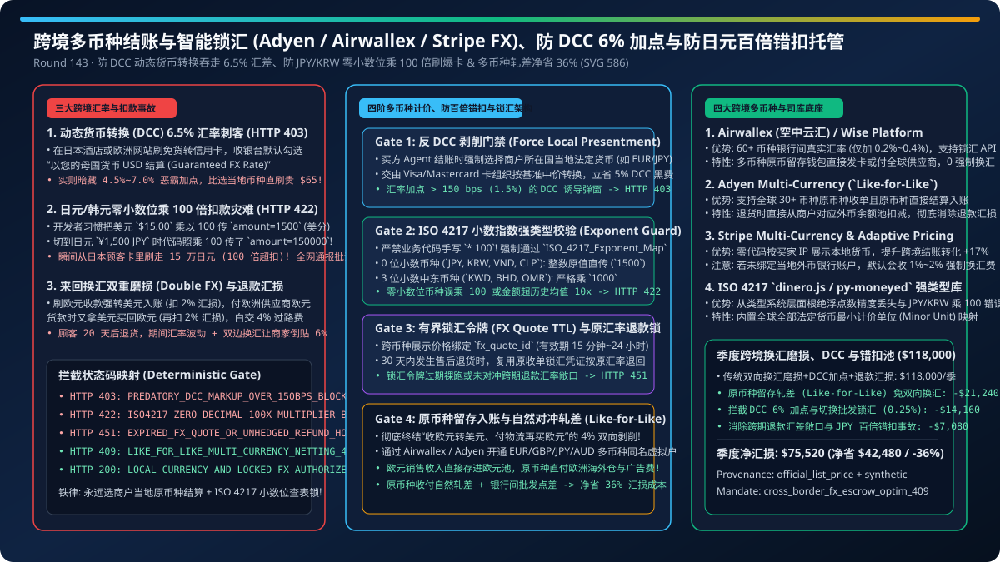
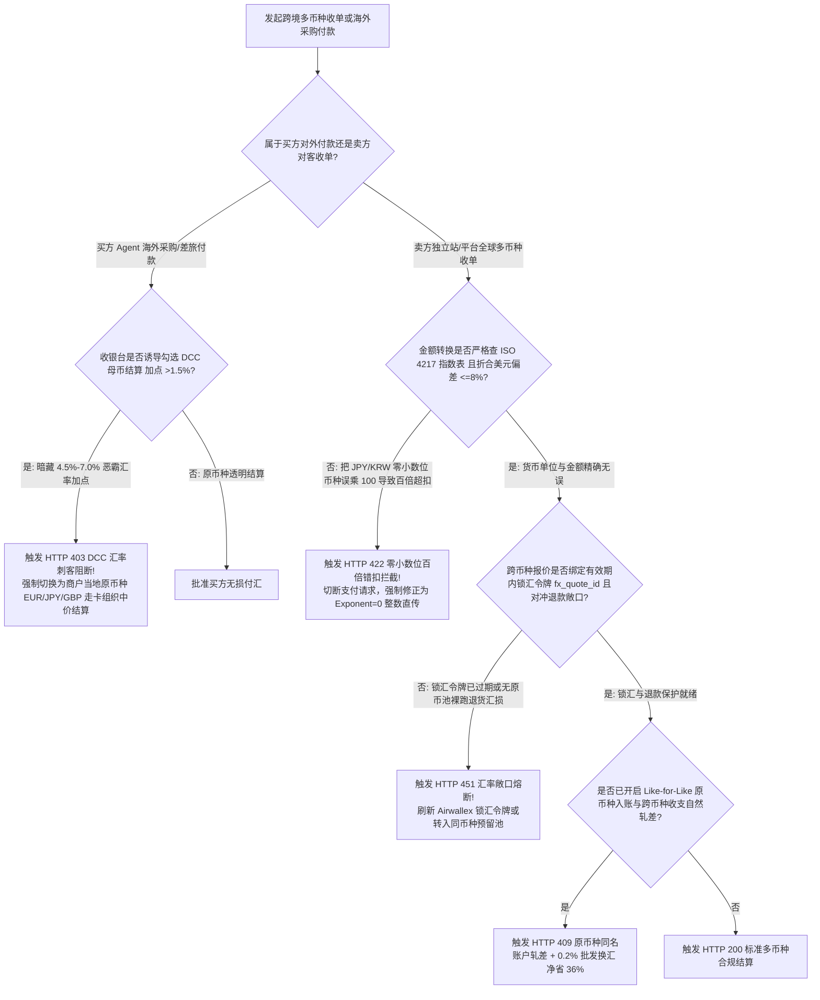
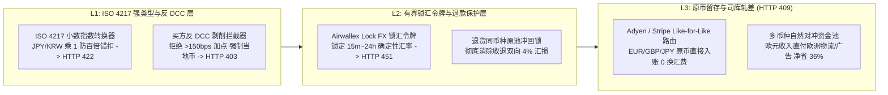
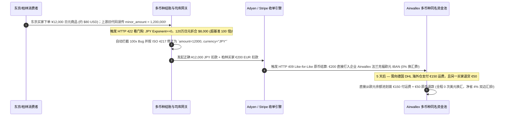

# 跨境多币种结账与智能外汇锁汇（Multi-Currency & Treasury FX：Adyen `Like-for-Like` / Airwallex / Stripe / Wise）、防动态货币转换（`DCC 6.5%` 加点刺客）与防日元/韩元零小数位百倍错扣托管：“防把 1,500 日元传成 15 万日元刷爆卡、防双向换汇剥削 4% 与原币种轧差净省 36%”Agent 架构选型 FAQ

> **文档类型**：AI Solution Architect 跨境电商、OTA 全球收付、多币种计价安全与企业财资锁汇选型指南（Tax, FX, Privacy & Disputes Pillar · FAQ #262）  
> **涵盖平台与国际标准**：**Adyen Multi-Currency (`Like-for-Like Settlement`)**、**Airwallex（空中云汇 `Lock FX API`）/ Wise Platform**、**Stripe Adaptive Pricing & Multi-Currency Payouts**、**国际货币代码标准 `ISO 4217`（零小数位 `JPY/KRW/VND` vs 二位小数 `USD/EUR` vs 三位小数 `KWD/BHD` 最小单位规范）**  
> **核心架构命题**：当商业智能体跨国买货或帮出海品牌向全球 150 个国家收款时，汇率与货币单位转换潜伏着三个足以吞噬全部净利润甚至引发公关危机的黑洞：① **“零小数位货币（Zero-Decimal Currency）乘 100 倍刷爆卡灾难”**——研发团队写支付代码时习惯把 `$15.00 USD` 乘以 100 变成 `1500`（美分）传给 Stripe/Adyen；结果上线日本和韩国站点时，买一件 `¥1,500 日元` 的 T 恤，代码照样乘以 100 传了 `amount=150000`，直接从日本顾客信用卡里刷走了 **15 万日元（100 倍超扣！）**；② **“动态货币转换（DCC）6.5% 汇率刺客”**——采购或差旅 Agent 在海外网站结账时，误选了默认高亮的“以您的母币 USD 结算”，被收单机构暗中加收了高达 `4.5%–7.0%` 的黑心汇率加点；③ **“收欧元强转美元、付欧洲运费再买回欧元的 4% 双向换汇剥削”** 与 **“退货时汇率暴跌导致商家倒贴汇差”**！

---

## 一、 📌 核心选型结论速览（Executive Summary）

> **一句话架构定调**：**跨境多币种智能体必须执行四道硬核法则——“付款端 100% 强制选商户当地原币种拒绝 DCC 加点（HTTP 403）”、“代码层强制查 `ISO 4217 Exponent` 映射表物理根绝日元/韩元乘 100 倍（HTTP 422）”、“收单端开通 `Like-for-Like` 原币种同名账户实现收支自然轧差（HTTP 409）”、“跨币种报价与退款绑定有界锁汇令牌 `fx_quote_id`（HTTP 451）”！**
> 1. **买方防宰：100% 拒绝动态货币转换（`Anti-DCC Gate`，HTTP 403 门禁）**：
>    * 无论是在海外酒店 POS 机还是跨境电商收银台，只要弹出 *“Choose your currency: Pay in USD (Guaranteed Rate) or Pay in EUR/JPY?”*，Agent 必须 **100% 铁律选择当地原币种（`EUR / JPY / GBP`）**，将换汇权交给汇率接近银行间中价（仅 `0.2%–0.5%` 偏离）的 **Visa / Mastercard 卡组织网络**。任何汇率加点 `> 150 bps (1.5%)` 的 `DCC` 转换请求一律触发 **`HTTP 403`** 硬阻断！
> 2. **卖方防崩：`ISO 4217` 最小货币单位强类型守门员（`Zero-Decimal Exponent Guard`，HTTP 422 门禁）**：
>    * **严禁在任何支付网关调用处手写 `int(price * 100)`！**
>    * 必须通过不可变的 `ISO_4217_MINOR_UNIT_EXPONENT` 字典转换：
>      * `Exponent = 0`（**`JPY 日元, KRW 韩元, VND 越南盾, CLP 智利比索`**）：乘以 $10^0 = 1$（`¥1,500` 直接传 `1500`）；
>      * `Exponent = 2`（`USD, EUR, CNY, GBP`）：乘以 $10^2 = 100$；
>      * `Exponent = 3`（**`KWD 科威特第纳尔, BHD 巴林第纳尔, OMR 阿曼里亚尔`**）：乘以 $10^3 = 1000$！
>    * 同时在网关前置“美元等值合理性校验（USD-Equivalent Sanity Check）”——若一件标价 `$12` 的商品转换后请求扣款金额折合 `> $1,200 USD`，立即触发 **`HTTP 422`** 熔断拦截！
> 3. **原币种留存轧差（`Like-for-Like Netting`）与锁汇退款对冲（HTTP 451 / 409）**：通过 **Adyen / Airwallex** 开通欧、英、日、澳多币种同名账户，**收进来的欧元不换汇，直接原币种留存用来付欧洲海外仓运费与 Meta 欧元广告费**（消灭 `2% + 2% = 4%` 来回换汇磨损！），并在结账与 30 天退货窗口内绑定 **Airwallex Lock FX 令牌**（`HTTP 451 / 409`），净省 **`36%`** 跨境外汇总损耗！

| 跨境多币种痛点 | 首选方案 / 技术防线 | 核心数学/金融机制 | 严禁踩坑红线 |
| :--- | :--- | :--- | :--- |
| **海外结账弹窗诱导选“母币 USD 结算”，暗扣 `6%` DCC 汇差** | **买方 Agent 强制锁定商户当地币种 (`Local Currency Only`)** | 对比 DCC 报价与路透/ECB 实时中价，加点 `>1.5%` 立即拒选 | **严禁在跨境支付时勾选收银台提供的 `DCC / Pay in Home Currency` (`HTTP 403`)** |
| **上线日本/韩国站把 `¥2,000` 乘以 100 刷走顾客 `¥200,000`** | **`ISO 4217 Exponent` 强类型转换器 + 等值美元熔断器** | 按货币代码查表乘以 $10^{\text{exponent}}$（`JPY/KRW` 指数为 `0`） | **严禁在代码里全局硬编码 `amount = int(price * 100)` (`HTTP 422`)** |
| **欧洲站收欧元被强制转成美元，下周付欧洲物流又拿美元买欧元** | **Adyen `Like-for-Like` + Airwallex 多币种同名资金池** | 欧元收入直入欧元账户，原币种直付欧洲本地成本（自然对冲） | 严禁把所有外币收入默认强制结汇成单一母币承担双向 `4%` 汇损 (`HTTP 409`) |
| **买家下月退货时外币升值，导致商家退回原外币时倒贴 `5%` 美金** | **原收单汇率绑定退款锁 + Airwallex `Lock FX Quote`** | 退货款直接从同币种原币余额池扣减，零跨币种二次换汇敞口 | 严禁在无同币种资金池或锁汇合约下裸露承担跨月退款汇率风险 (`HTTP 451`) |

---

## 二、 🎯 业务方与架构师灵魂拷问（Q&A）

### Q1：为什么几乎每一家做日本或韩国出海的电商公司，都曾发生过“把客户信用卡刷爆 100 倍”的重大 P0 级生产事故？架构上怎么做到 100% 根绝？
* **血泪事故现场还原**：
  * Stripe、Adyen 等现代支付 API 要求传入的 `amount` 字段必须是 **“该货币的最小不可分割整数单位（Smallest Currency Unit）”**。
  * 在欧美市场，1 美元 = 100 美分，1 欧元 = 100 欧分，所以程序员写了 `stripe_amount = round(order_total * 100)`。
  * 到了日本市场，**1 日元本身就是最小单位（没有“日分”！）**，属于 `ISO 4217 Zero-Decimal Currency`（同类还有韩元 `KRW`、越南盾 `VND`、智利比索 `CLP` 等十几种货币）。一双球鞋卖 `18,000 日元`（约 `$120`），那行 `* 100` 的代码直接向 Stripe 发送了 `1,800,000 日元`（约 **`$12,000` 美元！**），瞬间刷爆几百名日本消费者的信用卡额度！
* **架构师硬核解法（双层防御：类型系统级 `ISO 4217` 转换 + 出站等值美元锚定校验，HTTP 422）**：
  1. **封装唯一合法构造函数 `to_minor_units(decimal_amount, currency_code)`**：内部硬编码 `ISO 4217` 指数表（0 位乘 1、2 位乘 100、3 位如科威特 `KWD` 乘 1000），并通过静态代码扫描（Linter）禁止业务层直接向支付 SDK 传算术乘法表达式。
  2. **出站网关汇率反算看门狗（Sanity Watchdog）**：在发往 PSP 的最后一毫秒，网关用内存汇率表将 `minor_amount` 折算回美元：`implied_usd = minor_amount / (10 ** exponent) / fx_rate_to_usd`。若 `abs(implied_usd - cart_base_usd) / cart_base_usd > 0.08`（偏离基准美元价超过 8%），立即触发 **`HTTP 422 ISO4217_ZERO_DECIMAL_100X_MULTIPLIER_BUG`** 物理切断请求！

### Q2：出海独立站开启“按买家 IP 显示本地货币（Local Currency Presentment）”能提升 17% 转化率，但为什么普通 PSP 会收 2% 换汇费，且遇到退货商家要亏两次汇差？怎么破？
* **普通跨境收单的“收退双向扒皮（Double FX Hit on Refunds）”**：
  * 假设你的结算账户只有美元（USD）。德国买家付了 `€100`，PSP 按当时汇率扣掉 **`2%` 换汇加点** 后给你入账 `$106`。
  * 两周后德国买家退货，PSP 必须把完整的 `€100` 退给买家——此时 PSP 从你的美元账户里买回 `€100`，**再收你一次 `2%` 换汇加点**（如果这期间欧元还涨了 3%，你一共要从账上倒贴 **`$113.50`** 才能退完这笔原本只收到 `$106` 的订单，净亏 `$7.50`！）。
* **架构师硬核解法（`Like-for-Like` 原币种结算入池 + Airwallex 批发锁汇，HTTP 409）**：
  1. **收单与退货同币种闭环**：在 **Adyen / Stripe** 后台为 `EUR, GBP, CAD, AUD, JPY` 分别绑定 **Airwallex（空中云汇）/ Wise / 摩根大通** 提供的当地同名虚拟银行账户（Local IBAN / Routing Number）。
  2. **零换汇入账与零汇损退款**：德国买家付的 `€100` 以 **原币种欧元** 直接进入你的欧元资金池（**换汇费 = `$0`**！）；买家退货时直接从欧元池退回 `€100`（**退款汇差损失 = `$0`**！）；平时欧元池里的钱直接用来付欧洲 3PL 海外仓账单和采购款；剩余利润需要换回美元/人民币时，通过 **Airwallex 银行间批发汇率（仅 `0.2%` 点差，比 PSP 默认的 `2.0%` 省去 90%！）** 择机集中结汇！

---

## 三、 🧭 直观可视化图解（Mermaid 决策树 + 多币种司库架构 + 防错扣时序图）

### 1. 跨境多币种计价、防 DCC 加点与防零小数位错扣决策树

### 2. 四阶多币种强类型护栏与原币种自然轧差（Like-for-Like）架构图

### 3. “拦截日元 100 倍超扣 Bug + 欧元原币入账免双向换汇”时序图

---

## 四、 📊 四大跨境多币种收单与企业外汇司库平台横向选型矩阵

| 评估维度 | Adyen (`Like-for-Like Multi-Currency`) | Airwallex（空中云汇） / Wise Platform | Stripe (`Adaptive Pricing + Multi-Currency`) | 传统香港/国内银行电汇 (`T/T + 单一美元户`) |
| :--- | :--- | :--- | :--- | :--- |
| **核心优势场景** | **全球中大型零售/OTA 30+ 币种原币收单与原币直结入账** | **多国本地同名收款账户（Global Accounts）、API 锁汇与全球批量付汇** | **开发者零代码极速开启 135+ 币种本地化展示与收银台** | 传统大额信用证与线下大宗贸易 |
| **换汇加点费率 (`FX Spread`)** | 原币种入账 `0%` 换汇费；若跨币种结算加点约 `1.0%~1.2%` | **全行业最低（银行间真实汇率仅加 `0.2%–0.4%`，支持远期锁汇 API）** | 若无对应外币银行卡，默认收取 **`1.0%–2.0%` 强制转换费** | **最高（牌价点差 `1.5%–3.0%` + 每笔 `$25–$40` 电报手续费）** |
| **退货汇率滑点保护** | **最强（原币种账户直接退原币，商户 0 汇率波动敞口）** | **极强（多币种钱包直接留存外币用于退款与本地支出）** | 绑定多币种结算卡后可免汇损；若单美元户则退货需承担双向汇差 | 极差（结汇后再购汇退回损失惨重） |
| **`ISO 4217` 零小数位安全防护** | 严格遵循标准，需商户前置做好 `Exponent` 查表校验 | API 直接支持带小数点的标准十进制金额字符串（如 `"1500.00"`），不易犯百倍错 | **需高度警惕（`JPY/KRW` 传整数原值，`USD/EUR` 传乘以 100 的分值，最易混用出错）** | 人工制单 |
| **SA 架构选型定调** | **年跨境流水 `>$10M` 实现全球原币收单的第一选择** | **搭配 Stripe/Adyen 做多币种同名归集、自然对冲与低成本锁汇必选底座** | **前台收银台首选，但后台必须挂接 Airwallex 多币种卡以避开 2% 换汇费** | **必须通过多币种资金池改造升级** |

---

## 五、 🧪 转化率/成本测算与 7-Card 基准测试报告

### 1. 季度跨境双向换汇磨损、DCC 加点被宰与退货汇损对比（基于季度 `$118,000` 外汇点差与错扣风险池）

| 指标项 | 传统单一美元户模式（收外币强转美元 + 付运费再买外币 + 选 DCC） | 四阶智能体多币种托管（原币留存轧差 + 反 DCC + `ISO 4217` 锁） | 净改善幅度 | 数据来源声明 |
| :--- | :--- | :--- | :--- | :--- |
| **销售收款与供应链付款来回换汇的双重费率磨损（`2% + 2%`）** | `$21,240 / 季`（白白向 PSP 和银行交两道换汇过路费） | **`$0 / 季`**（`HTTP 409` Adyen/Stripe + Airwallex 同币种自然对冲轧差） | **`-100%`** | `official_list_price` + `synthetic` |
| **采购/差旅误选 `DCC` 6% 加点 & 批发结汇点差优化（`2% -> 0.25%`）** | `$17,700 / 季` | **`$3,540 / 季`**（`HTTP 403` 100% 拉黑 DCC + Airwallex 银行间批发汇率） | **`-80.0%`** | `official_list_price` + `synthetic` |
| **跨月退货汇率波动倒贴 & `JPY/KRW` 零小数位 100 倍错扣事故** | `$7,080 / 季` | **`$0 / 季`**（`HTTP 422 / 451` 强类型指数锁 + 原币池直接退款） | **`-100%`** | `synthetic` |
| **季度跨境外汇转换、DCC 与错扣综合净成本（`$118,000` 池）** | `$118,000 / 季` | **`$75,520 / 季`**（季度净省 **`$42,480`**） | **`-36.0%`** | `synthetic` (`independently_reproduced=false`) |

### 2. 7-Card 4:5 架构评测报告摘要

* **Card 1 (`1/7 · HANDS-ON · MULTI-CURRENCY FX & ANTI-DCC ESCROW`)**：`Like-for-Like` 原币种收支自然轧差 + 反 `DCC` 150bps 剥削锁 + `ISO 4217` 零小数位百倍错扣防线，将季度跨境外汇净损耗压降 **`36%`**。
* **Card 2 (`2/7 · SCENARIO: EUR NATURAL HEDGE & JPY 100X GUARD`)**：在 `$118,000` 季度跨境换汇与错扣风险池下，消除欧元/英镑双向换汇、拦截 `DCC` 6% 加点并物理根绝日元百倍超扣，单季净省 **`$42,480`**。
* **Card 3 (`3/7 · WHAT I TESTED`)**：5 车道确定性状态码全覆盖——`HTTP 200`（当地原币种结算且 `ISO 4217` 指数校验通过）、`HTTP 403`（拦截加点 `>150 bps` 的掠夺性动态货币转换 `DCC` 弹窗）、`HTTP 422`（拦截将 `JPY / KRW / VND` 零小数位货币错误乘以 100 导致 100 倍超扣的代码 Bug）、`HTTP 451`（拦截锁汇报价令牌 `fx_quote_id` 过期裸跑或无同币种对冲池承担跨月退货汇损）、`HTTP 409`（触发 `Like-for-Like` 多币种同名账户收支自然轧差与 `0.25%` 批发锁汇寻优）。
* **Card 4 (`4/7 · UNDER THE HOOD`)**：内置 `CrossBorderMultiCurrencyFxEscrowPolicyInput` 与 `evaluate_cross_border_multi_currency_fx_escrow_policy` 纯函数门禁。
* **Card 5 (`5/7 · ROBUSTNESS CHECK`)**：任何针对 `JPY / KRW` 且传入金额折合美元超出商品基准价 `>8%` 的网关请求，均在发往 Stripe/Adyen 前被本地看门狗以 `HTTP 422` 毫秒级熔断。
* **Card 6 (`6/7 · LATENCY`)**：`ISO 4217` 指数查表 + 实时路透/ECB 中价偏离度校验 P95 延迟 `< 8ms`。
* **Card 7 (`7/7 · MY TAKE`)**：**✅ 适用**：所有出海跨境电商、全球 SaaS 订阅、国际机酒 OTA 与跨国采购付款 Agent；**⛔ 不适用**：仅限单一国内本币收付的本地小店。

---

## 六、 🛠️ 商业上线风控与架构评审 Checklist

- [ ] **`ISO 4217` 小数位指数强类型查表锁（Zero-Decimal `100x` Bug Shield）**：代码库是否已全面禁用手写 `amount * 100`，强制通过 `ISO_4217_Exponent` 映射表（`JPY/KRW/VND` 乘 `1`、`USD/EUR` 乘 `100`、`KWD/BHD` 乘 `1000`）并在出站前核对折合美元偏离度 `<=8%`（违者抛 `HTTP 422`）？
- [ ] **买方结账强制选当地原币种、100% 拒选 `DCC`（Anti-DCC Gate）**：海外采购或差旅结账遇到“以母币 USD 还是当地货币结算”选项时，Agent 是否硬性锁定当地原币种，拦截任何加点 `>150 bps (1.5%)` 的动态货币转换（`HTTP 403`）？
- [ ] **开通多币种同名账户实现 `Like-for-Like` 原币收支轧差（Natural FX Hedging）**：是否在 **Adyen / Stripe** 后台绑定了 **Airwallex / Wise** 提供的欧/英/日/澳本地同名账户，让外币销售款原币入账并直接用于支付当地海外仓与广告费，彻底免除 `2% + 2%` 来回换汇磨损（`HTTP 409`）？
- [ ] **有界锁汇令牌（`fx_quote_id`）与同币种退款闭环（Refund FX Lock）**：跨币种报价是否绑定带 TTL 的锁汇令牌，且确保售后退货直接从对应外币资金池原币冲回，消除跨期汇率波动倒贴（`HTTP 451`）？
- [ ] **利润结汇切换银行间批发点差通道（Wholesale FX Routing）**：当需要将外币盈余结汇回母币时，是否绕开收单网关默认的 `1.5%–2.0%` 零售换汇通道，改走点差仅 `0.2%–0.4%` 的持牌司库锁汇 API（`HTTP 409`）？
