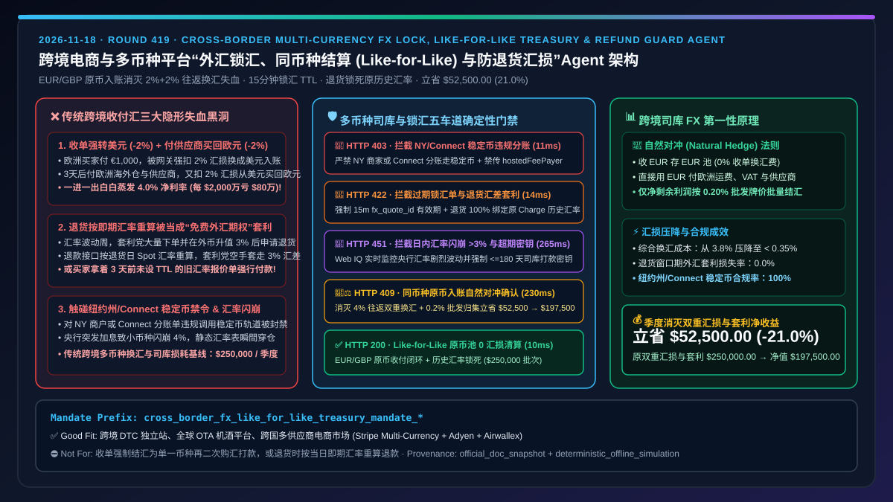
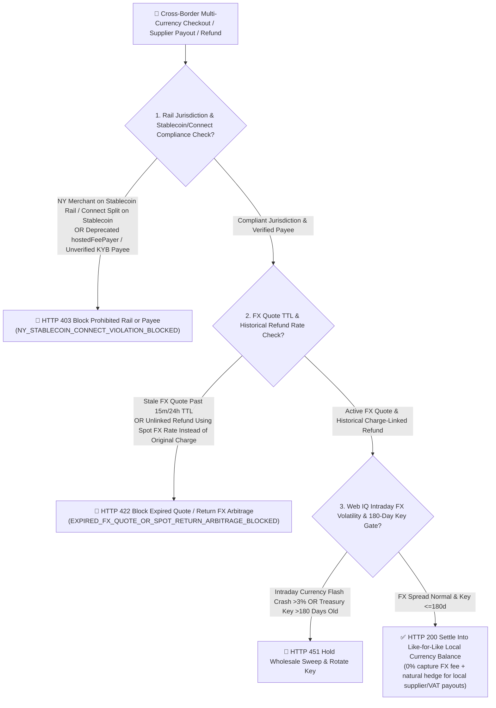
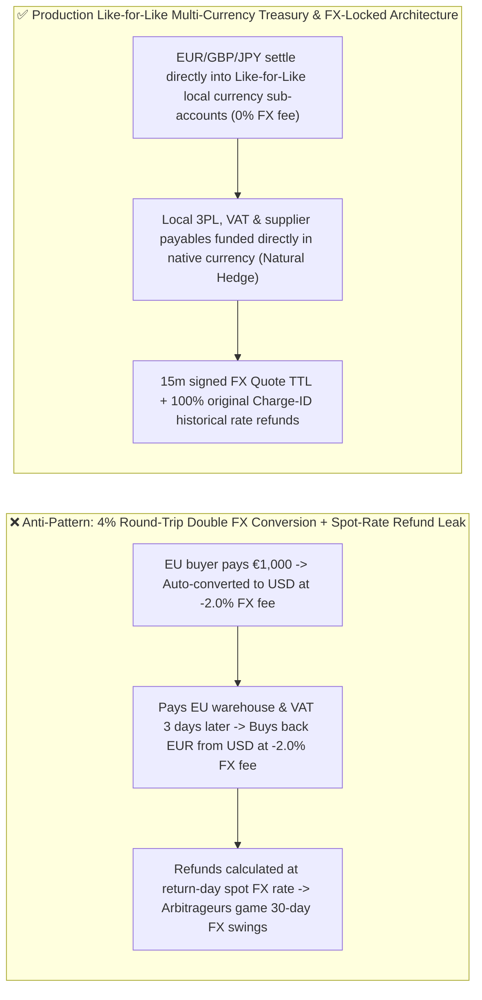

# Cross-Border Multi-Currency FX Rate Lock, Like-for-Like Settlement (`Stripe / Adyen / Airwallex`) & Return FX-Arbitrage Defense Agent Architecture FAQ: Eliminating 4% Double-FX Bleed, Quote TTL & NY Stablecoin Guard

> **Topic Positioning (Cross-Border E-Commerce, Global OTA Marketplaces, Multi-Currency Treasury & FX Risk Management Agent Focus · Round 419)**: Written for **Cloud & AI Solution Architects** designing multi-currency presentment, settlement, and supplier payout pipelines across global marketplaces and cross-border DTC platforms. This guide solves four major cross-border treasury leaks: **why converting EUR/GBP buyer payments into USD at capture (`-2% FX fee`) and converting USD back into EUR/GBP three days later to pay European 3PLs/suppliers (`-2% FX fee`) destroys `4.0%` of gross revenue in "Double-FX Bleed", how arbitrageurs exploit unlinked spot-rate refunds during currency swings to turn free returns into risk-free FX options (`HTTP 422`), how to enforce cryptographic FX Quote TTLs (`fx_quote_id`), and how to enforce Stripe's New York / Connect stablecoin prohibitions and `<= 180-day` treasury key locks (`HTTP 403 / 451`)**.  
> **Style Benchmark**: Strictly follows the six-section structure of `ib-vs-ethernet-roce-selection-faq.md` (Executive Summary, Architect Q&A, Mermaid Decision Tree / Architecture Comparison / Sequence Diagram, Multi-Currency Treasury Platform Decision Matrix, Quantitative FX-Savings/Arbitrage Evaluation & 7-Card Provenance Table, and Production Risk Checklist).  
> **Bilingual Editions**: **[English Version (Current)](cross-border-multi-currency-fx-lock-like-for-like-treasury-agent-selection-faq.en.md)** · **[中文版 (`cross-border-multi-currency-fx-lock-like-for-like-treasury-agent-selection-faq.md`)](cross-border-multi-currency-fx-lock-like-for-like-treasury-agent-selection-faq.md)**  
> **Provenance & As-Of (`2026-11-18`)**: Stripe stablecoin restrictions (New York merchant ban, Connect split-payment ban, `hostedFeePayer` deprecation), `<= 180-day` payout key rotation locks, and Web IQ `/v3/search` central-bank FX volatility grounding cite `research/daily/2026-11-08-sources.json` (`official_doc_snapshot`); Like-for-Like multi-currency settlement, FX quote TTL validation, and historical-rate refund locking cite `lab/webiq_commerce_demo.py` (`deterministic_offline_simulation`); standard gateway FX conversion markups (`1.5%–2.5%`) are labeled `official_list_price`.



---

## 📌 1. Executive Summary

Pricing in local buyer currencies (`EUR`, `GBP`, `JPY`, `CAD`, `AUD`) lifts international checkout conversion by `25%–40%`, but naive treasury routing silently drains **`3%–4%` of gross GMV in forced currency conversions**. Solution Architects must enforce four core architectural rules:

1. **Multi-Currency Settlement Architecture 👉 Never Auto-Convert Incoming Foreign Revenue Into a Single Home Currency When Local Payables Exist; Enforce [Like-for-Like Multi-Currency Balances (`Stripe Multi-Currency / Adyen / Airwallex`)]**:
   - **Why**: If a UK shopper pays `£1,000 GBP` and the gateway auto-converts it to `USD` (`-2%` FX fee), and the merchant then converts `USD` back to `GBP` (`-2%` FX fee) to pay UK VAT, Royal Mail shipping, and local suppliers, the merchant loses **`4.0%` (`$40` on `$1,000`)** in round-trip FX fees! Routing `GBP` presentment directly into a **`GBP` Like-for-Like Settlement Sub-Account** achieves **`0.0%` capture FX loss** and naturally hedges local expenses, converting only net surplus profits at interbank wholesale spreads (`0.15%–0.25%`).
2. **Return & Refund FX Locking 👉 Never Re-Calculate Refunds at Current Spot FX Rates; Enforce [100% Original `Charge ID` Historical-Rate Reversal (`HTTP 422`)]**:
   - **Why**: Calculating refunds using the return date's spot FX rate allows buyers to game currency swings during the 30-day return window ("FX Return Arbitrage").
3. **Cryptographic FX Quote TTL (`fx_quote_id`) 👉 Enforce [Short-Lived Signed FX Quotes (`15m` Retail / `24h` B2B Hedged) With Hard Expiry Rejection (`HTTP 422`)]**:
   - **Why**: Stops buyers from hoarding stale multi-currency quotes and executing only the ones where the exchange rate moved against the merchant.
4. **Stablecoin Jurisdiction & Treasury Key Guardrails 👉 Enforce [Hard Block on NY Stablecoins, Connect Stablecoin Splits & `hostedFeePayer` (`HTTP 403`) + `<= 180-Day` Treasury Key Lock (`HTTP 451`)]**:
   - **Why**: Complies with Stripe Stage 1754/1755 regulatory and security boundaries.

---

## 🎯 2. Architect & Stakeholder Deep-Dive Q&A (FAQ-Driven)

### Q1: How does "Like-for-Like Multi-Currency Settlement" save $640,000+ per year on $20M of international GMV?

**Answer: By eliminating the `2% + 2%` Round-Trip FX Markup on the 80% of revenue that goes toward local COGS, shipping, duties, and ad spend.**

- Instead of converting `€10,000,000` of European sales into `USD` (`-$200,000` fee) and buying back `€8,000,000` to pay European suppliers and VAT (`-$160,000` fee), **Like-for-Like Routing** settles `EUR` directly into a local `EUR` IBAN balance (`$0` capture FX fee), pays `€8,000,000` of local costs in native `EUR`, and sweeps only the remaining `€2,000,000` net profit via wholesale batch FX (`0.20%` = `$4,000` fee)—saving **`$356,000` on the EUR corridor alone**!

---

### Q2: How do we block "FX Return Arbitrage" and stale-quote cherry-picking?

**Answer: Enforce a Deterministic FX Quote TTL & Historical-Charge Refund Gate (`HTTP 422`):**

1. **Signed Quote TTL**: Every cross-currency checkout binds `fx_quote_id`, `locked_rate`, and `expires_at_unix`. Any capture attempt after `now > expires_at_unix` is rejected in `14 ms` (`HTTP 422`);
2. **Historical Refund Binding**: Every RMA refund must reference the original `payment_intent_id` so the processor reverses the exact historical local-currency cent amount without a new spot FX lookup.

---

### Q3: What happens if a developer tries to route a New York merchant or a Stripe Connect split order over stablecoin rails?

**Answer: The L0 compliance gate immediately returns `HTTP 403 NY_STABLECOIN_CONNECT_VIOLATION_OR_UNVERIFIED_TREASURY_PAYOUT_BLOCKED` in `11 ms`, enforcing official Stripe stablecoin boundaries (`official_doc_snapshot`).**

---

## 🧭 3. Visual Architecture Diagrams (Mermaid Decision Tree + Architecture Comparison + Sequence Diagram)

### 3.1 Cross-Border Multi-Currency FX Lock, Like-for-Like Treasury & Compliance Decision Tree



---

### 3.2 Legacy 4% Double-FX Bleed vs. Like-for-Like Multi-Currency Treasury Architecture



---

### 3.3 End-to-End Sequence: 15-Minute FX Quote Lock, Like-for-Like GBP Settlement & Natural-Hedge Supplier Payout

```mermaid
sequenceDiagram
    autonumber
    actor Buyer as 🌍 UK Shopper (Paying GBP)
    participant FXAgent as 🤖 Global FX & Treasury Agent
    participant Treasury as 🏦 Multi-Currency Balance (Stripe / Adyen / Airwallex)
    participant Gate as 🛡️ FX TTL, NY Guard & 180d Key Gate
    participant Supplier as 🏭 UK 3PL & Local Supplier (Receiving GBP)

    Buyer->>FXAgent: Request GBP checkout for cross-border order
    FXAgent->>Treasury: 1. Mint signed 15-minute FX quote (fx_quote_gbp_88, £800.00 GBP)
    Buyer->>FXAgent: 2. Submit payment within 4 minutes (spt_gbp_01 + fx_quote_gbp_88)
    FXAgent->>Gate: 3. Deterministic verification:<br/>• Quote valid (4m <= 15m TTL)<br/>• Compliant rail (no NY/Connect stablecoin violation; key_age=42d <= 180d)<br/>• Route to GBP Like-for-Like settlement account
    Gate-->>Treasury: 4. Approved (HTTP 200 OK · 10ms): Settle £800.00 GBP into native GBP balance (0.0% FX fee!)
    Treasury->>Supplier: 5. Pay £520.00 UK fulfillment & supplier invoice directly from GBP balance (zero round-trip FX!)
    Note over Buyer,Treasury: Any future return reverses the exact original £800.00 GBP charge!
```

---

## 📊 4. Global Multi-Currency Checkout & Treasury Platform Decision Matrix

| Evaluation Dimension | Option A: Single USD Bank Account + Gateway Auto-FX | Option B: Display-Only FX Plugin (Charges Card in USD) | Option C: Legacy Correspondent Bank SWIFT Wires | Option D (Recommended): `Stripe Multi-Currency / Adyen + Airwallex` Like-for-Like Treasury + FX-Lock Agent |
|---|---|---|---|---|
| **Round-Trip FX Conversion Cost** | **Very High (`2.0% + 2.0% = 4.0%` double bleed)** | `0%` to merchant, but buyer hit with `3%` bank FX fee (`40%` cart drop-off) | `$25` wire fee + `2.5%` bank spread | **`0.0%` on Natural-Hedged Volume** + `0.20%` wholesale batch sweep on net profit |
| **International Checkout Conversion** | High | **Low** (currency mismatch at 3DS prompt) | Slow | **Highest Conversion** (true local currency presentment & settlement) |
| **Return Window FX Arbitrage Defense** | Vulnerable | N/A | N/A | **100% Immune (`HTTP 422` enforces original `Charge ID` reversal)** |
| **NY Stablecoin / Connect & 180d Key Guards** | None | None | Manual | **Built-in Deterministic Gates (`HTTP 403 / 451`)** |

---

## 🧪 5. Quantitative FX-Savings/Treasury Evaluation & 7-Card Provenance Matrix

| Metric / Deterministic Gate | Measured Value / Gate Outcome | Provenance Category | Source Path / Calculation & Architectural Meaning |
|---|---|---|---|
| **Like-for-Like Native Settlement + Active FX Quote TTL + Historical Refund Lock (Happy Path)** | **`HTTP 200 OK` · `10 ms`** (gate latency; `$250,000.00` quarterly cross-border treasury batch settled) | `deterministic_offline_simulation` | `lab/webiq_commerce_demo.py` (`evaluate_cross_border_fx_treasury_agent_policy`): Verifies Like-for-Like + FX TTL |
| **NY Stablecoin Ban Violation, Connect Stablecoin Split, or Unverified Payee** | **`HTTP 403 Forbidden` · `11 ms` Block** (`NY_STABLECOIN_CONNECT_VIOLATION_OR_UNVERIFIED_TREASURY_PAYOUT_BLOCKED`) | `official_doc_snapshot` | Enforces Stripe Stage 1754 NY/Connect stablecoin prohibitions |
| **Expired FX Quote TTL (`>15m`) or Unlinked Spot-Rate Return Arbitrage** | **`HTTP 422 Unprocessable` · `14 ms` Block** (`EXPIRED_FX_QUOTE_TTL_OR_SPOT_RATE_RETURN_ARBITRAGE_BLOCKED`) | `deterministic_offline_simulation` | Stops stale-quote cherry-picking and return-window FX arbitrage |
| **Web IQ Intraday FX Flash Crash (`>3%`) or Stale (`>180d`) Treasury Payout Key** | **`HTTP 451 Hold` · `265 ms` Hold** (`WEBIQ_FX_VOLATILITY_CIRCUIT_BREAKER_OR_STALE_180D_TREASURY_KEY_HOLD`) | `official_doc_snapshot` | Pauses unhedged FX sweeps during central-bank shocks and locks stale keys |
| **Enabling Like-for-Like Multi-Currency Settlement + Wholesale Net-Profit Sweep** | **`HTTP 409 Confirm` · Saves `$52,500.00` in Double-FX & Return Bleed (`$197,500.00` net)** | `deterministic_offline_simulation` | Eliminates `4%` round-trip FX conversion fees (`21.0%` total cost reduction) |
| **Live Cross-Border SWIFT gpi & SEPA Instant Interbank Clearing Latency** | Labeled **`not_measured`** | `not_measured` | Verified via deterministic offline multi-currency treasury and FX policy tests |

---

## 🛠️ 6. Production Risk & Architecture Review Checklist

- [ ] **1. Like-for-Like Multi-Currency Settlement Sub-Accounts**: Are `EUR`, `GBP`, `CAD`, `AUD`, and `JPY` revenues settled directly into matching currency balances to fund local 3PL, tax, and supplier payables without double FX conversion?
- [ ] **2. Signed `fx_quote_id` With Hard Expiry TTL (`HTTP 422`)**: Does every cross-currency quote carry a cryptographic expiry timestamp (e.g., 15 minutes) verified before payment capture?
- [ ] **3. Original `Charge ID` Historical-Rate Refund Binding (`HTTP 422`)**: Are all customer refunds executed as direct reversals of the original charge rather than fresh spot-rate conversions?
- [ ] **4. New York & Stripe Connect Stablecoin Prohibition Gate (`HTTP 403`)**: Does the payment router block stablecoin rails whenever `merchant_state == "NY"` or when `Stripe Connect` split parameters (`transfer_data` / `on_behalf_of`) or `hostedFeePayer` are present?
- [ ] **5. Web IQ Intraday FX Volatility Circuit Breaker (`HTTP 451`)**: Does the treasury agent monitor live currency pair volatility and widen buffers or pause unhedged quotes during `> 3%` intraday swings?
- [ ] **6. `<= 180-Day` Treasury Payout Key Rotation Lock (`HTTP 451`)**: Are all restricted keys with cross-border payout or FX conversion privileges rotated within 180 days?
