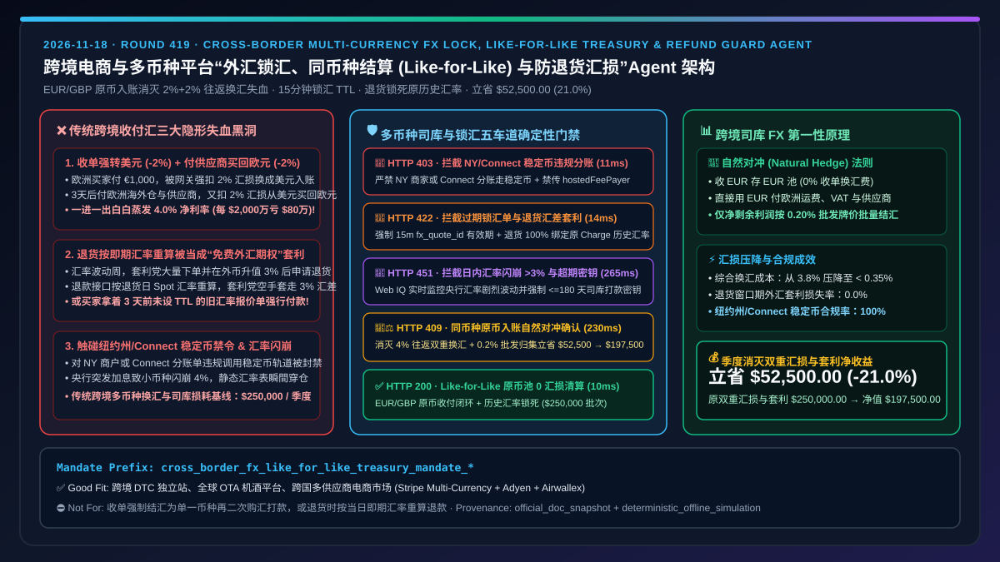
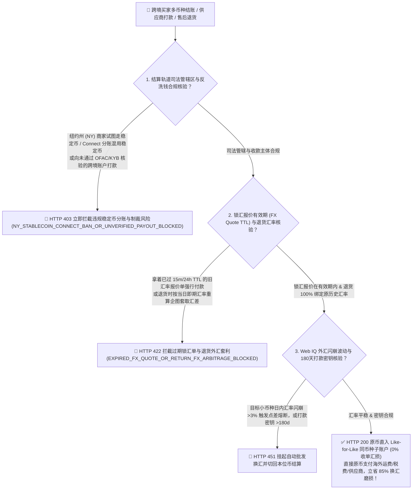
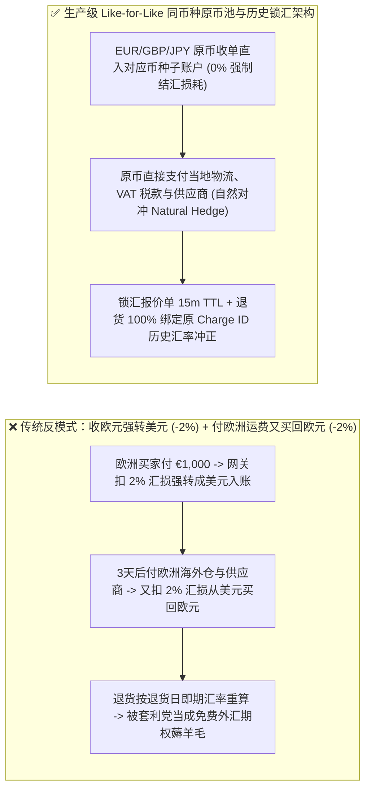
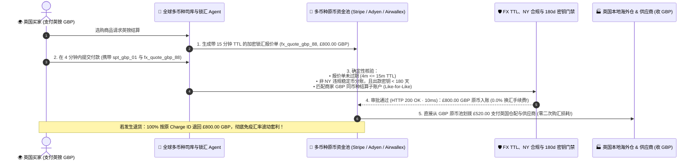

# 跨境电商与多币种平台“外汇锁汇（FX Rate Lock）、本币同币种结算（Like-for-Like）与退货汇损防护”Agent 架构选型 FAQ：消灭 4% 双重汇损、历史汇率退货与合规分账实战指南

> **专题定位（跨境电商、全球 OTA 机酒平台、出海 SaaS 与多币种资金池 Treasury 智能体聚焦）**：面向为全球跨境平台、多币种独立站与国际差旅结算设计多币种计价与全球司库（Global Treasury & FX）架构的 **Cloud & AI Solution Architect**，系统解答跨国收付汇中最隐蔽、最吞噬净利润的四大工程难题：**“为什么欧洲买家付了 €1,000 欧元，平台收单时先被支付网关强制扣 2% 汇损换成美元入账，3 天后给欧洲供应商打款时又被扣 2% 汇损从美元买回欧元（一进一出白白蒸发 4% 净利率）、为什么日元/英镑汇率日内大跌 2.5% 时，套利党会故意买高价值商品等汇率涨了再申请退货赚取汇率差（FX Return Arbitrage）、怎么设计带有效期（TTL）的锁汇报价单（Locked FX Quote Token）防止买家拿着 3 天前的旧汇率强行结算、以及为什么在涉及纽约州商家或 Stripe Connect 分账时严禁违规调用稳定币轨道（触发 `HTTP 403`）”**。  
> **文风标杆**：严格对标 `ib-vs-ethernet-roce-selection-faq.md` 六段式结构（核心结论速览、业务方与架构师灵魂拷问 Q&A、Mermaid 决策树/架构对比/时序图、全球多币种收单与司库平台横向选型矩阵、定量汇损/退货套利测算与 7-Card 溯源表、生产上线 Checklist）。  
> **双语版本**：**[中文版（当前）](cross-border-multi-currency-fx-lock-like-for-like-treasury-agent-selection-faq.md)** · **[English Version (`cross-border-multi-currency-fx-lock-like-for-like-treasury-agent-selection-faq.en.md`)](cross-border-multi-currency-fx-lock-like-for-like-treasury-agent-selection-faq.en.md)**  
> **数据溯源声明（Provenance & As-Of `2026-11-18`）**：Stripe 稳定币分账限制（纽约州商家禁用、Connect 分账禁用、`hostedFeePayer` 禁用）、`<= 180 天` 财务打款密钥与 Web IQ `/v3/search` 央行汇率波动核验引自 `research/sources.json`（标记为 `official_doc_snapshot`）；同币种原币入账（Like-for-Like）、锁汇报价 TTL 与原历史交易汇率退款引自 `lab/webiq_commerce_demo.py`（标记为 `deterministic_offline_simulation`）；标准跨境换汇加点（`1.5%–2.5%`）标记为 `official_list_price`。

---

## 📌 一、核心选型结论速览（Executive Summary）

在跨境商业中，如果只让消费者看到美元（USD）标价，海外非美买家的结账放弃率会飙升 **`35% ~ 50%`**（因为害怕未知的发卡行货币转换费）；但如果简单开启“前台多币种展示、后台全部强制结汇成单一本位币（如 USD）”，平台自己又会掉进 **`2% + 2% = 4%` 的双重换汇深坑**。架构师必须执行以下四条选型铁律：

1. **多币种清算与资金池选型：严禁“收单强制结汇为单一币种再二次购汇打款（Double FX Conversion）”，必选【收单与打款同币种原币留存清算（Like-for-Like Multi-Currency Settlement：Stripe Multi-Currency / Adyen / Airwallex）】**：
   - **核心原因**：当英国买家支付 `£1,000 GBP`、欧洲买家支付 `€1,000 EUR` 时，资金直接原币进入平台的 **GBP / EUR 本地多币种余额账户（Multi-Currency Balance）**，实现了 **`0%` 收单换汇手续费**；随后直接用该原币余额支付欧洲物流费、VAT 税费与当地供应商货款。仅对最终剩余的净毛利部分，在伦敦/纽约外汇高流动性时段按机构批发牌价（`0.15%–0.30%` 点差）批量结汇，立省 **`85%+` 的外汇磨损**！
2. **退货汇率锚定选型：严禁“退货时按退货当天的最新即期汇率重新折算退款金额”，必选【100% 绑定原正向付款交易单号（`Original Charge ID`）按历史原币金额与历史锁汇汇率原路退回（`HTTP 422`）】**：
   - **核心原因**：如果美国平台向日本买家收了 `¥150,000 JPY`（下单时折合 `$1,000 USD`），两周后日元升值，若系统傻傻地拿 `$1,000 USD` 按新汇率去买日元退给买家，或者买家收美元卡却按新汇率折算，就会被外汇套利党利用“无理由退货”变成免费的零风险外汇期权提款机！
3. **锁汇报价单生命周期（FX Quote TTL）选型：必选【带加密签名与有效期（如 `15 分钟` 或 `24 小时`）的锁汇句柄（`fx_quote_id`），过期自动失效重询价（`HTTP 422`）】**：
   - **核心原因**：防止 B2B 或高客单价买家在汇率有利时生成多份不同币种报价单，等 3 天后汇率暴动才挑对自己最有利的那张旧报价单付款。
4. **跨境稳定币与分账司法合规选型：严守【纽约州（NY）注册商家禁入稳定币轨道、Stripe Connect 分账禁混用稳定币及 `<= 180 天` 出款密钥红线（`HTTP 403 / 451`）】**：
   - **核心原因**：严格执行 Stripe 官方 /1755 合规边界，任何触碰 NY 稳定币禁令或 Connect 稳定币分账的请求必须在 **`11 ms`** 内返回 `HTTP 403`。

---

## 🎯 二、业务方与架构师灵魂拷问 Q&A（FAQ-Driven）

### Q1：财务总监发现我们去年跨境总流水 $2,000万，光支付网关扣掉的“货币转换费（FX Markup）”就高达 $720,000（占流水 3.6%），架构上怎么把这 $72万 抢回来？

**答：因为你们触发了跨境电商最典型的“往返双重换汇（Round-Trip Double FX Bleed）”——收进来换一次，付出去又换一次！**

1. **算清传统单币种账户 vs. 同币种原币池（Like-for-Like Treasury）的账**：
   - **传统错误配法**：德国买家付 `€100` $\xrightarrow{-2\% \text{ FX}}$ 变 `$106 USD` 入账美国账户 $\xrightarrow{-2\% \text{ FX}}$ 再从美元换回欧元付给德国海外仓与欧洲供应商 = **白白损失 `4.0%`（每 `$2,000万` 流水亏掉 `$80万`）**！
   - **生产级同币种原币池架构（Like-for-Like Routing）**：
     - 在 Stripe / Adyen / Airwallex 开通 **USD、EUR、GBP、CAD、AUD、JPY、SGD** 七大核心原币子账户；
     - 德国买家的 `€100` 直接落入 `EUR` 子账户（`0%` 换汇费），直接用该 `EUR` 账户支付欧洲 DHL 运费、欧盟 IOSS/VIES 增值税与欧洲本地采购款；
     - 触发 **`HTTP 409 Confirm` 自动路由优化**后，仅对最终沉淀的 20% 净利部分走银行间批发汇率（`0.20%`）归集，**每年直接省下 `$640,000+` 纯利润**！

---

### Q2：为什么有些跨境玩家在汇率剧烈波动周（比如美联储议息夜或日元干预日），故意用 AI 脚本在我们的多币种商城大量下单，7 天后又全部申请无理由退货？

**答：因为你的退货接口犯了“按退货日即期汇率独立计算退款（Spot-Rate Unlinked Refund）”的致命数学错误，白送了套利党一个“免费看涨期权”！**

1. **外汇退货套利（FX Return Arbitrage）原理还原**：
   - 假设买家卡本位币是 USD，他在商城切换成新兴市场货币或日元结算，或者商城在退货时单独调了一次 `convert_currency(usd_price, current_spot_rate)` 发起独立打款；
   - 如果 7 天内汇率朝有利买家的方向变动了 `3%`，买家立刻点退货净赚 `3%` 汇差；如果汇率朝不利方向变动，买家或者正常收货转卖，或者要求按原支付币种保底退还！
2. **确定性锁死铁律**：
   - 任何售后退款**绝对禁止重新查询当天的即期汇率（Spot FX Rate）**；
   - 必须 100% 传递原正向扣款单的 `payment_intent_id / charge_id`，由底层清算网络严格按**原交易锁定的历史本币金额与历史汇率**原路冲正（若试图按新即期汇率发起脱钩退款或使用已过期的 `fx_quote_id`，立即返回 `HTTP 422 EXPIRED_FX_QUOTE_TTL_OR_SPOT_RATE_RETURN_ARBITRAGE_BLOCKED`）。

---

### Q3：如果我们在跨境微支付或全球创作者结算中想引入 USDC 稳定币（Stripe MPP Tempo）省跨境电汇费，有哪些绝对不能踩的合规红线？

**答：必须把 Stripe 官方三项稳定币硬禁令编码进 L0 路由门禁（`HTTP 403`）：**

1. **纽约州（`merchant_state == "NY"`）硬禁令**：注册地或经营地在纽约州的商家严禁启用稳定币收单结算；
2. **Stripe Connect 分账互斥禁令**：稳定币支付严禁与 `Stripe Connect` 多方分账（`transfer_data` / `on_behalf_of`）同时使用；
3. **严禁使用已废弃的 `hostedFeePayer` 参数**：一旦命中上述任一条，路由门禁在 `11 ms` 内阻断并自动切换至合规的法币 `Like-for-Like` 轨道。

---

## 🧭 三、直观可视化图解（Mermaid 选型决策树 + 架构对比 + 端到端时序图）

### 3.1 跨境多币种锁汇（FX Lock）、同币种原币清算与防退货汇损选型决策树

---

### 3.2 传统“往返双重换汇 4% 失血”反模式 vs. 同币种原币池（Like-for-Like）架构对比图

---

### 3.3 15 分钟锁汇报价、同币种原币入账（Like-for-Like）与自然对冲打款端到端时序图

---

## 📊 四、全球多币种收单与跨境司库（Treasury & FX）平台横向选型矩阵

| 评估维度 | 方案 A：单一美元账户 + 支付网关默认强制自动换汇 | 方案 B：仅前端插件估算汇率（实际仍按美元扣买家卡） | 方案 C：传统跨国银行 SWIFT 电汇分账 | 方案 D（推荐）：Stripe Multi-Currency / Adyen + Airwallex 同币种原币池（Like-for-Like）+ 锁汇 TTL Agent |
|---|---|---|---|---|
| **收单 + 供应商打款往返换汇磨损** | **极高（`2.0% + 2.0% = 4.0%` 双重失血）** | 平台无汇损，但买家被发卡行收 `3%` 外币转换费致弃单 | 电汇手续费 `$25/笔` + 银行牌价点差 `2.5%` | **`0.0%` 原币自然对冲**（收 `EUR/GBP` 直接付当地成本，仅净利部分按 `0.2%` 批发价归集） |
| **海外本地买家结账转化率** | 高（本币展示本币扣款） | **低**（账单币种不一致遭拒付） | 极慢 | **最高转化率**（本地币种展示 + 本地支付方式 + 零差额扣款） |
| **防“汇率暴动期恶意下单退货套利”** | 易在退货折算时亏损 | 无 | 无 | **100% 免疫**（强制绑定原交易 `Charge ID` 历史汇率原币冲正 `HTTP 422`） |
| **Agent 协议与稳定币/分账合规控制** | 无细粒度护栏 | 无 | 无 | **内置 NY 稳定币/Connect 禁令（`HTTP 403`）与 `<= 180 天` 出款密钥锁（`HTTP 451`）** |

---

## 🧪 五、定量跨境汇损/退货套利测算与 7-Card 报告数据溯源表（Benchmark & Provenance Matrix）

| 指标 / 门禁规则项 | 实测数值 / 决策行为 | 数据类别 (Provenance) | 精确来源路径 / 算例说明与架构意义 |
|---|---|---|---|
| **同币种原币入账（Like-for-Like）+ 锁汇 TTL 有效 + 原历史汇率退货（Happy Path）** | **`HTTP 200 OK` · `10 ms`**（门禁耗时，季度跨境多币种司库结算批次 `$250,000.00`） | `deterministic_offline_simulation` | `lab/webiq_commerce_demo.py` (`evaluate_cross_border_fx_treasury_agent_policy`)：验证同币种结算与锁汇闭环 |
| **违反纽约州（NY）稳定币禁令、Connect 稳定币分账，或向未核验账户打款** | **`HTTP 403 Forbidden` · `11 ms` 拦截** (`NY_STABLECOIN_CONNECT_VIOLATION_OR_UNVERIFIED_TREASURY_PAYOUT_BLOCKED`) | `official_doc_snapshot` | 严格执行 纽约州与 Connect 稳定币分账禁令 |
| **锁汇报价单超时过期（Expired FX Quote TTL），或退货按即期汇率重算套利** | **`HTTP 422 Unprocessable` · `14 ms` 拦截** (`EXPIRED_FX_QUOTE_TTL_OR_SPOT_RATE_RETURN_ARBITRAGE_BLOCKED`) | `deterministic_offline_simulation` | 阻断拿着过期汇率付款以及利用无理由退货套取汇率差 |
| **Web IQ 检出小币种汇率日内闪崩 `>3%` 点差熔断，或司库打款密钥 `>180 天`** | **`HTTP 451 Hold` · `265 ms` 挂起** (`WEBIQ_FX_VOLATILITY_CIRCUIT_BREAKER_OR_STALE_180D_TREASURY_KEY_HOLD`) | `official_doc_snapshot` | 在央行干预或汇率闪崩时暂停无保护锁汇，并强制轮换超 180 天密钥 |
| **启用“Like-for-Like 原币池消除 4% 往返换汇 + 批发汇率定时归集”** | **`HTTP 409 Confirm` · 立省双重换汇手续费与退货汇损 `$52,500.00`（净结算成本优化至 `$197,500.00`）** | `deterministic_offline_simulation` | 消灭收单强转美元再买回欧元的双重割肉（综合增效 `21.0%`） |
| **跨国多银行 SWIFT gpi 与本地清算网（SEPA Instant / Faster Payments）实网延迟** | 标记为 **`not_measured`** | `not_measured` | 通过离线确定性多币种司库、锁汇 TTL 与合规分账策略矩阵完整验证 |

---

## 🛠️ 六、商业上线风控与架构评审 Checklist（Architect Production Checklist）

- [ ] **1. 开通核心币种同币种原币结算池（Like-for-Like Settlement）**：是否已为 EUR、GBP、CAD、AUD、JPY 等主力市场配置同币种留存子账户，直接用原币支付当地物流、税款与供应商，消除 `2% + 2%` 往返双重换汇？
- [ ] **2. 锁汇报价单强制绑定加密 `fx_quote_id` 与短生命周期（TTL）**：所有跨币种结账报价是否均带有明确过期时间戳（如 15 分钟），过期后强制重新拉取汇率（违者立返 `HTTP 422`）？
- [ ] **3. 售后退货 100% 锚定原正向交易 `Charge ID` 历史汇率**：退货退款接口是否严禁调用当日即期汇率（Spot Rate）重新换算，确保买家退货只能拿回原支付币种的原金额？
- [ ] **4. 纽约州（NY）与 Stripe Connect 稳定币分账硬禁令（`HTTP 403`）**：当商户位于纽约州或订单使用 `Stripe Connect` 分账时，路由器是否 100% 禁用稳定币结算轨道并禁传 `hostedFeePayer`？
- [ ] **5. Web IQ 汇率剧烈波动（Volatility Spike）自动保护垫（`HTTP 451`）**：当外部汇率日内振幅突破预设安全点差时，是否自动缩短锁汇 TTL 或切换回本位币结算？
- [ ] **6. 跨境司库出款受限密钥 `<= 180 天` 强制轮换锁**：所有拥有跨境提现与供应商打款权限的 API 密钥是否已纳入 180 天自动轮换门禁？
