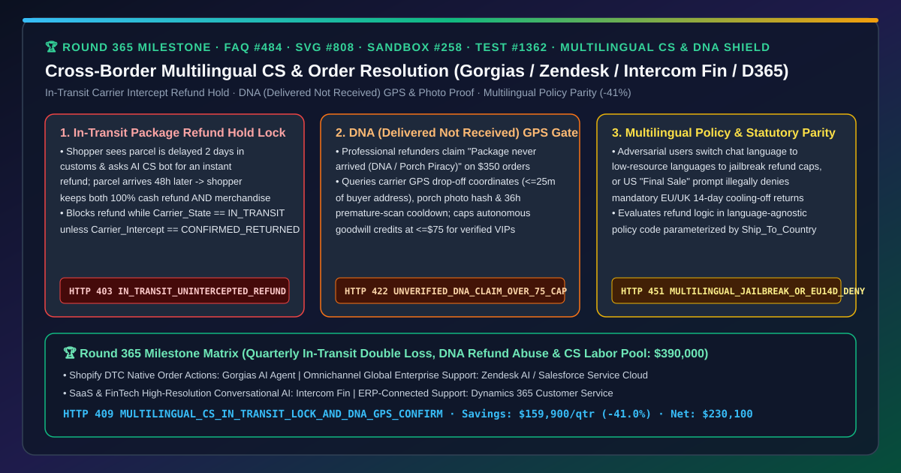
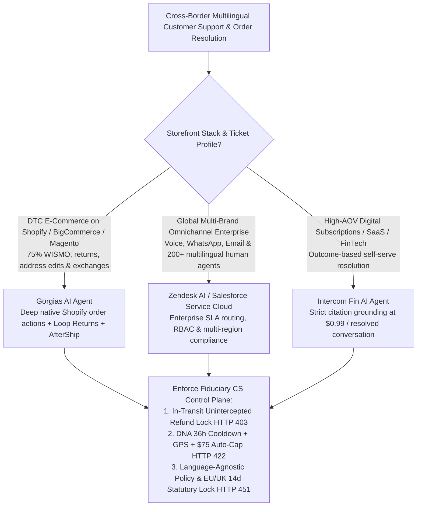
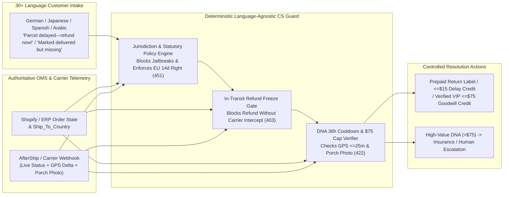

# 🏆 Cross-Border Multilingual Customer Support & Autonomous Order Resolution (`Gorgias AI / Zendesk AI / Intercom Fin / Salesforce Service Cloud / D365` · 🏆 Round 365 Milestone): In-Transit Carrier-Intercept Refund Locks, `DNA (Delivered Not Received)` `36h` GPS/Photo Verification & Statutory `EU/UK 14-Day` Return Parity (`-41%` Cost)

> **Document Type**: Enterprise AI Solution Architect Selection FAQ (`#484` · **🏆 Round 365 Milestone**)  
> **Target Audience**: Cross-Border DTC VP of Customer Experience (CX), Global Post-Purchase Architects, E-Commerce Fraud Leaders, and Cloud & AI Solution Architects  
> **Platforms Covered**: `Gorgias AI Agent` vs. `Zendesk AI` vs. `Intercom Fin AI Agent` vs. `Salesforce Service Cloud (Agentforce Service)` vs. `Microsoft Dynamics 365 Customer Service`  
> **Architecture Diagram**: [`assets/svg/808-cross-border-multilingual-cs-gorgias-zendesk-intercom-dna-2026-11-25.svg`](../assets/svg/808-cross-border-multilingual-cs-gorgias-zendesk-intercom-dna-2026-11-25.svg)

🌐 **Language / 语言切换**: **[中文 (`cross-border-multilingual-cs-gorgias-zendesk-intercom-fin-dna-gps-in-transit-refund-lock-selection-faq.md`)](cross-border-multilingual-cs-gorgias-zendesk-intercom-fin-dna-gps-in-transit-refund-lock-selection-faq.md)** | **English (Current)**

---

## 📌 1. Executive Summary

In cross-border e-commerce serving 30+ languages across North America, Europe, APAC, and LATAM, over 70% of incoming support tickets revolve around **`WISMO` (Where Is My Order), `DNA` (Delivered Not Received), address edits, cancellations, and returns**.  
Giving a multilingual LLM customer-support agent direct write access to `Shopify / Stripe Refund APIs` without deterministic **carrier-state gates, GPS delivery verification, and jurisdiction-aware statutory policy code** creates three severe post-purchase loss vectors:
1. **Refunding Packages That Are Still `IN_TRANSIT` Without a Confirmed Carrier Intercept (`Double Loss: Buyer Keeps Cash + Goods`)**: When an international parcel is delayed 48 hours in customs, an unguarded AI agent appeases an angry buyer by issuing an immediate `100%` refund—only for the carrier to deliver the physical package two days later, resulting in a total loss of both cash and inventory.
2. **Rubber-Stamping Fraudulent `"Delivered Not Received (DNA)"` Claims (`Porch-Piracy / Refund-Ring Abuse`)**: Organized refunding rings claim `$350` orders marked `DELIVERED` never arrived. Without enforcing a **`36-hour` premature-scan cooldown**, checking carrier **GPS drop-off coordinates (`<= 25m`) and porch photos**, and capping autonomous goodwill refunds at **`<= $75`**, AI bots get social-engineered into draining merchant cash.
3. **Low-Resource Language Jailbreaks & Illegally Denying Mandatory `EU / UK 14-Day` Statutory Cooling-Off Rights (`Multilingual Policy Drift`)**: Adversarial users switch into lower-resource languages to bypass prompt-based refund caps; conversely, US-trained prompts apply `"Final Sale - No Returns"` rules to German or UK shoppers—violating the mandatory **14-day cooling-off right under `EU Directive 2011/83/EU`**.

| Support Ecosystem & Scale | Recommended Primary Choice | Architectural Boundary & Production Rule |
|---|---|---|
| **Cross-Border DTC Storefronts (`Shopify / BigCommerce / Magento`)** | **Gorgias AI Agent** | Purpose-built for e-commerce with deep native actions across Shopify order edits, Loop Returns, and AfterShip/17TRACK carrier telemetry. |
| **Global Multi-Brand Omnichannel Support (`Email + WhatsApp + Voice + Social`)** | **Zendesk AI / Salesforce Service Cloud** | Ideal for enterprise operations with hundreds of multilingual human escalations, regional SLA routing, and strict audit trails. |
| **High-Resolution Conversational AI for Digital Commerce, SaaS & FinTech** | **Intercom Fin AI Agent** | Industry-leading citation-grounded resolution engine priced per resolved conversation (`$0.99 / resolution`). |
| **Three Mandatory Fiduciary Guardrails** | **100% Deterministic Gating** | ① **In-Transit Unintercepted Refund Lock (`HTTP 403`)**: Blocks full refunds while `Carrier_State == IN_TRANSIT` unless `Carrier_Intercept == CONFIRMED_RETURNED` or the parcel exceeds the `10-day` lost-in-transit inactivity window; ② **`DNA` `36h` Cooldown, GPS Check & `$75` Auto-Cap (`HTTP 422`)**: Holds `DNA` claims for `36h` post-delivery scan, verifies carrier GPS (`<=25m`) + photo proof, and caps autonomous goodwill refunds at `<= $75`; ③ **Language-Agnostic Policy Code & `EU/UK 14d` Statutory Lock (`HTTP 451`)**: Executes refund eligibility in deterministic backend code parameterized by `Ship_To_Country`. |



---

## 🎯 2. Architect & Business Stakeholder Q&A (Q1–Q3)

### Q1: Why must an AI support agent never issue a full refund while a package's tracking status is `IN_TRANSIT` or `IN_CUSTOMS`?
- **The Irreversibility of Cross-Border Parcels**:
  - Once a parcel leaves the origin fulfillment center, cross-border postal and consolidated air-freight carriers **cannot stop delivery mid-stream** (and even domestic `UPS / FedEx Delivery Intercept` fails if the package is already on the local delivery van).
  - Issuing a refund while the parcel is still moving guarantees that the shopper receives the physical product 2–4 days later with zero mechanism to re-charge their card.
- **Architectural Solution**: Enforce an **In-Transit Refund Freeze & Lost-in-Transit Timer (`HTTP 403` Guard)**:
  - While `Carrier_State IN ('IN_TRANSIT', 'IN_CUSTOMS', 'OUT_FOR_DELIVERY')` and `Days_Since_Last_Scan < 10`: hard-disable the `issue_full_refund` tool (`HTTP 403 IN_TRANSIT_PACKAGE_REFUND_WITHOUT_CONFIRMED_CARRIER_INTERCEPT`) unless a synchronous carrier API confirms `INTERCEPT_SUCCEEDED_RETURNING_TO_SENDER`.
  - Allow the agent to issue a `$5–$15` delay-apology store credit and instruct the buyer to refuse delivery or use a prepaid return label once delivered.

### Q2: How do we handle "Delivered Not Received (`DNA`)" claims without alienating honest VIPs or getting drained by refund fraud rings?
- **Two Operational Realities**:
  1. **Carrier Premature Delivery Scans**: Last-mile drivers frequently scan remaining parcels as `DELIVERED` on Friday evening to meet route quotas and physically drop them off on Saturday or Monday (`36-hour` lag).
  2. **GPS & Photo Telemetry**: Modern carrier webhooks (`FedEx / UPS / DHL / Royal Mail / OnTrac`) attach the driver's handheld **GPS coordinates (`lat/long` within `<=25m` of the recipient's porch)** and a **high-resolution delivery photo**.
- **Architectural Solution**: Enforce a **`36-Hour` Cooldown + GPS/Photo Verification + `$75` Autonomous Cap (`HTTP 422` Guard)**:
  - Reject immediate DNA refunds within `< 36 hours` of the `DELIVERED` timestamp.
  - After `36 hours`, verify `Customer_Lifetime_DNA_Claims == 0`. Even for eligible claims, cap autonomous AI refunds/reshipments at **`<= $75.00`**; orders above `$75` or where carrier GPS (`<=25m`) + porch photo confirm valid drop-off are blocked from auto-refund (`HTTP 422 UNVERIFIED_DNA_CLAIM_OR_EXCEEDED_75_AUTO_REFUND_CAP`) and routed to shipping-protection insurance (`Route / Corso / Seel`) or signed affidavit escalation.

### Q3: How do we prevent multilingual prompt-injection jailbreaks while respecting mandatory `EU / UK 14-Day` statutory return rights?
- **The Dual Multilingual Risk**:
  1. **Cross-Lingual Safety Degradation**: Attackers switch into low-resource languages or mixed scripts to trick the LLM into ignoring prompt-level refund rules.
  2. **Statutory Consumer Law Conflict**: A US store policy stating *"Clearance items (>30% off) are Final Sale and non-refundable"* is **illegal in the EU (`Directive 2011/83/EU`) and UK (`Consumer Contracts Regulations`)**, where online shoppers have an unwaivable **14-day statutory right to return discounted non-perishable goods for a full refund**.
- **Architectural Solution**: Decouple **Multilingual NLU Translation from a Deterministic Jurisdiction-Aware Policy Engine (`HTTP 451` Guard)**:
  - The LLM translates any language into a typed intent (`Request_Return(order_id, sku)`), while deterministic backend code evaluates `Ship_To_Country` (`EU/UK -> 14d statutory override enabled`) and enforces invariant dollar caps—preventing `HTTP 451 MULTILINGUAL_PROMPT_JAILBREAK_OR_EU_14D_COOLING_OFF_DENIAL`.

---

## 🧭 3. Visual Architecture Diagrams (Mermaid Decision Tree + Architecture + Sequence)

### 3.1 Cross-Border Multilingual CS Platform Selection Tree



### 3.2 End-to-End Multilingual Intent Decoupling, In-Transit Lock & `DNA` GPS Architecture



### 3.3 In-Transit Refund Freeze & `DNA` GPS Verification Sequence

```mermaid
sequenceDiagram
    autonumber
    participant Buyer as Shopper (Paris, France / California, US)
    participant CS as Multilingual CS Agent (Gorgias / Zendesk)
    participant Guard as Fiduciary CS Policy Engine
    participant Carrier as DHL / FedEx / AfterShip API

    Buyer->>CS: Send French message: "My €220 coat is stuck in customs—refund me immediately!"
    CS->>Guard: Evaluate structured action: Action=FULL_REFUND, Order=ORD-551
    Guard->>Carrier: Query live tracking state & carrier intercept status
    Carrier-->>Guard: State = IN_TRANSIT (Cleared CDG Airport hub, out for delivery tomorrow, intercept unavailable)
    Guard-->>CS: Block premature in-transit refund (prevents HTTP 403)! Issue €10 delay credit & confirm EU 14-day return right upon delivery (prevents HTTP 451)
    Note over Buyer,Carrier: Next day parcel scans DELIVERED; 2 hours later buyer claims "Delivered Not Received (DNA)" for €220
    Buyer->>CS: Submit DNA claim
    CS->>Guard: Evaluate DNA auto-refund eligibility
    Guard->>Carrier: Check elapsed time (2h < 36h cooldown), GPS drop-off delta (8m <= 25m) & value (€220 > $75 auto-cap)
    Guard-->>CS: Block autonomous refund (prevents HTTP 422)! Present carrier porch photo, enforce 36h wait & route >$75 claim to protection workflow
```

---

## 📊 4. Platform Comparison Matrix (`Gorgias AI` vs. `Zendesk AI` vs. `Intercom Fin` vs. `Salesforce Service Cloud` vs. `D365`)

| Evaluation Dimension | Gorgias AI Agent | Zendesk AI | Intercom Fin AI Agent | Salesforce Service Cloud (Agentforce) | Dynamics 365 Customer Service |
|---|---|---|---|---|---|
| **Primary Sweet Spot** | **DTC e-commerce (`Shopify / Magento`) order-action automation** | Global multi-brand omnichannel support operations | High-resolution conversational AI for SaaS, FinTech & digital retail | Enterprise CRM-unified sales, marketing & service clouds | ERP-integrated manufacturing, B2B & omnichannel retail service |
| **Native Storefront Order Actions (Edit/Cancel/Return)** | ⭐⭐⭐⭐⭐ (Out-of-the-box Shopify, Loop Returns & Recharge actions) | ⭐⭐⭐⭐ (Via Shopify app & custom webhook actions) | ⭐⭐⭐⭐ (Via custom HTTP tool actions) | ⭐⭐⭐⭐⭐ (Native Salesforce Order Management integration) | ⭐⭐⭐⭐⭐ (Direct native `D365 F&O` order & inventory actions) |
| **30+ Language Auto-Translation & Single-KB Grounding** | ⭐⭐⭐⭐⭐ (Answers in 30+ languages from a single English Help Center) | ⭐⭐⭐⭐⭐ (Enterprise multilingual routing & translation) | ⭐⭐⭐⭐⭐ (Zero-hallucination multilingual synthesis) | ⭐⭐⭐⭐⭐ (Global multi-language enterprise scale) | ⭐⭐⭐⭐⭐ (Native Azure AI Translator + Copilot) |
| **Deterministic Refund Caps & Carrier State Guardrails** | ⭐⭐⭐⭐ (Action conditions & dollar thresholds) | ⭐⭐⭐⭐ (Trigger workflows & role restrictions) | ⭐⭐⭐⭐ (Deterministic Fin workflow branches) | ⭐⭐⭐⭐⭐ (Granular Apex/Flow approval gates) | ⭐⭐⭐⭐⭐ (Dataverse business rules & security roles) |
| **Indicative Pricing (`official_list_price`)** | Ticket tier + **`~$0.90–$1.00 / AI-resolved ticket`** | `$55–$115/seat/mo` + automated resolution add-on | `$29+/seat/mo` + **`$0.99 / resolved conversation`** | `$150–$500/user/mo` enterprise edition | `$50–$95/user/mo` + Copilot add-on |

---

## 🧪 5. Deterministic Fraud & Support Cost Evaluation (`7-Card Benchmark Summary` · 🏆 Round 365)

> **Provenance**: Figures below are generated by `evaluate_cross_border_multilingual_cs_dna_refund_policy` in `lab/webiq_commerce_demo.py` (`provenance: "synthetic"`, `independently_reproduced: False`), modeling a cross-border DTC brand with a **`$390,000.00` quarterly unintercepted in-transit refund loss, fraudulent `DNA` claim payout, and multilingual support/compliance penalty pool**.

| Scenario Case ID | Scenario Description | HTTP Status | Deterministic Decision | Quarterly Net Cost | Quarterly Savings |
|---|---|---|---|---|---|
| `CASE-CS-200` | Manual multilingual agent ticket handling baseline | `HTTP 200` | `VERIFIED_MULTILINGUAL_CS_ORDER_RESOLUTION_AUTHORIZED` | `$390,000.00` | `$0.00` |
| `CASE-CS-403` | Full refund issued while package is `IN_TRANSIT` without confirmed carrier intercept | `HTTP 403` | `IN_TRANSIT_PACKAGE_REFUND_WITHOUT_CONFIRMED_CARRIER_INTERCEPT` | `$390,000.00` | `$0.00` (Blocks cash+goods double loss) |
| `CASE-CS-422` | `DNA` claim auto-refunded within `<36h` of scan, over `$75` cap, or despite `<25m` GPS + photo proof | `HTTP 422` | `UNVERIFIED_DNA_CLAIM_OR_EXCEEDED_75_AUTO_REFUND_CAP` | `$390,000.00` | `$0.00` (Blocks DNA refunding rings) |
| `CASE-CS-451` | Low-resource language jailbreak bypasses cap or `EU/UK 14-day` statutory return right denied | `HTTP 451` | `MULTILINGUAL_PROMPT_JAILBREAK_OR_EU_14D_COOLING_OFF_DENIAL` | `$390,000.00` | `$0.00` (Blocks jailbreak & EU fine) |
| `CASE-CS-409` | **In-Transit Refund Lock + `DNA 36h/GPS/$75` Gate + Statutory `EU/UK 14d` Engine** | `HTTP 409` | `MULTILINGUAL_CS_IN_TRANSIT_LOCK_AND_DNA_GPS_CONFIRM` | **`$230,100.00`** | **`$159,900.00` (`-41.0%`)** |

---

## 🛠️ 6. Production Go-Live & Architecture Review Checklist

- [ ] **In-Transit Refund Lock (`HTTP 403` Prevention)**: Hard-disable full refunds whenever `Carrier_State == IN_TRANSIT / OUT_FOR_DELIVERY` unless the carrier API confirms a successful return intercept or the parcel has had zero tracking scans for `>= 10–14 days`.
- [ ] **`DNA` `36-Hour` Cooldown, GPS Verification & `$75` Cap (`HTTP 422` Prevention)**: Require a `36-hour` buffer after a `DELIVERED` scan before accepting `DNA` claims, verify carrier GPS drop-off distance (`<= 25m`) and porch photos, and cap autonomous AI goodwill refunds at `<= $75`.
- [ ] **Language-Agnostic Policy Engine & `EU / UK 14-Day` Statutory Override (`HTTP 451` Prevention)**: Evaluate all refund/return rules in deterministic backend code keyed by `Ship_To_Country`, automatically honoring mandatory 14-day cooling-off returns for EU and UK consumers even on discounted items.
- [ ] **Synchronous WMS Wave-Lock Before Address Edits or Cancellations**: Require a confirmed `WMS_HOLD_ACQUIRED` response before telling a customer their shipping address change or cancellation succeeded.
