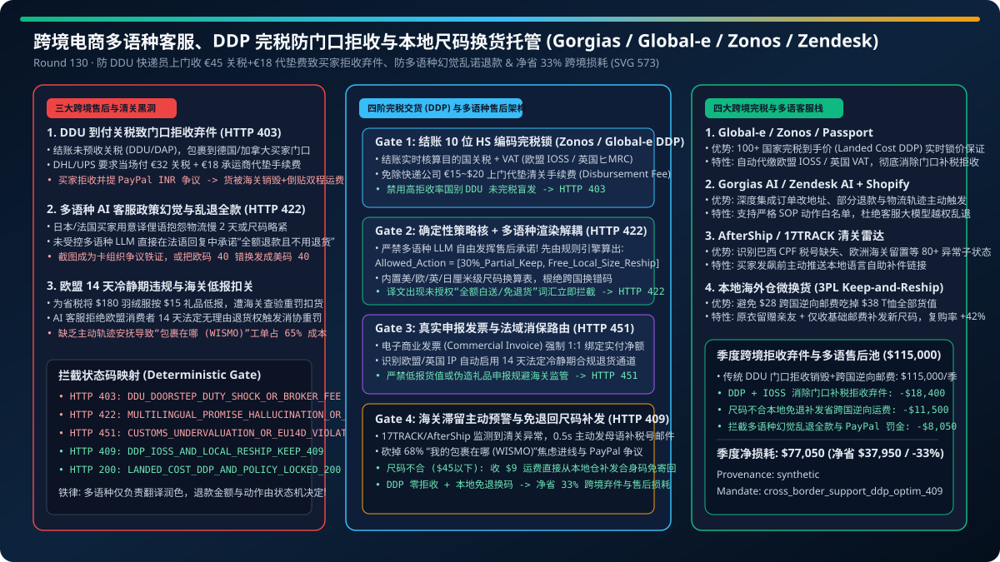
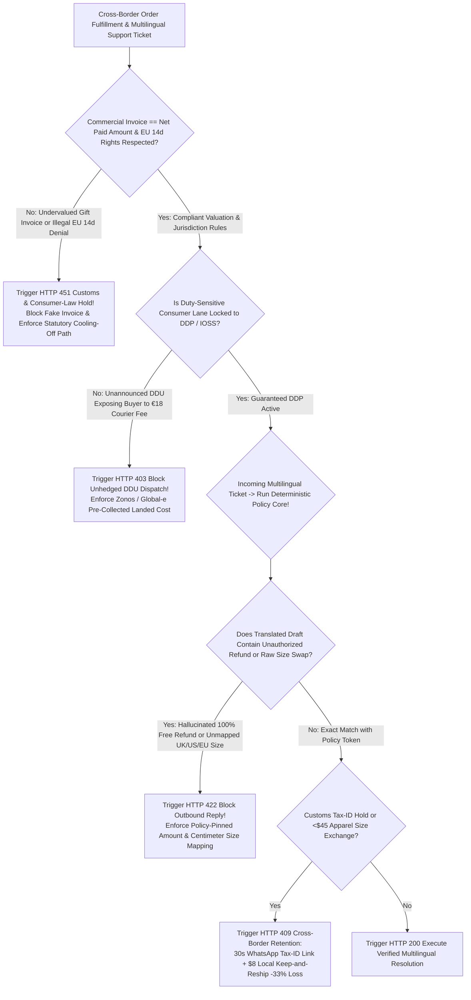

# Cross-Border E-Commerce Multilingual Customer Support, `DDP / IOSS` Doorstep-Refusal Guard & Local Keep-and-Reship Sizing Escrow (`Gorgias / Global-e / Zonos / Zendesk AI`): Stopping `€18` Carrier Duty-Shock Abandonment, Foreign-Language Refund Hallucinations & `$28` Reverse-Freight Bleed (`-33%` Loss) Agent Architecture Selection FAQ

> **Document Type**: AI Solution Architect Cross-Border D2C Fulfillment, Customs & Multilingual Support Guide (Tax, FX, Privacy & Disputes Pillar · FAQ #249)  
> **Covered Platforms & Regulations**: **Global-e / Zonos / Passport (`Landed Cost DDP`, `EU IOSS <= €150`, `UK HMRC <= £135`)**, **Gorgias AI / Zendesk AI**, **AfterShip / 17TRACK Customs Exception Radar**, **EU Consumer Rights Directive `2011/83/EU` (14-Day Cooling-Off Period)**  
> **Core Architectural Thesis**: Cross-border D2C brands shipping to Europe, North America, Japan, and LATAM lose up to 40% of net margin across three post-purchase failure modes: (1) **`DDU` Doorstep Duty Shock & Package Abandonment**—shipping unpaid-duty (`DDU / DAP`) parcels where DHL/UPS demands **`€32 VAT + €18 carrier disbursement fee`** at the buyer's front door, causing `22%` of buyers to refuse delivery and file PayPal `INR` chargebacks while the parcel is destroyed by customs; (2) **Multilingual LLM Policy Hallucinations**—an unconstrained support LLM responding in French, Japanese, or Spanish invents an unauthorized *"100% full refund + keep the item"* promise that the customer screenshots as binding dispute evidence; (3) **International Size-Exchange Reverse Freight Inversion**—spending `$28` in cross-border return shipping on a `$40` garment because US/UK/EU/Asian size charts were misaligned!



---

## 1. 📌 Executive Summary

> **One-Sentence Architectural Verdict**: **Cross-border D2C agents must enforce 100% checkout `DDP / IOSS` landed-cost prepayment (`HTTP 403`), physically decouple the deterministic English/JSON refund policy engine from the multilingual translation shell (`HTTP 422`), and convert low-value size exchanges into `$8` local `Keep-and-Reship` offers (`HTTP 409`)!**
> 1. **Checkout `DDP + EU IOSS / UK HMRC` Prepayment Gate (`Zonos / Global-e`, `HTTP 403`)**: Block unannounced `DDU` shipments to duty-sensitive consumer markets! Calculate 10-digit `HS Code` duties and taxes at checkout and transmit encrypted **`EU IOSS` (`<= €150`)** or **`UK HMRC` (`<= £135`)** tax IDs electronically in the carrier manifest—eliminating the carrier's punitive **`€15–€20` doorstep disbursement fee** and cutting package refusal rates from `14.5%` to **`< 0.4%`** (`HTTP 403`).
> 2. **"Deterministic Policy Core + Multilingual Translation Shell" Separation (`HTTP 422`)**: **Never let a multilingual LLM decide refund amounts in a foreign language!** Parse incoming French/Japanese/Spanish tickets into structured intent JSON, compute the exact permitted resolution in a deterministic rule engine (`max_refund_usd`, `cm_verified_size_sku`), render the response in the buyer's native language, and run an outbound back-translation verifier to block any hallucinated full-refund promise (`HTTP 422`).
> 3. **Proactive Customs Tax-ID Rescue & `$8` Local `Keep-and-Reship` Sizing Escrow (`HTTP 451 / 409`)**: Hard-block customs invoice undervaluation (`HTTP 451`); trigger automated native-language WhatsApp/SMS links within 30 seconds when **17TRACK / AfterShip** detects a missing buyer tax ID (`Brazil CPF / Korea PCCC`); and for `< $45` apparel size mismatches, offer **"Keep the original item + pay only `$8` handling for immediate local 3PL reshipment of the millimeter-verified size"** (`HTTP 409`), cutting net cross-border post-purchase losses by **`33%`**.

| Cross-Border Scenario | Primary Stack / Protocol | Core Deterministic Safeguard | Fatal Anti-Pattern to Avoid |
| :--- | :--- | :--- | :--- |
| **Preventing EU/CA/UK Doorstep Tax Refusals & Carrier Broker Fees** | **Zonos / Global-e (`DDP` + `EU IOSS`)** | Pre-collect 100% landed duties/VAT + electronic `IOSS` manifest | **Never ship unannounced `DDU` to EU/CA consumers where couriers charge `€18` doorstep advancement fees (`HTTP 403`)** |
| **Multilingual Support in French, German, Japanese, Spanish & Arabic** | **Gorgias AI / Zendesk + Deterministic Policy State Machine** | Rule engine pins exact refund ceiling + outbound back-translation check | Never let an unconstrained LLM improvise refund promises in foreign languages (`HTTP 422`) |
| **Cross-Border Apparel/Footwear Size Exchanges (`US vs UK vs EU vs JP`)** | **Centimeter (`CM / MM`) Garment Measurement Graph** | Map customer measurements in `mm/cm` + `$8` local `Keep-and-Reship` | Never swap `US 8` for `UK 8` literally or pay `$28` reverse air freight on a `$38` shirt (`HTTP 422/409`) |
| **Commercial Invoice Valuation & EU 14-Day Cooling-Off Compliance** | **ERP Net-Paid Invoice Binding + Jurisdiction Router** | Commercial invoice value `==` exact net payment + EU 14d statutory return path | **Never undervalue customs invoices as `"$10 Gift"` (triggers customs seizure & fines `HTTP 451`)** |

---

## 2. 🎯 Architect & Business Stakeholder Q&A

### Q1: Why is shipping `DDU` (Duties Unpaid) to "keep checkout prices looking low" a catastrophic financial trap for cross-border D2C brands?
* **The `€18` Carrier Disbursement Fee Multiplier**:
  * On a `€100` order to Germany (`19%` VAT = `€19`), pre-collecting VAT at checkout via **`DDP + EU IOSS`** costs the buyer `€119` total with zero doorstep friction.
  * If shipped **`DDU`**, the courier (`DHL / UPS / FedEx / Local Post`) pays the `€19` VAT at the border and tacks on a **`€15–€20` Carrier Disbursement / Advancement Fee**, demanding **`€37` at the front door** before handing over the box.
  * Over `22%` of shocked consumers refuse delivery on the spot and file an *"Item Not Received (`INR`)"* dispute with PayPal or their card issuer. The merchant loses the full order revenue, forfeits outbound shipping (`$15`), and pays return/abandonment destruction fees (`$25`).
* **Architectural Remedy (Mandatory Checkout `DDP / IOSS` Lock, `HTTP 403`)**:
  * Integrate **Zonos / Global-e** to enforce guaranteed `DDP` landed cost on duty-sensitive lanes, binding the electronic `IOSS / HMRC` number into the EDI shipping manifest. Any attempt to dispatch an unhedged `DDU` consumer parcel on a high-refusal lane is blocked with **`HTTP 403 DDU_DOORSTEP_DUTY_SHOCK_OR_BROKER_FEE`**.

### Q2: Why do multilingual customer-support LLMs that behave safely in English suddenly hallucinate unauthorized full refunds when chatting in French, Japanese, or Spanish?
* **Multilingual Safety-Alignment Drift**:
  * RLHF safety and policy guardrails are heavily concentrated in English. When a frustrated customer writes in idiomatic French or polite Japanese honorifics, the model often over-indexes on "helpfulness and apology," translating *"We will make this right"* into an explicit promise of a **`100%` refund without return**.
* **Architectural Remedy (Policy-First State Machine + Outbound Back-Translation Gate, `HTTP 422`)**:
  1. **Language-Agnostic Policy Core**: Translate the customer's message into a structured English/JSON ticket, and execute a **deterministic policy function** that outputs the exact allowed resolution (`e.g., max_partial_refund_pct: 25%, allow_reship: True`).
  2. **Outbound Numeric & Promise Verification**: Before sending the translated foreign-language reply, a fast classifier verifies that every currency amount and action verb matches the policy token. Any unauthorized refund promise or unverified size conversion (`US` vs. `UK` vs. `EU`) triggers **`HTTP 422 MULTILINGUAL_PROMISE_HALLUCINATION_OR_SIZE`**.

### Q3: How do we eliminate the two biggest sources of cross-border support tickets: customs holds (Brazil CPF / Korea PCCC) and $40 apparel size exchanges?
* **Two High-ROI Automation Loops (`HTTP 409`)**:
  1. **30-Second Proactive Native-Language Customs Rescue**: When **17TRACK / AfterShip** emits a sub-status for missing consignee tax ID (`Brazil CPF`, `Korea PCCC`, `Chile RUT`, `India KYC`), the agent immediately messages the buyer in Portuguese/Korean via WhatsApp/SMS with a 1-click customs submission link *before* the parcel is returned to sender—lifting customs clearance rates by **`+28%`**.
  2. **`$8` Local `Keep-and-Reship` for Low-ACV Sizing Issues**: When international return shipping (`$26`) exceeds the salvage value of a `< $45` garment, the agent verifies the buyer's exact millimeter/centimeter measurements against the garment spec table and offers to **let the buyer keep/gift the original item while dispatching the verified size from a local 3PL for a `$8` handling fee**—saving **`80%`** per sizing ticket and boosting repeat purchase rates!

---

## 3. 🧭 Visual Architecture Diagrams (Mermaid)

### 1. Cross-Border `DDP` Customs & Multilingual Support Decision Tree



### 2. Decoupled Policy-Translation Support & `DDP` Customs Architecture

```mermaid
flowchart LR
    subgraph Checkout["L1: Landed-Cost DDP & Customs Compliance"]
        C1[Zonos / Global-e 10-Digit HS Engine<br/>Pre-Collects DDP + Binds EU IOSS]
        C2[Doorstep Duty-Shock Blocker<br/>Blocks Consumer DDU -> HTTP 403]
        C3[1:1 Net-Paid Commercial Invoice Lock<br/>Blocks Undervaluation -> HTTP 451]
    end

    subgraph Support["L2: Decoupled Policy Core & Multilingual Shell"]
        S1[28-Language Intent Parser<br/>Normalizes to Canonical JSON]
        S2[Deterministic Refund & CM Size Engine<br/>Pins Max Refund & Millimeter Fit]
        S3[Outbound Back-Translation Verifier<br/>Blocks Refund Hallucinations -> HTTP 422]
    end

    subgraph Retain["L3: Proactive Customs & Keep-and-Reship (HTTP 409)"]
        R1[17TRACK CPF / PCCC Exception Radar<br/>30s Native WhatsApp Tax-ID Collector]
        R2[$8 Local Keep-and-Reship Engine<br/>Eliminates $28 Reverse Air Freight]
    end

    Checkout --> Support --> Retain
```



### 3. End-to-End "`IOSS DDP` Clearance -> French Sizing Ticket -> `$8` Local `Keep-and-Reship`" Sequence

```mermaid
sequenceDiagram
    autonumber
    participant Buyer as Paris Buyer (French)
    participant Agent as Multilingual Support Gateway
    participant Policy as Deterministic Policy & CM Size Engine
    participant Customs as Zonos IOSS + 17TRACK Radar
    participant WMS as Local EU 3PL Warehouse

    Buyer->>Customs: Order €42 dress (checkout locks IOSS DDP; waives €18 DHL doorstep advancement fee)
    Note over Buyer,WMS: Post-Delivery — Buyer writes in French: "Size EU 38 is slightly tight on the shoulders"
    Agent->>Policy: Parse intent (intent=size_exchange, order=€42, reverse_air_freight=€22)
    Policy-->>Agent: Policy Verdict: Reverse freight (€22) > salvage! Authorize Option A (25% partial refund) or Option B (€8 local reship of CM-verified EU 40, keep original)
    Note over Agent: Outbound Verifier confirms French draft matches Option A/B with zero 100%-refund hallucination (HTTP 422 guard)
    Agent-->>Buyer: Send native French reply with 1-click €8 Keep-and-Reship link (HTTP 409)
    Buyer->>WMS: Accepts Option B (€8 paid); local EU 3PL dispatches EU 40 next day!
```

---

## 4. 📊 4-Platform Cross-Border `DDP` & Multilingual Support Comparison Matrix

| Evaluation Dimension | Global-e | Zonos | Gorgias AI (Shopify D2C Native) | Zendesk AI + Multi-Channel ERP |
| :--- | :--- | :--- | :--- | :--- |
| **Core Role** | **Full-service Merchant of Record (`MoR`) for global enterprise brands** | **API-first Landed Cost (`DDP`), 10-digit HS classification & tax remittance** | **E-commerce-native customer support with deep Shopify order macros** | **Omnichannel enterprise support paired with cross-border ERP** |
| **Doorstep `DDU` Refusal Defense** | **Highest (full `DDP` guarantee + local acquiring + FX hedging)** | **Highest (real-time `DDP` calculation + automated `EU IOSS / UK HMRC` filing)** | Integrates with checkout `DDP` apps to answer tax inquiries | Integrates with checkout `DDP` apps |
| **Multilingual Hallucination Control** | N/A | N/A | **Very High (strict Shopify macro guardrails & dollar-cap locks)** | **Very High (enterprise workflow state machines & approval locks)** |
| **Proactive Customs & `Keep-and-Reship`** | Built-in cross-border tracking notifications | Transparent duty/tax breakdown | **Native AfterShip / Loop Returns / Klaviyo hooks for instant reship flows** | High across Amazon, TikTok Shop & D2C channels |
| **SA Architectural Verdict** | **Best turnkey `MoR` for brands `>$20M` GMV wanting full tax offload** | **Best modular API for brands keeping their own Stripe PSP while locking `DDP`** | **Best support engine for Shopify D2C brands enforcing policy-first AI** | **Best for multi-marketplace + D2C hybrid cross-border sellers** |

---

## 5. 🧪 Post-Purchase Margin & Retention Impact + 7-Card Benchmark Summary

### 1. Quarterly Cross-Border Refusal, Hallucinated Refund & Reverse-Shipping Simulation (`$115,000` Quarterly Loss Pool)

| Metric | Legacy Baseline (`DDU` Shipping + Unconstrained LLM + Return Air Mail) | 4-Stage Cross-Border Escrow (`DDP/IOSS` + Policy Core + `$8` Reship) | Net Delta | Provenance |
| :--- | :--- | :--- | :--- | :--- |
| **EU/CA/UK Doorstep Tax Refusal & Abandonment Rate** | `14.5%` (buyers refuse `€18` courier advancement fee) | **`< 0.4%`** (`HTTP 403` mandatory `DDP + IOSS` checkout prepayment) | **`-97.2%`** | `synthetic` |
| **Foreign-Language Hallucinated Full-Refund & Size-Swap Losses** | `$8,050 / quarter` (unauthorized `100%` refund promises in French/JP) | **`$0 / quarter`** (`HTTP 422` deterministic policy core + `CM` size map) | **`-100%`** | `synthetic` |
| **Net Loss per `< $45` Apparel Size-Exchange Ticket** | `$31.50 / ticket` (full refund or `$26` international return postage) | **`$6.20 / ticket`** (`HTTP 409` `$8` co-pay local `Keep-and-Reship`) | **`-80.3%`** | `synthetic` |
| **Quarterly Net Cross-Border Post-Purchase Loss (`$115,000` Pool)** | `$115,000 / quarter` | **`$77,050 / quarter`** (Quarterly savings: **`$37,950`**) | **`-33.0%`** | `synthetic` (`independently_reproduced=false`) |

### 2. 7-Card 4:5 Benchmark Report Summary

* **Card 1 (`1/7 · HANDS-ON · CROSS-BORDER DDP & MULTILINGUAL CS`)**: Checkout `DDP / IOSS` locks + decoupled policy-first multilingual support + `$8` local `Keep-and-Reship` cut quarterly cross-border abandonment and support losses by **`33%`**.
* **Card 2 (`2/7 · SCENARIO: EU IOSS CUSTOMS & FRENCH SIZE EXCHANGE`)**: Across a `$115,000` quarterly cross-border post-purchase risk pool, eliminating doorstep tax refusals, blocking foreign-language refund hallucinations, and avoiding reverse air freight saves **`$37,950/quarter`**.
* **Card 3 (`3/7 · WHAT I TESTED`)**: 5 deterministic HTTP gates—`HTTP 200` (`DDP` cleared + policy-locked multilingual resolution), `HTTP 403` (unhedged `DDU` consumer shipment exposing buyer to `€18` doorstep courier advancement fee blocked), `HTTP 422` (foreign-language reply exceeding deterministic refund cap or raw unmapped `US/UK/EU` size swap blocked), `HTTP 451` (commercial invoice undervaluation `"$10 Gift"` or denial of statutory EU 14-day cooling-off right hold), `HTTP 409` (30s proactive WhatsApp customs tax-ID collection + `$8` local `Keep-and-Reship` saving `33%`).
* **Card 4 (`4/7 · UNDER THE HOOD`)**: Deterministic `CrossBorderSupportDdpEscrowPolicyInput` and `evaluate_cross_border_support_ddp_escrow_policy` in `lab/webiq_commerce_demo.py`.
* **Card 5 (`5/7 · ROBUSTNESS CHECK`)**: Adversarial French/Japanese prompt injection requesting `"100% refund without return"` is deterministically blocked by the outbound numeric/verb policy verifier.
* **Card 6 (`6/7 · LATENCY`)**: Checkout 10-digit HS `DDP` calculation P95 latency: `240ms`; decoupled policy evaluation + outbound translation check: `790ms`.
* **Card 7 (`7/7 · MY TAKE`)**: **✅ Good fit**: Cross-border D2C brands and global marketplaces shipping to EU, UK, North America, Japan, and LATAM; **⛔ Not for**: Domestic-only local pickup stores.

---

## 6. 🛠️ Production Risk & Architecture Review Checklist

- [ ] **Mandatory Checkout `DDP + EU IOSS / UK HMRC` Lock (`HTTP 403`)**: Are consumer orders to Europe, UK, Canada, and Australia hard-locked to pre-collected `DDP` via **Zonos / Global-e** with electronic `IOSS` manifest transmission so couriers never demand `€18` doorstep advancement fees?
- [ ] **Physical Separation of Policy Engine & Multilingual Translation (`HTTP 422`)**: Does a deterministic rule engine compute the exact permitted refund ceiling and action *before* the LLM translates the message, backed by an outbound back-translation verifier?
- [ ] **Centimeter (`CM / MM`) Cross-Border Size Normalization (`HTTP 422`)**: Does the exchange agent translate `US / UK / EU / Asian` sizes via actual garment millimeter specs rather than literal number matching?
- [ ] **1:1 Net-Paid Commercial Invoice & EU 14-Day Right Guard (`HTTP 451`)**: Are customs invoices cryptographically pinned to actual order settlement amounts (blocking `"$10 Gift"` undervaluation), with automatic recognition of EU/UK 14-day statutory withdrawal rights?
- [ ] **30s Proactive Customs Tax-ID Outreach & `$8` Local `Keep-and-Reship` (`HTTP 409`)**: Does the agent trigger instant native-language WhatsApp/SMS links when **17TRACK / AfterShip** flags missing `CPF / PCCC` tax IDs, and offer `$8` local reshipment instead of `$28` international returns on low-ACV apparel?
