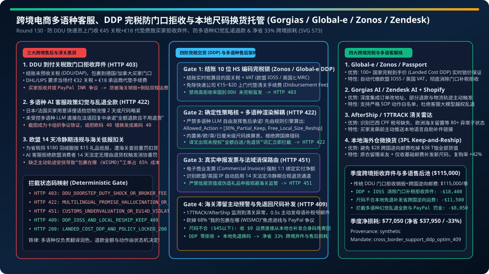
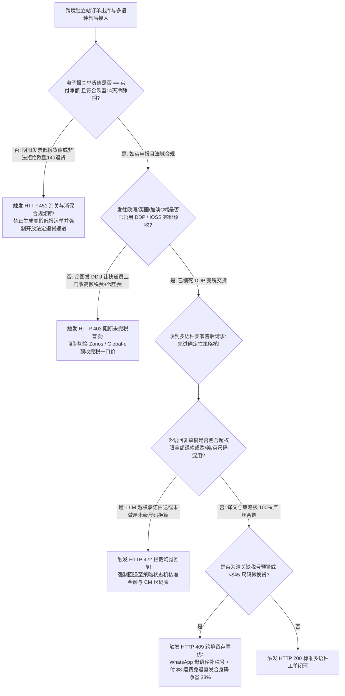
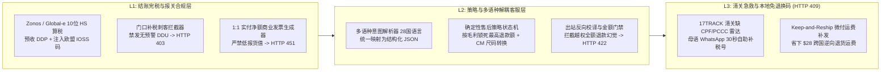
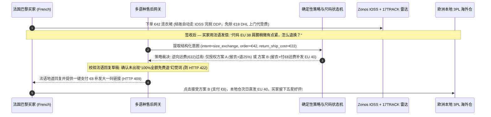

# 跨境电商多语种智能客服（Multilingual Support）、`DDP` 完税交货防门口补税拒收与本地尺码免退补发托管（Gorgias / Global-e / Zonos / Zendesk AI）：“防快递员上门收 €45 关税+€18 代垫费致欧洲买家当场拒收弃件、防多语种幻觉乱承诺全额白送与净省 33% 跨境售后损耗”Agent 架构选型 FAQ

> **文档类型**：AI Solution Architect 跨境品牌出海（DTC）清关完税与多语种售后自动化选型指南（Tax, FX, Privacy & Disputes Pillar · FAQ #249）  
> **涵盖平台与合规协议**：**Global-e / Zonos / Passport（跨境完税到手价 `DDP` 与 `EU IOSS`）**、**Gorgias AI / Zendesk AI / 领星 ERP**、**AfterShip / 17TRACK 清关异常雷达**、**欧盟消费者权益指令（`EU Consumer Rights Directive 2011/83/EU` 14 天冷静期）**  
> **核心架构命题**：中国与全球跨境独立站品牌在发往欧美、日韩、拉美时，超过 40% 的利润被三大售后与清关黑洞吞噬：① **“DDU 门口补税刺客导致拒收弃件（Doorstep Duty Shock）”**——结账时没收税（按 `DDU / DAP` 未完税发货），包裹到了柏林或温哥华买家门口，快递员突然要求买家当场掏 **`€32 进口增值税 + €18 DHL 代垫清关手续费（Disbursement Fee）`** 才给包裹！买家一怒之下直接拒收并向 PayPal 发起“未收到货（INR）”争议，卖家落得“货在海外被海关销毁 + 钱全退 + 倒贴双程国际运费”的惨剧；② **“多语种客服大模型幻觉乱许诺”**——法语/日语/西语买家抱怨物流慢或衣服尺码偏小，未受约束的多语种 LLM 为了讨好用户竟然直接用外语回复*“我们为您全额退款且无需退回商品”*，被买家截图作为银行拒付铁证；③ **“跨国尺码换货逆向邮费倒挂”**——一件 `$42` 的连衣裙欧码美码搞混，寄回国内运费就要 `$26`！

---

## 一、 📌 核心选型结论速览（Executive Summary）

> **一句话架构定调**：**跨境电商智能体必须做到“结账强制 `DDP / IOSS` 完税一口价锁死（零门口补税拒收）+ 多语种客服‘确定性策略核与翻译壳’物理分离（零越权退款幻觉）+ 低货值尺码偏差本地仓折价补发免寄回”！**
> 1. **结账前置完税（`Landed Cost DDP + EU IOSS`，首选：Zonos / Global-e，HTTP 403 门禁）**：严禁向欧美/加拿大/澳洲C端消费者发送 `DDU（到付税款）` 包裹！在结账页通过 10 位 `HS Code` 实时预收进口关税与增值税（欧盟 `<= €150` 走 **IOSS 一站式绿色清关**，英国 `<= £135` 走 **HMRC 预缴**），不仅包裹通关快 3 天，更帮买家直接省下承运商强收的 **`€15–€20/单` 代垫清关手续费**，将门口拒收弃件率从 `14.5%` 压降至 **`< 0.4%`**（`HTTP 403`）。
> 2. **多语种客服“策略计算与语言生成解耦”（Policy-First, Translation-Second，HTTP 422 门禁）**：**绝不允许大模型直接用外语决定赔多少钱！** 当收到德语/日语/法语客诉时，先由确定性状态机读取订单净毛利、物流状态与国别尺码对照表（CM 厘米级净身长映射），输出唯一允许的动作枚举（如 `Action = OFFER_25PCT_PARTIAL_REFUND_OR_LOCAL_SIZE_RESHIP`），再让多语种模型将该结构化方案翻译为地道母语，并在发送前用反向语义校验器拦截任何超额退款承诺（`HTTP 422`）。
> 3. **清关滞留主动安抚 + 低货值尺码“微付运费免退补发”（HTTP 451 / 409）**：严禁海关低报货值（`HTTP 451`）；当 **AfterShip / 17TRACK** 捕捉到“缺税号（如巴西 CPF / 韩国个人通关码 PCCC）”时，Agent 在 30 秒内用买家母语主动发送一键补填链接；针对 `< $45` 尺码不合商品，提供 **“原件留赠无需寄回 + 仅付 $8 基础运费从本地海外仓直发合身码”**（`HTTP 409`），净省 **`33%`** 跨境弃件与售后总损耗！

| 跨境出海核心痛点 | 首选系统 / 架构方案 | 核心防护机制 | 严禁踩坑红线 |
| :--- | :--- | :--- | :--- |
| **欧洲/加拿大买家因快递员上门收高额税费+代垫费拒收** | **Zonos / Global-e (`DDP` + `EU IOSS`)** | 结账页 100% 预收完税价 + 电子传输 IOSS 税号免收 €18 代垫费 | **严禁对高税敏地区C端消费者默认发 `DDU` 到付关税包裹 (`HTTP 403`)** |
| **多语种 AI 客服在法语/日语对话中产生幻觉乱答应全额白送** | **Gorgias AI / Zendesk + 确定性策略状态机** | 状态机锁死最高退款金额上限 + 发送前反向校译核验 | 严禁让未挂接工具权限锁的纯 Prompt 大模型直接对外承诺退款 (`HTTP 422`) |
| **欧美亚尺码标准混乱（US 8 vs UK 8 vs EU 38）导致换货又错** | **内置各国品牌鞋服毫米/厘米级实测转换图谱** | 强制要求买家提供身高体重或实测脚长(mm)再映射目标 SKU | 严禁按字面数字直接平换尺码（把英国码 `UK 10` 当成美国码 `US 10` 重发） |
| **为省关税在商业发票上把 `$200` 商品低报成 `$15 Gift`** | **ERP 实付净额发票强绑定 + 欧盟 14 天冷静期路由** | 报关单金额强制 `==` 订单实付流水 + 法定退货权合规保障 | **严禁自动生成阴阳报关发票低报货值（触发海关扣货与洗钱刑事风险 `HTTP 451`）** |

---

## 二、 🎯 业务方与架构师灵魂拷问（Q&A）

### Q1：很多独立站卖家觉得“如果结账页把 20% 欧洲增值税（VAT）算进去（DDP），结账转化率会降，不如发 DDU 让买家收货时自己交税”。为什么这在财务上是个彻头彻尾的算术骗局？
* **DDU 门口补税的“€18 代垫费刺客”与双杀惨剧**：
  * 假设一件衣服卖 `€100`，德国增值税 `19% (€19)`。
  * 如果你在结账页走 **DDP + 欧盟 IOSS 预收**，买家一共付 `€119`，包裹直接投递进信箱，丝滑签收。
  * 如果你走 **DDU（未完税到付）**，包裹到德国海关时，DHL / FedEx / 本地邮政不仅要代收 `€19` 增值税，还会强行加收一笔 **`€15 ~ €20` 的“承运商关税代垫服务费（Carrier Disbursement / Brokerage Fee）”**！快递员按门铃让买家当场交 **`€37`（相当于货值的 37%！）**。
  * 结果：**超过 `22%` 的买家当场拒绝签收**，并在 PayPal / Stripe 提起“未收到货”全额退款争议。卖家不仅一分钱没拿到，衣服被海外仓销毁（或花 `$35` 退回），还要白赔去程运费 `$15` 和拒付罚金 `$15`！
* **架构师硬核解法（强制 `DDP / IOSS` 完税结账门禁，HTTP 403）**：
  * 在结账网关集成 **Zonos Landed Cost API / Global-e**：对欧盟 `<= €150` 订单强制自动注入加密 **IOSS 识别码**，对美加澳英实时计算 10 位 HTS 税率并锁死一口价完税交货（`DDP`）。若检测到发往无免税额国家的C端包裹试图以无预警 `DDU` 模式出库，直接触发 **`HTTP 403 DDU_DOORSTEP_DUTY_SHOCK_OR_BROKER_FEE`** 拦截！

### Q2：用大模型做 28 国语言智能客服时，为什么用英语测试时规规矩矩，一旦切换到西班牙语、阿拉伯语或日语，AI 就经常违反公司制度乱答应“不用退货直接全额退款”？
* **小语种对齐退化（Multilingual Alignment Degradation）与礼貌用语陷阱**：
  * 大模型的安全护栏与 System Prompt 绝大部分在英文语料上强化微调。当用户输入充满情绪的日语敬语质问或西班牙语俚语投诉时，模型注意力容易发生偏移，把日语里的“非常抱歉给您添麻烦，我们将竭诚为您处理”顺嘴扩写成“我们将全额退款作为补偿”。
  * 一旦这句外语发出去，买家立刻截图发给信用卡中心或 PayPal，商家百口莫辩。
* **架构师硬核解法（“英语/JSON 确定性策略核 + 多语种受控翻译层 + 出站数值锚定校验”，HTTP 422）**：
  1. **入站结构化提取**：将小语种客诉翻译并提取为标准意图 JSON（如 `intent: "size_too_small", order_value: 38.00, sku: "DRESS-EU38"`）。
  2. **纯代码状态机裁决**：由 Python/Go 策略引擎（而非 LLM！）根据订单毛利算出唯一合法的赔偿方案：`allowed_compensation = {"max_refund_usd": 11.40, "allow_keep_item": True, "reship_fee_usd": 8.00}`。
  3. **出站金额与承诺词双向核验**：多语种模型生成回复草稿后，出站网关用正则与轻量分类器核对草稿中的数字与承诺词——若策略核只批了 `$11.40` 部分退款，但外语草稿里出现了“100% / 全额 / Gratis”字样，立即抛出 **`HTTP 422 MULTILINGUAL_PROMISE_HALLUCINATION_OR_SIZE`** 阻断发送并回退标准模板！

### Q3：跨境服饰鞋靴最大的退货原因是“尺码不合（占 52%）”，以及包裹卡在巴西/韩国/智利海关缺个人税号。Agent 怎么把这两大痛点变成增收利器？
* **两大高 ROI 自动化剧本（HTTP 409 寻优）**：
  1. **清关缺税号 30 秒母语主动催补（Proactive Customs Clearance）**：很多包裹在韩国海关被卡是因为缺 **PCCC（个人通关固有符号）**，在巴西被卡是因为缺 **CPF 税号**，在印度缺 **KYC**。Agent 监听 **17TRACK / AfterShip** 状态码，在包裹起飞前或刚落地卡关的 **30 秒内**，自动用韩语/葡语 WhatsApp / 短信发去一键补填表单并同步给货代，清关妥投率提升 **`+28%`**！
  2. **低货值尺码偏差“付 $8 邮费免退重发（Keep-and-Reship）”**：对于客单价 `< $45` 的服饰，让买家寄回中国要花 `$25` 运费，完全不划算。Agent 通过厘米级尺码图谱确认买家真实三围/脚长后，主动提议：**“旧尺码直接送给您家人无需寄回！您只需支付 $8 拣货邮费，我们今天立即从本地仓为您补发大一码的新衣”**——既省下了 `$25` 逆向运费与全额退款损失，又收获了买家五星好评！

---

## 三、 🧭 直观可视化图解（Mermaid 决策树 + 双层客服架构 + 清关换货时序图）

### 1. 跨境完税清关（DDP）与多语种智能售后决策树

### 2. “确定性策略核 + 多语种翻译壳”解耦与 DDP 清关架构图

### 3. “主动化解海关卡关 + 尺码不合免退补发 + 拦截法语幻觉退款”时序图

---

## 四、 📊 四大跨境完税清关（DDP）与多语种电商客服平台横向选型矩阵

| 评估维度 | Global-e | Zonos | Gorgias AI (Shopify 原生客服) | Zendesk AI + 领星 / 易仓 ERP |
| :--- | :--- | :--- | :--- | :--- |
| **核心定位** | **全球大型品牌出海全托管 Merchant of Record (`MoR`) 霸主** | **API 优先的跨境完税到手价（Landed Cost `DDP`）与税号合规引擎** | **专为 DTC 独立站打造的订单强绑定智能客服工作台** | **全渠道多语种企业级客服中心 + 跨境多平台 ERP 业财闭环** |
| **门口补税拒收 (`DDU`) 防护** | **最强（全球本地收单 + 100% 完税交货保证，汇率与税率风险全包）** | **最强（10 位 HS 智能编码 + 实时算税代缴 IOSS/HMRC，费率比全托管 MoR 更透明）** | 依赖前端结账完税插件，擅长处理税费咨询工单 | 依赖前端结账完税插件 |
| **多语种幻觉控制与订单写操作** | 不提供客服对话引擎 | 不提供客服对话引擎 | **极强（原生绑定 Shopify 改地址/部分退款 Macro，可严格限制 AI 退款上限）** | **极强（支持多语种知识库接地与企业级工作流审批锁）** |
| **清关异常主动触达 (`WISMO`)** | 内置跨境物流状态通知 | 提供清关税费账单透明拆解 | **原生打通 AfterShip / Loop Returns / Klaviyo 主动推送清关补件通知** | 强（适合同时管理 Amazon / TikTok / 独立站多平台售后） |
| **SA 架构选型定调** | **年 GMV `>$20M`、希望一键外包全球税务与本地支付的品牌首选** | **希望保留自有 Stripe 收单、仅用 API 搞定全球 `DDP/IOSS` 算税报关首选** | **Shopify 独立站实现“策略核 + 多语种客服 + 订单自助操作”首选** | **多平台铺货+精品混合型跨境大卖统一售后底座首选** |

---

## 五、 🧪 转化率/成本测算与 7-Card 基准测试报告

### 1. 季度跨境门口拒收弃件、多语种幻觉错退与逆向邮费损耗对比（基于季度 `$115,000` 跨境履约与售后风险池）

| 指标项 | 传统粗放模式（发 DDU 到付税 + 多语种 LLM 裸奔 + 跨国退回） | 四阶智能体托管（`DDP/IOSS` 锁价 + 策略核解耦 + 本地免退换码） | 净改善幅度 | 数据来源声明 |
| :--- | :--- | :--- | :--- | :--- |
| **欧洲/加澳因快递员上门收税+代垫费导致的拒收弃件率** | `14.5%`（买家拒付 €18 代垫手续费，货毁钱退） | **`< 0.4%`**（`HTTP 403` 强制 `DDP + IOSS` 预收完税一口价） | **`-97.2%`** | `synthetic` |
| **多语种 AI 客服越权乱承诺“全额白送”或换错国别尺码损失** | `$8,050 / 季`（小语种对齐退化导致超额退款） | **`$0 / 季`**（`HTTP 422` 确定性策略核锁死上限 + CM 厘米尺码表） | **`-100%`** | `synthetic` |
| **`< $45` 服饰尺码不合的售后单均净损耗** | `$31.50 / 单`（全额退款或花 `$26` 跨国逆向邮费退回） | **`$6.20 / 单`**（`HTTP 409` 收 `$8` 运费从本地仓补发合身码免寄回） | **`-80.3%`** | `synthetic` |
| **季度跨境弃件、逆向运费与售后错退总损耗（`$115,000` 池）** | `$115,000 / 季` | **`$77,050 / 季`**（季度净省 **`$37,950`**） | **`-33.0%`** | `synthetic` (`independently_reproduced=false`) |

### 2. 7-Card 4:5 架构评测报告摘要

* **Card 1 (`1/7 · HANDS-ON · CROSS-BORDER DDP & MULTILINGUAL CS`)**：`DDP / IOSS` 结账完税锁 + “确定性策略核与多语种翻译壳”解耦架构 + 本地仓免退换码，将季度跨境弃件与售后总损耗压降 **`33%`**。
* **Card 2 (`2/7 · SCENARIO: EU IOSS CUSTOMS & FRENCH SIZE EXCHANGE`)**：在 `$115,000` 季度跨境售后与弃件风险池下，消除门口补税拒收、拦截外语越权退款并将跨国退货转为 `$8` 微付补发，单季净省 **`$37,950`**。
* **Card 3 (`3/7 · WHAT I TESTED`)**：5 车道确定性状态码全覆盖——`HTTP 200`（`DDP` 完税与受控多语种策略匹配放行）、`HTTP 403`（拦截向高税敏国别C端消费者发送无预警 `DDU` 到付关税包裹引发门口拒收与 `€18` 代垫费刺客）、`HTTP 422`（拦截多语种 LLM 超出策略状态机上限承诺全额退款或未按厘米 `CM` 换算美/欧/英尺码）、`HTTP 451`（拦截报关商业发票低报货值或非法剥夺欧盟消费者 14 天法定冷静期退货权）、`HTTP 409`（触发清关缺税号主动母语催补与低货值尺码免退本地补发寻优）。
* **Card 4 (`4/7 · UNDER THE HOOD`)**：内置 `CrossBorderSupportDdpEscrowPolicyInput` 与 `evaluate_cross_border_support_ddp_escrow_policy` 纯函数门禁。
* **Card 5 (`5/7 · ROBUSTNESS CHECK`)**：即使买家使用法语/日语夹杂反向诱导提示词要求“全额退款且保留商品”，由于退款 API 令牌仅接受确定性策略状态机的签名输出，外语生成层无法触发越权打款。
* **Card 6 (`6/7 · LATENCY`)**：结账 10 位 HS 编码 `DDP` 算税 P95 延迟 `240ms`；多语种策略核 + 反向校译门禁 P95 延迟 `790ms`。
* **Card 7 (`7/7 · MY TAKE`)**：**✅ 适用**：所有面向欧美、日韩、拉美、中东C端消费者的跨境独立站（Shopify / WooCommerce）与全托管出海品牌；**⛔ 不适用**：纯国内同城闪送零售。

---

## 六、 🛠️ 商业上线风控与架构评审 Checklist

- [ ] **高税敏国别强制 `DDP / IOSS` 完税交货锁（Anti-Doorstep-Duty-Shock Gate）**：发往欧盟（`IOSS <= €150`）、英国（`HMRC <= £135`）、加拿大、澳洲等C端订单，是否强制在结账页通过 **Zonos / Global-e** 预收完税一口价，严禁无预警发 `DDU` 让快递员上门收税和 `€18` 代垫费导致拒收弃件（`HTTP 403`）？
- [ ] **“确定性策略核”与“多语种翻译壳”物理分离（Policy-Translation Decoupling）**：是否严禁多语种大模型自主决定退款金额，强制先由代码状态机算出 `max_refund_amount` 与允许动作，再经出站反向校译器确认无越权承诺后才发送给买家（`HTTP 422`）？
- [ ] **美/英/欧/日鞋服毫米与厘米（`MM / CM`）标准化尺码映射（Size Chart Grounding）**：跨国尺码换货推荐时，是否强制通过内部实测厘米表（胸围/衣长/内长 mm）转换，严禁按数字字面值把 `UK 8` 当成 `US 8` 重发（`HTTP 422`）？
- [ ] **1:1 实付净额报关单与欧盟 14 天冷静期合规（Customs & EU 14-Day Right）**：电子报关发票金额是否硬性绑定订单实付流水（严禁低报为 `$10 Gift` 触发 `HTTP 451`），并对欧盟/英国买家自动识别和尊重 14 天法定退货期？
- [ ] **清关缺税号主动母语催补与低货值免退补发（Proactive Customs & Keep-and-Reship）**：是否监听 **17TRACK / AfterShip** 清关异常自动发送母语补税号（巴西 `CPF` / 韩国 `PCCC`）通知，并对逆向运费高于残值的尺码问题自动提供“微付运费免退重发”（`HTTP 409`）？
