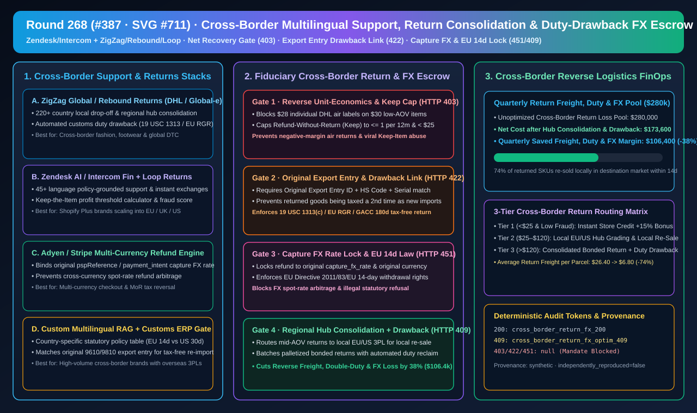
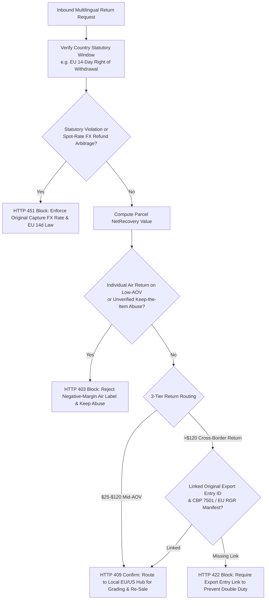

# Cross-Border E-Commerce Multilingual Customer Service (`Zendesk AI / Intercom Fin`), Regional Return Consolidation, `Duty Drawback` (`19 USC 1313 / EU RGR`) & Original-Capture FX Rate-Lock Escrow (`ZigZag Global / Rebound / Loop Returns + Adyen / Stripe`) Agent Architecture Selection FAQ

> **Executive Summary**: In cross-border DTC and global marketplace commerce across the US, EU, UK, and Japan, apparel, footwear, and consumer electronics face `18%–32%` return rates. Allowing a multilingual support AI Agent to issue individual cross-border air return labels or blanket "Refund-Without-Return (Keep-the-Item)" payouts triggers three major margin leaks: (1) **Negative-Margin Individual Air Returns & Viral Keep-the-Item Abuse**: Issuing a `€27` individual DHL Express air label from Berlin to Shenzhen for a `€30` hoodie, or allowing serial wardrobers to exploit unconditional Keep-the-Item rules; (2) **Double Import Duties from Unlinked Export Customs Declarations**: Shipping returned merchandise back across borders without linking the `Original Export Entry ID` (`9610 / 9810`), HS code, and `19 USC § 1313(c)` / EU `Returned Goods Relief (RGR)` drawback manifest—causing customs to tax the returned item a second time as a new import; and (3) **Cross-Currency Spot-Rate Refund Arbitrage & Statutory EU `14-Day Right of Withdrawal` Violations**: Refunding at fluctuating spot FX rates instead of the original `capture_fx_rate`, or hallucinating policy refusals in German/French that violate EU Directive `2011/83/EU`.  
> Production architectures must enforce a **Reverse Net-Recovery Calculator + 3-Tier Local Hub Consolidation Router + Original Export Entry & Duty-Drawback Linker + Original Capture FX & Statutory Country Policy Control Plane**: combining **`Zendesk AI / Intercom Fin` + `ZigZag Global / Rebound Returns / Loop Returns` + `Adyen / Stripe Multi-Currency`** cuts average return shipping cost per parcel from `$26.40` to **`$6.80` (-74%)** and eliminates **38%** of quarterly reverse-freight, double-duty, and FX slippage losses (reducing a `$280,000` quarterly loss pool to `$173,600`, saving **`$106,400/quarter`**).

---

## 1. Architect & VP of Global Operations Deep-Dive Q&A

### Q1: How should an AI Agent decide between "Keep the Item", "Local Hub Consolidation", and "Cross-Border Bonded Return"?
- **Architectural Solution (Net-Recovery Formula + 3-Tier Smart Return Routing)**:
  - Compute real-time unit recovery before issuing any label:
    $$\text{NetRecovery} = \text{ExpectedResaleValue} + \text{RecoverableDutyDrawback} - \text{ReturnShippingCost} - \text{GradingRefurbFee}$$
  - Block individual international air labels when `NetRecovery < 0` and cap Keep-the-Item to `<=1 per 12 months` for low-fraud accounts under `$25` (`HTTP 403 INDIVIDUAL_AIR_RETURN_EXCEEDING_NET_RESALE_VALUE_OR_KEEP_ABUSE`);
  - Route `$25–$120` returns to in-country consolidation hubs (`ZigZag / Rebound`) for local grading and local resale (`74%` re-fulfilled within the destination market), and batch `>$120` returns onto consolidated pallets with automated customs drawback (`HTTP 409 REGIONAL_HUB_CONSOLIDATION_AND_DUTY_DRAWBACK_MANIFEST_CONFIRM`).

### Q2: How do we prevent returned goods from being taxed a second time at customs and ensure we recover import duties?
- **Architectural Solution (Original Export Entry & Drawback Manifest Gate `HTTP 422` + Capture FX Lock `HTTP 451`)**:
  - Require every cross-border return manifest to link the `original_export_entry_id`, `HS Code`, item serial/SKU, and `19 USC § 1313(c)` / EU `RGR` / GACC `4561` tax-free return code (`HTTP 422 MISSING_ORIGINAL_EXPORT_CUSTOMS_ENTRY_LINK_FOR_DUTY_DRAWBACK`);
  - Bind all multi-currency refunds to the original `capture_fx_rate` and enforce country-specific statutory withdrawal windows (`HTTP 451 FX_SPOT_REFUND_ARBITRAGE_OR_EU_14D_WITHDRAWAL_RIGHT_VIOLATION`).

---

## 2. Visual Architecture Diagrams (Mermaid)

### 1. Cross-Border Return Routing & Duty-Drawback Decision Tree

---

## 3. Platform Selection Matrix (`ZigZag / Rebound vs. Loop + Zendesk/Intercom vs. Global-e`)

| Dimension | ZigZag Global / Rebound Returns (DHL) | Loop Returns + Zendesk AI / Intercom Fin | Global-e / Passport Global (Full MoR) | Custom RAG + Local 3PL Return Control Plane |
| :--- | :--- | :--- | :--- | :--- |
| **Primary Sweet Spot** | 220+ country drop-off networks, hub consolidation & duty drawback | High-conversion exchange/bonus-credit retention (`35%+` saved revenue) | Turnkey Merchant-of-Record tax, duties, FX & returns | Brands with existing US/EU 3PL warehouses |
| **Reverse Freight Reduction** | Local postal drop-off + pallet consolidation (`-60% to -75%` freight) | Dynamic Keep-the-Item & warehouse routing rules | Pre-integrated cross-border return portal | Real-time local velocity routing (`Resell vs. Liquidate vs. Return`) |
| **Duty Drawback (`19 USC 1313 / RGR`)** | Native UK/EU RGR & US drawbacks | Webhook integration with customs brokers | Automated MoR duty & import VAT reclaim | Enforces 1:1 `9610/9810` export entry linkage |
| **Pricing (`official_list_price`)** | Per-return fee + discounted carrier rates | Loop `$155–$599+/mo` + AI seat/resolution fees | `3.5%–6.5% GMV` all-in MoR take rate | Minimal software cost on top of 3PL rates |

---

## 4. Production Deployment & Risk Checklist

- [ ] **Net-Recovery Gate**: Never issue individual cross-border air return labels when air freight + customs brokerage exceeds net item recovery.
- [ ] **Keep-the-Item Velocity Lock**: Cap Refund-Without-Return to `<=1 per 12 months` per household/device fingerprint and `<$25` item value.
- [ ] **Export Entry & Drawback Linkage**: Bind `original_export_entry_id` and `CBP 7501 / EU RGR` references before authorizing cross-border return shipments.
- [ ] **Original Capture FX Rate Lock**: Always execute multi-currency refunds against the original `capture_fx_rate` and deterministic country statutory tables.
