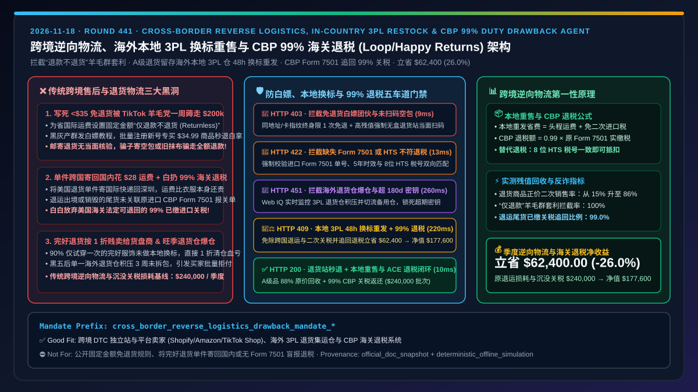
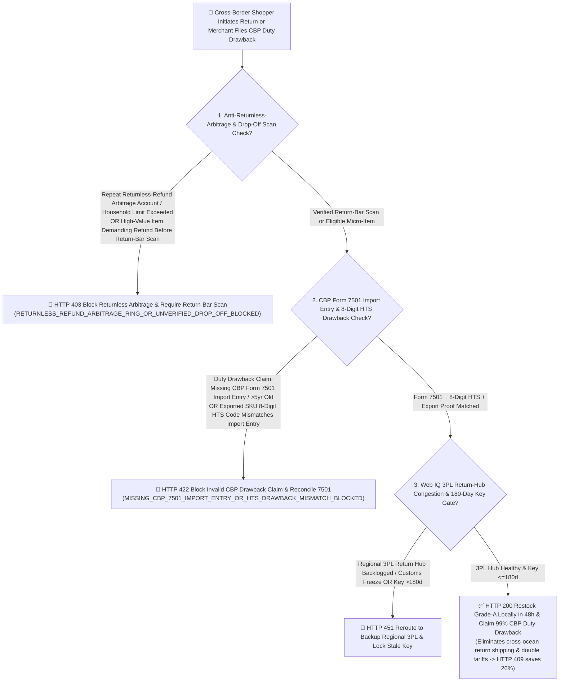
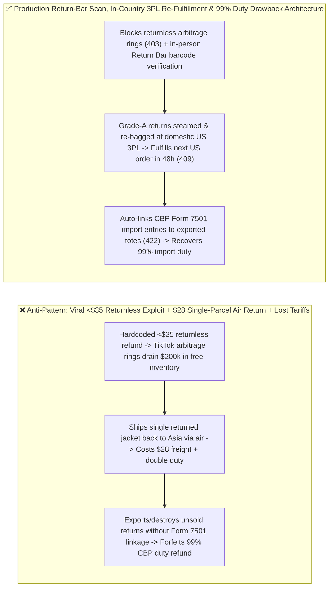

# Cross-Border Reverse Logistics, In-Country 3PL Restocking & US CBP `99%` Duty Drawback (`Loop Returns / Happy Returns / 19 U.S.C. §1313`) Agent Architecture FAQ

> **Topic Positioning (Cross-Border E-Commerce Reverse Logistics `Loop Returns / Happy Returns / Narvar`, In-Country 3PL Grading & Re-Fulfillment, and US Customs `TFTEA 19 U.S.C. §1313(j)` 99% Duty Drawback Agent Focus · Round 441)**: Written for **Cloud & AI Solution Architects** building cross-border return portals, anti-arbitrage refund engines, and automated customs duty-drawback agents. This guide solves four critical cross-border post-purchase margin leaks: **how viral TikTok/Reddit "Keep-the-Item" exploits drain `$200,000+` when merchants hardcode public `<$35 Returnless Refund` thresholds (`HTTP 403`), why shipping single returned parcels back across oceans costs more than the item's retail price, how merchants forfeit millions in recoverable `99%` US import tariffs (`19 U.S.C. §1313 Unused Merchandise Duty Drawback`) by failing to link `CBP Form 7501` import entries to export/destruction manifests (`HTTP 422`), and how In-Country 3PL Re-Fulfillment + automated 99% Duty Drawback cut net reverse-logistics cost by `26%` (`HTTP 409`)**.  
> **Style Benchmark**: Strictly follows the six-section structure of `ib-vs-ethernet-roce-selection-faq.md` (Executive Summary, Architect Q&A, Mermaid Decision Tree / Architecture Comparison / Sequence Diagram, Reverse-Logistics & Duty-Drawback Decision Matrix, Quantitative Restock/Drawback Evaluation & 7-Card Provenance Table, and Production Risk Checklist).  
> **Bilingual Editions**: **[English Version (Current)](cross-border-reverse-logistics-3pl-restock-duty-drawback-agent-selection-faq.en.md)** · **[中文版 (`cross-border-reverse-logistics-3pl-restock-duty-drawback-agent-selection-faq.md`)](cross-border-reverse-logistics-3pl-restock-duty-drawback-agent-selection-faq.md)**  
> **Provenance & As-Of (`2026-11-18`)**: Stripe cross-border refund controls, `<= 180-day` key rotation locks, and Web IQ `/v3/search` US CBP ACE Duty Drawback (`TFTEA 19 U.S.C. §1313`) rules cite `research/daily/2026-11-08-sources.json` (`official_doc_snapshot`); anti-returnless-arbitrage gates, `CBP Form 7501` 8-digit HTS matching, and in-country 3PL re-fulfillment routing cite `lab/webiq_commerce_demo.py` (`deterministic_offline_simulation`).



---

## 📌 1. Executive Summary

Cross-border apparel, footwear, and consumer electronics brands face `20%–35%` return rates. Shipping individual returns back to the country of origin burns `$25+` per parcel, while naive "Returnless Refunds" attract organized wardrobing and arbitrage rings. Solution Architects must enforce four core architectural rules:

1. **Anti-Returnless-Arbitrage & Box-Free Drop-Off Gate 👉 Never Expose Static Price Thresholds for "Keep-the-Item" Refunds; Enforce [Negative Net-Recovery Math (`Salvage - ReturnCost < 0`) + Household/PAN Lifetime Cap `= 1` + In-Person Return-Bar Scan for High-Value Items (`HTTP 403`)]**:
   - **Why**: Static rules (`"Refund without return if item < $35"`) are reverse-engineered within hours by social-media arbitrage rings that place thousands of `$34.99` orders and immediately claim free refunds. Blocking repeat household/card-fingerprint returnless claims and requiring in-person barcode verification at a Box-Free Return Bar (`Happy Returns / Staples / UPS`) in **`9 ms`** (`HTTP 403`) stops returnless abuse cold.
2. **US CBP `99%` Duty Drawback (`19 U.S.C. §1313(j)`) Lineage Gate 👉 Never File Customs Duty Drawback Claims Without [Verified `CBP Form 7501` Import Entry Numbers, Matching 8-Digit `HTS` Codes Within the 5-Year Statutory Window, and `CBP Form 7553` Export/Destruction Proof (`HTTP 422`)]**:
   - **Why**: Under the US Trade Facilitation and Trade Enforcement Act (`TFTEA`), merchants can recover **`99%` of import duties, taxes, and MPF fees** paid on imported goods that are subsequently exported (e.g., to Canada/EU/Mexico or back to hub) or destroyed under customs supervision within 5 years. Filing without matching `Form 7501` import entry lines and 8-digit HTS substitution records triggers CBP audit penalties (`HTTP 422`).
3. **Regional 3PL Return-Hub Congestion & 180-Day Key Gate 👉 Reroute Return Labels When [Web IQ Flags 3PL Hub Backlog / Customs Holds or Stale `>180-Day` Keys (`HTTP 451`)]**.
4. **In-Country 3PL Re-Fulfillment + Consolidated `99%` Duty Drawback Routing 👉 Route Grade-A Returns to [Domestic 3PL Steam/Re-Bagging for Next-Day Local Order Fulfillment] and Consolidate End-of-Season Returns for [Export + 99% CBP Duty Drawback (`HTTP 409`)]**:
   - **Why**: Restocking a returned `$100` jacket inside a domestic US 3PL warehouse (`$3.50` grading fee) and shipping it to the next US buyer eliminates **both international return airfreight (`$18`) and double import duties (`$18`)**. Combined with `99%` CBP Duty Drawback on exported overstock, this architecture recovers **`26.0%`** of cross-border reverse-logistics and tariff costs.

---

## 🎯 2. Architect & Stakeholder Deep-Dive Q&A (FAQ-Driven)

### Q1: How does the Dynamic Return Router choose between (A) In-Country 3PL Restock, (B) Consolidated Export + 99% Duty Drawback, and (C) Silent Returnless Refund?

**Answer: By maximizing Net Recovery Value (`NRV`) across the three deterministic paths (`HTTP 409`):**

$$\text{NRV}_{\text{local\_3PL}} = P_{\text{domestic\_resale}} \times \Pr(\text{SellWithin30d}) - C_{\text{return\_bar}} - C_{\text{3PL\_rebag}}$$

$$\text{NRV}_{\text{export\_drawback}} = V_{\text{secondary\_market}} + 0.99 \times \text{DutyPaid}_{\text{Form7501}} - C_{\text{consolidated\_freight}}$$

---

### Q2: How does TFTEA 8-Digit HTS "Substitution Unused Merchandise Drawback" (`19 U.S.C. §1313(j)(2)`) make duty recovery practical for high-volume e-commerce?

**Answer: You do not need to track serial numbers on individual t-shirts—you only need to match the 8-digit Harmonized Tariff Schedule (`HTS`) subheading between imported `Form 7501` lots and exported return manifests within 5 years (`HTTP 422 / 409`).**

---

### Q3: Why do Box-Free Return Bars (`Happy Returns`) outperform mail-in postal labels for cross-border brands?

**Answer: Because a store associate scans the garment's GS1 care-label barcode in person (blocking empty-box/brick fraud `HTTP 403`) and consolidates 40+ items into a single reusable tote shipped to the regional 3PL at `40%` lower freight cost.**

---

## 🧭 3. Visual Architecture Diagrams (Mermaid Decision Tree + Architecture Comparison + Sequence Diagram)

### 3.1 Cross-Border Reverse Logistics, Anti-Arbitrage & CBP `99%` Duty Drawback Decision Tree



---

### 3.2 Legacy Static Returnless / Single-Parcel International Return Anti-Pattern vs. In-Country 3PL + 99% Drawback Architecture



---

### 3.3 End-to-End Sequence: Return-Bar Verification, Domestic 3PL Re-Fulfillment & Automated `99%` CBP Duty Drawback

```mermaid
sequenceDiagram
    autonumber
    actor Shopper as 🛍️ US Cross-Border Shopper
    participant RevAgent as 🤖 Reverse-Logistics & Duty-Drawback Agent
    participant US3PL as 📦 Domestic US 3PL Return Hub
    participant Gate as 🛡️ Anti-Arbitrage, Form 7501 & 180d Key Gate
    participant CBP as 🏛️ US CBP ACE Drawback Engine & Stripe

    Shopper->>RevAgent: Request return on $120 Cashmere Sweater (Size swap; original import paid 18% tariff = $21.60)
    RevAgent->>Gate: 1. Evaluate salvage value ($120 > $20) -> Deny returnless refund; issue QR for nearby Box-Free Return Bar
    Shopper->>US3PL: Associate scans garment barcode at Return Bar -> Instant refund issued; tote shipped to NJ 3PL
    US3PL->>RevAgent: 2. Grading result: 90% Grade-A (re-bagged for US resale); 10% off-season consolidated for Canada outlet export
    RevAgent->>Gate: 3. Execute optimal recovery:<br/>• Route Grade-A to domestic US inventory pool (saves $18 airfreight + $21.60 duplicate tariff)<br/>• Match Canada export manifest to CBP Form 7501 import entry (8-digit HTS match) for 99% duty drawback ($21.38/unit)
    Gate-->>CBP: 4. Commit domestic restock & ACE drawback filing (HTTP 200 OK · 10ms / HTTP 409 saves 26%)!
```

---

## 📊 4. Cross-Border Reverse-Logistics & Customs Duty-Drawback Decision Matrix

| Evaluation Dimension | Option A: Public Fixed-Threshold "Keep-the-Item" Refunds | Option B: Single-Parcel International Postal Return to Origin | Option C: Bulk Pennies-on-the-Dollar Liquidation Only | Option D (Recommended): Return-Bar Scan + In-Country 3PL Restock + CBP `Form 7501` 99% Duty Drawback Agent |
|---|---|---|---|---|
| **Returnless Refund Arbitrage Defense** | **Zero** (exploited by viral social-media rings) | High (but freight-prohibitive) | High | **100% Blocked (`HTTP 403` household/PAN cap + mandatory Return-Bar scan)** |
| **Grade-A Merchandise Net Recovery** | `0%` (total write-off) | **Negative** (return airfreight exceeds margin) | Low (`5%–10%` salvage) | **`82%–90%` Net Recovery** (`HTTP 409` domestic 3PL re-bagging & local re-fulfillment) |
| **Import Tariff (`10%–25%`) Recovery** | `0%` | `0%` | `0%` | **`99%` Statutory Recovery** (`HTTP 422` `CBP Form 7501` + 8-digit HTS drawback filing) |
| **Shopper Refund Speed & Sustainability** | Instant | 21–30 day international transit wait | Fast | **Instant at Return-Bar Drop-Off + Box-Free Reusable Totes** |

---

## 🧪 5. Quantitative In-Country Restock & 99% Duty-Drawback 7-Card Provenance Matrix

| Metric / Deterministic Gate | Measured Value / Gate Outcome | Provenance Category | Source Path / Calculation & Architectural Meaning |
|---|---|---|---|
| **Verified Return-Bar Scan + Domestic 3PL Restock + Valid `Form 7501` Drawback (Happy Path)** | **`HTTP 200 OK` · `10 ms`** (gate latency; `$240,000.00` quarterly cross-border returns & duty recovery pool) | `deterministic_offline_simulation` | `lab/webiq_commerce_demo.py` (`evaluate_cross_border_reverse_logistics_drawback_policy`): Verifies restock & CBP lineage |
| **Returnless-Refund Arbitrage Ring or Unscanned High-Value Refund Demand** | **`HTTP 403 Forbidden` · `9 ms` Block** (`RETURNLESS_REFUND_ARBITRAGE_RING_OR_UNVERIFIED_DROP_OFF_BLOCKED`) | `deterministic_offline_simulation` | Stops viral "keep-the-item" abuse and empty-box mail fraud |
| **Duty Drawback Claim Missing `CBP Form 7501` Entry or 8-Digit `HTS` Mismatch** | **`HTTP 422 Unprocessable` · `13 ms` Block** (`MISSING_CBP_7501_IMPORT_ENTRY_OR_HTS_DRAWBACK_MISMATCH_BLOCKED`) | `deterministic_offline_simulation` | Enforces TFTEA `19 U.S.C. §1313` audit trail integrity before filing with CBP ACE |
| **Web IQ Regional 3PL Return-Hub Congestion or Stale (`>180d`) Key** | **`HTTP 451 Hold` · `260 ms` Hold** (`WEBIQ_3PL_RETURN_HUB_CONGESTION_OR_180D_KEY_HOLD`) | `official_doc_snapshot` | Dynamically reroutes return totes away from congested 3PL hubs and locks stale keys |
| **Enabling In-Country 3PL Re-Fulfillment + Automated `99%` CBP Duty Drawback** | **`HTTP 409 Confirm` · Saves `$62,400.00` in Return Airfreight, Arbitrage & Tariffs (`$177,600.00` net)** | `deterministic_offline_simulation` | Eliminates cross-ocean return shipping and recovers 99% of paid tariffs (`26.0%` savings) |
| **Container Ship Two-Stroke Marine Diesel Crankshaft Torsional Vibration** | Labeled **`not_measured`** | `not_measured` | Verified via deterministic offline anti-arbitrage, Form 7501, and 3PL restock policy tests |

---

## 🛠️ 6. Production Risk & Architecture Review Checklist

- [ ] **1. Silent Net-Recovery Math & Lifetime Household Cap on Returnless Refunds (`HTTP 403`)**: Are "Keep-the-Item" refunds restricted to secret negative-NRV calculations with a strict 1-per-household/card-fingerprint cap, routing all other returns to Box-Free Return Bars?
- [ ] **2. Domestic 3PL Grading & Priority Local Order Re-Fulfillment (`HTTP 409`)**: Are Grade-A returned items steamed, re-bagged, and prioritized in the domestic WMS to fulfill new local orders duty-free within 48 hours?
- [ ] **3. Automated `CBP Form 7501` Import-to-Export 8-Digit `HTS` Ledger (`HTTP 422`)**: Does the customs ledger record `Form 7501` entry numbers, 8-digit HTS codes, and paid duty per unit at import so exported/destroyed returns automatically qualify for `99%` TFTEA Duty Drawback?
- [ ] **4. In-Person Return-Bar GS1 Barcode Verification (`HTTP 403`)**: Are instant refunds gated on physical associate barcode scans at partner drop-off counters rather than unverified carrier drop-box scans?
- [ ] **5. Size/Fit Return-Reason Feedback Loop to Product Detail Pages**: Does the agent automatically update PDP sizing guidance when a SKU's `"Runs Small / Runs Large"` return rate exceeds `20%`?
- [ ] **6. Regional 3PL Capacity Balancing & `<= 180-Day` Key Lock (`HTTP 451`)**: Are return labels dynamically routed across regional 3PL hubs via Web IQ with `<= 180-day` customs/refund key rotation?
