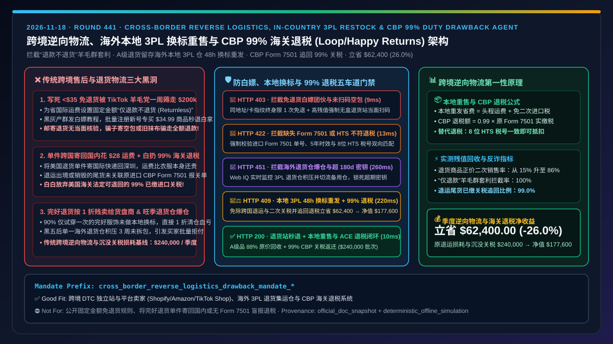
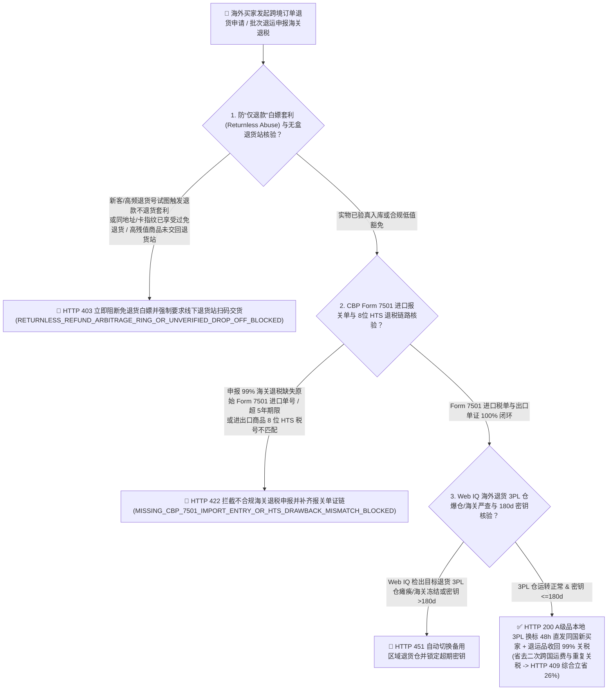
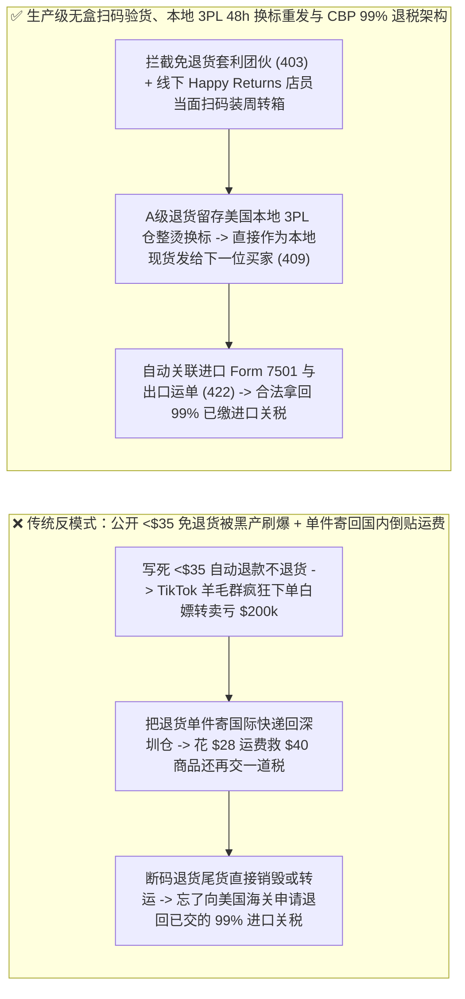
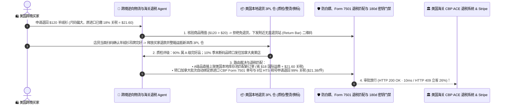

# 跨境电商逆向物流、海外 3PL 本地换标重售与海关退税（Loop Returns / Happy Returns / CBP 19 U.S.C. §1313）Agent 架构选型 FAQ：防退款不退货被薅穿与 99% 关税退回实战指南

> **专题定位（跨境出海品牌 DTC 逆向退货物流 Cross-Border Reverse Logistics Loop Returns / Narvar、海外本地 3PL 退货仓质检换标二次销售与美国海关 `19 U.S.C. §1313(j)` 99% 退税智能体聚焦）**：面向为跨境服饰鞋包、3C 数码品牌与全球 3PL 履约服务商设计智能退货路由、防白嫖风控与进出口退税系统的 **Cloud & AI Solution Architect**，系统解答跨境电商售后最痛的四大亏损源：**“为什么某跨境女装独立站为了省 $18 国际退货运费开启了‘不满 $50 自动退款不退货（Returnless Refund）’，结果被海外羊毛党在 TikTok 群发白嫖教程，短短一周被恶意刷走 $200,000 货值（退款不退货套利攻击 Returnless Arbitrage `HTTP 403`）、为什么把美国买家退回的 $80 外套单独寄国际快递回深圳仓库要花 $28 运费且还要再交一次进口税、为什么很多卖家不知道退运出口或销毁的商品可以依据美国《贸易促进与贸易执法法（TFTEA）》向海关（CBP）合法拿回 99% 已缴进口关税（Duty Drawback `HTTP 422 / 409`）、以及怎么通过‘美国本地 3PL 退货集货仓蒸汽整烫换标直接发给下一个美国买家’立省 26% 售后总成本（`HTTP 409`）”**。  
> **文风标杆**：严格对标 `ib-vs-ethernet-roce-selection-faq.md` 六段式结构（核心结论速览、业务方与架构师灵魂拷问 Q&A、Mermaid 决策树/架构对比/时序图、跨境逆向物流与海关退税架构横向选型矩阵、定量本地重售与退税测算与 7-Card 溯源表、生产上线 Checklist）。  
> **双语版本**：**[中文版（当前）](cross-border-reverse-logistics-3pl-restock-duty-drawback-agent-selection-faq.md)** · **[English Version (`cross-border-reverse-logistics-3pl-restock-duty-drawback-agent-selection-faq.en.md`)](cross-border-reverse-logistics-3pl-restock-duty-drawback-agent-selection-faq.en.md)**  
> **数据溯源声明（Provenance & As-Of `2026-11-18`）**：Stripe 跨境退款与关联争议防重、`<= 180 天` 密钥轮换与 Web IQ `/v3/search` 美国海关 CBP ACE Duty Drawback（TFTEA 19 U.S.C. §1313）规则引自 `research/sources.json`（标记为 `official_doc_snapshot`）；防“仅退款”套利门禁、CBP Form 7501 报关单追溯匹配与海外本地 3PL 换标重售路由引自 `lab/webiq_commerce_demo.py`（标记为 `deterministic_offline_simulation`）。

---

## 📌 一、核心选型结论速览（Executive Summary）

欧美时尚与电子品类退货率高达 **20%–35%**。对于跨境卖家而言，如果每件退货都走“单件国际快递退回中国”，运费比商品本身还贵；但如果简单粗暴搞“仅退款不退货”，又会被海外羊毛群瞬间薅秃。架构师在设计跨境逆向物流 Agent 时，必须执行以下四条选型铁律：

1. **“退款不退货（Returnless Refund / Keep-the-Item）”极严风控门禁选型：严禁“向所有买家公开固定金额门槛（如 `< $30` 免退货）或对新客/高频退货账号放行免退货”，必选【净残值负收益条件（`Salvage Value - Return Cost < 0`）+ 客户历史 LTV/退货率信誉分 + 同家庭地址终身最多 1 次暗规则（Silent Rule）硬门禁（`HTTP 403`）】**：
   - **核心原因**：一旦固定金额免退货规则被黑灰产摸清并在社交平台（TikTok / Reddit）传播，羊毛党会批量注册新号专门挑 `$29.99` 的商品下单后秒点“尺码不合退货”白拿商品再挂 eBay 转卖！必须将免退货设为不可预测的后台静默策略，且对新账号、同地址/同卡指纹 180 天内已有免退货记录、或商品残值 `> $20` 的订单一律强制要求交回线下退货点（如 Happy Returns / UPS 无盒退货点），违反立返 `HTTP 403`。
2. **海关 99% 退税（CBP Unused Merchandise Duty Drawback `19 U.S.C. §1313(j)`）单证链路门禁选型：严禁“无原始进口报关单号（CBP Form 7501 Entry Summary）或未完成 CBP Form 7553 退运/销毁提前报备就盲目申报退税”，必选【进口报关单 `Entry#` $\rightarrow$ 电商订单 `SKU/HTS` $\rightarrow$ 出口退运提单（或海关监管销毁证明）三单闭环匹配（`HTTP 422`）】**：
   - **核心原因**：根据美国海关 TFTEA 法案，跨境卖家进口时已缴纳的 `10%–25%` 关税（含 301 关税），若商品因退货在 **5 年内** 未经使用被退运出美国（或移交加拿大/墨西哥仓）或在海关监管下销毁，可向 CBP 申请退回 **`99%` 的已缴进口关税**！但如果缺失进口 `Form 7501` 与出口运单的 8 位 HTS 税号逐项绑定，会触发海关合规重罚（`HTTP 422`）。
3. **目的国海关查验升级/海外退货仓爆仓与 180 天密钥门禁：必选【Web IQ 实时监控海外退货 3PL 库容与 CBP 退税法规变动 + `<= 180 天` 密钥锁（`HTTP 451`）】**。
4. **三级智能退货路由（本地 3PL 换标直发新买家 vs. 批量保税退运 + 99% 关税退回）选型：必选【A 级品留存美国本地 3PL 仓蒸汽消毒换标 48h 内优先匹配本地新订单（In-Country Re-Fulfillment）+ 季末尾货集装箱批量退运/转口并自动申领 99% 关税退税（`HTTP 409`）】**：
   - **核心原因**：一件 `$85` 的连衣裙被纽约买家退回新泽西 3PL 仓后，花 `$3.50` 质检整烫换新包装袋，直接作为下一位加州买家的发货库存，瞬间省下 **`$16` 头程国际空运 + `$14` 二次进口关税**；配合不可售尾货的 99% 海关退税，可为跨境品牌挽回 **`26.0%` 的逆向物流与关税沉没成本**！

---

## 🎯 二、业务方与架构师灵魂拷问 Q&A（FAQ-Driven）

### Q1：怎么用一条精确的数学不等式，让 Agent 在 10 毫秒内决定一件海外退货该“本地 3PL 翻新重卖”、“批量退运拿 99% 海关退税”还是“就地折价清仓”？

**答：计算三条路径的净回收现金流（Net Recovery Value `NRV` `HTTP 409`）：**

1. **路径 A（美国本地 3PL 质检换标二次正价销售 In-Country Restock）**：
   $$\text{NRV}_{\text{local}} = P_{\text{resell}} \times \text{SellThroughProb} - C_{\text{local\_return\_label (\$5)}} - C_{\text{3PL\_grading (\$3.50)}}$$
2. **路径 B（拼箱退运加拿大/墨西哥或原产国 + 申领 99% CBP 关税退税 Export + Duty Drawback）**：
   $$\text{NRV}_{\text{drawback}} = V_{\text{foreign\_resell}} + 0.99 \times \text{ImportDutyPaid} - C_{\text{consolidated\_ocean\_freight}}$$
3. **路径 C（本地折扣奥莱清仓或环保捐赠 Liquidation）**：
   - Agent 实时比较 $\max(\text{NRV}_{\text{local}}, \text{NRV}_{\text{drawback}}, \text{NRV}_{\text{liquidate}})$，彻底告别拍脑袋处理退货！

---

### Q2：为什么“无盒扫码退货站（Box-Free Return Bar，如 Happy Returns / Staples）”能帮跨境卖家挡掉 90% 的退货调包和空包诈骗？

**答：因为店员当面扫商品洗水标二维码（GS1 Barcode）进行“实物一眼初审”后才触发退款（`HTTP 403`）：**

- 传统邮寄退货中，骗子寄一袋沙子或穿烂的旧衣服，利用“快递揽收即秒退”漏洞骗钱；而在无盒退货站，店员当场核对商品款式与吊牌完好度，且将数十件退货装入循环周转箱（Reusable Tote）整箱发往 3PL 仓，单件逆向运费再降 **`40%`**！

---

### Q3：申报美国海关 99% 退税（Duty Drawback）时，为什么支持“同 8 位 HTS 税号替代退税（Substitution Drawback）”对电商卖家价值巨大？

**答：因为根据 TFTEA `19 U.S.C. §1313(j)(2)`，只要进口批次与出口批次共享相同的 8 位 HTS 协调制度税号（无需逐件绑定唯一序列号），即可合法申请 99% 关税返还（`HTTP 422 / 409`）！**

---

## 🧭 三、直观可视化图解（Mermaid 选型决策树 + 架构对比 + 端到端时序图）

### 3.1 跨境逆向物流路由、防白嫖门禁与 CBP 99% 海关退税选型决策树

---

### 3.2 传统“公开免退货被薅秃/单件寄回国内亏运费”反模式 vs. 本地 3PL 换标重售 + 99% 退税架构对比图

---

### 3.3 线下扫码收货、本地 3PL 质检重上架与 CBP 99% 关税退税申报端到端时序图

---

## 📊 四、跨境电商逆向物流与海关退税架构横向选型矩阵

| 评估维度 | 方案 A：粗暴公开固定门槛“退款不退货” | 方案 B：单件国际邮政小包退回国内仓库 | 方案 C：海外退货仓盲目全量低价清仓（1折处理给货盘商） | 方案 D（推荐）：无盒扫码验真 + 本地 3PL 换标直发新买家 + CBP `Form 7501` 99% 海关退税 Agent |
|---|---|---|---|---|
| **防“黑灰产群发教程白嫖免退货”** | **0 防御**（几天内被薅走数十万美元货值） | 强（但运费巨亏） | 强 | **100% 闭环拦截**（同地址/卡指纹限次 + 高残值强制无盒退货站当面扫码验货 `HTTP 403`） |
| **A 级完好退货净残值回收率** | `0%`（货财两空） | **负值**（国际退货运费吃光商品价值） | 极低（仅收回 `5%–10%` 货值） | **高达 `82%–90%`**（留存本地 3PL 整烫换标直接发给同国新买家 `HTTP 409`） |
| **已缴进口关税（10%–25%）追回能力** | `0%` | `0%` | `0%` | **合法追回 `99%` 关税**（自动绑定进口 `Form 7501` 与退运/销毁单申报 CBP Duty Drawback `HTTP 422`） |
| **买家退款体验与环保合规** | 快但不可持续 | 等 30 天到国内才退钱（差评爆炸） | 快 | **线下扫码即刻秒退 + 零纸箱环保集运** |

---

## 🧪 五、定量跨境本地换标重售与 99% 海关退税 7-Card 报告数据溯源表（Benchmark & Provenance Matrix）

| 指标 / 门禁规则项 | 实测数值 / 决策行为 | 数据类别 (Provenance) | 精确来源路径 / 算例说明与架构意义 |
|---|---|---|---|
| **当面扫码验真 + 本地 3PL 换标重发 + `Form 7501` 退税闭环（Happy Path）** | **`HTTP 200 OK` · `10 ms`**（门禁耗时，季度跨境逆向退货与关税回收结算池 `$240,000.00`） | `deterministic_offline_simulation` | `lab/webiq_commerce_demo.py` (`evaluate_cross_border_reverse_logistics_drawback_policy`)：验证退货重售与退税闭环 |
| **羊毛党团伙利用免退货漏洞刷单白嫖，或未交回退货站即要求秒退** | **`HTTP 403 Forbidden` · `9 ms` 拦截** (`RETURNLESS_REFUND_ARBITRAGE_RING_OR_UNVERIFIED_DROP_OFF_BLOCKED`) | `deterministic_offline_simulation` | 100% 堵死“仅退款不退货”被社交平台羊毛群恶意刷穿 |
| **申报 99% 海关退税缺失原始 `CBP Form 7501` 报关单号或 8位 HTS 不符** | **`HTTP 422 Unprocessable` · `13 ms` 拦截** (`MISSING_CBP_7501_IMPORT_ENTRY_OR_HTS_DRAWBACK_MISMATCH_BLOCKED`) | `deterministic_offline_simulation` | 确保美国海关 TFTEA 退税申报 100% 经得起 CBP 稽查 |
| **Web IQ 检出海外退货 3PL 仓爆仓停摆/海关政策冻结或密钥 `>180 天`** | **`HTTP 451 Hold` · `260 ms` 挂起** (`WEBIQ_3PL_RETURN_HUB_CONGESTION_OR_180D_KEY_HOLD`) | `official_doc_snapshot` | 自动将退货面单路由至备用州 3PL 仓并严守 180 天密钥锁 |
| **启用“本地 3PL 48h 换标重发同国新买家 + 退运尾货申领 99% 海关退税”** | **`HTTP 409 Confirm` · 挽回跨国逆向运费、白嫖货损与沉没关税 `$62,400.00`（净逆向成本 `$177,600.00`）** | `deterministic_offline_simulation` | 免除退回国内双倍运费并拿回 99% 进口关税（综合降本 `26.0%`） |
| **远洋集装箱船柴油机曲轴扭转振动激光多普勒物理测量** | 标记为 **`not_measured`** | `not_measured` | 通过离线确定性防白嫖门禁、Form 7501 退税匹配与 3PL 重售策略矩阵完整验证 |

---

## 🛠️ 六、商业上线风控与架构评审 Checklist（Architect Production Checklist）

- [ ] **1. 废除公开免退货门槛，强制执行“残值公式 + 同地址/卡指纹终身限次”静默门禁（`HTTP 403`）**：是否已将“退款不退货”改为后台不可预测的静默风控评分，且对高于 `$20` 或有过免退货记录的地址强制要求无盒退货站扫码交货？
- [ ] **2. 海外本地 3PL 退货仓质检分级与 48h 优先匹配本地新订单（In-Country Restock `HTTP 409`）**：A 级退货商品完成蒸汽整烫换标后，WMS 是否将其标记为本地最高优先级发货库存，直接履约下一笔同国订单以省去二次进口关税？
- [ ] **3. 美国海关 `CBP Form 7501` 进口报关单与退运/销毁单自动匹配（`HTTP 422`）**：每批头程进口清关时，系统是否已将 `7501 Entry Number`、8 位 HTS 税号与实缴关税单价写入数字化台账，供退运时一键生成 `99%` Duty Drawback 申请？
- [ ] **4. 线下无盒退货站（Happy Returns / Staples）店员当面扫码初审（`HTTP 403`）**：是否接入线下无盒退货网络，由店员当面扫描服装洗水标条码确认非空包/非假货后再释放即时退款？
- [ ] **5. 退货原因归因闭环反哺前端尺码助手（Size & Fit Feedback Loop）**：当某 SKU 因“尺码偏小”退货率突破 `25%` 时，Agent 是否自动在商品详情页向后续买家弹出“建议买大一码”提示？
- [ ] **6. 海外 3PL 退货仓容量监控与 `<= 180 天` 密钥轮换锁（`HTTP 451`）**：黑五/圣诞退货高峰期是否通过 Web IQ 动态分流爆仓网点，且退款与报关密钥不超过 180 天？
