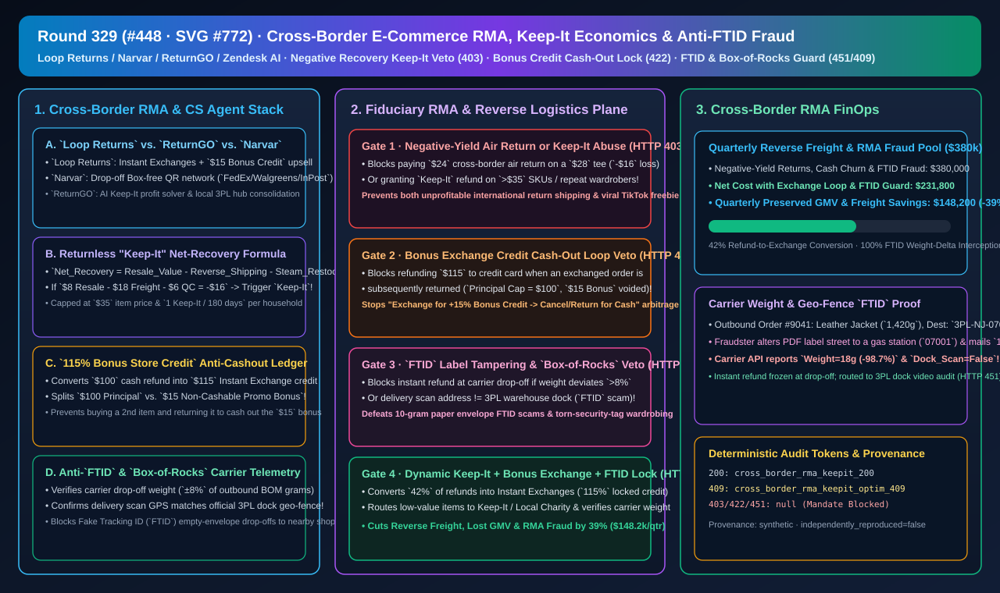

# Cross-Border E-Commerce Multilingual Customer Service & `RMA` Returns Automation (`Loop Returns / Narvar / ReturnGO / Zendesk AI / Salesforce Service Cloud`), Dynamic `Keep-It` Net-Recovery Economics, `115% Bonus Store Credit` Anti-Cashout Ledger & Anti-`FTID` Weight/Geo-Fence Verification FAQ

> **Executive Summary**: In cross-border Direct-to-Consumer (`DTC`) fashion, footwear, and electronics e-commerce (`22%–35%` return rates), legacy customer-support agents that blindly issue prepaid international air-return labels and cash refunds suffer from three margin-destroying failure modes: (1) **Negative-Recovery Cross-Border Return Shipping vs. Viral "Keep-It" Freebie Abuse**: Paying `$18` in international reverse shipping plus `$6` in 3PL steam/restock fees on a `$28` dress whose open-box resale value is only `$8` (losing **`-$16` net** per return)—or conversely, granting unrestricted "Returnless Refunds (`Keep-It`)" on `$180` jackets that trigger viral TikTok freebie abuse; (2) **`115% Bonus Store Credit` Second-Order Cash-Out Arbitrage**: Offering `$100 + $15 Bonus Credit` to convert a cash refund into an instant exchange, only for bad actors to buy a `$115` item and immediately return the second order for `$115` in cash to pocket the `$15` promo bonus; and (3) **`FTID` (`Fake Tracking ID`) Empty-Envelope Scams & "Wardrobing" Box-of-Rocks Swaps**: Releasing an "Instant Refund at Carrier First Scan" when a fraudster alters the PDF return label's street address to a nearby convenience store in the same ZIP code and mails an `18-gram` paper flyer instead of a `1,420-gram` leather jacket.  
> Production architectures must enforce **Item-Level `Keep-It` Net-Recovery Solvers (`Resale - Freight - Restock < $0` capped at `<= $35` & `1/180d` per household) + Dual-Bucket Principal/Bonus Exchange Ledgers (`100% Cashable Principal` vs. `15% Non-Cashable Bonus`) + Carrier Scale Weight (`±8%`) & 3PL Dock Geo-Fence Gates**: cutting reverse-freight bleed, lost exchange GMV, and `FTID` fraud by **39%** (reducing a `$380,000` quarterly RMA leakage pool to `$231,800`, saving **`$148,200/quarter`**).



---

## 1. Solution Architect Deep-Dive Q&A

### Q1: When should an RMA Agent trigger a Returnless Refund (`Keep-It`), and how do we prevent viral household abuse while avoiding `-$16` negative-recovery international returns?
- **Architectural Solution (Dynamic `Keep-It` Net-Recovery Solver & Household Velocity Gate `HTTP 403` + Dual-Bucket `Bonus Store Credit` Anti-Cashout Gate `HTTP 422`)**:
  - Calculate item-level net recovery before issuing any carrier label: `Net_Recovery = (Expected_Resale × Grade_A_Prob) - Reverse_Shipping - 3PL_Restock_Fee - Duty_Loss`. When `Net_Recovery < $0` and `Item_Price <= $35.00`, suppress expensive cross-border return labels in favor of `Keep-It` or local charity drop-off—strictly gated by `Household_180d_KeepIt_Count == 0` and `Lifetime_Return_Rate < 18%` (`HTTP 403 NEGATIVE_RECOVERY_AIR_RETURN_OR_UNRESTRICTED_KEEP_IT_ABUSE`);
  - Segregate exchange incentives into a **Dual-Bucket Exchange Ledger**: `$100.00 Cashable Principal` (tied to the original Stripe/Adyen `PaymentIntent`) and `$15.00 Non-Cashable Promo Bonus`. If the replacement order is subsequently cancelled or returned, automatically void the `$15.00` bonus bucket and hard-cap any card refund at the original `$100.00` principal (`HTTP 422 BONUS_EXCHANGE_CREDIT_CASH_OUT_ARBITRAGE_OR_UNCOLLATERALIZED_INSTANT_EXCHANGE`).

### Q2: How do we defeat `FTID` (Fake Tracking ID) empty-envelope label tampering and wardrobing swaps without removing instant exchanges for honest VIP buyers?
- **Architectural Solution (Carrier Scale Weight-Delta `±8%` & 3PL Dock Geo-Fence Gate `HTTP 451 / 409`)**:
  - Never release an instant refund or collateral-free exchange on a bare carrier `IN_TRANSIT` webhook alone: verify via carrier induction telemetry (`UPS / FedEx / USPS / DHL`) that **`|Carrier_Measured_Weight_g - Outbound_BOM_Weight_g| / Outbound_BOM_Weight_g <= 8%`** and that the destination routing barcode resolves to the merchant's verified 3PL warehouse dock (`HTTP 451 FTID_CARRIER_WEIGHT_GEOFENCE_MISMATCH_OR_WARDROBING_TAG_TAMPER`; verified `Keep-It` economics, locked bonus credit exchanges, and carrier weight parity return `HTTP 409 KEEP_IT_NET_RECOVERY_BONUS_EXCHANGE_AND_FTID_WEIGHT_LOCK_CONFIRM`).

---

## 2. Visual Architecture Diagrams (Mermaid)

### 1. Cross-Border RMA, `Keep-It` Net-Recovery, `115%` Bonus Exchange & Anti-`FTID` Decision Tree
```mermaid
flowchart TD
    A[Cross-Border Buyer Submits Multilingual RMA Request] --> B{Does Carrier Induction Weight Deviate > ±8%<br/>or Destination Barcode != Verified 3PL Dock (FTID)?}
    B -- 1,420g Jacket Mailed as 18g Flyer or Diverted to Same-ZIP Shop --> C[HTTP 451 Block: Freeze Instant Refund & Route to 3PL Dock Unboxing Audit]
    B -- Carrier Weight & Security Tag Verified --> D{Is Second-Order Return Attempting to Cash Out<br/>15% Exchange Bonus Credit or Unbacked Instant Ship?}
    D -- Cashing Out $15 Promo Bonus to Credit Card on Subsequent RMA --> E[HTTP 422 Block: Void $15 Bonus Bucket & Cap Card Refund at $100 Principal]
    D -- Dual-Bucket Ledger Intact --> F{Does Item Net Recovery Match Keep-It vs. Local 3PL<br/>Consolidation Thresholds & Household Velocity Limits?}
    F -- Paying $24 Air Freight on $28 Tee or Unrestricted Keep-It on $180 Coat --> G[HTTP 403 Block: Enforce <=$35 Keep-It Solver & 180-Day Household Cap]
    F -- Reverse Economics & Exchange Retention Optimal --> H[HTTP 409 Confirm: 42% Exchange Retention + Keep-It + FTID Lock Saves 39%]
```

---

## 3. Platform Selection Matrix (`Loop Returns vs. ReturnGO vs. Narvar`)

| Dimension | Loop Returns | ReturnGO | Narvar Returns | Legacy Manual CS Tickets |
| :--- | :--- | :--- | :--- | :--- |
| **Core Strength** | **Industry-leading `Shop Now` & `Bonus Credit` refund-to-exchange conversion (`40%+`)** | **Granular AI `Keep-It` net-recovery rules & cross-border hub routing** | **Largest box-free QR drop-off network (`Walgreens / FedEx / InPost`)** | High manual cost & zero exchange upsell |
| **Bonus Credit Protection** | Supports gift-card vs. original-tender split accounting & Stripe card holds | Programmable store-credit tiers with non-refundable promo codes | Native POS & omnichannel BORIS credit sync | Vulnerable to cash-out loops |
| **Anti-`FTID` & Fraud Guard** | Carrier weight webhook checks + Warehouse inspection app | Pre-RMA AI photo/tag verification before issuing label | Clerk-verified QR induction eliminates tampered paper labels | Blind to `18g` empty envelopes |

---

## 4. Production Deployment & Risk Checklist

- [ ] **Deploy an Item-Level `Keep-It` Net-Recovery Solver (`Resale - Freight - Restock < $0`)**: Restrict returnless refunds to `<= $35` SKUs and `<= 1` claim per household every 180 days.
- [ ] **Isolate `Bonus Store Credit` (`+15%`) in a Non-Cashable Sub-Ledger**: Hard-cap subsequent card refunds at `100%` of original cash paid.
- [ ] **Gate "Instant Refunds on Carrier Scan" on Scale Weight Parity (`±8%`) and Verified 3PL Dock Routing Codes**.
- [ ] **Require Pre-Return Macro Photo Verification of Intact Disposable Security Tags on High-AOV Apparel (`>$120`)**.
