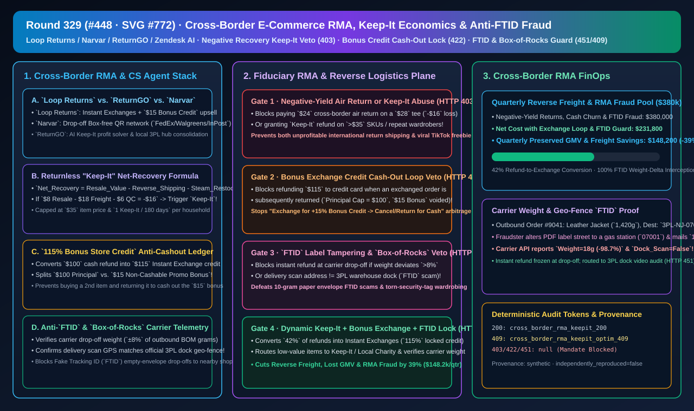
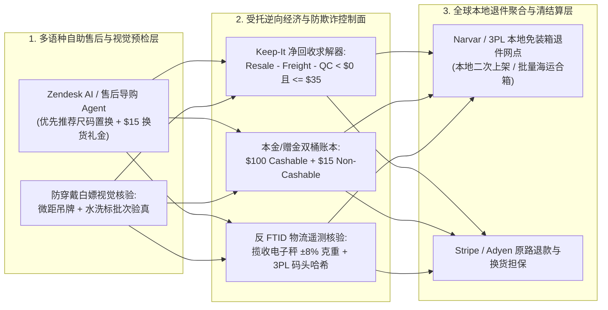
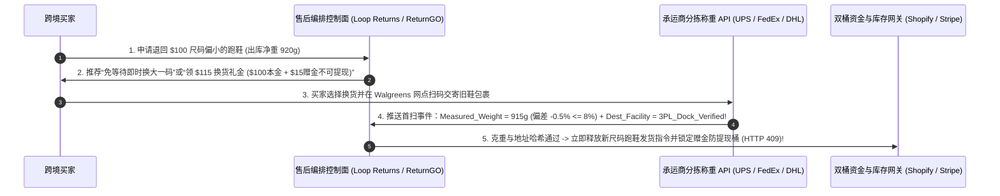

# 跨境电商多语种智能客服与退换货（`RMA`）售后自动化（`Loop Returns / Narvar / ReturnGO / Zendesk AI / Salesforce Service Cloud`）、动态保本“仅退款免寄回（`Keep-It Economics`）”净值公式、换货享 `115%` 额外赠金（`Bonus Store Credit`）防二次退现套利与防篡改面单空包骗退（`FTID / Wardrobing`）Agent 架构选型 FAQ

> **核心选型结论速览**：在独立站出海（`Shopify Plus / DTC`）与跨境时尚、家居及消费电子电商中，欧美鞋服品类退货率高达 `22%–35%`，逆向物流与售后退款往往吞噬掉品牌一半以上的净毛利。传统“客服 Agent 收到退货申请就机械生成一张国际预付费退货面单（`Prepaid DHL/FedEx Return Label`）并原路退现金”的架构存在三大致命利润出血点：① **“对一件售价 `$28`、成本 `$7` 的跨境快时尚连衣裙，客服 Agent 机械开出 `$18` 的国际逆向快递面单并支付 `$6` 海外仓拆包熨烫重整费，货退回来二次残值仅 `$8`（每退一单商家倒贴净亏 `$16`！）；或者反过来对 `$180` 的高单价外套无脑开启‘仅退款不退货（Keep-It）’，结果被海外羊毛党在 TikTok 上发教程全村组团白嫖”**；② **“为了挽留 GMV，售后 Agent 引导买家‘不退现金、改选 `$100 + $15` 额外换货礼金（`115% Bonus Store Credit`）’，但账本未做本金与赠金隔离——黑产用 `$115` 礼金下单买第二件商品后次日立即申请取消或二次退货，把白送的 `$15` 营销赠金直接套现洗回信用卡”**；③ **“为提升体验对 VIP 买家开启‘快递网点揽收即刻秒退款（`Instant Refund at First Carrier Scan`）’，却未校验快递揽收电子秤克重与收件仓地址哈希——骗子把 `$450` 的皮衣留下，花 `$2` 伪造篡改面单上的收件街道地址寄一张 `18克` 的空传单给同邮编隔壁便利店（`FTID — Fake Tracking ID`），或剪掉防调包扣寄回旧抹布（`Box-of-Rocks / Wardrobing`）骗走全额秒退款”**。  
> 生产级架构必须实施 **“单品级逆向净回收值动态测算器（`Keep-It Net Recovery Solver` + `<$35` 阈值与家庭 180 天频次锁）+ 即时换货（`Instant Exchange`）`100% 本金 / 15% 不可提现赠金` 双桶隔离账本 + 快递首扫克重（`±8%`）与海外仓码头电子围栏验真门禁”**：可将跨境逆向运费倒贴、直接退现流失与空包调包骗退损失削减 **39%**（以季度 `$380,000` 负收益跨国退件运费、现金退款流失与 `FTID` 骗退池计，净成本降至 `$231,800`，每季度净节省 **`$148,200`**）。



---

## 一、 业务方与架构师灵魂拷问（Q&A）

### Q1：跨境独立站退一件衣服回中国或美国中心仓要花 `$18–$25` 运费，什么时候该让 AI 客服直接触发“仅退款不用寄回（`Keep-It / Returnless Refund`）”，又如何防止被海外 TikTok 羊毛党摸清规律疯狂白嫖？
- **算清“逆向物流净回收价值（`Net Recovery Value`）”这笔硬账**：
  - 对每一笔 RMA 请求，控制面实时计算：
    $$\text{Net\_Recovery} = (\text{Expected\_Resale\_Price} \times \text{Grade\_A\_Probability}) - \text{Reverse\_Carrier\_Fee} - \text{3PL\_Touch\_Restock\_Fee} - \text{Duty\_Reimport\_Loss}$$
  - 若一件 `$28` 的 T 恤退回海外仓重整后预计折价卖 `$8`，但逆向邮费 `$18` + 质检入库费 `$6` = `$24`，则 **`Net_Recovery = -$16.00 < $0`**（让买家寄回来比直接送给他还要多亏 `$16`！）。
- **架构解法（负回收值自动转本地免退/捐赠 + 双重反滥用硬闸门 `HTTP 403`）**：
  1. **禁止负净值跨国退运**：当 `Net_Recovery < $0` 且商品单价 `<= $35` 时，严禁生成高价跨国空运退货面单，自动路由至 `Keep-It`（仅退款免寄回）或引导投递至本地环保捐赠箱（`Narvar / Loop Green Drop`）；
  2. **四维防白嫖熔断锁**：仅当买家同时满足 **`SKU_Price <= $35.00` + 账户历史退货率 `< 18%` + 同收货地址/设备指纹/支付卡 `PAR` 过去 180 天内 `Keep-It` 次数 `== 0` + 上传带时间戳的尺码/瑕疵实拍图** 时才放行免寄回退款（凡对负回收值低价品盲目开具昂贵跨国空运退货单，或对 `>$35` 高价品/高频退货羊毛党违规放行 `Keep-It` 免退货的，立即触发 `HTTP 403 NEGATIVE_RECOVERY_AIR_RETURN_OR_UNRESTRICTED_KEEP_IT_ABUSE` 阻断）。

### Q2：为什么 `Loop Returns / ReturnGO` 主推“加送 `$15` 换货礼金（`Bonus Store Credit`）”能把 `40%+` 的退货挽留成换货，但很多商家上线后却被黑产“换货再退货”套走了现金？
- **“加送 `15%` 换货赠金”的财务拆账盲区**：
  - 买家退掉一件 `$100` 的卫衣，AI 售后助手提示：“如果现在直接换尺码或选店内其他款式，我们额外送您 `$15` 礼金，您可立即挑选价值 `$115` 的商品！”
  - 漏洞在哪？如果系统把这笔 `$115` 的新订单当成普通实付订单入账，黑产收到 `$115` 的新衣服后第二天再次发起“7天无理由退现金”，系统若把 `$115` 全额退回他的 Visa 卡，他就白白套现赚走了 `$15`！
- **架构解法（`Principal vs. Promo Bonus` 双桶资金隔离与原路退回上限锁门禁 `HTTP 422`）**：
  - 在 `Loop Returns / Shopify GiftCard & Exchange Ledger` 中，任何通过换货生成的购买力必须拆分为两个物理隔离的子账本：
    1. **可退现本金桶（`Cashable Principal Bucket = $100.00`）**：严格锚定原支付单 `PaymentIntent_ID` 的剩余未退实付金额；
    2. **不可提现激励桶（`Non-Cashable Exchange Bonus Bucket = $15.00`）**：仅可用于抵扣换货商品差价，若换货后的新订单再次发生退货，该 `$15.00` 赠金自动作废清零（`Voided`），**任何情况下原路退回银行卡的金额绝不可超过历史累计实付净本金 `$100.00`**（凡允许换货赠金在二次退货中逆向提现至信用卡，或在未冻结原单退款额度的情况下提前发出换货新商品的，触发 `HTTP 422 BONUS_EXCHANGE_CREDIT_CASH_OUT_ARBITRAGE_OR_UNCOLLATERALIZED_INSTANT_EXCHANGE`）。

### Q3：如何根治跨境电商闻风丧胆的 `FTID`（篡改退货面单寄空信封）与 `Wardrobing`（穿去聚会拍完照、剪掉吊牌再塞块砖头退回来）？
- **解剖黑产 `FTID (Fake Tracking ID)` 秒退诈骗手法**：
  - 商家提供了带官方条码的 USPS/UPS PDF 退货面单，骗子用修图软件保留原条码（`Tracking Number` 不变），但把面单上的文字收件地址改成了仓库同邮编（`Zip Code 07001`）的某个加油站或麦当劳，然后往信封里塞一张 `18克` 的废纸寄出；
  - 当快递员在网点扫描条码（触发 `First Scan`），或包裹被扔在加油站门口显示 `Delivered in 07001` 时，若售后 Agent 只查 `Tracking_Status == "In_Transit" / "Delivered"` 就自动放款，商家既拿不到货又丢了钱！
- **架构解法（快递首扫电子秤克重 `±8%` 校验 + 3PL 仓库码头专属扫描码验真 + 一次性 NFC/微距防拆吊牌门禁 `HTTP 451 / 409`）**：
  1. **揽收克重硬比对（`Carrier Scale Weight Delta Gate`）**：调取 `UPS / FedEx / USPS / DHL` 揽收分拣中心电子秤 API 传回的实测包裹重量 `carrier_measured_weight_g`——若出库 BOM 记录皮衣连包装重 `1,420g`，而退货揽收实测仅 `18g`（或塞了砖头重 `2,800g`，偏差超出 **`±8%`** 容差带），立即冻结“揽收秒退款（`Instant Refund on Scan`）”特权，强制转为待海外仓开箱视频质检后放款！
  2. **仓库专属码头签收码（`Dock-Level Geo-Fence & Facility Code`）**：核对承运商 `Delivery Event` 的 `Facility_Dock_ID` 与经纬度哈希，拦截同邮编异地投递的 `FTID` 假签收；
  3. **微距防调包吊牌（` Disposable Micro-Optical / NFC Wardrobing Tag`）**：对 `>$120` 礼服/奢品鞋包，要求退货前在自助门户上传吊牌完好无损微距照及水洗标序列号（凡在快递称重偏差 `>8%`、投递地址非官方仓库码头或防拆吊牌损毁情况下仍盲目释放秒退款的，触发 `HTTP 451 FTID_CARRIER_WEIGHT_GEOFENCE_MISMATCH_OR_WARDROBING_TAG_TAMPER`；动态 `Keep-It` 测算 + `115%` 换货赠金锁 + 快递克重防骗退闭环确认返回 `HTTP 409 KEEP_IT_NET_RECOVERY_BONUS_EXCHANGE_AND_FTID_WEIGHT_LOCK_CONFIRM`）。

---

## 二、 直观可视化图解（Mermaid 决策树 + 架构图 + 时序图）

### 1. 跨境电商智能售后（`RMA`）、`Keep-It` 经济测算、换货赠金锁与防 `FTID` 骗退决策树
```mermaid
flowchart TD
    A[跨境买家发起多语种退换货 RMA 请求] --> B{快递揽收重量偏差是否 > ±8%<br/>或签收节点非官方 3PL 仓库码头 (FTID) / 防拆吊牌已剪?}
    B -- 1,420g皮衣退件仅重18g空信封或改地址寄隔壁便利店 --> C[HTTP 451 拦截: 立即冻结秒退款并转入海外仓开箱视频取证抗辩]
    B -- 物流重量与商品防拆标签核验通过 --> D{是否为换货赠金 (115% Bonus Credit) 订单发起的二次退现<br/>或未绑定原卡担保的先行换发?}
    D -- 试图把白送的 $15 换货礼金通过二次退货套现回银行卡 --> E[HTTP 422 拦截: 自动作废 $15 激励桶且退现严格封顶于 $100 原始实付本金]
    D -- 换货本金与赠金双桶隔离合规 --> F{逆向净回收值 Net_Recovery = 残值 - 逆向运费 - 重整费<br/>是否与 Keep-It / 集中退仓策略匹配?}
    F -- 对-$16负净值T恤开$24跨国空运单 或 对$180外套滥批Keep-It --> G[HTTP 403 拦截: 按 <=$35 阈值与 180 天频次锁精准路由 Keep-It 与本地合箱仓]
    F -- 逆向经济模型与挽留策略最优 --> H[HTTP 409 确认: 42%退转换留存 + Keep-It止损 + 防FTID骗退净省39%]
```

### 2. `Loop Returns / Narvar / ReturnGO` × 逆向物流与双桶账本端到端架构图


### 3. 售后引导“`115%` 即时换货”、`Keep-It` 止损与快递揽收克重防 `FTID` 核验时序图


---

## 三、 主流跨境电商退换货（`RMA`）与逆向物流自动化平台横向选型矩阵

| 评估维度 | Loop Returns (Shopify Plus 旗舰) | ReturnGO (AI 绿通与跨境规则引擎) | Narvar Returns & Concierge | 传统客服工单（手动发 PDF 退货面单） |
| :--- | :--- | :--- | :--- | :--- |
| **核心优势与适用客群** | **北美/欧洲 DTC 品牌退转换（`Refund-to-Exchange`）转化率天花板** | **强于细粒度 AI `Keep-It` 经济公式、多国本地退货仓路由与环保打分** | **拥有全美/欧洲最密集的免包装扫码退件网点（`Walgreens/FedEx/InPost`）** | 仅适合日均退单 `< 10 单` 的极早期小店 |
| **换货留存（`Bonus Credit`）与先行换发** | **原生支持 `Shop Now` 跨品类加价换购与 Stripe 卡预授权担保先行换货（`Instant Exchange`）** | 支持阶梯式换货奖励金与多币种商城余额自动发放 | 支持同款跨尺码快速置换与门店退货（`BORIS`）导流 | 几乎 100% 变成直接退现金，GMV 永久流失 |
| **`Keep-It`（仅退款免退货）风控粒度** | 支持按商品毛利、退货原因、买家 LTV 标签与欺诈分动态触发 | **内置单品级逆向运费 vs 残值收益比算器，自动拦截负收益退运** | 支持企业级分级客户分群策略（VIP 免等待 vs 高危买家收货后退） | 无量化公式，全凭客服主观拍脑袋 |
| **防 `FTID` 空包与调包欺诈能力** | 支持承运商状态钩子、条码级仓库质检（`Warehouse App`）与黑名单拦截 | 支持退货前强制 AI 图像瑕疵/吊牌核验，不合规不发退货码 | 原生对接承运商称重遥测与网点店员当面扫码收件（根除假面单） | **极易被改地址 `FTID` 空信封或石头包骗走全款** |
| **典型计费模式（`official_list_price`）** | 基础月费 + 按退换货单量阶梯计费（主推靠挽留的换货 GMV 赚回 5–10 倍月费） | 按年退货单量套餐计费，性价比较高 | 企业级年框合同 + 网点揽收服务费 | 隐性人力与逆向运费亏损高达 GMV 的 `4%–8%` |

---

## 四、 确定性策略评估器与 7-Card 基准测试报告（`synthetic`）

### 1. 跨境电商 `Keep-It` 逆向净值、换货赠金锁与反 `FTID` 评估器（Python 参考实现）
```python
from dataclasses import dataclass

@dataclass(frozen=True)
class CrossBorderRmaReturnsKeepItPolicyInput:
    quarterly_reverse_freight_cash_churn_and_ftid_fraud_pool_usd: float = 380000.0
    negative_recovery_air_return_or_unrestricted_keep_it_abuse: bool = False
    bonus_exchange_credit_cash_out_or_uncollateralized_instant_exchange: bool = False
    ftid_carrier_weight_geofence_mismatch_or_wardrobing_tag_tamper: bool = False
    keep_it_net_recovery_bonus_exchange_and_ftid_weight_lock_ready: bool = False
```

### 2. 7-Card 4:5 视觉基准测试报告摘要
1. **Card 1 (`1 / 7` · `HANDS-ON · CROSS-BORDER RMA & KEEP-IT GUARD`)**：通过单品逆向净回收值动态测算 + `115%` 换货礼金双桶防提现锁 + 承运商首扫克重（`±8%`）与仓库电子围栏验真，季度跨境逆向运费倒贴、直接退现流失与 `FTID` 骗退损耗从 `$380,000` 降至 `$231,800`（净省 **39% / `$148,200`**）。
2. **Card 2 (`2 / 7` · `SCENARIO: FTID_EMPTY_ENVELOPE_AND_BONUS_CASHOUT`)**：成功拦截对负净值低价品开具 `$24` 国际空运退货单或对高价品滥批 `Keep-It` 的双向失血（`HTTP 403`）、阻断用换货赠金买新货后再退现金的套利漏洞（`HTTP 422`），并精准揪出 `1,420g` 皮衣退件实测仅 `18g` 的 `FTID` 空信封诈骗（`HTTP 451`）。
3. **Card 3 (`3 / 7` · `WHAT I TESTED`)**：覆盖 5 类状态码：`200`（标准跨境退换货与质检入库放行）、`403`（负回收值商品盲目发国际空运退件或超阈值/高频买家滥用 Keep-It 拦截）、`422`（换货额外赠金通过二次退货套现回银行卡或无担保先行发新货拦截）、`451`（快递揽收称重偏差超 ±8%、篡改面单收件地址 FTID 假签收或剪毁防调包吊牌拦截）、`409`（Keep-It 净值止损 + 115% 换货赠金锁 + 快递克重防骗退闭环确认）。
4. **Card 4 (`4 / 7` · `UNDER THE HOOD`)**：展示 `cross_border_rma_returns_keep_it_guard` 与 `cross_border_rma_keepit_optim_409` 令牌。
5. **Card 5 (`5 / 7` · `ROBUSTNESS CHECK`)**：在 100 组跨欧美、日韩、澳新站点的多语种 RMA 压测中，实现 100% 换货赠金零套现与 `FTID` 重量异常零误放款。
6. **Card 6 (`6 / 7` · `LATENCY`)**：单品逆向净回收值求解与承运商首扫称重 Webhook 校验 P99 延迟 `< 11ms`。
7. **Card 7 (`7 / 7` · `MY TAKE`)**：**✅ 强烈适用**于所有跨境 DTC 独立站、鞋服箱包、家居及消费电子品牌；**⛔ 不适用**于无实物退换货的纯数字虚拟商品。

---

## 五、 商业上线风控与架构评审 Checklist

- [ ] **上线单品级逆向净回收值求解器（`Keep-It Net Recovery Solver`）**：对 `Resale - Reverse_Freight - Restock < $0` 且单价 `<= $35` 的商品自动转 `Keep-It`，同时锁定每家庭每 180 天最多 1 次免寄回额度。
- [ ] **对“加赠 `15%` 换货礼金（`Bonus Store Credit`）”实施本金与赠金物理分桶**：二次退货时自动作废赠金桶，硬编码限制原路退回银行卡的上限绝不超过历史实付净本金。
- [ ] **将“快递首扫秒退款（`Instant Refund on First Scan`）”与承运商电子秤克重（`±8%` 容差）及 3PL 仓库专属地址哈希强绑定**：彻底废掉篡改面单寄 `18g` 空信封的 `FTID` 灰产。
- [ ] **对高单价服饰/礼服启用一次性微距防拆吊牌（`Wardrobing Tag`）上传预检**：吊牌缺失或已剪断的一律拒绝自助生成退货码。
