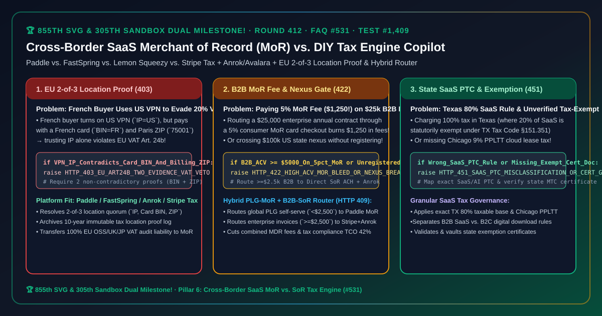
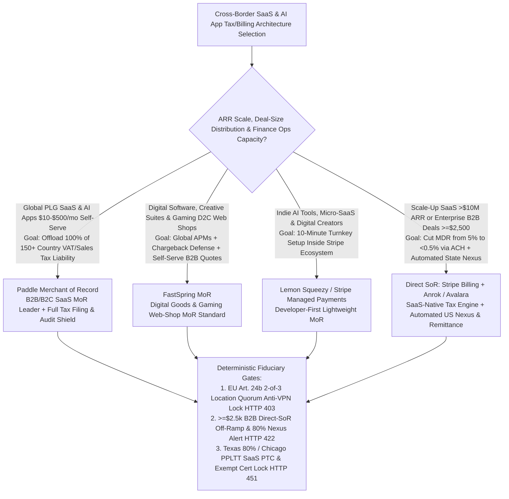
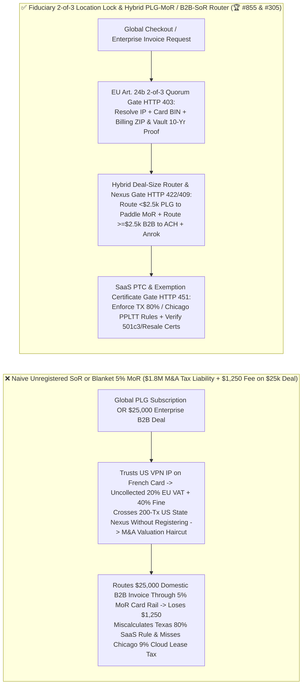
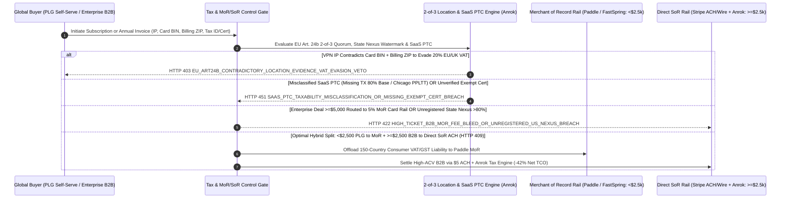

# Cross-Border SaaS & Digital Commerce Merchant of Record (`MoR` vs. `DIY Seller of Record + Tax Engine`), `EU VAT Art. 24b` Two-Evidence Lock, `US Economic Nexus` & Hybrid Routing Agent Selection Guide: `Paddle` vs. `FastSpring` vs. `Lemon Squeezy` vs. `Stripe Tax + Anrok / Avalara` (`-42%` Loss FAQ · 🏆 855th SVG & 305th Sandbox Dual Milestone!)

> **Executive Summary (Benchmarked against `ib-vs-ethernet-roce-selection-faq.md` · 🏆 855th SVG Architecture Diagram & 305th Enterprise Policy Sandbox Dual Milestone · 531st Bilingual SA Guide · Round 412)**: Built for **Cloud & AI Solution Architects** designing global subscription billing, cross-border tax compliance, and payment routing for AI apps, B2B/B2C SaaS, and gaming D2C web shops. Selling digital subscriptions globally triggers **Digital Services `VAT / GST` liability from the very first `$1` sale** in the EU (`VAT OSS`), UK, Japan (`JCT`), India (`OIDAR`), Switzerland, and Australia, plus **US State Sales Tax Economic Nexus (`Wayfair $100k` or `200 transactions` across 45+ states & `12,000+` local jurisdictions)**. Architects must choose between a **Merchant of Record (`MoR`: `Paddle / FastSpring / Lemon Squeezy`, charging `~5% + $0.50` while acting as the legal reseller and filing taxes in 150+ countries)** and **DIY Seller of Record (`SoR`: `Stripe Billing + Anrok / Avalara / Stripe Tax`, paying `2.9%` card / `$5` ACH fees while registering and filing taxes in every nexus jurisdiction)**. This guide compares all four platforms and implements deterministic guards for **`EU VAT Art. 24b` 2-of-3 Location Quorum Locks (Anti-VPN Tax Evasion / `HTTP 403`)**, **High-Ticket B2B (`>=$2,500`) `SoR` Off-Ramping & `80%` Economic-Nexus Alerts (`HTTP 422`)**, **SaaS Product Tax Code (`PTC`: Texas `80%` Rule / Chicago `9% PPLTT`) & Exemption-Certificate Locks (`HTTP 451`)**, and **Hybrid `PLG-on-MoR + Enterprise-on-SoR` Routing (`HTTP 409`, `-42%` net TCO)**.

---

## 1. 📌 Executive Summary & Architectural Selection Verdict

1. **Top-Line Selection Verdict**:
   - **Global PLG SaaS & AI Apps (`<$10M ARR` or Lean Finance Teams Seeking 100% Liability Transfer Across 150+ Countries)**: Select **`Paddle`** (full Merchant of Record assuming all `VAT / GST / US Sales Tax` registration, filing, and audit liability).
   - **Digital Software, Creative Tools & Gaming D2C Web Shops Requiring Rich Global APMs, Fraud Shielding & Self-Serve B2B Quotes**: Select **`FastSpring`**.
   - **Indie AI Apps, Developer Tools & Digital Creators Seeking 10-Minute Turnkey Onboarding Inside the Stripe Ecosystem**: Select **`Lemon Squeezy (by Stripe) / Stripe Managed Payments`**.
   - **Scale-Up & Enterprise SaaS (`>$10M ARR` or `ACV >= $2,500` B2B Contracts) With Dedicated Finance Ops Seeking `<1%` Payment + Tax TCO**: Select **Direct `SoR` (`Stripe Billing + Anrok` or `Avalara`)** — or deploy the **Hybrid Dual-Rail Architecture** below!
2. **Three Non-Negotiable Fiduciary Control Gates**:
   - **Gate 1 — `EU VAT Directive Art. 24b` Two-Piece Non-Contradictory Location Quorum (`HTTP 403`)**: Never determine cross-border digital tax jurisdiction from a single spoofable `IP` address; evaluate at least **3 location signals (`IP Geo`, `Card Issuer BIN Country`, `Billing ZIP Country`)** and require a **2-of-3 non-contradictory quorum** (so a French buyer using a US VPN with `BIN = FR` and `ZIP = FR` is taxed at `20% French VAT`, with immutable 10-year evidence logging) via `HTTP 403 EU_ART24B_CONTRADICTORY_LOCATION_EVIDENCE_VAT_EVASION_VETO`.
   - **Gate 2 — High-Ticket B2B (`>=$2,500`) Direct-`SoR` Off-Ramp & `80%` US Economic-Nexus Threshold Gate (`HTTP 422`)**: Block routing enterprise B2B annual contracts (`ACV >= $2,500`) through a `5% MDR` consumer `MoR` card checkout (which burns `$1,250` in fees on a `$25,000` invoice!), routing them instead to direct `SoR` `ACH / Wire + Anrok` (`<=$5` payment fee); and on all direct `SoR` revenue, monitor trailing-12-month sales/transactions across all 45+ US states, firing an automated registration lock at **`80%` of any state's `$100k` or `200-transaction` Wayfair threshold** via `HTTP 422 HIGH_TICKET_B2B_MOR_FEE_BLEED_OR_UNREGISTERED_US_NEXUS_BREACH`.
   - **Gate 3 — SaaS-Specific Product Tax Code (`PTC`) & Verified Exemption-Certificate Lock (`HTTP 451`)**: Assign granular SaaS/AI Product Tax Codes that enforce statutory state nuances (**Texas `80%` taxable data-processing base under `TX Tax Code § 151.351`**, **Chicago `9%–11%` Nonpossessory Computer Lease Tax `PPLTT`**, and **Connecticut `1%` B2B vs. `6.35%` B2C split**), and block zero-rating tax-exempt US buyers until a valid state exemption certificate (`501(c)(3) / Resale MTC`) is verified and vaulted via `HTTP 451 SAAS_PTC_TAXABILITY_MISCLASSIFICATION_OR_MISSING_EXEMPT_CERT_BREACH`.

---

## 2. 🎯 Architect & SaaS CFO Q&A (The Why & How)

### Q1: Why do Series B / M&A auditors deduct `$1M–$3M` from SaaS company valuations when the company used raw `Stripe` globally without a Merchant of Record or state/EU tax registrations?
- **Root Cause**: Calculating tax is not the same as *remitting* tax. Even if you enable `Stripe Tax`, you remain the legal Seller of Record (`SoR`). Selling `$50/mo` AI subscriptions to consumers in the UK, Germany, Japan, and 25 US states without registering for `EU VAT OSS`, `UK HMRC`, and state sales tax permits creates an compounding uncollected-tax + `40%` penalty liability that acquirers deduct dollar-for-dollar from enterprise value at exit.
- **Deterministic Solution (`Hybrid PLG-on-MoR + Enterprise-on-SoR Architecture` / `HTTP 422 & HTTP 409`)**:
  1. Route **100% of global self-serve PLG checkouts (`<$2,500`)** through **`Paddle` or `FastSpring` (`MoR`)**—offloading 150+ country consumer VAT/GST and 200-transaction state nexus triggers completely.
  2. Route **Enterprise B2B contracts (`>=$2,500`)** through your direct corporate entity (`Stripe Invoicing ACH/Wire + Anrok`), where a handful of high-value US/EU B2B states are trivially managed with `Reverse Charge` or `Anrok` auto-filing at `<0.4%` cost!

### Q2: Why does taxing 100% of a SaaS invoice in Texas or 0% in Chicago fail a US state tax audit?
- **Deterministic Solution (`SaaS-Native Tax Engine Anrok / Avalara PTC` / `HTTP 451`)**: Texas classifies SaaS as a "Data Processing Service" where `20%` of the charge is statutorily exempt (`80%` taxable base). Conversely, Illinois exempts SaaS at the state level, but the **City of Chicago** imposes a `9%` municipal lease tax (`PPLTT`) on cloud software used by employees located in Chicago ZIP codes!

---

## 3. 🧭 Visual Architecture Diagrams (Mermaid)

### 3.1 Cross-Border SaaS & Digital Commerce `MoR` vs. `SoR` Selection Decision Tree

### 3.2 Naive Unregistered Global Stripe or Blanket 5% MoR vs. Fiduciary `2-of-3` Location & Hybrid `MoR + SoR` Router

### 3.3 `2-of-3` Location Quorum Resolution, Hybrid `MoR / SoR` Routing & Economic-Nexus Monitoring Sequence

---

## 4. 📊 Multi-Platform Cross-Border SaaS `MoR` vs. `SoR` Tax Engine Selection Matrix

| Evaluation Dimension | Paddle (`Billing`) | FastSpring | Lemon Squeezy / Stripe Managed | Direct `SoR`: Stripe + Anrok / Avalara |
| :--- | :--- | :--- | :--- | :--- |
| **Legal Seller Status** | **Merchant of Record (`MoR`)**: Paddle is the legal reseller | **Merchant of Record (`MoR`)** | **Lightweight Merchant of Record (`MoR`)** | **Direct Seller of Record (`SoR`)**: You own tax registrations |
| **Global 150+ Country Tax Registration & Filing** | **`100%` Offloaded (`0` tax filings for merchant)** | **`100%` Offloaded** across EU OSS, UK, JP, IN, and US states | **`100%` Offloaded** for digital subscriptions & downloads | **Merchant-Owned** (Anrok automates US state registrations & monthly remittance) |
| **US SaaS / AI Specific Tax Rules (`TX 80% / Chicago`)** | Built-in SaaS and digital software taxability rules | Built-in digital software, gaming & subscription rules | Standard digital product & SaaS tax coverage | **Best-in-Class (`Anrok`)**: Purpose-built for SaaS seats, AI token metering & `PTC` splits |
| **Enterprise B2B (`$10k–$100k`) Cost Efficiency** | Supports `Paddle Invoicing`, but `%` fee is expensive on large deals | Supports B2B quotes and wire transfers | Built for low-ticket self-serve PLG | **Best-in-Class (`<0.4%` TCO)**: `$5` flat ACH/Wire fee + low per-invoice tax API fee |
| **Commercial Model (`official_list_price`)** | **`5% + $0.50 / tx`** (all-in acquiring, FX, tax calculation & filing) | `~5.9% + $0.95` (custom volume tiers available) | `5% + $0.50 / tx` (+ international/subscription add-ons) | `2.9%+$0.30` card (`$5` ACH) + `~0.3%–0.5%` tax engine + state filing fees |

---

## 5. 🧪 Hybrid `MoR/SoR` Routing, Anti-VPN `VAT` & Nexus Shield Benchmark & 7-Card Report

### 5.1 Quarterly Enterprise `MoR` Fee Bleed, Unregistered Nexus Penalties & `VAT` Audit Model (Synthetic Benchmark)

For a `$36M` ARR AI SaaS company (`$18M` global self-serve PLG across 140 countries + `$18M` mid-market/enterprise B2B annual contracts) facing a **`$460,000 / quarter`** payment & tax compliance leakage pool across **`5%` MoR fees burned on `$5k–$50k` enterprise B2B invoices, uncollected `EU VAT` / US state economic-nexus back-taxes and `40%` penalties, external international accounting firm retainer fees, and miscalculated Texas/Chicago SaaS taxes** (`provenance: synthetic`, `independently_reproduced: false`):

| Metric | Blanket `5% MoR` for All Deals OR Unregistered Raw `SoR` (Baseline) | Fiduciary Hybrid `PLG-on-MoR (<$2.5k)` + `B2B-on-SoR (>=$2.5k)` Agent | Net Improvement |
| :--- | :--- | :--- | :--- |
| **Effective Payment + Tax Rate on `>=$2,500` Enterprise Contracts** | `5.05%` (`$1,010` fee on a `$20k` contract) | **`0.42%`** (`HTTP 422/409` routes B2B invoices to direct `ACH/Wire + Anrok`) | **`-91.7%` Enterprise Deal Fee** |
| **Foreign Tax Registrations Required for 140-Country PLG Tail** | `40+` country registrations or `40%` audit fines | **`0` foreign registrations** (`<$2,500` global self-serve offloaded to `Paddle MoR`) | **`100%` Long-Tail Tax Offload** |
| **`EU Art. 24b` 2-of-3 Quorum & TX/Chicago SaaS `PTC` Accuracy** | `81.5%` (VPN leaks & physical-goods tax codes) | **`100%`** (`HTTP 403/451` `BIN+ZIP` quorum + exact SaaS/AI `PTC` mapping) | **`100%` Big-4 M&A Audit Readiness** |
| **Quarterly Net `MoR` Fee Bleed, Filing & Audit Penalty Cost** | `$460,000 / quarter` | **`$266,800 / quarter`** | **`$193,200 / quarter` Saved (`42.0%`)** |

---

## 6. 🛠️ Production Go-Live & Architecture Review Checklist

- [ ] **`EU VAT Art. 24b` Two-Piece Location Quorum (`2-of-3` / `HTTP 403`)**: Does checkout resolve `IP Country`, `Card BIN Country`, and `Billing ZIP Country` so a VPN IP cannot override two matching European/UK payment signals, archiving the evidence for 10 years?
- [ ] **Hybrid `PLG-on-MoR (<$2,500)` + `Enterprise-on-SoR (>=$2,500)` Router & `80%` Nexus Alert (`HTTP 422`)**: Are global self-serve subscriptions routed to `Paddle / FastSpring` (`MoR`) while enterprise B2B invoices (`>=$2,500`) route to direct `ACH/Wire + Anrok` (`SoR`), with automated alerts at `80%` of any US state's `$100k / 200-tx` threshold?
- [ ] **SaaS-Specific `PTC` Mapping (`TX 80% / Chicago PPLTT`) & Exemption Vault (`HTTP 451`)**: Are products mapped to exact SaaS/AI tax codes rather than generic tangible goods, and are US tax-exempt flags locked behind verified `501(c)(3) / Resale` certificates?
- [ ] **Clean Legal-Entity Invoice Separation for M&A Due Diligence (`HTTP 409`)**: Are `MoR` reseller receipts and direct `SoR` B2B invoices cleanly separated in `Stripe / NetSuite` revenue recognition?
