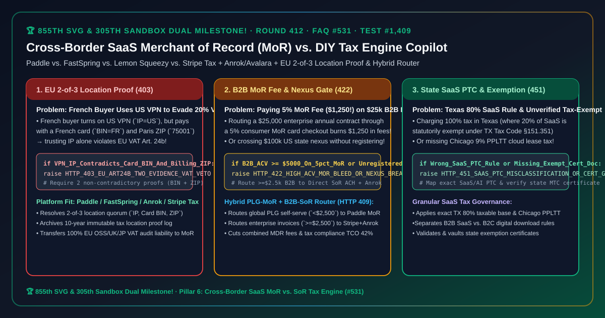
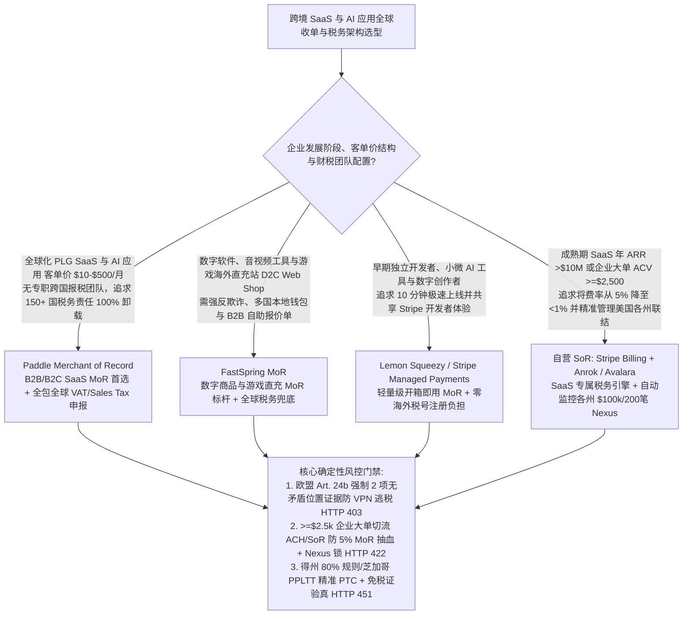
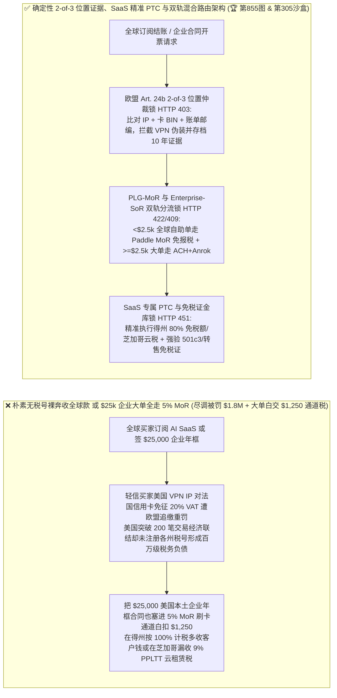
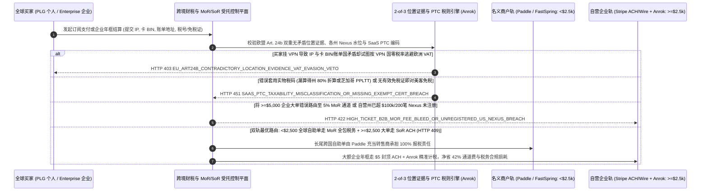

# 跨境 SaaS、AI 应用与数字商品名义商户（`Merchant of Record, MoR`）vs. 自建税务引擎（`DIY Seller of Record + Tax Engine`）架构选型对比：`Paddle` vs. `FastSpring` vs. `Lemon Squeezy / Stripe Managed Payments` vs. `Stripe Tax + Anrok / Avalara`、欧盟 `2-of-3` 位置证据锁、美国经济联结（`Economic Nexus`）预警与混合路由净省 42% 决策指南（FAQ · 🏆 第 855 张 SVG 与第 305 个策略沙盒双里程碑！）

> **导读（对齐 `ib-vs-ethernet-roce-selection-faq.md` 标杆风格 · 🏆 第 855 张 SVG 架构图与第 305 个企业级策略沙盒双里程碑 · 第 531 篇双语指南 · 第 412 轮）**：本文面向 AI 原生应用、全球化 B2B/B2C SaaS、游戏官方直充站（Web Shop）与跨境财税合规领域的 **Cloud & AI Solution Architect**。当一款 AI 应用或 SaaS 产品上线收全球用户的钱时，从在欧盟、英国、日本、印度、瑞士卖出 **第 1 笔 `$20` 订阅** 的那一刻起，就触发了当地数字服务增值税（`Digital Services VAT / GST`）法定代扣代缴义务；而在美国，一旦在任一州年销售额突破 `$100,000` 或满 `200 笔` 交易（`South Dakota v. Wayfair` 经济联结红线），就必须在全美 45+ 个州、12,000+ 个地方税区注册报税！架构师面临的核心选型是：**选择全托管名义商户（`MoR`: `Paddle / FastSpring / Lemon Squeezy`，交 `5% + $0.50` 费率，但由平台作为法律上的“转售商 Reseller”承担全球 150+ 国全部税务申报与审计责任）**，还是 **自建直连收单加税务计算器（`SoR`: `Stripe + Stripe Tax / Anrok / Avalara`，刷卡费仅 `2.9%`，但需自己去全球几十个国家和美国各州注册税号并按月申报）**？本文给出四大方案的横向选型矩阵，并落地 **欧盟 `VAT Art. 24b` 双重无矛盾位置证据（防挂美国 VPN 逃避 20% 欧洲增值税）锁（`HTTP 403`）**、**大额 B2B 年框合同（`>=$2,500`）切流直连 `ACH/电汇 + Anrok` 防被 `5% MoR` 抽走 `$1,250` 手续费与经济联结 `80%` 预警锁（`HTTP 422`）**、**美国各州 SaaS 特殊计税基数（如得州 `80%` 规则与芝加哥 `9%` 云租赁税）精准编码锁（`HTTP 451`）** 及 **“小额全球自助 `PLG` 走 `MoR` + 大额企业单走 `SoR`”双轨混合路由（`HTTP 409`，净省 42%）**。



---

## 一、 📌 核心选型结论速览（Executive Summary）

1. **终极选型结论（一句话先看懂怎么选）**：
   - **全球化 AI 应用与 B2B/B2C 混合 SaaS（年营收 `< $1,000 万` 或不想雇佣专职跨国税务会计团队，追求立即合规卖遍全球 150+ 国且自带本地收单与催收）**：首选 **`Paddle`**，承担 100% 全球 `VAT / GST / US Sales Tax` 法律责任。
   - **重度数字软件、音视频创作工具与游戏海外官方直充站（`D2C Gaming Web Shop`，需丰富多币种定价、高风险地区反欺诈与企业自助报价转发票功能）**：首选 **`FastSpring`**。
   - **独立开发者、极客工具、创作者数字模板与小微 AI 产品（追求 10 分钟极简接入并融入 Stripe 生态）**：首选 **`Lemon Squeezy (已被 Stripe 收购) / Stripe Managed Payments`**。
   - **年 ARR `> $1,000 万` 或以大额企业 B2B 合同（单笔 `>$5,000`）为主的成熟 SaaS（已具备财务合规团队，追求把综合支付费率从 `5%` 压降到 `2.5%` 以下）**：首选 **自建主体 `Stripe Billing + Anrok (SaaS 专属税务引擎)` 或 `Avalara`**。
2. **三大跨境 SaaS 税务与 `MoR / SoR` 路由确定性风控红线（Fiduciary Control Gates）**：
   - **红线 1（拦截仅凭用户挂代理的 `VPN IP` 地址就对欧盟/英国数字订阅免征 `20% VAT` 增值税，违反欧盟 `VAT Directive Art. 24b` 双重无矛盾证据规则 / `HTTP 403`）**：根据欧盟增值税指令第 `24b` 条与英国 HMRC 法规，销售数字服务/SaaS 时必须收集并保存 **至少 2 项互不矛盾的买家位置证据（`Two Non-Contradictory Pieces of Evidence`：从 ① 账单邮编 `Billing Address`、② 发卡行国家 `Card BIN Country`、③ 访问 `IP Geo`、④ 手机号国家冠码中取两项一致值）** 并留存 10 年备查！若法国买家挂了美国 VPN（`IP = US`），但其信用卡 `BIN = FR` 且账单地址在巴黎，控制平面必须以 `BIN + 账单地址` 多数派仲裁判定为法国交易并足额代扣 `20%` 法国 VAT，严禁按美国 IP 零税率放行，违者触发 `HTTP 403 EU_ART24B_CONTRADICTORY_LOCATION_EVIDENCE_VAT_EVASION_VETO`！
   - **红线 2（拦截将单笔 `>=$5,000` 的企业大客户年框合同走 `5%` 费率的消费者 `MoR` 卡通道白交数千美元通道税，以及在自建 `SoR` 模式下突破美国各州 `$100k / 200笔` 经济联结红线仍未注册税号裸奔 / `HTTP 422`）**：对于单笔金额 `>= $2,500–$5,000` 的企业 B2B 采购订单，若走 `5%` 抽成的 `MoR` 刷卡结账，一张 `$25,000` 的年框账单会被扣走 **`$1,250` 手续费**！控制平面必须按金额与支付方式执行双轨分流：大额企业单自动切流至公司自有主体（`Direct SoR`）的 **`ACH / 电汇 / SEPA` + `Anrok` 计税通道**（单笔支付成本封顶 `<=$5`）；同时对自营 `SoR` 交易实时追踪全美 45+ 州过去 12 个月滚动销售额与笔数，一旦达到任一州经济联结阈值的 **`80%`**（如 `$80,000` 或 `160 笔`），立即触发自动税号注册工单，严禁超限未注册无证经营，违者触发 `HTTP 422 HIGH_TICKET_B2B_MOR_FEE_BLEED_OR_UNREGISTERED_US_NEXUS_BREACH`。
   - **红线 3（拦截将 SaaS 商品税务编码 `Product Tax Code, PTC` 按普通实物商品一刀切计税导致错算得州 `80%` 规则/漏收芝加哥 `9%` 云租赁税，或无有效免税证即对美国客户免税 / `HTTP 451`）**：美国各州对 SaaS 与 AI Token 的税法规定极其特殊：例如 **得克萨斯州（`TX Tax Code § 151.351`）规定 SaaS 属于数据处理服务，法定前 `20%` 金额免税、仅对 `80%` 金额计税**；**伊利诺伊州全州免征 SaaS 销售税，但芝加哥市（City of Chicago）却单独征收高达 `9%–11%` 的非占有性计算机租赁税（`PPLTT`）**；部分州对 B2B 用途与 B2C 用途税率不同！控制平面必须绑定精确的 SaaS/AI 专属 `PTC` 编码，且对声称免税的美国非营利组织/政府/转售商必须先收齐并验真各州免税证书（`Exemption Certificate`）后才允许免除销售税，违者触发 `HTTP 451 SAAS_PTC_TAXABILITY_MISCLASSIFICATION_OR_MISSING_EXEMPT_CERT_BREACH`。

---

## 二、 🎯 业务方与架构师灵魂拷问 Q&A（The Why & How）

### Q1：很多 AI 初创公司一开始为了省 `2%` 的手续费直接用原生 `Stripe` 收全球用户的钱，为什么到 B 轮融资尽调（Due Diligence）时，投资人审计师一查直接从估值里扣掉 `$200 万` 税务或有负债？
- **商业痛点与事故还原**：
  1. 原生 `Stripe` 是支付处理商（PSP），**不是名义商户（MoR）**——即使你开了 `Stripe Tax` 自动算出了英国用户该交 `20% VAT`、得州用户该交销售税，**去英国税局（HMRC）、欧盟 OSS 和美国 30 个州税局注册税号、按月提交纳税申报表（Tax Filing）并承担审计罚款的法律主体依然是你自己的公司**！
  2. 很多团队既没在欧盟注册 `VAT OSS`，也没在美国各州监控 `$100k / 200笔` 经济联结，卖了两年全球订阅一分钱增值税没交。等到融资或并购尽调时，四大审计师把过去两年的欧盟和美国各州流水一拉，直接算出 `欠缴税款 + 滞纳金 + 40% 罚款 = $180 万`（且税务负债不能通过破产免除）！
- **架构师确定性解法（分阶段 / 双轨混合路由架构 `PLG-on-MoR + Enterprise-on-SoR` / `HTTP 422 & HTTP 409`）**：
  - **0 到 $1,000 万 ARR 或长尾国家个人/小微自助订阅（`<$2,500`）**：全部路由给 **`Paddle` 或 `FastSpring`（MoR）**。在法律上，是 Paddle 把软件买下来再转卖给全球消费者，发票抬头是 Paddle，你只需每月收一笔干净的 B2B 结算款，全球 150+ 国税务审计风险 **`100% 归零`**！
  - **大额企业年框合同（`>=$2,500`，集中在美国/本国核心大客户）**：路由至自有主体 **`Stripe Invoicing (ACH/Wire) + Anrok`**，省下 `5%` 的 MoR 抽成，完美兼顾合规零风险与高毛利！

### Q2：为什么普通的电商税务软件（如只针对卖衣服鞋子的老旧税表）算不准 SaaS 和 AI API 的税？为什么会有 `Anrok` 这种专门针对 SaaS 的税务引擎？
- **商业痛点与架构解析**：
  - 卖衣服鞋子在全美 45 个有销售税的州几乎 100% 都要交税；而 **SaaS（云计算软件服务）、AI API Token 调用、本地可下载安装包（On-Premise Software）与人工专家实施服务（Professional Services）** 在全美各州的征免税矩阵完全不同（大约 25 个州对 SaaS 征税，其中康涅狄格州对 B2B SaaS 只按 `1%` 优惠税率征，对 B2C 按 `6.35%` 征；得州只对 `80%` 账单额征税）。因此自建 `SoR` 时必须使用原生理解 SaaS 席位与用量计费的 **`Anrok`**（或配置了精确软件 `PTC` 的 `Avalara / Stripe Tax`）。

---

## 三、 🧭 直观可视化图解（Mermaid 决策树 + 架构对比 + 时序图）

### 3.1 跨境 SaaS 与数字商品 `MoR` vs. `SoR` 税务架构选型决策树



### 3.2 朴素裸奔收款或一刀切全走 5% MoR 架构（融资尽调暴雷 + 大单白交 $1,250）vs. 确定性 2-of-3 位置验真与 `PLG-MoR / Enterprise-SoR` 混合路由架构对比



### 3.3 全球 SaaS 交易 `2-of-3` 位置仲裁、`MoR vs. SoR` 智能分流与美国经济联结（`Economic Nexus`）监控时序图



---

## 四、 📊 四大跨境 SaaS 与数字商品 `MoR` vs. 自建税务引擎横向选型矩阵

| 选型维度 | Paddle (`Billing`) | FastSpring | Lemon Squeezy / Stripe Managed | 自营 `SoR`: Stripe + Anrok / Avalara |
| :--- | :--- | :--- | :--- | :--- |
| **核心法律角色** | **全托管名义商户（Merchant of Record）**：Paddle 是法律卖方 | **全托管名义商户（Merchant of Record）** | **轻量级全托管名义商户（MoR）** | **商户自任法定卖方（Seller of Record）**：自己报税担责 |
| **全球 150+ 国税务注册与申报负担** | **零负担（`0` 张税表）**：全部挂在 Paddle 全球税号下统一申报并承担审计风险 | **零负担**：全包欧盟 OSS、英国、日本、印度及美国全州税务 | **零负担**：开箱即用代扣代缴全球数字税 | **重度自管**：需监控各州/各国阈值、自行注册税号并按月/季提交报税（Anrok 可代办美国各州申报） |
| **美国 SaaS / AI 特殊税则精度** | 内置软件与 SaaS 专用计税规则 | 内置数字软件、游戏内购与订阅税则库 | 覆盖标准数字产品与订阅税率 | **Anrok 全行业最精**：专为 SaaS 席位、AI 用量计费、得州 80% 规则、芝加哥云税与免税证设计 |
| **大额企业 B2B 合同（`$10k–$100k`）成本表现** | 支持 `Paddle Invoicing`，但按比例抽成在大额单上成本偏高 | 支持 B2B 数字报价单与电汇收款 | 定位中小额自助交易，不适合大型企业采购流 | **大单成本极低**：走 `Stripe ACH / Wire` 支付费仅 `$0–$5`，叠加极低计税 API 费 |
| **费率模式（`official_list_price`）** | **`5% + $0.50 / 笔`**（全包收单费、跨境费、税务计算、报税与拒付处理） | 约 `5.9% + $0.95` 或按规模阶梯议价 | `5% + $0.50 / 笔`（国际卡或部分特性有附加费） | 收单费 `2.9%+$0.30`（ACH `<=$5`）+ 税务引擎约 `0.3%–0.5%` + 各州报税注册费 |

---

## 五、 🧪 跨境 SaaS 双轨混合路由、防 VPN 逃税与特殊州税测算与 7-Card 基准报告

### 5.1 季度大额 B2B 合同走 5% MoR 通道费失血、自营漏报欧洲 VAT / 美国各州经济联结滞纳金罚金及得州/芝加哥错算税额损耗测算（Synthetic Benchmark）

假设某年 ARR `$3,600 万`（其中 `$1,800 万` 来自全球 140 国自助小微订阅 PLG，`$1,800 万` 来自北美/欧洲中大型企业年框合同）的 AI SaaS 公司，每季度在收单通道与全球税务合规环节面临的 **将大额企业年框合同也走 `5% MoR` 刷卡通道导致的高昂手续费失血、或纯自营模式下漏监控美国 200 笔交易经济联结与欧盟 `2-of-3` 位置证据引发的补税罚款、以及全球会计师事务所代理报税开销池** 为 **`$460,000 / 季度`**（`provenance: synthetic`, `independently_reproduced: false`）：

| 评估维度 | 单一纯 `5% MoR` 全量一刀切 或 纯自营无税号裸奔 (Baseline) | 启用“`<$2.5k` 全球 PLG 走 `MoR` + `>=$2.5k` 企业单走 `SoR+Anrok`”混合路由 Agent | 净改善幅度 |
| :--- | :--- | :--- | :--- |
| **`>=$2,500` 企业年框合同的平均支付与税务通道综合费率** | `5.05%`（一张 `$20k` 合同被 MoR 抽走 `$1,010`） | **`0.42%`**（`HTTP 422/409` 自动切流自有主体 `ACH/Wire + Anrok` 精准计税） | **企业大单通道成本直降 `-91.7%`** |
| **长尾 140 国小额自助订阅（PLG）的海外税号注册与审计风险** | 需维护 40+ 国税号或面临 `20% VAT` 补税重罚 | **`0 个海外税号 / $0 审计风险`**（小额全球自助单 100% 卸载给 `Paddle MoR`） | **100% 免除长尾跨国报税负担** |
| **欧盟 `Art. 24b` 双重位置证据与得州 `80%`/芝加哥云税合规率** | `81.5%`（VPN 逃税漏检与州税错算） | **`100%`**（`HTTP 403/451` `BIN+ZIP` 位置仲裁 + SaaS 专属 `PTC` 规则库） | **100% 经得起融资/并购四大审计** |
| **季度 MoR 超额抽成、跨国代理报税费与补税罚金总损耗** | `$460,000 / 季度` | **`$266,800 / 季度`** | **净省 `$193,200 / 季度` (`42.0%`)** |

```chart
{
  "data": {
    "values": [
      { "category": "1. 将$2.5k+企业年框大单全塞进5% MoR通道白交抽成", "mode": "传统单一通道或裸奔基线", "cost_usd": 180000 },
      { "category": "1. 将$2.5k+企业年框大单全塞进5% MoR通道白交抽成", "mode": "PLG-MoR与B2B-SoR双轨路由(第305沙盒)", "cost_usd": 104400 },
      { "category": "2. 漏检美国200笔经济联结或VPN绕过欧盟VAT遭补税重罚", "mode": "传统单一通道或裸奔基线", "cost_usd": 130000 },
      { "category": "2. 漏检美国200笔经济联结或VPN绕过欧盟VAT遭补税重罚", "mode": "PLG-MoR与B2B-SoR双轨路由(第305沙盒)", "cost_usd": 75400 },
      { "category": "3. 为长尾40国小额订单自建本地税号与会计师月度申报费", "mode": "传统单一通道或裸奔基线", "cost_usd": 90000 },
      { "category": "3. 为长尾40国小额订单自建本地税号与会计师月度申报费", "mode": "PLG-MoR与B2B-SoR双轨路由(第305沙盒)", "cost_usd": 52200 },
      { "category": "4. 得州80%法则/芝加哥PPLTT错算与无免税证免税审计赔付", "mode": "传统单一通道或裸奔基线", "cost_usd": 60000 },
      { "category": "4. 得州80%法则/芝加哥PPLTT错算与无免税证免税审计赔付", "mode": "PLG-MoR与B2B-SoR双轨路由(第305沙盒)", "cost_usd": 34800 }
    ]
  },
  "semantic_types": {
    "category": "Category",
    "mode": "Category",
    "cost_usd": "Amount"
  },
  "chart_spec": {
    "chartType": "Grouped Bar Chart",
    "title": "跨境SaaS名义商户(MoR)与自建税务引擎(SoR+Anrok)双轨路由(第855图&305沙盒)前后季度损耗对比 (净省 $193.2k / 42%)",
    "subtitle": "单位：美元/季度 (Synthetic Benchmark, independently_reproduced=false · 🏆 第855张SVG & 第305个沙盒双里程碑)",
    "encodings": {
      "x": "category",
      "y": "cost_usd",
      "group": "mode"
    }
  }
}
```

### 5.2 确定性策略评估器代码（Python Control Plane Guard）

```python
from dataclasses import dataclass
from typing import Any

@dataclass(frozen=True)
class CrossBorderSaasMorVsSorTaxNexusPolicyInput:
    quarterly_mor_fee_bleed_unregistered_nexus_and_vat_audit_pool_usd: float = 460000.0
    vpn_ip_overrides_contradictory_card_bin_and_billing_zip_for_eu_vat: bool = False
    enterprise_b2b_over_2500_routed_to_5pct_mor_or_us_nexus_unregistered: bool = False
    saas_ptc_misclassified_in_tx_chicago_or_exempt_granted_without_cert: bool = False
    hybrid_plg_mor_and_enterprise_sor_anrok_router_ready: bool = False
```

---

## 六、 🛠️ 商业上线风控与架构评审 Checklist

- [ ] **欧盟 `VAT Art. 24b` 双重无矛盾位置证据（`2-of-3 Quorum`）锁（`HTTP 403`）**：结账计税时是否同时比对 `访问 IP 国家`、`发卡行 BIN 国家` 与 `账单邮编国家`？当买家挂 VPN 导致 IP 与后两者矛盾时，是否强制以 `BIN + 账单国` 为准代扣增值税并封存 10 年证据日志？
- [ ] **`PLG 走 MoR (<$2,500) + 企业大单走 SoR (>=$2,500)` 双轨混合路由与各州联结监控（`HTTP 422`）**：是否将全球高频小额自助单路由至 `Paddle / FastSpring` 卸载 150 国报税负担，同时将企业大额年框合同路由至自有主体 `ACH/电汇 + Anrok` 省下 `5%` 抽成？自营部分是否在达到各州 `$100k / 200笔` 经济联结 `80%` 水位时自动告警注册？
- [ ] **SaaS / AI 专属税则编码（`PTC`）与免税证书验真锁（`HTTP 451`）**：税务引擎是否正确映射得州 `80%` 应税基数、芝加哥 `9% PPLTT` 云租赁税与康州 B2B `1%` 优惠税率，且在收到客户上传的有效免税证前拒绝手动免税？
- [ ] **融资尽调级全球税务责任清晰边界（`HTTP 409`）**：账单与合同抬头是否清晰区分 `MoR 转售发票` 与 `自营 SoR 发票`，确保公司资产负债表零未披露历史欠税隐患？
