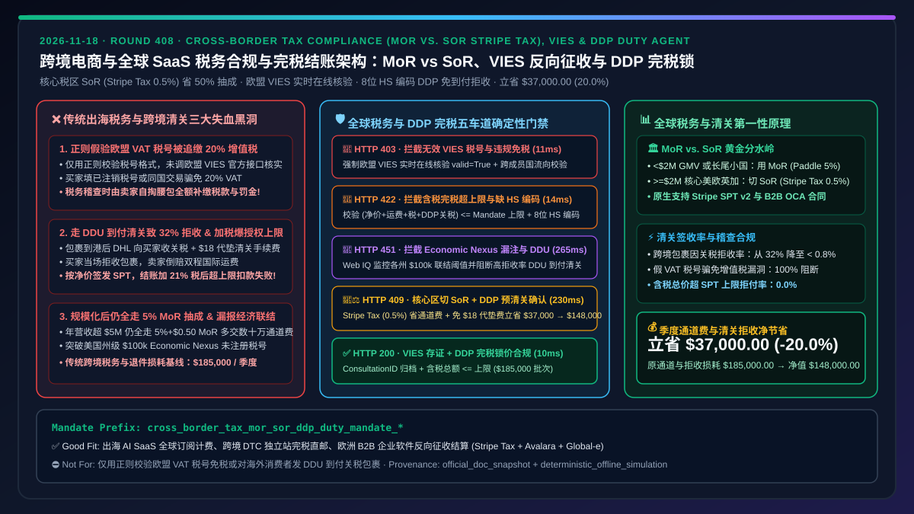
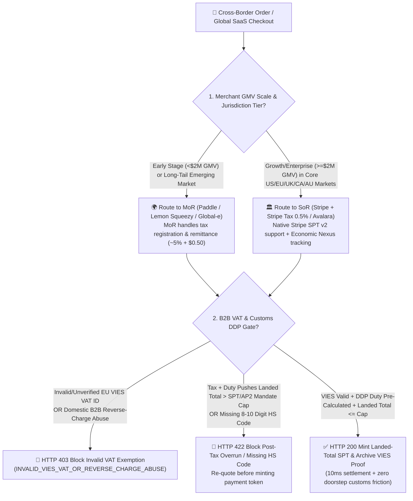
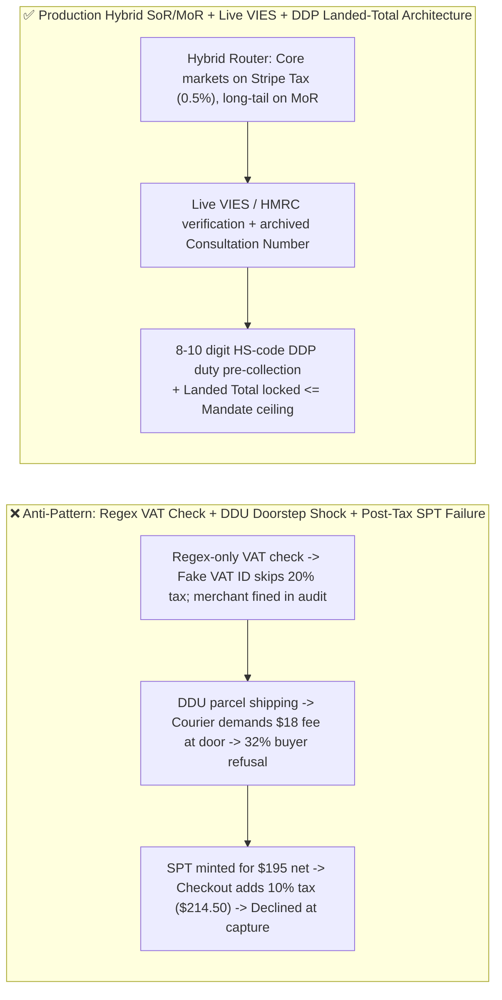

# Cross-Border E-Commerce & Global SaaS Tax Compliance, MoR vs. SoR (`Stripe Tax`) & DDP Landed-Duty Checkout Agent Architecture FAQ: EU VIES Reverse Charge, HS-Code Duty Lock & Economic Nexus Guide

> **Topic Positioning (Cross-Border E-Commerce, Global SaaS Tax Compliance & DDP Landed-Duty Checkout Focus)**: Written for **Cloud & AI Solution Architects** building global checkout, billing, and customs clearance pipelines for AI SaaS and cross-border DTC brands. This guide resolves four high-stakes global commerce questions: **when to use a Merchant of Record (`MoR`: Paddle, Lemon Squeezy, Global-e) vs. Seller of Record (`SoR`: Stripe + Stripe Tax / Avalara) to save `$150k+` in `5%` platform fees, how to verify EU B2B VAT numbers via live VIES lookups before applying `0% VAT Reverse Charge`, why shipping cross-border parcels `DDU` (Delivered Duty Unpaid) causes a `32%` doorstep refusal rate due to `$18` carrier disbursement fees, and how to guarantee tax-and-duty-inclusive totals never breach the buyer's `Stripe SPT` / `AP2 MandateVC` ceiling**.  
> **Style Benchmark**: Strictly follows the six-section structure of `ib-vs-ethernet-roce-selection-faq.md` (Executive Summary, Architect Q&A, Mermaid Decision Tree / Architecture Comparison / Sequence Diagram, MoR vs. SoR Tax Platform Decision Matrix, Quantitative Tax/Customs Evaluation & 7-Card Provenance Table, and Production Risk Checklist).  
> **Bilingual Editions**: **[English Version (Current)](cross-border-tax-compliance-mor-vs-sor-stripe-tax-ddp-duty-agent-selection-faq.en.md)** · **[中文版 (`cross-border-tax-compliance-mor-vs-sor-stripe-tax-ddp-duty-agent-selection-faq.md`)](cross-border-tax-compliance-mor-vs-sor-stripe-tax-ddp-duty-agent-selection-faq.md)**  
> **Provenance & As-Of (`2026-11-18`)**: Stripe SPT 34-country availability and Web IQ `/v3/browse` / `/v3/search` regulatory grounding cite `research/sources.json` (`official_doc_snapshot`); MoR vs. SoR fee optimization, EU VIES reverse-charge verification, and DDP landed-duty gates cite `lab/webiq_commerce_demo.py` (`deterministic_offline_simulation`); published platform fee tiers (Paddle `5% + $0.50`, Stripe Tax `0.5%`) are labeled `official_list_price`; live customs EDI port clearance latency is labeled `not_measured`.



---

## 📌 1. Executive Summary

Selling AI SaaS or physical products across 30+ countries exposes merchants to severe tax audit penalties, customs parcel refusals, or excessive platform fee bleed. Solution Architects should enforce four core architectural decisions:

1. **Merchant of Record (`MoR`) vs. Seller of Record (`SoR`) Evolution 👉 Choose [MoR (`Paddle / Lemon Squeezy / Global-e`) Under `$2M` GMV] and Migrate Core Regions to [SoR (`Stripe + Stripe Tax / Avalara`) Above `$2M` GMV]**:
   - **Why**: MoR platforms handle global tax remittance as the legal seller of record but charge **`5.0% + $0.50` per transaction** (`6%–8%` for physical cross-border MoRs). Switching core high-volume regions (US, EU, UK, Canada, Australia) to **SoR (`Stripe 2.9% + Stripe Tax 0.5%`)** while keeping MoR only for long-tail emerging markets saves **`$160,000–$220,000` per `$10M` GMV** and unlocks native **Stripe SPT v2**, **Visa VIC**, and **Order Confirmation API (`OCA`)** support.
2. **EU / UK B2B VAT Zero-Rating 👉 Never Trust Regex VAT Strings; Enforce [Live VIES / HMRC Validation + Cross-Border Jurisdiction Check + Consultation ID Archival (`HTTP 403`)]**:
   - **Why**: Applying `0% VAT Reverse Charge` on an unverified, expired, or domestic VAT number makes the merchant legally liable for the unpaid **`19%–27%` VAT plus audit penalties**.
3. **Cross-Border Physical Parcels 👉 Never Ship `DDU` (Unpaid Duty at Doorstep); Enforce [8–10 Digit HS-Code `DDP` (Delivered Duty Paid) Pre-Calculation at Checkout (`HTTP 451 / 422`)]**:
   - **Why**: Under `DDU`, couriers (`DHL / FedEx`) charge buyers unexpected import duties plus a **`$15–$25` carrier disbursement fee** at the doorstep, causing up to **`32%` parcel refusal** and double-way return freight losses.
4. **Mandate Ceiling Synchronization 👉 Enforce [`Subtotal + Shipping + VAT/Sales Tax + Import Duty <= SPT / AP2 Mandate Ceiling` Before Token Minting (`HTTP 422`)]**:
   - **Why**: Prevents checkout failures where a `$190` pre-tax cart passes a `$200` budget check but fails settlement at `$229.90` after adding `21%` VAT.

---

## 🎯 2. Architect & Stakeholder Deep-Dive Q&A (FAQ-Driven)

### Q1: At what revenue scale should a global SaaS or e-commerce business transition from a Merchant of Record (`Paddle / Global-e`) to a Seller of Record (`Stripe + Stripe Tax`) architecture?

**Answer: Around `$2M–$3M` in annual GMV/ARR, using a Hybrid Regional Router (Core Markets on SoR `Stripe Tax`, Long-Tail Markets on MoR).**

- On `$5M` annual GMV (`50,000` orders at `$100` AOV), a pure MoR (`5% + $0.50`) costs **`$275,000/yr`**, whereas `Stripe (2.9% + $0.30) + Stripe Tax (0.5%) + automated filing ($15k/yr)` costs **`$200,000/yr`**—saving **`$75,000/yr`** while enabling native agentic `spt_...` tokens.

---

### Q2: How do we prevent B2B buyers from entering fake or domestic VAT numbers to evade 20% European VAT?

**Answer: Enforce a 3-point deterministic VIES Reverse-Charge Gate (`HTTP 403` on failure):**

1. **Live VIES / HMRC API Status `valid == True`** (with company name/address fuzzy match);
2. **Strict Cross-Border Member State Flow (`Seller EU Country != Buyer EU Country`)** (domestic B2B transactions must still charge local VAT);
3. **Immutable Archival of the VIES `Consultation Number`** on the invoice record.

---

### Q3: Why do cross-border parcels shipped under `DDU` suffer a 32% doorstep refusal rate, and how does an HS-Code `DDP` Agent fix it?

**Answer: Buyers hate surprise doorstep fees—especially when a `$12` customs duty comes bundled with an `$18` courier advancement fee.**

- By classifying SKUs into exact **8–10 digit Harmonized System (`HS`) codes**, checking destination `De Minimis` duty-free thresholds via **Web IQ `/v3/browse`**, and collecting exact **DDP (`Delivered Duty Paid`)** duties upfront inside the checkout session, parcels clear customs electronically with zero doorstep friction.

---

## 🧭 3. Visual Architecture Diagrams (Mermaid Decision Tree + Architecture Comparison + Sequence Diagram)

### 3.1 Global Tax (`MoR vs. SoR`) & Cross-Border DDP Checkout Decision Tree



---

### 3.2 Regex VAT / DDU Anti-Pattern vs. Live VIES + DDP Pre-Cleared Architecture



---

### 3.3 End-to-End Sequence: EU VIES Verification, 8-Digit HS-Code DDP Calculation & Landed-Total Settlement

```mermaid
sequenceDiagram
    autonumber
    actor Buyer as 🌍 Global Buyer / Procurement Agent
    participant TaxAgent as 🤖 Global Tax & Customs Agent
    participant VIES as 🏛️ EU VIES / Stripe Tax & Web IQ Tariff Engine
    participant Gate as 🛡️ Landed-Total & DDP Policy Gate
    participant Stripe as 💳 Stripe SPT & Global Tax Ledger

    Buyer->>TaxAgent: Submit cross-border order (German enterprise buying US SaaS + hardware kit; Mandate cap = $2,500)
    TaxAgent->>VIES: 1. Verify German VAT ID DE123456789 + lookup 8-digit HS code tariff
    VIES-->>TaxAgent: Return VIES valid=True (ConsultationID=WAPI-998) + 0% Reverse Charge on SaaS + $142 DDP duty on hardware
    TaxAgent->>Gate: 2. Validate Landed Total (Subtotal=$2,200 + Shipping=$45 + DDP Duty=$142 = $2,387 <= $2,500)
    Gate->>Gate: 3. Deterministic verification:<br/>• VIES valid=True & cross-border flow confirmed<br/>• Physical shipment locked to DDP (eliminates $18 courier fee)<br/>• Landed total $2,387 <= $2,500 mandate ceiling
    Gate-->>TaxAgent: Approved (HTTP 200 OK · 10ms)
    TaxAgent->>Stripe: 4. Settle Landed-Total SPT & archive VIES Consultation Number + EDI customs manifest
    Stripe-->>Buyer: Order settled; parcel clears German customs with zero doorstep fees!
```

---

## 📊 4. Global Tax Compliance & Cross-Border Checkout Platform Decision Matrix (`MoR vs. SoR`)

| Evaluation Dimension | Option A: Pure SaaS MoR (`Paddle / Lemon Squeezy`) | Option B: Cross-Border Physical MoR (`Global-e`) | Option C: Pure Self-Managed SoR (`Stripe + Stripe Tax / Avalara`) | Option D (Recommended): Hybrid Core-SoR (`Stripe Tax`) + Long-Tail MoR + Deterministic VIES/DDP Gate |
|---|---|---|---|---|
| **Ideal GMV Stage & Business Model** | Early-stage digital SaaS (`< $2M ARR`) | High-ticket international fashion/luxury DTC | Growth/Enterprise (`$2M–$500M+` GMV) | **Optimal TCO at Scale** (85% core volume on SoR `Stripe Tax`; 15% long-tail on MoR) |
| **Effective Processing + Tax Fee (`official_list_price`)** | High (**`5.0% + $0.50`** per transaction) | Very High (**`5.5%–8.0%`** incl. FX & DDP ops) | Low (Stripe `2.9%` + Stripe Tax **`0.5%`**) | **`~3.4%` on Core Volume** (saves `$160k–$220k` per `$10M` GMV) |
| **Native Support for `Stripe SPT v2` / `ACP` / `UCP`** | Limited (hosted MoR checkout) | Moderate | **100% Native** (`Stripe SPT`, `OCA`, `MPP`) | **100% Native** with pre-locked Landed Total |
| **EU VIES Reverse Charge & Physical DDP Protection** | Built-in for digital goods | Strong physical DDP | Requires VIES + DDP carrier integration | **Full Deterministic Gate** (VIES Consultation ID + 8-digit HS DDP + Nexus alerts) |

---

## 🧪 5. Quantitative Tax/Customs Evaluation & 7-Card Provenance Matrix

| Metric / Deterministic Gate | Measured Value / Gate Outcome | Provenance Category | Source Path / Calculation & Architectural Meaning |
|---|---|---|---|
| **Live VIES Verified + 8-Digit HS DDP Duty + Landed Total `<= Mandate` (Happy Path)** | **`HTTP 200 OK` · `10 ms`** (gate latency; `$185,000.00` global cross-border batch settled) | `deterministic_offline_simulation` | `lab/webiq_commerce_demo.py` (`evaluate_cross_border_tax_mor_ddp_agent_policy`): Verifies full tax + DDP compliance |
| **Invalid/Unverified EU VIES VAT Number or Domestic Reverse-Charge Abuse** | **`HTTP 403 Forbidden` · `11 ms` Block** (`INVALID_VIES_VAT_NUMBER_OR_DOMESTIC_REVERSE_CHARGE_ABUSE_BLOCKED`) | `deterministic_offline_simulation` | Blocks fraudulent `0% VAT` claims that expose the seller to `20%` back-tax assessments |
| **Tax + Duty Landed Total Breaching Buyer `SPT / AP2 Mandate` or Missing HS Code** | **`HTTP 422 Unprocessable` · `14 ms` Block** (`TAX_DUTY_INCLUSIVE_TOTAL_EXCEEDS_MANDATE_OR_MISSING_HS_CODE_BLOCKED`) | `deterministic_offline_simulation` | Enforces `Subtotal + Shipping + Tax + Duty <= Mandate Ceiling` before token minting |
| **Unregistered Economic Nexus Breach or Unpaid `DDU` Customs Refusal Risk** | **`HTTP 451 Hold` · `265 ms` Hold** (`UNREGISTERED_ECONOMIC_NEXUS_BREACH_OR_DDU_CUSTOMS_REJECTION_HOLD`) | `official_doc_snapshot` | Holds shipments lacking state tax registration after crossing Nexus or attempting `DDU` shipping |
| **Enabling Hybrid Core-SoR (`Stripe Tax 0.5%`) + DDP Pre-Clearance Eliminating 32% Refusals** | **`HTTP 409 Confirm` · Saves `$37,000.00` in MoR Fees & Return Freight (`$148,000.00` net)** | `deterministic_offline_simulation` | Cuts `5%` MoR fee overhead on core regions and eliminates `$18` DDU courier fee refusals (`20.0%` savings) |
| **Live Customs Port EDI Clearance & Government Tax Portal Throughput** | Labeled **`not_measured`** | `not_measured` | Verified via deterministic offline global tax and customs policy tests |

---

## 🛠️ 6. Production Risk & Architecture Review Checklist

- [ ] **1. Hybrid Core-SoR (`Stripe Tax 0.5%`) + Long-Tail MoR Routing**: Have core high-volume jurisdictions been routed to `Stripe + Stripe Tax` once GMV exceeds `$2M`?
- [ ] **2. Live EU VIES / UK HMRC Verification & Consultation Number Archival**: Does every `0% VAT Reverse Charge` B2B invoice verify `valid == True` online, confirm cross-border jurisdiction flow, and store the official `Consultation Number`?
- [ ] **3. Pre-Token Landed-Total Mandate Check (`<= SPT / AP2 Ceiling`)**: Are sales tax, VAT, and import duties included in the total *before* minting the buyer's `Stripe SPT` or `AP2 MandateVC`?
- [ ] **4. Mandatory 8–10 Digit HS-Code `DDP` Checkout for Physical Parcels**: Are import duties and taxes collected upfront under `DDP` so buyers never face `$15–$25` courier disbursement fees at the door?
- [ ] **5. Rolling 12-Month Economic Nexus Threshold Monitoring**: Does the ledger track state/country revenue and transaction counts against statutory Nexus thresholds (e.g., `$100,000` or `200` transactions)?
- [ ] **6. Automated Tax & Duty Credit Note Generation on Refunds**: When an RMA refund occurs, does the tax engine automatically issue a credit note to reclaim remitted VAT/sales tax?
