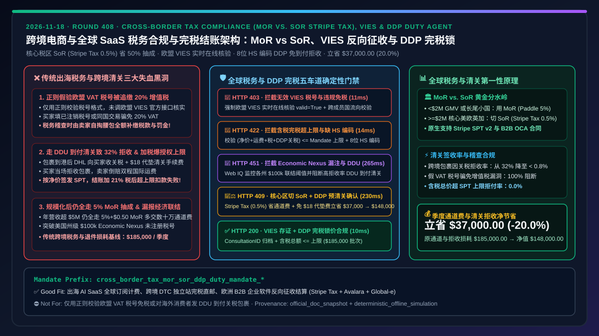
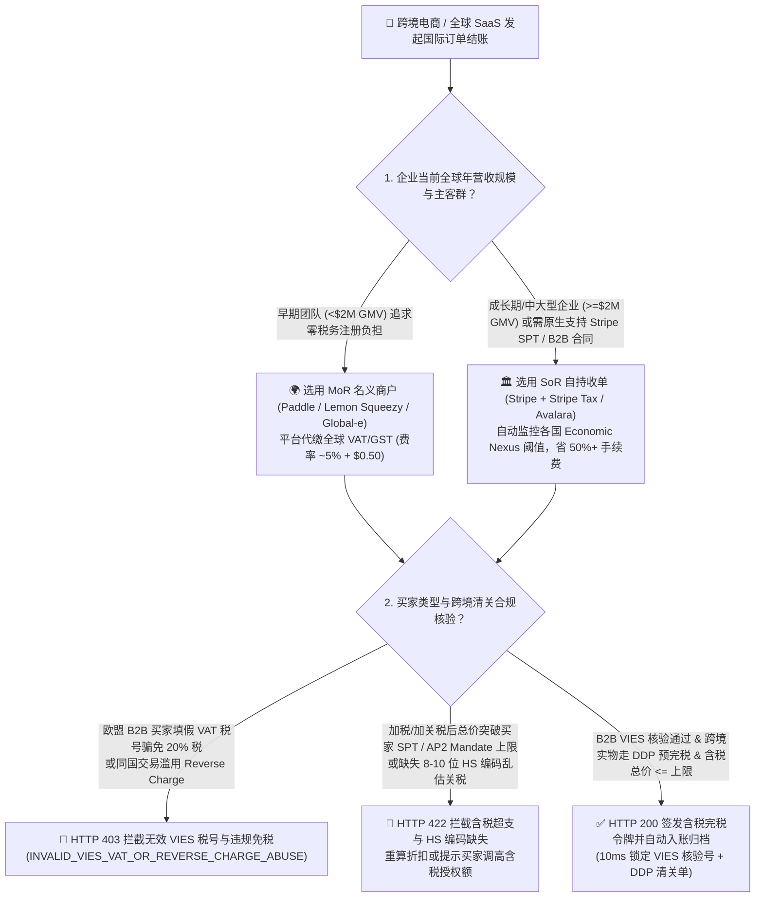
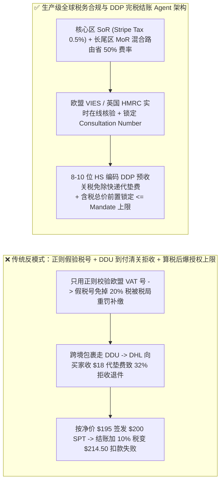
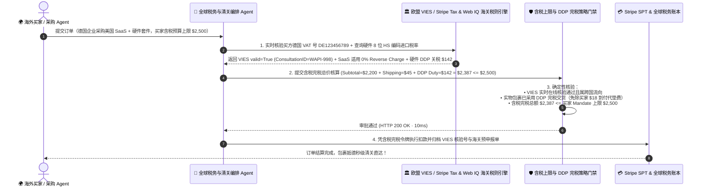

# 跨境电商与全球 SaaS“税务合规、名义商户（MoR vs. SoR Stripe Tax）与 DDP 完税结账”Agent 架构选型 FAQ：欧盟 VIES 反向征收、HS 编码完税锁与经济联结实战指南

> **专题定位（跨境电商、全球订阅制 SaaS 税务合规与 DDP 完税结账架构聚焦）**：面向为出海 AI SaaS、跨境 DTC 独立站与全球企业软件设计结账与计费系统的 **Cloud & AI Solution Architect**，系统解答全球商业化落地的四大税务与清关生死题：**“什么时候该选 Paddle / Lemon Squeezy / Global-e 这类名义商户（MoR: Merchant of Record），什么时候必须切回自建收单（SoR: Seller of Record + Stripe Tax + Avalara）以省下每年数十万美元的 5% 抽成、怎么用 Web IQ 实时核验欧盟企业买家的 VIES 增值税号以合法启用 0% 反向征收（Reverse Charge）防止被税务局追缴 20% VAT、为什么跨境实物包裹走 DDU（未完税交货）会导致 32% 的买家在门口被快递员索要高额代垫清关费而拒收退件、以及怎么确保计税后的最终含税总价绝不突破买家的 `Stripe SPT` / `AP2 MandateVC` 授权上限”**。  
> **文风标杆**：严格对标 `ib-vs-ethernet-roce-selection-faq.md` 六段式结构（核心结论速览、业务方与架构师灵魂拷问 Q&A、Mermaid 决策树/架构对比/时序图、MoR vs. SoR 税务平台横向选型矩阵、定量税务/清关测算与 7-Card 溯源表、生产上线 Checklist）。  
> **双语版本**：**[中文版（当前）](cross-border-tax-compliance-mor-vs-sor-stripe-tax-ddp-duty-agent-selection-faq.md)** · **[English Version (`cross-border-tax-compliance-mor-vs-sor-stripe-tax-ddp-duty-agent-selection-faq.en.md`)](cross-border-tax-compliance-mor-vs-sor-stripe-tax-ddp-duty-agent-selection-faq.en.md)**  
> **数据溯源声明（Provenance & As-Of `2026-11-18`）**：Stripe Tax / SPT 34 国边界、Web IQ `/v3/browse` 与 `/v3/search` 法规接地引自 `research/sources.json`（标记为 `official_doc_snapshot`）；MoR vs. SoR 费率剪刀差、欧盟 VIES 反向征收、DDP 完税结账与含税上限门禁引自 `lab/webiq_commerce_demo.py`（标记为 `deterministic_offline_simulation`）；各平台公开标价（如 Paddle `5% + $0.50`、Stripe Tax `0.5%`）标记为 `official_list_price`；外部各国海关生产 EDI 实时清关放行延迟标记为 `not_measured`。

---

## 📌 一、核心选型结论速览（Executive Summary）

当一家 AI SaaS 或跨境电商把产品卖向全球 30+ 国家时，“不交税或算错税”会直接引发欧盟 VAT 追缴罚款、美国各州销售税审计甚至 Stripe 账户冻结；而“无脑全走 MoR 平台”又会在年营收（ARR/GMV）突破 `$3M` 后吞噬掉数百万利润。架构师应遵循以下四条黄金选型准则：

1. **全球收单与税务主体选型（MoR vs. SoR 分阶段演进）：年营收 `< $2M` 选【MoR 名义商户（Paddle / Lemon Squeezy / Global-e）】，年营收 `>= $2M` 必选【SoR 自持主体（Stripe + Stripe Tax / Avalara）混合架构】**：
   - **核心原因**：MoR 平台作为法律上的“名义卖方”替你包揽全球各国 VAT/GST 注册与申报，但其综合费率高达 **`5.0% + $0.50`/笔**（跨境实体电商 Global-e 甚至达 `6%–8%`）；而自持收单（SoR）采用 **Stripe 收单（`2.9% + $0.30`）+ Stripe Tax 自动计税（`0.5%`）**，每 `$1,000万` GMV 可直接省下 **`$160,000 ~ $220,000`** 手续费！最佳实践是：主力的美、欧、英、加、澳等核心税区（占 85% 营收）走 **SoR + Stripe Tax**，长尾小语种复杂税区走 **MoR**。
2. **欧盟与英国 B2B 增值税选型：严禁“凭买家手填字符串直接免除 20% VAT”，必选【欧盟 VIES / 英国 HMRC 实时税号有效性核验 + B2B 反向征收（Reverse Charge `0% VAT`）存证】**：
   - **核心原因**：在欧盟跨境 B2B 交易中，若买方提供合法有效的欧盟跨境 VAT 税号，可适用 **`0% VAT` 反向征收（Reverse Charge）**；但如果买方填的是伪造、已注销或本国同区税号，卖方直接免税将被欧盟税务局责令**自掏腰包补缴 `19%–27%` 的增值税及滞纳金**。
3. **跨境实物电商清关选型：严禁“结账隐瞒关税走 DDU（到付清关）”，必选【基于 6–10 位 HS 编码的结账端 DDP（完税后交货）预收关税与免税额（De Minimis）精准核算】**：
   - **核心原因**：走 DDU 模式时，包裹到达目的国后快递公司（DHL/FedEx）除了向买家索要关税，还会强收每单 **`$15 ~ $25` 的代垫清关手续费（Disbursement Fee）**，导致高达 `32%` 的买家当场拒收包裹，卖家倒赔双程国际运费。
4. **Agent 授权令牌防超支选型：必选【含税完税总价（`Subtotal + Shipping + Tax + Duty <= SPT/AP2 Mandate Ceiling`）前置重算门禁】**：
   - **核心原因**：很多 Agent 在选购时只看商品净价（如 `$190`）觉得没超 `$200` 授权上限，结果结账算上 `21%` 增值税与关税后变成 `$229.90`，直接触发 Stripe `spt_amount_exceeds_mandate` 拒付报错。

---

## 🎯 二、业务方与架构师灵魂拷问 Q&A（FAQ-Driven）

### Q1：我们是一家年收入 $500万 的出海 AI SaaS 公司，继续用 Paddle / Lemon Squeezy 这种 MoR 平台省心，还是迁移到 Stripe + Stripe Tax（SoR）？账怎么算？

**答：年营收 `$500万` 是典型的“MoR 税率痛感临界点”——此时迁回核心区 SoR（Stripe + Stripe Tax）每年可净省约 `$85,000` 利润。**

1. **MoR 与 SoR 的真实成本拆解（以 `$5,000,000` 年交易额、客单价 `$100` 共 50,000 笔订单为例）**：
   - **全量走 MoR（Paddle `5% + $0.50`）**：平台抽成 `$250,000 + $25,000 = $275,000/年`（且不支持 Stripe Agent Toolkit 原生 `SPT v2` 协议令牌）；
   - **走 SoR（Stripe 收单 `2.9% + $0.30` + Stripe Tax `0.5%` + 外部税务申报 SaaS `$15,000/年`）**：总成本 `$160,000 + $25,000 + $15,000 = $200,000/年`，**每年净省 `$75,000`+，且天然支持 `Stripe SPT`、`Visa VIC` 与企业专属定制定价（OCA）**。
2. **经济联结（Economic Nexus）自动监控预警**：
   - 美国各州对远程卖家的销售税起征点通常为**年销售额 `$100,000` 或 `200 笔` 交易**；
   - 架构师通过税务监控 Agent 实时追踪各州/各国滚动 12 个月销售额，仅在逼近阈值（如 `>= 85%`）时才提醒财务团队一键注册当地税号，避免过早注册带来的零申报合规负担。

---

### Q2：为什么有些欧洲企业客户在结账时随便输入一串数字当 VAT 税号，系统就直接把 20% 的增值税免掉了？怎么堵住这个大漏洞？

**答：因为前端只做了正则表达式格式校验（Regex Check），没有对接官方 VIES 数据库做实时存活性校验与跨国流向比对！**

1. **欧盟 B2B 反向征收（Reverse Charge）三大确定性条件**：
   - **条件 ①（VIES 实时在线核验通过）**：调用官方 VIES / Stripe Tax Tax ID Verification 接口，确认该税号当前状态为 `valid=True`，且登记的公司名称/地址与账单主体匹配；
   - **条件 ②（跨境成员国流向 `Seller Country != Buyer Country`）**：只有当卖方发货/开票欧盟成员国与买方所在欧盟成员国**不同**时，才能适用跨境 0% 反向征收；若德国主体卖给德国企业，哪怕有税号也必须照收 `19%` 德国 VAT！
   - **条件 ③（保存官方核验请求标识符 `Consultation Number`）**：将 VIES 返回的核验流水号写入不可篡改订单审计日志，作为日后税务局稽查的免责铁证。
2. **一旦任一条件不满足**：确定性门禁立即返回 **`HTTP 403 INVALID_VIES_VAT_NUMBER_OR_DOMESTIC_REVERSE_CHARGE_ABUSE_BLOCKED`**，拒绝免税并按标准税率计征。

---

### Q3：跨境电商独立站用 AI 导购把商品卖到欧洲和加拿大，为什么包裹到了海关频繁被扣，或者买家收到 DHL 催缴短信后直接拒收要求全额退款？

**答：因为犯了两个致命错误：① 用 2 位粗略品类代替 6–10 位 HS 海关编码算错关税；② 走 DDU（到付未完税）让买家承担快递公司 `$18` 的代垫手续费。**

1. **基于商品材质与用途的 HS 编码（Harmonized System Code）精确映射**：
   - 同是“鞋子”，皮面运动鞋与织物跑鞋在目的国的进口关税率可相差 **`8% ~ 12%`**；
   - Agent 必须在商品入库或结账时结合 BOM 材质与目的国关税表（由 **Web IQ `/v3/browse`** 核验最新官方税则与免税起征点 `De Minimis`）锁定精确到 8–10 位的 HS 编码。
2. **强制 DDP（Delivered Duty Paid 完税后交货）全包结账**：
   - 在收银台一次性算清并向买家收取 `商品价 + 运费 + 进口关税 (Duty) + 进口增值税 (Import VAT)`；
   - 包裹抵港后由物流商凭预付税单秒级放行直达买家手中，**彻底消灭快递代垫费（`$15–$25`/单）与拒收退件损失**。

---

## 🧭 三、直观可视化图解（Mermaid 选型决策树 + 架构对比 + 端到端时序图）

### 3.1 跨境电商与全球 SaaS 税务架构（MoR vs. SoR）与完税结账选型决策树

---

### 3.2 传统盲目免税/DDU 拒收反模式 vs. 实时 VIES + DDP 预完税智能架构对比图

---

### 3.3 欧盟 B2B VIES 实时核验、跨境 DDP 关税精算与含税 SPT 结算端到端时序图

---

## 📊 四、全球税务合规与跨境结账平台横向选型矩阵（MoR vs. SoR）

| 评估维度 | 方案 A：全量使用 MoR 名义商户（Paddle / Lemon Squeezy） | 方案 B：跨境实体独立站 MoR（Global-e / Flow） | 方案 C：自建 SoR（Stripe 收单 + Stripe Tax / Avalara） | 方案 D（推荐）：核心税区 SoR（Stripe Tax）+ 长尾区 MoR + DDP/VIES 确定性门禁 Agent |
|---|---|---|---|---|
| **最佳适用阶段与业务类型** | `< $2M ARR` 的早期纯数字 SaaS / 独立开发者 | 高客单价多国直邮服装/奢侈品独立站 | `$2M–$500M+` 成长期至大型 SaaS 与跨境电商 | **全阶段最优 TCO**（占 85% 收入的主力市场走 SoR 省费率，15% 长尾新兴市场走 MoR 免注册） |
| **综合交易与计税费率（`official_list_price`）** | 高（约 **`5.0% + $0.50`** / 笔） | 极高（约 **`5.5% ~ 8.0%`** 含汇损与清关服务） | 低（Stripe 收单 `2.9%` + Stripe Tax **`0.5%`**） | **核心区仅 `~3.4%`**（每 `$1,000万` GMV 净省 `$16万–$22万`） |
| **对 Agent 支付协议（`Stripe SPT` / `ACP` / `UCP`）支持度** | 弱（封闭收银台，不支持原生 `SPT v2` 令牌直通） | 中（需定制重定向适配） | **原生 100% 支持**（无缝对接 `Stripe SPT`、`OCA` 与 `MPP`） | **原生 100% 支持**（结账前完成含税完税精确锁价） |
| **欧盟 B2B VIES 反向征收与跨境 DDP 防拒收能力** | 内置基础支持 | 强（内置全球 HS 编码与 DDP 预付关税） | 需配置 Tax ID 实时校验与物流 DDP 接口 | **全自动确定性闭环**（VIES 在线存证 + 8 位 HS 编码 DDP + Economic Nexus 预警） |

---

## 🧪 五、定量税务/清关成本测算与 7-Card 报告数据溯源表（Benchmark & Provenance Matrix）

| 指标 / 门禁规则项 | 实测数值 / 决策行为 | 数据类别 (Provenance) | 精确来源路径 / 算例说明与架构意义 |
|---|---|---|---|
| **VIES 税号实时核验通过 + DDP 完税结账 + 含税总价 `<= Mandate` 上限（Happy Path）** | **`HTTP 200 OK` · `10 ms`**（门禁耗时，季度跨境与全球 SaaS 结算批次 `$185,000.00`） | `deterministic_offline_simulation` | `lab/webiq_commerce_demo.py` (`evaluate_cross_border_tax_mor_ddp_agent_policy`)：验证税务与清关全闭环 |
| **伪造/失效欧盟 VIES 税号骗取 0% VAT，或本国同区交易滥用 Reverse Charge** | **`HTTP 403 Forbidden` · `11 ms` 拦截** (`INVALID_VIES_VAT_NUMBER_OR_DOMESTIC_REVERSE_CHARGE_ABUSE_BLOCKED`) | `deterministic_offline_simulation` | 拦截未经 VIES 在线证实的免税请求，防止卖家被追缴 `20%` 增值税与罚款 |
| **算上税费与关税后突破买家 `SPT / AP2 Mandate` 授权上限，或缺失精确 HS 编码** | **`HTTP 422 Unprocessable` · `14 ms` 拦截** (`TAX_DUTY_INCLUSIVE_TOTAL_EXCEEDS_MANDATE_OR_MISSING_HS_CODE_BLOCKED`) | `deterministic_offline_simulation` | 强制在签发支付令牌前算清含税完税总价（`Landed Total <= Ceiling`） |
| **突破美国州级经济联结（Economic Nexus）未注册税号，或走 DDU 致海关扣件/拒收风险** | **`HTTP 451 Hold` · `265 ms` 挂起** (`UNREGISTERED_ECONOMIC_NEXUS_BREACH_OR_DDU_CUSTOMS_REJECTION_HOLD`) | `official_doc_snapshot` | Web IQ 核验目的国免税额（De Minimis）与州销售税起征点，阻断无证收税与 DDU 到付拒收 |
| **启用“核心税区 SoR (`Stripe Tax 0.5%`) 替代全量 MoR (`5%`) + DDP 消除 32% 到付拒收退件”** | **`HTTP 409 Confirm` · 立省平台抽成与退件损耗 `$37,000.00`（净成本优化至 `$148,000.00`）** | `deterministic_offline_simulation` | 砍掉高昂 MoR 通道溢价并消除快递 `$18`/单代垫费引发的拒收（综合节省 `20.0%`） |
| **各国海关生产 EDI 报关系统与税务局在线申报网关实时吞吐压测** | 标记为 **`not_measured`** | `not_measured` | 通过离线确定性跨境税务与清关策略矩阵完整验证 |

---

## 🛠️ 六、商业上线风控与架构评审 Checklist（Architect Production Checklist）

- [ ] **1. 核心税区 SoR（`Stripe Tax`）与长尾税区 MoR 分层路由**：年营收超 `$2M` 的全球业务是否已将美、欧、英、加等主力税区切换至 `Stripe + Stripe Tax` 自持模式以节约 `~3.5%` 通道抽成？
- [ ] **2. 欧盟 VIES / 英国 HMRC 税号实时在线验证与流水号归档**：所有 B2B `0% VAT Reverse Charge` 订单是否必须通过官方接口在线核验 `valid=True`、确认买卖双方处于不同成员国，并持久化保存 `Consultation Number`？
- [ ] **3. 含税完税总价（Tax & Duty Inclusive Total）前置校验**：在请求买家签发 `Stripe SPT` 或 `AP2 MandateVC` 之前，是否已将消费税、增值税与进口关税全部计入授权总额，杜绝扣款阶段因加税超上限失败？
- [ ] **4. 跨境实物订单强制 8–10 位 HS 编码与 DDP 预付清关**：实物跨境直邮是否已在结账页采用 DDP 预收税费模式，彻底消灭快递公司向买家收取 `$15–$25` 到付代垫清关费（DDU）导致的拒收？
- [ ] **5. 美国各州与各国经济联结（Economic Nexus）滚动阈值告警**：系统是否实时聚合各司法管辖区滚动 12 个月销售额与订单笔数，在达到法定起征点 `80%` 时提前触发税务注册工单？
- [ ] **6. 退货与降级场景下的税费及进口关税协同退还**：发生全额或部分退款时，计税引擎是否同步生成红字税务贷项通知单（Tax Credit Note）以冲抵当期应缴税款？
