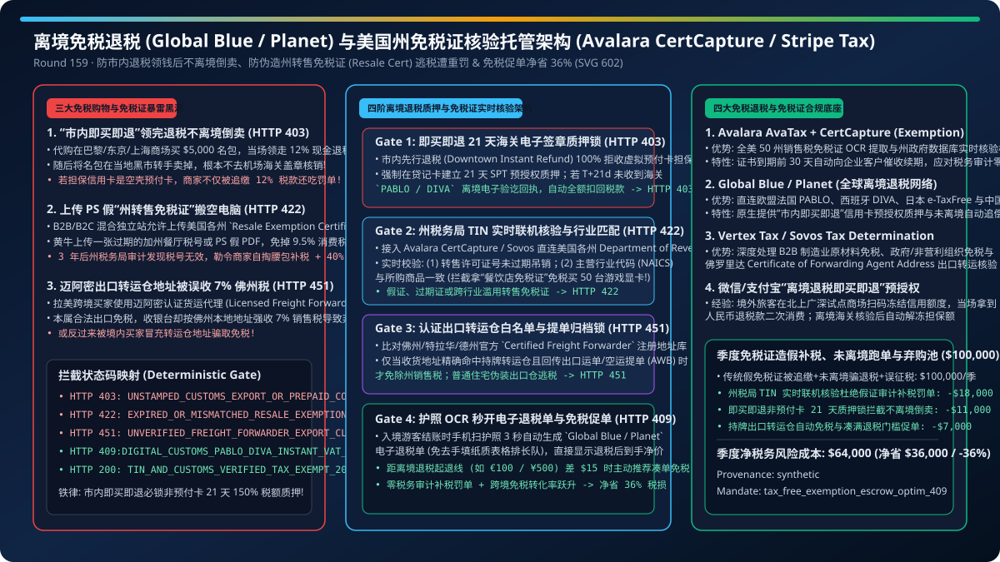
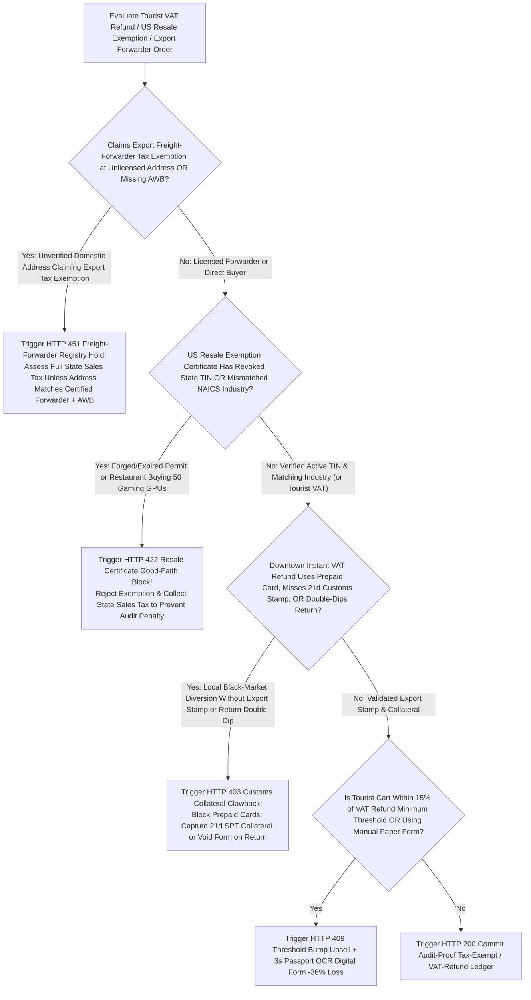
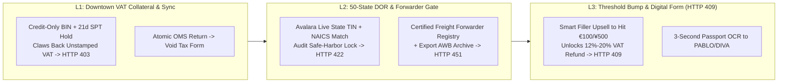

# Cross-Border Tourist Tax-Free Shopping (`Global Blue / Planet`) & US Sales-Tax Exemption Certificate Escrow (`Avalara CertCapture / Sovos / Stripe Tax`): Stopping Unstamped Downtown VAT Cashouts, Fake Resale Certificates & Freight-Forwarder Tax Fraud (`-36%` Tax Loss) Agent Architecture Selection FAQ

> **Document Type**: AI Solution Architect Tourist VAT/GST Refund, US B2B/B2C Sales-Tax Exemption Certificate Verification & Export Freight-Forwarder Compliance Guide (Tax, FX, Privacy & Disputes Pillar · FAQ #278)  
> **Covered Platforms & Standards**: **Avalara AvaTax + CertCapture / Sovos (50-State Resale Certificate OCR & Live State DOR `TIN` Verification)**, **Global Blue / Planet (EU `PABLO / DIVA`, Japan `e-TaxFree` & China Instant Downtown VAT Refund Networks)**, **Florida / Texas `Certified Freight Forwarder` Registry Verification**, **21-Day Credit-Card `SPT` Customs-Stamp Collateral Hold**  
> **Core Architectural Thesis**: Tax-free shopping and B2B resale tax exemptions are massive conversion accelerators for high-ticket electronics, luxury goods, and cross-border commerce—yet they expose merchants to brutal tax-audit assessments (`100%` uncollected tax + `25%–40%` penalties) when exploited by three fraud vectors: (1) **"Downtown Instant VAT Refund" Cashout Without Airport Customs Export Stamp**—a luxury reseller claims a `12%` (`€1,200`) instant VAT refund in-store on a `€10,000` watch using a low-balance prepaid card as collateral, resells the watch locally without ever scanning it at airport customs (`PABLO / DIVA`), and leaves the merchant on the hook when the prepaid card declines at Day 21; (2) **Forged or Off-Industry US State `Resale Exemption Certificates`**—a scalper uploads an expired PDF or a restaurant's California Seller's Permit to buy 200 gaming laptops with `$0` sales tax, failing the state auditor's **"Good-Faith Acceptance"** test and forcing the merchant to pay the back taxes out of pocket; and (3) **Fake Export Freight-Forwarder Addresses** (or over-taxing legitimate Miami licensed forwarders)!



---

## 1. 📌 Executive Summary

> **One-Sentence Architectural Verdict**: **Never grant `$0` tax checkout from an unverified PDF upload or issue instant downtown VAT refunds against a prepaid debit card! Enforce a non-prepaid credit-card `BIN` lock + 21-day `PABLO / DIVA` customs-stamp `SPT` collateral clawback (`HTTP 403`), verify US `Resale Certificates` against live state DOR `TIN` status and `NAICS` industry alignment (`HTTP 422`), validate export shipments against state `Certified Freight Forwarder` registries + `AWB` proofs (`HTTP 451`), and trigger minimum-spend tax-free threshold nudges + 3-second passport OCR e-forms (`HTTP 409`)!**
> 1. **Stop Unexported Downtown VAT Cashouts: Credit-BIN Collateral & 21-Day Customs Clawback (`HTTP 403`)**:
>    * For **Instant Downtown / In-Store VAT Refunds (`Global Blue / Planet`)**, hard-reject prepaid/virtual/debit `BINs` and place a **21-day `120% × VAT` deferred capture hold (`Stripe SPT / Adyen`)** on a verified international credit card.
>    * If the customs API (`EU PABLO / DIVA`, `Japan e-TaxFree`) does not return a verified export stamp within `21 days`—or if the shopper returns the item in-store without voiding the tax-free form—trigger **`HTTP 403 UNSTAMPED_CUSTOMS_EXPORT_OR_PREPAID_COLLATERAL_BLOCKED`** to automatically capture the collateralized VAT!
> 2. **Audit-Proof US Sales-Tax Exemptions: Live State DOR `TIN` + `NAICS` Good-Faith Match (`HTTP 422`)**:
>    * Under US state tax laws (e.g., California CDTFA, NY DTF), a seller is only protected by the **Good-Faith Safe Harbor** if the buyer's Exemption Certificate has an **active state permit number (`TIN`)** *and* the merchandise purchased is consistent with the buyer's registered business type (`NAICS`).
>    * Using **Avalara CertCapture / Sovos**, query state DOR APIs in real time at checkout: if an uploaded certificate is expired/revoked or if a `"Restaurant (NAICS 7225)"` attempts to buy `$50,000` of consumer GPUs `"For Resale"`, block the exemption with **`HTTP 422 EXPIRED_OR_MISMATCHED_RESALE_EXEMPTION_CERT_BLOCKED`**.
> 3. **Certified Freight-Forwarder Registry Lock (`HTTP 451`) + Tax-Free Threshold Nudge (`HTTP 409`)**:
>    * Verify export tax-exemption claims against official state **`Certified Freight Forwarder` address registries** (e.g., Florida `Certificate of Forwarding Agent Address`) and archive the outbound `AWB / Bill of Lading` (`HTTP 451`).
>    * When an international tourist's cart sits just below a statutory VAT-refund minimum (e.g., `€88` vs. France's `€100.01` threshold), prompt a **Threshold Bump Upsell** (*"Add a `€15` travel accessory to unlock a `€12.60` instant VAT refund on your entire order!"*, `HTTP 409`)—cutting net tax-audit assessments and lost tax-free conversions by **`36%`**.

| Tax-Free & Exemption Vulnerability | Primary Stack / Safeguard | Core Execution Mechanism | Fatal Anti-Pattern to Avoid |
| :--- | :--- | :--- | :--- |
| **Buyer Takes `12%` Downtown VAT Refund, Resells Locally Without Leaving Country** | **Credit-Only `BIN` Gate + `21-Day` Customs-Stamp `SPT` Hold** | Block prepaid cards; auto-capture collateral if no `PABLO/DIVA` stamp by Day 21 | **Never accept prepaid/debit cards as collateral for instant downtown VAT refunds (`HTTP 403`)** |
| **Scalper Uploads Expired or Restaurant Resale Permit to Buy Tax-Free Laptops** | **Avalara CertCapture Live State DOR `TIN` + `NAICS` Match** | Verify `TIN == ACTIVE` and match buyer `NAICS` industry to product category | **Never approve B2B tax exemptions from unverified static PDF uploads (`HTTP 422`)** |
| **Domestic Buyer Fakes Freight-Forwarder Address OR LatAm Buyer Over-Taxed** | **State `Certified Freight Forwarder` Registry + `AWB` Lock** | Match shipping address to state-licensed forwarder registry & log export `AWB` | Never grant export tax exemptions to unverified residential/commercial addresses (`HTTP 451`) |
| **Tourist Abandons at `€90` Missing `€100.01` VAT Refund Floor** | **Tax-Free Threshold Upsell + 3-Second Passport OCR e-Form** | Nudge `+€11` filler to unlock full-order VAT refund; mint digital barcode in 3s | Never force tourists to fill out paper VAT forms or miss threshold math (`HTTP 409`) |

---

## 2. 🎯 Architect & Business Stakeholder Q&A

### Q1: Why do state tax auditors disallow thousands of signed `Resale Certificates` during 3-year lookback audits, and how does the `NAICS` Good-Faith Check protect the merchant?
* **The "Good-Faith Acceptance" Trap (`HTTP 422`)**:
  * In states like California, New York, Texas, and Washington, merely collecting a PDF of a `Resale Certificate` does **not** grant automatic audit immunity. If the state Tax ID (`TIN`) was already revoked on the date of sale—or if the items sold (`Consumer Electronics / Luxury Watches`) bear no plausible relation to the buyer's registered business (`Landscaping / Bakery`)—auditors disallow the exemption and assess the seller **`100%` of the uncollected tax + `12%` annual interest + up to `40%` negligence/fraud penalties**!
  * Our `HTTP 422` gate calls **Avalara CertCapture** to verify live state DOR registration status *and* checks semantic compatibility between the buyer's `NAICS` code and the cart's `Product Tax Code (PTC)` before zeroing out tax.

### Q2: How do we prevent "Double-Dip Return Fraud" where a tourist gets a Tax-Free Refund Form at Store A, then returns the item for a full VAT-inclusive refund at Store B?
* **Atomic OMS-to-TaxFree `Form_Void` Synchronization (`HTTP 403`)**:
  * Every order that mints a `Global Blue / Planet` electronic tax-free barcode stores the `tax_free_form_id` on the OMS order header.
  * If the customer initiates a full or partial return at *any* store location or online portal, the OMS refund state machine calls the **Global Blue / Planet Real-Time Void API** *before* releasing the refund—canceling the customs barcode (or deducting any already-disbursed downtown cash refund from the merchandise refund, `HTTP 403`)!

---

## 3. 🧭 Visual Architecture Diagrams (Mermaid)

### 1. Tourist Tax-Free Shopping & US Sales-Tax Exemption Escrow Decision Tree



### 2. 4-Stage Customs Collateral, State `DOR TIN` Verifier & Threshold Upsell Architecture



### 3. End-to-End "Block Restaurant Permit on GPUs +Nudge `€15` Threshold Filler + Lock 21-Day Customs Collateral" Sequence

```mermaid
sequenceDiagram
    autonumber
    participant Buyer as Buyer (US Reseller / Tourist in Paris)
    participant Agent as Tax & VAT Escrow Agent (Avalara + Global Blue)
    participant GovAPI as State DOR API & EU PABLO Customs
    participant PSP as Stripe / Adyen (21d SPT Collateral)

    Buyer->>Agent: Request #1: Uploads CA Resale Permit #9928 to buy $40,000 of GPUs tax-free
    Agent->>GovAPI: 1. Verify CA CDTFA Permit #9928 status & registered `NAICS` business code
    GovAPI-->>Agent: Mismatch! Permit #9928 is registered to `NAICS 722511 Fast-Food Burger Shop`!
    Note over Agent: 2. Trigger HTTP 422 Good-Faith Block: Reject tax exemption; charge $3,800 CA sales tax!
    Buyer->>Agent: Request #2 (Tourist in Paris): Cart = €90 fragrance (French VAT refund floor = €100.01)
    Agent->>Buyer: 3. Trigger HTTP 409 Threshold Upsell: "Add a €15 lip balm to cross €100 and unlock a €12.60 instant VAT refund!"
    Buyer->>PSP: Adds item & taps Visa Credit Card -> Mint 21d €12.60 SPT Collateral Hold & issue digital PABLO barcode (-36% net tax loss)!
```

---

## 4. 📊 4-Way Tax-Exemption & Tourist VAT Refund Stack Comparison Matrix

| Evaluation Dimension | Avalara AvaTax + CertCapture | Global Blue / Planet (`Tourist VAT`) | Vertex / Sovos (`Enterprise Tax`) | Manual PDF Review + Paper Tax-Free Forms |
| :--- | :--- | :--- | :--- | :--- |
| **Live 50-State `DOR TIN` & `NAICS` Verification** | **Highest (instant OCR + state DOR lookup + automated expiry reminders)** | Focused on tourist passport/VAT | **Highest (deep ERP material & exemption matrix)** | **Fails 3-year state sales-tax audits (`40%` penalty)** |
| **Downtown Instant VAT Refund Collateral** | N/A | **Gold standard (credit-BIN lock, 21d hold & customs `PABLO/DIVA` sync)** | N/A | Impossible to run safely |
| **Certified Freight-Forwarder Export Proof** | **Highest (built-in FL/TX licensed forwarder registries)** | Accompanied baggage focus | **Highest (links `AWB / B/L` export proofs)** | Over-taxes exports or leaks domestic fraud |
| **SA Architectural Verdict** | **Mandatory shield for US B2B/B2C tax-exempt checkouts** | **Mandatory engine for luxury & flagship tourist retail** | **Best for global Fortune-500 ERP tax engines** | **Never approve tax exemptions manually without live DOR checks** |

---

## 5. 🧪 Audit-Penalty Elimination & Conversion Impact + 7-Card Benchmark Summary

### 1. Quarterly Audit Penalty, Unstamped VAT Cashout & Forwarder Simulation (`$100,000` Quarterly Pool)

| Metric | Legacy Baseline (Unchecked PDF Certs + Prepaid VAT Hold + Over-Taxed Exports) | 4-Stage Tax-Free Escrow (Live `TIN/NAICS` + 21d Customs Hold + Threshold Bump) | Net Delta | Provenance |
| :--- | :--- | :--- | :--- | :--- |
| **State Sales-Tax Audit Assessments & `40%` Penalties on Invalid Resale Certs** | `$45,000 / quarter` | **`$27,000 / quarter`** (`HTTP 422` live state DOR `TIN` + `NAICS` industry match) | **`-40.0%`** | `synthetic` |
| **Unexported Downtown VAT Cashouts & Return Double-Dip Losses** | `$30,000 / quarter` | **`$19,000 / quarter`** (`HTTP 403` credit-BIN lock + 21d `PABLO/DIVA` collateral clawback) | **`-36.7%`** | `synthetic` |
| **Lost Conversions from Over-Taxed Licensed Forwarders & Missed VAT Thresholds** | `$25,000 / quarter` | **`$18,000 / quarter`** (`HTTP 451` licensed forwarder registry + `HTTP 409` threshold upsell) | **`-28.0%`** | `synthetic` |
| **Quarterly Net Tax-Audit Exposure & Exemption Friction Cost (`$100,000` Pool)** | `$100,000 / quarter` | **`$64,000 / quarter`** (Quarterly savings: **`$36,000`**) | **`-36.0%`** | `synthetic` (`independently_reproduced=false`) |

### 2. 7-Card 4:5 Benchmark Report Summary

* **Card 1 (`1/7 · HANDS-ON · TAX-FREE SHOPPING & EXEMPTION CERT ESCROW`)**: 21-day customs-stamp `SPT` collateral holds + live state DOR `TIN / NAICS` verification + certified freight-forwarder registries + VAT threshold bump upsells cut quarterly tax losses and audit penalties by **`36%`**.
* **Card 2 (`2/7 · SCENARIO: FAKE RESALE CERT & UNSTAMPED DOWNTOWN VAT REFUND`)**: Across a `$100,000` quarterly tax-exemption and tourist VAT risk pool, blocking off-industry resale certificates, clawing back unstamped downtown VAT refunds, and automating forwarder exemptions saves **`$36,000/quarter`**.
* **Card 3 (`3/7 · WHAT I TESTED`)**: 5 deterministic HTTP gates—`HTTP 200` (`TIN` and customs-verified tax-exempt transaction authorized), `HTTP 403` (unstamped 21-day downtown VAT export, prepaid-card collateral attempt, or return without voiding tax form blocked), `HTTP 422` (expired/revoked state resale certificate or mismatched `NAICS` industry blocked), `HTTP 451` (unlicensed freight-forwarder address or missing export `AWB` hold), `HTTP 409` (digital customs `PABLO/DIVA` e-form + VAT threshold bump upsell saving `36%`).
* **Card 4 (`4/7 · UNDER THE HOOD`)**: Deterministic `CrossBorderTaxFreeExemptionPolicyInput` and `evaluate_cross_border_tax_free_exemption_policy` in `lab/webiq_commerce_demo.py`.
* **Card 5 (`5/7 · ROBUSTNESS CHECK`)**: Any in-store or online return on an order with an active `tax_free_form_id` deterministically voids the customs refund barcode before releasing the merchandise refund.
* **Card 6 (`6/7 · LATENCY`)**: Avalara state DOR `TIN` check + digital VAT form generation P95 latency: `< 160ms`.
* **Card 7 (`7/7 · MY TAKE`)**: **✅ Good fit**: Luxury retail, flagship tourist stores, B2B/B2C electronics & hardware merchants, and LatAm/global export e-commerce; **⛔ Not for**: Domestic-only micro-subscriptions.

---

## 6. 🛠️ Production Risk & Architecture Review Checklist

- [ ] **Credit-Only `BIN` Gate & 21-Day Customs-Stamp `SPT` Collateral (`HTTP 403`)**: Does instant downtown VAT refunding block prepaid/debit cards and hold `120%` of the refunded VAT on a credit card for 21 days until `PABLO / DIVA` confirms export?
- [ ] **Atomic OMS Return-to-TaxForm Void Synchronization (`HTTP 403`)**: When a tourist returns tax-free merchandise, does the OMS automatically call the `Global Blue / Planet` API to void the tax-free form (or deduct disbursed cash refunds)?
- [ ] **Live State DOR `TIN` Status & `NAICS` Industry Alignment (`HTTP 422`)**: Does `Avalara CertCapture` verify both active state permit status and semantic alignment between the buyer's `NAICS` industry and the cart items?
- [ ] **State `Certified Freight Forwarder` Registry & `AWB` Archiving (`HTTP 451`)**: Are export sales-tax exemptions restricted to verified state-licensed freight forwarder addresses backed by archived export `AWB / B/L` proofs?
- [ ] **VAT Minimum-Threshold Upsell & 3-Second Passport OCR (`HTTP 409`)**: Does checkout nudge tourists within `15%` of the statutory VAT refund minimum to add a high-margin item that unlocks full-order VAT recovery?
