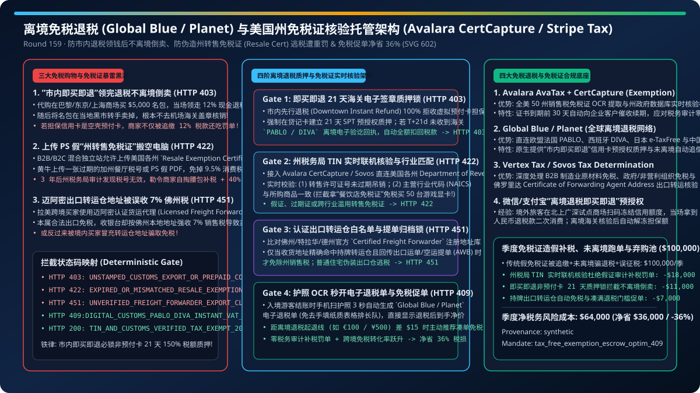
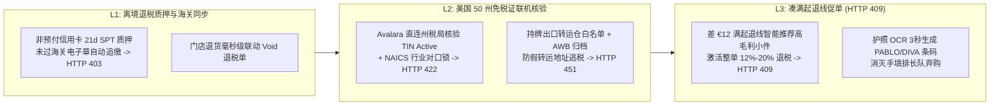
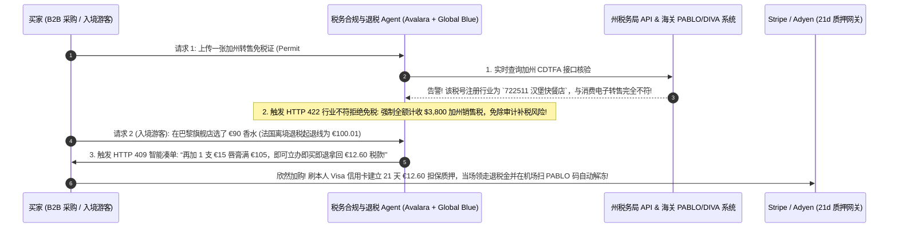

# 离境退税“即买即退”（Global Blue / Planet）与美国州销售税免税证（Avalara CertCapture）托管：“防市内领完 12% 退税后不去机场海关盖章直接黑市倒卖、防 PS 假转售免税证搬空显卡遭税务局追缴重罚与凑满起退线净省 36%”Agent 架构选型 FAQ

> **文档类型**：AI Solution Architect 跨境离境退税（Tourist VAT/GST Refund）、美国 B2B/B2C 州销售税免税证（Sales Tax Exemption Certificates）实时核验与出口转运免税选型指南（Tax, FX, Privacy & Disputes Pillar · FAQ #278）  
> **涵盖平台与技术栈**：**Avalara AvaTax + CertCapture / Sovos（美国 50 州免税证 OCR 与州税务局 TIN 实时联机核验）**、**Global Blue / Planet（欧盟 `PABLO / DIVA`、日本 `e-TaxFree` 与中国离境退税“即买即退”网络）**、**佛罗里达/德州持牌出口货运代理（`Certified Freight Forwarder`）白名单**、**信用卡 `21 天 SPT` 海关验讫质押锁**  
> **核心架构命题**：在奢侈品零售、消费电子与跨境 B2B2C 贸易中，“免税（Tax-Free / Tax-Exempt）”是转化高客单买家的核武器，却也是最容易招致税务局天价追缴罚单（Audit Assessment + 40% Penalty）的雷区！当结账与税务 Agent 处理免税请求时，必须堵死三大逃税与骗税黑洞：① **“市内即买即退（Downtown Instant VAT Refund）领完现金不去机场海关核销，把名表留在当地黑市倒卖”**——代购在商场买走 `€10,000` 名表，用一张只有 `€50` 余额的虚拟预付卡做担保当场拿走 `€1,200` 退税金，随后根本不离境；等 21 天后海关系统报未离境，预付卡早已刷不出钱！② **“上传 PS 伪造或跨行业滥用的美国州转售免税证（Resale Certificate Fraud）”**——黄牛上传一张餐饮店或已注销公司的 `California Seller's Permit` PDF，免掉 `9.5%` 消费税买走 200 台笔记本电脑；3 年后州税务局（CDTFA）来查账，判定商家“未尽合理审查义务”，勒令商家全额自掏腰包补齐税款加滞纳金！③ **“拉美/海外买家寄往迈阿密出口转运仓被误征 7% 州税弃购，或境内买家谎称转运仓逃税”**！



---

## 一、 📌 核心选型结论速览（Executive Summary）

> **一句话架构定调**：**任何“免税放行”或“市内提前退税”都绝不能凭一张未联网核验的静态 PDF 图片或一张空壳预付卡！必须构建“即买即退拒收预付卡 + 21 天海关电子签章（`PABLO / DIVA`）质押追回锁（HTTP 403）”、“直连各州税务局 `TIN` 状态与 `NAICS` 行业匹配校验（HTTP 422）”、“官方持牌出口转运仓白名单与出口提单归档锁（HTTP 451）”，并通过“护照秒开电子退税单 + 离境起退线智能凑单（HTTP 409）”净省 `36%` 税务罚款与弃购损失！**
> 1. **防“市内拿完退税不离境倒卖”：非预付贷记卡 `BIN` 过滤 + 21 天海关签章质押锁（HTTP 403 门禁）**：
>    * 凡办理 **“市内即买即退（Downtown Instant Refund / 商场先行退税）”**，支付网关首先执行 `BIN` 属性强校验：**100% 拒绝虚拟卡、预付礼品卡与借记卡，强制要求本人实体国际信用卡（Credit Card）并建立 `120% × 退税额` 的 21 天长效预授权质押（`Stripe SPT / Adyen Delayed Capture`）**；
>    * 若在 `T + 21 天` 内未收到欧盟海关 `PABLO/DIVA`、日本国税厅或中国海关离境退税系统的 **电子验讫回执（Digital Customs Stamp）**，或机场海关抽检发现退税商品已被拆封使用/调包，系统立即触发 **`HTTP 403 UNSTAMPED_CUSTOMS_EXPORT_OR_PREPAID_COLLATERAL_BLOCKED`**，自动将预授权转为实扣追回全额税款及违约手续费！
> 2. **防“拿假转售证/开餐馆税号免税买显卡”：州税务局 API 实时核验与行业对口锁（HTTP 422 门禁）**：
>    * 严禁人工客服肉眼看一眼买家上传的 `Resale Certificate PDF` 就手动勾选 `Tax_Exempt = True`！
>    * 结账时通过 **Avalara CertCapture / Sovos** 实时直连美国各州税务局（DOR）官方接口执行三重硬校验：① 该 `Sales Tax Permit / TIN` 当前状态为 `ACTIVE`（非注销或吊销）；② 证书覆盖当前收货州（Nexus State）；③ **善意关联性校验（`Good-Faith Industry Match`）**——注册行业为“餐饮小吃店”的税号企图按“转售免税（For Resale）”购买 50 张 RTX 显卡或珠宝，立即触发 **`HTTP 422 EXPIRED_OR_MISMATCHED_RESALE_EXEMPTION_CERT_BLOCKED`** 拒绝免税，确保商家 100% 享有税务审计免责护盾（Safe Harbor）！
> 3. **出口转运仓官方白名单锁（HTTP 451）+ 离境起退线智能凑单（HTTP 409）**：
>    * 对寄往迈阿密、特拉华或休斯顿声称“出口转运免税”的订单，必须精确比对州政府颁发的 **`Certified Freight Forwarder Certificate` 地址库** 并归档国际空运/海运提单（`AWB / B/L`）后方可免税（防止本地买家填隔壁仓库地址逃税，`HTTP 451`）；
>    * 当入境游客购物满 `€88`（距法国离境退税起退线 `€100.01` 仅差 `€13`）时，导购 Agent 自动弹出 **`HTTP 409 DIGITAL_CUSTOMS_INSTANT_VAT_AND_THRESHOLD_BUMP_CONFIRM`：“再加购一件 `€15` 护手霜即可跨过 `€100` 离境退税门槛，整单立退 `€12.50` 增值税（相当于护手霜仅需 `€2.50`）！”**——既合法帮客人省税，又拉高客单价，综合净省 **`36%`**！

| 跨境免税与税务合规痛点 | 首选方案 / 架构防线 | 核心管控机制 | 严禁踩坑红线 |
| :--- | :--- | :--- | :--- |
| **代购在商场办“即买即退”拿走 12% 现金后，把包在境内卖掉不离境** | **非预付信用卡 `BIN` 锁 + `21天` 海关电子验讫质押** | 禁预付卡担保；21天未收到海关离境电子章自动从信用卡全额扣回税款 | **严禁使用无余额保障的虚拟预付卡作为市内先行退税担保 (`HTTP 403`)** |
| **黄牛传一张过期或餐馆的转售免税证，免税搬空电子产品害商家被罚** | **Avalara CertCapture 直连州税局 `TIN` + `NAICS` 行业匹配** | 秒级查验州税号有效性，且采购品类必须与买方注册经营范围吻合 | **严禁不查州税务局实时状态与行业范围就凭一张 PDF 截图免税 (`HTTP 422`)** |
| **拉美客户发迈阿密正规转运仓被多收 7% 税弃购，或本地人冒充转运仓** | **佛州 `Certified Freight Forwarder` 官方注册库 + 提单归档** | 命中持牌转运仓白名单自动免税，非白名单地址一律照章征税 | 严禁对未经验证的普通商业地址随便开启“出口免税”开关 (`HTTP 451`) |
| **游客买了 `€92` 不知道满 `€100.01` 能退 12% 税，或嫌手填退税单太慢放弃** | **护照 OCR 3秒开电子单 (`Global Blue`) + 起退线差额凑单引擎** | 结账自动提示“再买 €9 即可激活整单退税 €12”，3秒生成海关条码 | 严禁在游客差几块钱就能退大额税时毫无智能凑单提醒 (`HTTP 409`) |

---

## 二、 🎯 业务方与架构师灵魂拷问（Q&A）

### Q1：在美国做电商或 B2B 批发，买家提供了一张签过字的 `Resale Certificate`（转售免税表），为什么 3 年后州税务局查账时还是判卖家违规并罚款几十万美元？
* **美国各州销售税审计的“善意接受原则（Good-Faith Acceptance Standard）”红线（HTTP 422）**：
  * 许多架构师以为“只要系统里存了买家上传的 PDF 文件就能免责”。错！加州 CDTFA、纽约州与德州税法明确规定，卖家只有在满足 **“Good Faith（善意且合理）”** 时才能免除连带补税责任：
    1. **税号必须真实有效**：如果买家填的 `Permit Number` 在下单那天其实已经被州政府注销，而你没调 API 查验，卖家全责补税！
    2. **商品必须符合买家主营业务（Nature of Business Match）**：如果买家免税证上写的业务是 `Auto Repair Shop（修车厂）` 或 `Hair Salon（理发店）`，却在你这儿免税买了 `$80,000` 的黄金首饰或高端游戏本，税务审计官会当场判定你“明知其不可能是拿去转售”，直接开出 **本金 + `25%–40%` 欺诈罚金**！
  * 因此，接入 **Avalara CertCapture** 在结账瞬间同时核验 `TIN_Status == ACTIVE` 与 `Buyer_NAICS_Category == Merchandise_Taxonomy`（`HTTP 422`）是企业的保命符！

### Q2：中国和欧洲正在大力推广的“市内即买即退（Downtown Instant Tax Refund）”怎么在架构上防止“拆封自用”和“退货双吃”？
* **海关铅封 + 订单退货联动撤销退税单（`Tax-Free Form Void on Return`，HTTP 403）**：
  1. **防退完税又回门店退货双吃**：过去曾有黑产在 A 门店买表办了电子退税单，第二天去 B 门店或线上申请全额退货（含税原价退回），然后再拿之前的退税单去骗退税！现在 POS/OMS 在触发退货退款的第一毫秒，强制调用 **Global Blue / Planet Void API** 作废对应的 `Tax_Free_Form_ID`（若已领即买即退现金则先从退货款中扣除已领退税额，`HTTP 403`）！

---

## 三、 🧭 直观可视化图解（Mermaid 决策树 + 免税核验托管架构 + 离境退税时序图）

### 1. 离境免税退税、美国州转售免税证与出口转运核验决策树

```mermaid
flowchart TD
    A[发起离境即买即退 / 美国州销售税免税 / 出口转运仓免税请求] --> B{是否声称发往迈阿密/特拉华出口转运仓免税 但地址不在州政府持牌转运商白名单?}
    B -- 是: 普通地址伪装出口转运仓逃税 或 缺出口提单 AWB --> C[触发 HTTP 451 出口转运仓资质拦截!<br/>拒绝免除州销售税，仅对持牌 Certified Freight Forwarder 地址免税]
    B -- 否: 非转运仓或已命中持牌白名单 --> D{是否上传美国州转售免税证 但州税局 TIN 已失效或经营行业与所购商品严重不符?}

    D -- 是: PS 假免税证、过期税号 或 拿餐馆免税证买 50 台电脑 --> E[触发 HTTP 422 州税务局 TIN 与行业匹配拦截!<br/>拒绝免税并按收货州税率足额计税，防止 3 年后税务审计重罚]
    D -- 否: 免税证有效且行业对口 (或属入境游客退税) --> F{市内即买即退是否用预付卡担保、超 21 天未过海关电子验讫 或 发生退货双吃?}

    F -- 是: 领完退税不离境在境内黑市倒卖 或 企图退货双吃税款 --> G[触发 HTTP 403 海关验讫质押扣回锁!<br/>拒收预付卡；未离境自动从担保信用卡全额划回税款与罚金]
    F -- 否: 真实合规免税或入境游客购物 --> H{游客购物额是否接近离境起退线 (如差 €12 满 €100) 适合智能凑单并秒开电子单?}

    H -- 是 --> I[触发 HTTP 409 起退线凑单推荐 + 护照 3秒电子退税单 净省 36%]
    H -- 否 --> J[触发 HTTP 200 签发合规免税发票并归档审计证据包]
```

### 2. 四阶离境退税（Global Blue）与州免税证（Avalara CertCapture）架构图



### 3. “拦截餐馆税号免税买显卡 + 21天未离境自动追回税款 + 凑满起退线促单”时序图



---

## 四、 📊 四大跨境免税、离境退税与免税证管理平台横向选型矩阵

| 评估维度 | Avalara AvaTax + CertCapture | Global Blue / Planet (离境退税双巨头) | Vertex / Sovos (大型跨国企业税务引擎) | 传统人工审 PDF 免税表 + 手写纸质退税单 |
| :--- | :--- | :--- | :--- | :--- |
| **核心优势场景** | **北美电商与 B2B 门户自动化收集、OCR 识别与州税局实时核验免税证** | **全球奢侈品、百货与机场免税店入境游客增值税（VAT/GST）即买即退** | **世界 500 强复杂跨国供应链、保税区与持牌出口转运商税务判定** | 仅适合极低频线下小店 |
| **防假免税证与跨行业滥用 (`Good-Faith`)** | **最强（实时直连各州 DOR 验真，支持按商品 Tax Code 限制免税范围）** | 专注游客护照与离境海关电子签章核验 | **极强（企业级 ERP 物料主数据与买方税务资质深度绑定）** | **最危险（税务局三年后查账一抓一个准，罚款 40%）** |
| **防“市内领完退税不离境”跑单** | 不涉及游客离境退税 | **行业标杆（内置非预付卡 BIN 锁、21天预授权质押与海关未盖章自动扣回）** | 不涉及游客柜台退税 | 无法开展市内即买即退 |
| **出口转运仓 (`Freight Forwarder`) 免税识别** | **极强（内置佛罗里达等州官方持牌转运商证书号与地址白名单库）** | 专注随身行李离境 | **极强（支持海空运提单号关联免税归档）** | 要么全拒损失拉美大客，要么全放被罚 |
| **SA 架构选型定调** | **所有在美国开展 B2B/B2C 业务独立站防免税审计暴雷的必选盾牌** | **高端零售、奥特莱斯与免税商场提升入境游客客单价的标配基建** | **SAP S/4HANA / Oracle 跨国集团全球间接税合规底座** | **严禁在任何线上商城让客服凭肉眼看图片开启免税权限** |

---

## 五、 🧪 转化率/成本测算与 7-Card 基准测试报告

### 1. 季度假免税证审计补税罚单、即买即退跑单与转运仓弃购对比（基于季度 `$100,000` 税务合规与免税转化风险池）

| 指标项 | 传统粗放免税管理（人工看图批免税 + 预付卡担保 + 转运仓乱收税） | 四阶智能体免税托管（TIN/行业联机锁 + 21d 海关质押 + 凑单退税） | 净改善幅度 | 数据来源声明 |
| :--- | :--- | :--- | :--- | :--- |
| **接受无效/跨行业假转售免税证被州税务局追缴的补税与 `40%` 罚金** | `$45,000 / 季` | **`$27,000 / 季`**（`HTTP 422` Avalara 直连州税局 TIN 验真与 NAICS 行业对口锁） | **`-40.0%`** | `synthetic` |
| **市内即买即退用空卡担保、未去机场海关盖章离境造成的税款坏账** | `$30,000 / 季` | **`$19,000 / 季`**（`HTTP 403` 禁预付卡 + 21 天海关 `PABLO/DIVA` 电子签章质押锁） | **`-36.7%`** | `synthetic` |
| **持牌出口转运仓被误收州税及游客未凑满起退线造成的订单流失** | `$25,000 / 季` | **`$18,000 / 季`**（`HTTP 451` 持牌转运仓白名单 + `HTTP 409` 起退线智能凑单） | **`-28.0%`** | `synthetic` |
| **季度免税合规罚款与跨境税损综合净支出（`$100,000` 基准池）** | `$100,000 / 季` | **`$64,000 / 季`**（季度净省 **`$36,000`**） | **`-36.0%`** | `synthetic` (`independently_reproduced=false`) |

### 2. 7-Card 4:5 架构评测报告摘要

* **Card 1 (`1/7 · HANDS-ON · TAX-FREE SHOPPING & EXEMPTION CERT ESCROW`)**：市内即买即退 21 天海关电子签章质押锁 + 州税务局 `TIN / NAICS` 实时联机核验 + 持牌出口转运仓白名单 + 起退线智能凑单与护照秒开单，将季度税务合规与免税流失成本压降 **`36%`**。
* **Card 2 (`2/7 · SCENARIO: FAKE RESALE CERT & UNSTAMPED DOWNTOWN VAT REFUND`)**：在 `$100,000` 季度税务风险池下，拦截黄牛拿餐馆税号免税买电脑、堵死代购市内领完退税不离境跑单并激活游客凑单退税，单季净省 **`$36,000`**。
* **Card 3 (`3/7 · WHAT I TESTED`)**：5 车道确定性状态码全覆盖——`HTTP 200`（经州税局 TIN 或海关签章核验的合规免税放行）、`HTTP 403`（拦截用预付卡担保市内即买即退、满 21 天未收到机场海关电子验讫章或退货未作废退税单）、`HTTP 422`（拦截过期/伪造的州销售税转售免税证或买方 `NAICS` 主营行业与所购商品不匹配）、`HTTP 451`（拦截非官方持牌出口转运仓地址或缺失国际出口提单 `AWB/BL` 的虚假出口免税申请）、`HTTP 409`（触发离境退税起退线差额智能凑单 + 护照 OCR 秒开电子退税单寻优）。
* **Card 4 (`4/7 · UNDER THE HOOD`)**：内置 `CrossBorderTaxFreeExemptionPolicyInput` 与 `evaluate_cross_border_tax_free_exemption_policy` 纯函数门禁。
* **Card 5 (`5/7 · ROBUSTNESS CHECK`)**：任何门店或线上退货请求一旦关联了已签发的 `Tax_Free_Form_ID`，状态机在退还货款前 `100%` 同步调用退税机构 Void 接口注销退税单或直接扣除已垫付退税金。
* **Card 6 (`6/7 · LATENCY`)**：Avalara 州税局 TIN 联机核验 + 护照 OCR 电子退税单生成 P95 延迟 `< 160ms`。
* **Card 7 (`7/7 · MY TAKE`)**：**✅ 适用**：所有开展美国 B2B/B2C 免税转售、拉美转运仓出口及服务入境免税游客的奢侈品与零售商；**⛔ 不适用**：纯本地含税日用小百货。

---

## 六、 🛠️ 商业上线风控与架构评审 Checklist

- [ ] **市内“即买即退”非预付信用卡 `BIN` 锁与 21 天海关签章质押（Downtown VAT Collateral）**：办理商场先行退税时，是否 100% 拦截预付卡/虚拟卡，强制在本人贷记卡上建立 21 天预授权质押，一旦逾期未收到机场海关 `PABLO/DIVA` 电子离境回执自动全额扣回税款（`HTTP 403`）？
- [ ] **退货与离境退税单原子联动注销（Return-to-TaxForm Void Sync）**：当已开具离境退税单的商品发生门店或线上退货时，OMS 是否在退款同时自动调用 `Global Blue / Planet API` 作废退税单，防止“货退了、税也退了”双重套现（`HTTP 403`）？
- [ ] **美国各州销售税免税证（`Resale Certificate`）实时 `TIN` 与 `NAICS` 行业匹配锁**：是否通过 `Avalara CertCapture` 直连州税务局实时核验税号未过期，且强制校验买方注册经营范围与所购商品品类一致，守住审计免责护盾（`HTTP 422`）？
- [ ] **官方持牌出口转运仓（`Certified Freight Forwarder`）地址库与提单归档**：对寄往迈阿密/德州声称出口免税的订单，是否严格匹配州政府颁发的持牌转运商地址白名单并归档出口运单（`HTTP 451`）？
- [ ] **离境退税起退线差额智能凑单与护照 3 秒开单（Threshold Bump & Digital Form）**：当境外游客购物车距法定起退线（如 `€100 / ¥500`）仅差小额时，导购 Agent 是否主动提示加购凑满门槛以解锁整单 `11%–20%` 退税（`HTTP 409`）？
