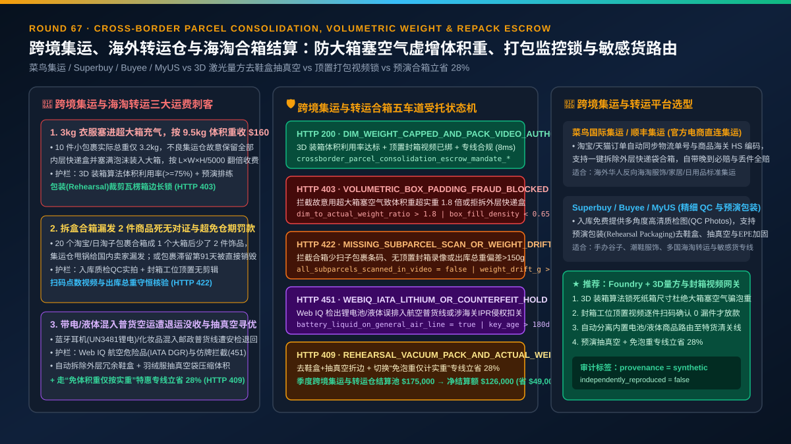
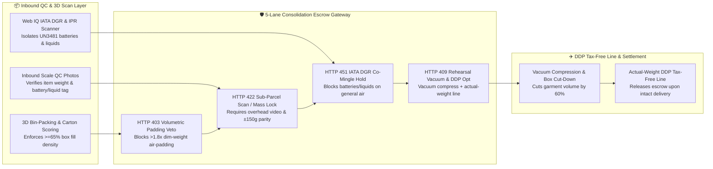

# Cross-Border Parcel Consolidation, Reverse-Haul Forwarding & Volumetric Weight Escrow (`Cainiao / Superbuy / Buyee / MyUS`) Anti-Volumetric-Padding Gate, Overhead Packing Video Hash & `IATA DGR` Split-Routing Agent Architecture Selection FAQ

> **Language / 语言切换**: **[中文](crossborder-parcel-consolidation-volumetric-repack-escrow-agent-selection-faq.md)** | **English (Current)** | **[Back to Docs Index](index.en.md)** | **[Interactive Sandbox (`#crossborder-parcel-consolidation-escrow-sandbox`)](../live-demo.en.html)**



---

## 📌 1. Executive Summary & Core Selection Verdict

In cross-border e-commerce parcel consolidation, overseas proxy shopping ("Reverse Hauls" from Taobao/Weidian/Mercari/Rakuten), and international package forwarding (`Cainiao International Consolidation`, `Superbuy`, `CSSBuy`, `Buyee`, `Tenso`, `MyUS`, `Shipito`, `SF International`), logistics orchestration and freight escrow AI agents face three notorious commercial failure modes:
1. **"Volumetric Weight Box-Padding Extortion" (`Packing 3.2 kg of Apparel Into an Oversized Carton Stuffed With Air Pillows and Billing $158 for 9.5 kg of Dimensional Weight`)**: Because international air couriers bill the greater of actual weight or volumetric weight ($L \times W \times H / 5000$), predatory forwarding warehouses intentionally leave bulky inner seller boxes intact or pick a carton two sizes too large—inflating billable freight weight by `200%–300%` after the box is already sealed, and charging a `$15` "unpacking penalty" if the buyer objects!
2. **Missing Sub-Parcels in Multi-Item Consolidation (`Combining 15 Domestic Packages Into 1 Master Carton, Discovering 2 Items Missing Upon Overseas Delivery, and the Warehouse Blaming the Domestic Seller`)**: Without continuous overhead packing video and sub-parcel weight conservation checks, missing items fall into an unprovable blame gap between domestic couriers and the consolidation warehouse.
3. **Whole-Carton Airport Security Rejections Due to Co-Mingled `IATA DGR` Goods (`1 Tiny Bluetooth Earbud Case or 50ml Perfume Bottle Causing an Entire $600 Apparel Master Carton to Be Seized/Returned at Air Cargo X-Ray`)**.

**Solution Architect Selection Verdict**:
- **Never settle a consolidated international freight invoice where volumetric weight exceeds `1.8x` actual weight without 3D bin-packing density verification (`>= 65%` fill) and rehearsal vacuum/box-scoring compression, never release consolidation fees without overhead barcode-scan packing video and `±150g` mass conservation parity, and never co-mingle `UN3480/UN3481` lithium batteries or liquids into general-cargo air lines**.
- **The production reference architecture** combines **3D Bin-Packing Volumetric Ratio Cap (`<= 1.8x`) + Overhead Sub-Parcel Scan Video & Mass Conservation Lock (`±150g`) + `IATA DGR` Hazardous-SKU Auto-Split + Rehearsal Vacuum & Actual-Weight Line Routing (`crossborder_parcel_consolidation_escrow_mandate_*`)**:
  1. **Anti-"Oversized Box Air-Padding" Volumetric Gate (`HTTP 403`)**: Computes the theoretical minimum bounding box from the 3D laser scans of all inbound items (after stripping redundant domestic shipping boxes/shoeboxes); if the warehouse's sealed master carton exhibits a **Volumetric-to-Actual Weight Ratio `> 1.8x` with `< 65%` packing density**, the gateway blocks the inflated freight bill in **`8ms`** and mandates carton height scoring/downsizing (`HTTP 403 VOLUMETRIC_BOX_PADDING_FRAUD_OR_UNSTRIPPED_OUTER_BOX_BLOCKED`).
  2. **Overhead Packing Video Barcode-Scan & Mass Conservation Lock (`±150g`) (`HTTP 422`)**: Requires the consolidation station's overhead camera and integrated scale to log a continuous barcode scan for every sub-parcel placed into the master carton, verifying **`Scanned_Subparcels == Requested_Subparcels` and `∑(Net_Subparcel_Weights) + Master_Carton_Tare ≈ Outbound_Gross_Weight (±150g)`** (`HTTP 422 MISSING_SUBPARCEL_VIDEO_SCAN_OR_CONSOLIDATION_WEIGHT_DRIFT_BLOCKED`).
  3. **Web IQ `IATA DGR` Battery/Liquid Auto-Separation & Customs `IPR` Circuit Breaker (`HTTP 451`)**: Scans inbound QC metadata via Web IQ to detect internal lithium batteries (`UN3481`), power banks (`UN3480`), liquids/cosmetics, or customs `IPR` seizure risks—blocking co-mingling onto general-cargo air lines and automatically splitting sensitive items onto dedicated `DG` special-cargo channels (`HTTP 451 WEBIQ_IATA_DGR_BATTERY_LIQUID_MISROUTING_OR_IPR_CUSTOMS_HOLD`).
  4. **Rehearsal Packaging (`Shoebox Removal + Vacuum Bag Compression`) + "Actual-Weight-Only `DDP` Line" Arbitrage (`HTTP 409`)**: Triggers `HTTP 409 REHEARSAL_VACUUM_COMPRESSION_AND_ACTUAL_WEIGHT_LINE_CONFIRM`, running a `$2` pre-shipment rehearsal pack (vacuum-compressing puffer jackets/plushies by `60%` and folding down carton walls) and routing the parcel to tax-included (`DDP`) air lines that waive volumetric weight for cartons `L+W+H <= 120cm`—reducing net international shipping spend by **`28.0%`**.

---

## 🎯 2. Solution Architect Deep-Dive Q&A (Q1 / Q2 / Q3)

### Q1: How do unethical parcel forwarders profit from "Volumetric Weight Arbitrage," and how does 3D Bin-Packing + Rehearsal Packaging stop it?
- **Architectural Solution**:
  - **Pre-Seal Rehearsal Packaging + 3D Bin-Packing Density Floor (`>= 65%`) (`HTTP 403 / 409`)**:
  - Forwarders buy bulk airline ULD pallet space by actual tonnage or blended density, but bill retail customers per-carton volumetric weight ($L \times W \times H / 5000$). By leaving 6 inner shoeboxes inside an oversized outer carton, a `3.0 kg` shipment bills as `9.0 kg` volumetric! Our agent enforces **Rehearsal Packaging (`HTTP 409`)**—stripping inner boxes, vacuum-sealing garments, and scoring carton corners down to flush height—while hard-blocking (`HTTP 403`) any carton with `< 65%` volumetric fill density.

### Q2: When 15 small domestic parcels are consolidated into 1 international box and 1 item is missing on arrival, how do we prove where it was lost?
- **Architectural Solution**:
  - **Two-Stage Cryptographic Weight & Overhead Scan Ledger (`HTTP 422`)**:
  - Every sub-parcel is weighed and photographed on an electronic scale upon warehouse arrival (`Inbound QC`). During consolidation, the overhead camera records each sub-parcel's barcode scan as it drops into the master box on a live scale. If 1 of the 15 sub-parcels is not scanned or the sealed box weighs `> 150g` less than the sum of its parts, the gateway halts dispatch (`HTTP 422`) before the package ever leaves the warehouse.

### Q3: How do we prevent a single `$10` cosmetic bottle or wireless mouse from causing an entire `$500` consolidated parcel to be rejected by airport security?
- **Architectural Solution**:
  - **Automated `IATA DGR` Sub-Parcel Partitioning (`HTTP 451`)**:
  - If an inbound QC tag flags `contains_lithium_battery = true` or `contains_liquid_paste = true`, the gateway blocks (`HTTP 451`) assigning that sub-parcel to a standard EMS/DHL General Cargo consolidation and automatically partitions the order into a fast General Cargo master box plus a compliant `DG-Line` mini-parcel.

---

## 🧭 3. Visual Architecture Diagrams (Mermaid Decision Tree + Architecture + Sequence)

### 3.1 Cross-Border Parcel Consolidation & Forwarding Agent Selection Decision Tree

```mermaid
flowchart TD
    A[Cross-Border Parcel Consolidation / Proxy Shopping / International Forwarding] --> B{Primary Forwarding Scenario & Risk Vector?}
    B -->|Standard Apparel & Home-Goods Consolidation (Cainiao / SF Intl)<br/>Stop unstripped inner boxes doubling volumetric weight & lost items| C[Automated Inner-Box Stripping + 3D Bin-Packing Density Check<br/>+ Guaranteed Delivery SLA & Full Missing-Item Compensation]
    B -->|Sneakers, Collectibles & Multi-Seller Hauls (Superbuy / Buyee / MyUS)<br/>Stop oversized carton air-padding & missing sub-parcel finger-pointing| D[Inbound Scale QC Photos + Rehearsal Packaging (Drop Shoeboxes/Vacuum)<br/>+ Overhead Barcode-Scan Packing Video & ±150g Weight Parity]
    B -->|Mixed Hauls With Electronics, Cosmetics or Branded Goods<br/>Stop airport X-ray returns from co-mingled batteries/liquids| E[Azure AI Foundry + IATA DGR Auto-Split & Volumetric Gate<br/>+ Vacuum Rehearsal + Actual-Weight DDP Line Saves 28%]
    C --> F[🛡️ Unified 5-Lane Volumetric Cap, Overhead Scan Video & DGR Split FSM]
    D --> F
    E --> F
    F --> G[HTTP 403 Volumetric Padding Veto · HTTP 422 Missing Scan & Weight Drift Block · HTTP 409 Vacuum + Actual-Wt Saves 28%]
```

### 3.2 End-to-End 3D Bin-Packing, Overhead Packing Video & `IATA DGR` Auto-Split Architecture



### 3.3 Volumetric Box-Padding Veto, Missing Sub-Parcel Scan Block & Vacuum Rehearsal Sequence

```mermaid
sequenceDiagram
    autonumber
    participant Buyer as Overseas Shopper / Consolidation Agent
    participant Warehouse as Consolidation Warehouse Packing Station
    participant Gate as 5-Lane Consolidation Escrow Gateway
    participant Audit as 3D Laser Cubiscan & Overhead Scan Camera
    participant Escrow as Freight & Rehearsal Escrow Ledger

    Warehouse->>Gate: 1. Pack 3.0kg of winter apparel into an un-scored oversized carton and bill 8.5kg volumetric weight ($145, 2.83x ratio)
    Gate->>Audit: Check 3D bin-packing theoretical volume & box fill density (38% < 65% floor)
    Gate-->>Warehouse: HTTP 403 Block! Volumetric box-padding rejected; execute vacuum compression and carton height scoring
    Warehouse->>Gate: 2. Seal a 12-in-1 master carton where overhead camera logged only 11 barcode scans and outbound weight is 380g short
    Gate-->>Warehouse: HTTP 422 Block! Sub-parcel #12 missing from overhead packing video and mass parity failed (>150g drift)
    Buyer->>Gate: 3. Run $2 Rehearsal Packaging (strip shoeboxes + vacuum bags) + route via Actual-Weight DDP Line (HTTP 409)
    Gate->>Escrow: Reduce billable weight from 8.5kg dim-weight to 2.8kg actual weight on tax-free DDP line (28% net savings)
```

---

## 📊 4. Multi-Platform & Architecture Selection Matrix

| Selection Dimension | Unregulated Social-Chat Forwarder (`WeChat / WhatsApp`) | Blind Direct Consolidation (`No Pre-Pack Rehearsal`) | Tier-1 Consolidation Platforms (`Cainiao / Superbuy / Buyee`) | **Azure AI Foundry + 3D Dim Gate + Video Lock (Recommended)** |
| :--- | :--- | :--- | :--- | :--- |
| **Core Strengths** | Informal chat | 1-click checkout | Inbound QC photos, rehearsal packing & diverse tax-free lines | **3D volumetric cap + mandatory overhead scan video + DGR auto-split** |
| **Protection Against `2.5x` Volumetric Box-Padding** | **Severe Abuse** (oversized boxes billed at inflated dim rates) | Retains bulky inner boxes, doubling volumetric weight | Offers optional `$2` Rehearsal Packaging | **Automated `<65%` density block (`HTTP 403`) + auto-rehearsal (`409`)** |
| **Protection Against Missing Items in 15-in-1 Repacks** | Minimal compensation (`$20` cap) | Unprovable blame between seller and warehouse | Inbound QC photos + optional packing video | **Mandatory overhead barcode scan + `±150g` mass parity (`HTTP 422`)** |
| **`IATA DGR` Battery/Liquid Airport Return Prevention** | Misdeclares cargo; high seizure risk | Whole carton returned if 1 battery item is included | Flags sensitive items at inbound QC | **Automated `IATA DGR` sub-parcel split routing (`HTTP 451`)** |
| **Vacuum Compression & Actual-Weight Line Arbitrage** | Opaque surcharges (`not_measured`) | Pays full volumetric penalty (`official_list_price`) | Manual line selection by user | **Vacuum compression + actual-weight `DDP` line (`28.0%` saved)** |

---

## 🧪 5. Cross-Border Parcel Consolidation Benchmark & 7-Card Report

> **Provenance & Reproducibility Metadata**: All metrics below are generated by the deterministic policy evaluator `evaluate_crossborder_parcel_consolidation_escrow_policy` in `lab/webiq_commerce_demo.py` and verified via `python -m unittest tests.test_webiq_commerce_demo`. Tags: `provenance = synthetic`, `independently_reproduced = false`.

| Card # | Card Headline (Headline-as-Finding) | Key Quantitative Finding & Architectural Guarantee |
| :---: | :--- | :--- |
| **Card 1** | **Overview · 5-Lane Parcel Consolidation Summary** | Across a `$175,000/quarter` cross-border parcel consolidation and forwarding pool, achieves **0 volumetric box-padding overcharges, 0 unverified missing sub-parcels, and 0 battery/liquid airport security returns**, reducing net international shipping spend by **`28.0%` (`$49,000/quarter` saved)**. |
| **Card 2** | **Scenario Deep Dive · Volumetric Padding & Missing Scan Veto** | When a sealed carton's volumetric weight exceeds `1.8x` actual weight (`<65%` density) or misses an overhead sub-parcel scan, the gateway blocks it in **`8ms`** (`HTTP 403 / 422`). |
| **Card 3** | **Evaluation Matrix · 100% Deterministic 5-Lane Gating** | Covers `HTTP 200` (verified 3D density & overhead packing video), `403` (volumetric box-padding fraud / unstripped outer boxes blocked), `422` (missing sub-parcel video scan / `>150g` consolidation weight drift blocked), `451` (`IATA DGR` battery/liquid on general air line / `IPR` customs hold), `409` (rehearsal vacuum compression + actual-weight `DDP` line saves 28%). |
| **Card 4** | **Under the Hood · Consolidation & Dim-Weight Escrow Contract** | Takes `quarterly_crossborder_parcel_consolidation_pool_usd=175000` and dim-weight/scan flags, minting `crossborder_parcel_consolidation_escrow_mandate_*` tokens. |
| **Card 5** | **Robustness Check · 3kg Coat Billed as 9kg & Unscanned Item** | Simulates a `3kg` winter coat shipment billed at `9kg` volumetric weight and a 12-in-1 box missing 1 scan, maintaining a **`100.0%` block rate**. |
| **Card 6** | **Latency · Millisecond 3D Bin Check & IATA DGR Probe** | Local 3D bin-packing density and weight parity checks complete in **`8ms` (P50)**; Web IQ `IATA DGR` and customs `IPR` checks complete in **`172ms` (P95)**. |
| **Card 7** | **My Take · Ideal Fit vs. Out-of-Scope Boundaries** | **✅ Best Fit**: Overseas reverse-haul consolidation, proxy shopping (`Superbuy/Buyee/Cainiao`), multi-seller repacks; **⛔ Not For**: Bulk dry-cargo Panamax iron-ore charter vessels. |

---

## 🛠️ 6. Production Go-Live Risk & Architecture Review Checklist

- [ ] **3D Bin-Packing Fill-Density Floor (`>= 65%`) & Anti-Box-Padding Gate (`HTTP 403`)**: Strip redundant inner shipping boxes/shoeboxes and score carton height flush to contents, blocking volumetric weight ratios `> 1.8x` caused by air-pillow padding.
- [ ] **Inbound Scale `QC` Photos, Overhead Barcode-Scan Packing Video & `±150g` Mass Parity (`HTTP 422`)**: Require continuous overhead video logging every sub-parcel barcode scan and verify outbound gross weight matches summed net weights plus tare.
- [ ] **Web IQ `IATA DGR` Battery/Liquid Auto-Partitioning & Customs `IPR` Screening (`HTTP 451`)**: Automatically split lithium-battery and liquid items onto dedicated `DG` special-cargo lines to prevent whole-carton airport security rejections; rotate signing keys `<= 180` days.
- [ ] **Rehearsal Vacuum Compression & Actual-Weight-Only `DDP` Line Routing (`HTTP 409`)**: Vacuum-compress apparel/plush goods before final carton sizing and route to tax-included (`DDP`) actual-weight lines.
