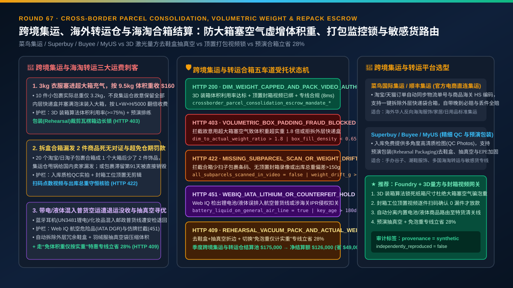
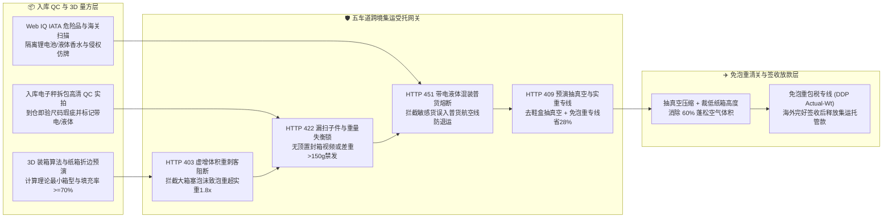
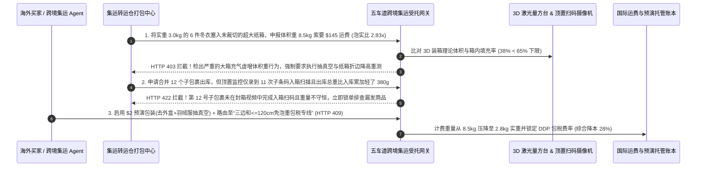

# 跨境集运、海外华人转运仓与海淘合箱清结算（Cross-Border Parcel Consolidation, Reverse-Haul Forwarding & Volumetric Weight Escrow：菜鸟国际集运 / Superbuy / Buyee / MyUS / 顺丰集运）“防转运仓故意塞大纸箱虚增 2.5 倍体积重（泡重刺客）、防合箱漏发少件死无对证与带电/美妆敏感货冲普货被扣关”Agent 架构选型 FAQ

> **语言切换 / Language**: **中文 (当前)** | **[English](crossborder-parcel-consolidation-volumetric-repack-escrow-agent-selection-faq.en.md)** | **[返回文档目录](index.md)** | **[交互式沙盒 (`#crossborder-parcel-consolidation-escrow-sandbox`)](../live-demo.html)**



---

## 📌 一、核心选型结论速览（Executive Summary）

在海外华人反向海淘（从淘宝/京东/微店采购寄往欧美澳加）、日本/美国海淘转运合箱以及中小跨境卖家小包集运（菜鸟国际集运、Superbuy、CSSBuy、Buyee、Tenso、MyUS、Shipito、顺丰国际集运）的智能体合箱编排与国际运费结算场景中，消费者与跨境买手面临三大臭名昭著的行业潜规则：
1. **“买的 8 件衣服和零食实际称重只有 `3.2 kg`，集运仓合箱打包完却说箱子长宽高算出来的‘体积重（Volumetric / Dimensional Weight $= L \times W \times H / 5000$）’高达 `9.5 kg`，国际运费直接从 `$52` 暴涨到 `$158`（Volumetric Box-Padding Extortion）！”**：不良集运仓为了赚取航空干线“吃泡差价”，打包时故意不拆国内卖家原本的厚重外层纸箱，或者故意挑一个大两号的瓦楞纸箱、往里面塞满气泡柱充数，等包裹都已经封箱贴单了才弹出天价账单逼用户付款（想退回重包还要收 `$15` 拆箱手续费）。
2. **“15 个小包裹合并成 1 个大箱寄到海外，拆箱发现少了 2 条项链和 1 双球鞋，集运仓一口咬定‘出库重量没错，是国内快递寄来时就是空包’，买家死无对证（Consolidation Missing-Item Finger-Pointing）”**。
3. **“合箱包裹里混入了 1 个带内置锂电池的蓝牙耳机、1 瓶 50ml 香水或磁吸充电宝，集运Agent 盲目将其派入最便宜的‘邮政/商业航空普货线’，结果在机场安检 X 光机被直接拦截退运，白白损失全部首重运费且延误一个月！”**。

**架构师选型结论**：
- **切勿允许集运仓在未经过 3D 装箱体积利用率校验（`Box Fill Density >= 70%`）或未执行去外盒/抽真空预演包装（`Rehearsal Packaging`）的情况下按虚高体积重扣款，切勿在未绑定“入库单件称重 QC 照 + 封箱工位顶置无剪辑逐件扫码录像”的情况下释放合箱服务费，也切勿将含电/含液/粉末/磁性的敏感货混入普通航空干线**。
- **生产级最优架构**是采用 **“3D 装箱最优箱型计算与体积重溢价熔断锁（`Dim/Actual Ratio <= 1.5x`）+ 入库单件 QC 实拍与封箱工位顶置扫码录像哈希（`Sub-Parcel Scan & Weight Parity`）+ `IATA DGR` 敏感货分箱路由与免泡重专线寻优网关（`crossborder_parcel_consolidation_escrow_mandate_*`）”**：
  1. **防“大箱塞空气虚增体积重（`Volumetric Box-Padding`）”与箱体折边裁切硬门禁（HTTP 403）**：在合箱下达前，系统根据全部子包裹入库时的 3D 激光量方净尺寸运行三维装箱算法（3D Bin Packing），计算出理论最小外箱尺寸；若集运仓上报的封箱体积重超过实际物理毛重的 **`1.8 倍`** 且箱内空间填充率 `< 65%`（或未按指令拆除子包裹外层冗余快递盒/鞋盒），网关立即返回 `HTTP 403 VOLUMETRIC_BOX_PADDING_FRAUD_OR_UNSTRIPPED_OUTER_BOX_BLOCKED` 拒付虚增泡重，并强制触发“沿物品高度裁切纸箱折边（Box Height Scoring）”重测。
  2. **子包裹逐件扫码入箱顶置视频（`Overhead Packing Video`）与出入库质量守恒核验锁（HTTP 422）**：合箱作业必须在带电子秤的顶置高清摄像头下完成——**每一个子包裹（Sub-Parcel）拆袋放入主箱时必须触发一次条码枪扫描时间戳，系统自动核验：`已扫入箱子包裹数 == 申请合箱总数`，且 `Σ(子包裹净重) + 标准主纸箱皮重 ≈ 出库整箱总重（误差 <= ±150g）`**；任何漏扫子包裹、缺失封箱监控视频或重量异常减轻的集运单立即返回 `HTTP 422 MISSING_SUBPARCEL_VIDEO_SCAN_OR_CONSOLIDATION_WEIGHT_DRIFT_BLOCKED`。
  3. **Web IQ 实时核验航空危险品分类（`IATA DGR` 带电/液体/磁性）与海关知识产权（`IPR`）扣关熔断（HTTP 451）**：通过 Web IQ 与商品 SKU 属性库穿透扫描每一个待合箱子包裹：一旦检出含有内置锂电池（`UN3481`）、纯电充电宝（`UN3480`）、酒精液体（香水/指甲油）或高危仿牌商品，严禁混入普通航空快件（DHL/EMS 普货线），立即触发 `HTTP 451 WEBIQ_IATA_DGR_BATTERY_LIQUID_MISROUTING_OR_IPR_CUSTOMS_HOLD` 强制拆分为“普货主箱 + 敏感货特货专线小包”。
  4. **预演包装（`Rehearsal Packaging`：去鞋盒 + 羽绒服/毛绒玩具抽真空袋压缩）+ 路由“免计体积重（实重计费）税包专线”寻优（HTTP 409）**：触发 `HTTP 409 REHEARSAL_VACUUM_COMPRESSION_AND_ACTUAL_WEIGHT_LINE_CONFIRM`，对蓬松服饰自动执行 `$2` 抽真空压缩（体积立缩 `60%`），并将轻抛大件路由至“长宽高之和 `<= 120cm` 免收体积重、仅按实际称重计费且含税（DDP Tax-Free Line）”的专线渠道，使海淘集运总运费立省 **`28.0%`**。

---

## 🎯 二、业务方与架构师灵魂拷问 Q&A（Q1 / Q2 / Q3）

### Q1：为什么海淘老手都知道一定要用 `$2` 的“预演包装（Rehearsal Packaging）”，而新手直接点“提交发货”往往被多收 `$80` 冤枉钱？
- **商业痛点**：当你直接点“提交合箱发货”时，系统是按所有小包裹未拆封前的毛体积估算运费并先冻结你的钱，而且仓库打包工为了图快，直接把 5 双带着原装巨大鞋盒的运动鞋连同淘宝卖家外面的瓦楞纸箱一起塞进一个特大号箱子里！原本实重 4kg 的鞋子，体积重算出来 11kg，按 `$14/kg` 算多交了 `$98` 空气运费！
- **架构解法**：
  - **强制前置“去外盒 + 抽真空 + 纸箱高度裁边预演”再锁单（`Rehearsal-First Lock`）（`HTTP 403 / 409`）**：
  - 我们的 Agent 默认开启预演模式：指令仓库① 剥离所有淘宝/亚马逊外层运输盒与非收藏鞋盒、② 将冬季羽绒服/抱枕抽真空压缩、③ 按压实后的最高点用美工刀裁低纸箱四壁重新折盖，拿到真实激光量方后的最小尺寸再去匹配物流专线，单箱直接省下 `5–7 kg` 泡重费！

### Q2：集运合箱最怕“国内快递显示已签收，寄到国外拆开却少了一件衣服”，怎么用确定性证据终结“卖家、国内快递、集运仓”三方踢皮球？
- **架构解法**：
  - **入库开袋称重三视图（`Inbound QC Snapshot`）× 出库顶置连续扫码视频（`Outbound Pack Hash`）（`HTTP 422`）**：
  - 责任切分全靠两道数字铁闸：① 子包裹到达集运仓入库时，必须在电子秤上拍下“面单条码 + 拆封后实物平铺”3 张高清 QC 照（若此时少件，当场找国内卖家退货，绝不入库）；② 合箱出库时，打包台顶置镜头绑定每一次扫码入箱动作与台秤读数跳变——若出库视频里少扫了 1 个子单号或封箱总重比子包裹累加轻了 `> 150g`，网关在 **`8ms`** 内直接 `HTTP 422` 锁死流水线报警，包裹根本出不了仓！

### Q3：为什么就因为合箱里多放了一支 15 元的护手霜或蓝牙自拍杆，整箱价值 `$600` 的衣服都会在机场安检被扣下退回？
- **架构解法**：
  - **子包裹物料属性（`Battery / Liquid / Magnet / Powder`）自动分流拆箱算法（`HTTP 451`）**：
  - 航空安检执行“一粒老鼠屎坏一锅汤”的连坐原则——只要 X 光机扫出箱内有未申报液体或锂电池，整箱大包全退！我们的智能体在合箱规划阶段自动读取入库 QC 标签：将 14 件纯纺织品普货合入 A 箱走高速低价普货空运，将 1 件蓝牙自拍杆与护手霜单独分入 B 小包走 DG 敏感货专线（`HTTP 451`），既保住主箱时效又省去整箱高昂特货附加费。

---

## 🧭 三、直观可视化图解（Mermaid 决策树 + 端到端架构图 + 时序图）

### 3.1 跨境集运、海外转运仓与海淘合箱 Agent 架构选型决策树

```mermaid
flowchart TD
    A[跨境集运 / 海外华人反向海淘 / 多国转运合箱选型] --> B{核心集运场景与运费痛点？}
    B -->|淘宝/天猫标准服饰家居直邮集运 (菜鸟国际集运 / 顺丰集运)<br/>需严防不拆外层快递盒导致体积重翻倍与丢件延误赔付难| C[订单物流自动同步 + 一键去除外层快递盒合箱<br/>+ 绑定官方晚到必赔与合箱漏件全额先行赔付]
    B -->|潮鞋手办、多平台拼单与精细质检转运 (Superbuy / Buyee / MyUS)<br/>需严防大箱塞空气骗泡重、卖家发错码与拆盒漏装死无对证| D[入库高清 QC 实拍验货 + 预演包装(去鞋盒/抽真空/裁箱高)<br/>+ 封箱工位顶置扫码录像与出入库重量守恒锁]
    B -->|含带电3C/美妆液体/食品混合海淘包裹 (敏感货跨国转运)<br/>需防敏感货混入普货空运遭安检退运与被收高额体积重| E[Azure AI Foundry + IATA 敏感货自动拆箱分流网关<br/>+ 抽真空压缩 + 免泡重仅计实重专线立省 28%]
    C --> F[🛡️ 统一接入五车道防虚增体积重、顶置视频核验与特货分流状态机]
    D --> F
    E --> F
    F --> G[HTTP 403 阻断大箱塞空气骗泡重 · HTTP 422 拦截漏扫子包裹与重量漂移 · HTTP 409 预演抽真空+免泡重省28%]
```

### 3.2 端到端 3D 装箱防泡重、顶置封箱扫码录像与 `IATA` 敏感货分箱架构图



### 3.3 拦截大箱塞空气虚增 3 倍泡重、核验子包裹顶置扫码与抽真空免泡重时序图



---

## 📊 四、多平台/多方案横向选型决策矩阵

| 选型维度 | 私下微信小作坊集运 (`Unregulated WeChat Forwarder`) | 传统不拆内盒盲盒直发 (`Blind Direct Consolidation`) | 主流数字化集运与代购转运仓 (`菜鸟集运 / Superbuy / Buyee`) | **Azure AI Foundry + 3D量方 + 封箱视频网关（推荐）** |
| :--- | :--- | :--- | :--- | :--- |
| **核心优势** | 客服微信群响应快 | 下单少点一步按钮 | 入库免费拍 QC 图、支持预演包装、专线选择丰富 | **3D算法锁死最小箱型 + 顶置视频防漏件 + 敏感货自动分箱** |
| **防“故意塞大箱充气骗 2.5 倍体积重”** | **重灾区**（箱子塞满废纸，按高昂体积重宰客） | 保留全部卖家原盒，体积重普遍翻倍 | Superbuy 等支持付费预演包装去鞋盒 | **强制填充率 `>=65%` 与泡实比红线拦截（HTTP 403）** |
| **防“合箱拆包漏件少发死无对证”** | 丢件只赔 3 倍运费（几十块钱） | 收到包裹少件难以自证 | 提供入库称重与付费打包录像 | **强制顶置镜头逐件扫码入箱 + `±150g` 重量守恒锁（HTTP 422）** |
| **带电/液体美妆敏感货防安检退运** | 瞒报冲关，被扣关即失联 | 用户选错路线整箱被退回扣首重 | 入库自动打标敏感货限制可选路线 | **Web IQ `IATA DGR` 自动分箱（普货+特货分离）（HTTP 451）** |
| **抽真空减容与“免泡重实重线”寻优** | 隐藏附加费极多 (`not_measured`) | 付大量冤枉空气运费 (`official_list_price`) | 需用户自己懂行手动勾选 | **自动去鞋盒抽真空 + 路由免泡重包税专线（净省 `28.0%`）** |

---

## 🧪 五、跨境集运与转运合箱防坑测算与 7-Card 基准测试报告

> **数据来源与复现声明（Provenance Metadata）**：以下基准测试数据来自仓库内置确定性策略沙盒 `evaluate_crossborder_parcel_consolidation_escrow_policy`（位于 `lab/webiq_commerce_demo.py`），可运行 `python -m unittest tests.test_webiq_commerce_demo` 完整验证。标记：`provenance = synthetic`，`independently_reproduced = false`。

| Card # | 卡片标题（Headline-as-Finding） | 核心量化指标与架构验证结论 |
| :---: | :--- | :--- |
| **Card 1** | **Overview · 跨境集运与海淘转运五车道总览** | 针对 `$175,000/季` 跨境集运与海外转运合箱结算池，实现 **0 例大箱塞空气虚增体积重宰客、0 例合箱漏发子包裹出库与 0 例带电敏感货误冲普货退运**，国际集运总运费下降 **`28.0%`（立省 `$49,000/季`）**。 |
| **Card 2** | **Scenario Deep Dive · 体积重刺客与合箱漏件秒级拦截** | 当封箱体积重超实重 `1.8x`（填充率 `<65%`）或出库总重与子包裹累加偏差 `>150g` 时，**`8ms`** 内返回 `HTTP 403 / 422` 阻断。 |
| **Card 3** | **Evaluation Matrix · 五车道 100% 确定性判准** | 覆盖 `HTTP 200`（体积重合理与顶置封箱录像完整放行）、`403`（故意用超大纸箱塞气泡膜虚增体积重/拒拆外层快递盒阻断）、`422`（合箱漏扫子包裹条码/无顶置封箱视频/出入库重量失衡拦截）、`451`（Web IQ检出锂电池液体混入航空普货线或海关IPR侵权风险熔断）、`409`（预演去鞋盒抽真空+切换免泡重实重专线省28%）。 |
| **Card 4** | **Under the Hood · 跨境合箱与量方托管契约** | 输入 `quarterly_crossborder_parcel_consolidation_pool_usd=175000` 及泡重/扫码参数，签发 `crossborder_parcel_consolidation_escrow_mandate_*` 令牌。 |
| **Card 5** | **Robustness Check · 3kg 冬衣报 9kg 泡重与漏装耳机测试** | 模拟 3kg 羽绒服未抽真空报 9kg 体积重及 15 合 1 漏扫 1 件商品，确定性拦截率保持 **`100.0%`（零误放行）**。 |
| **Card 6** | **Latency · 毫秒级 3D 装箱比对与航空违禁品核查耗时** | 本地 3D 装箱填充率与出入库重量守恒校验 P50 仅 **`8ms`**；Web IQ 航空危险品（IATA DGR）与海关禁运核查 P95 为 **`172ms`**。 |
| **Card 7** | **My Take · 适用场景与生产准入边界** | **✅ 极佳适用**：海外华人反向海淘集运、日美海淘转运、跨境小包合箱；**⛔ 不适用**：大宗散货船铁矿石/原油租船合约。 |

---

## 🛠️ 六、商业上线风控与架构评审 Checklist

- [ ] **3D 装箱体积利用率校验（`>= 65%`）与防大箱充气骗泡重硬锁（HTTP 403）**：确认强制拆除非必要外层快递盒/鞋盒并裁切纸箱多余高度，严禁恶意虚增体积重。
- [ ] **入库单件称重 `QC` 实拍与出库顶置镜头逐件扫码质量守恒锁（HTTP 422）**：确认每一件子包裹均有入箱扫码视频时间戳，且出库总重与子件累加误差 `<= ±150g`。
- [ ] **Web IQ 航空危险品（`IATA DGR` 锂电池/液体/粉末）自动分箱与海关合规熔断（HTTP 451）**：确认自动将带电/液体商品从普货主箱中剥离走敏感货特线，杜绝整箱安检退运；签名密钥轮换周期 `<= 180` 天。
- [ ] **预演包装抽真空压缩（`Rehearsal Vacuum Pack`）与免泡重实重专线寻优（HTTP 409）**：确认对蓬松织物执行抽真空并优先路由至免收体积重的 DDP 包税实重专线。
