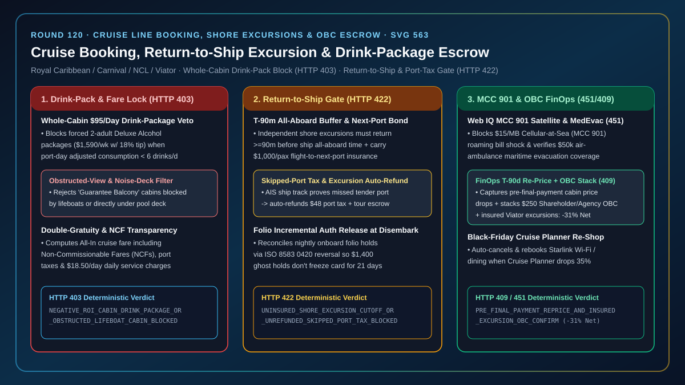
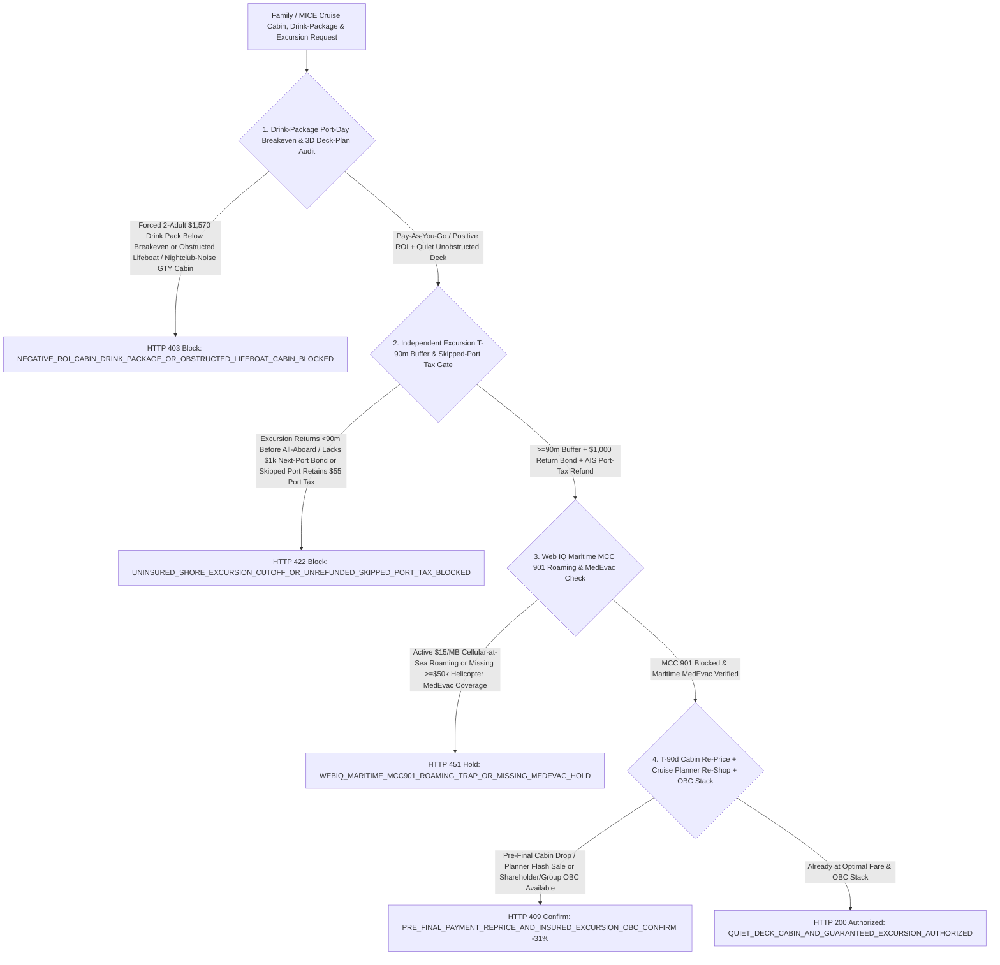
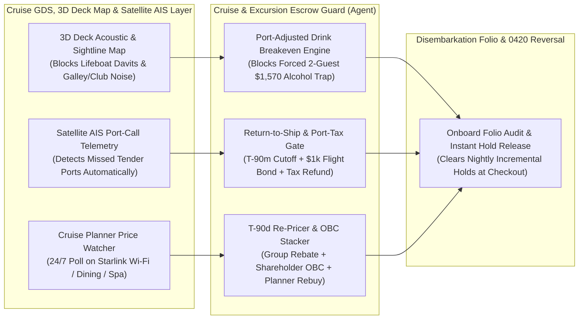
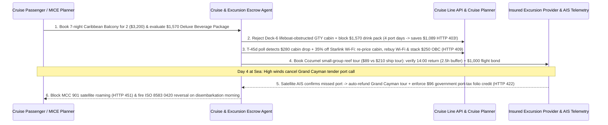

# Cruise Line Booking, Return-to-Ship Excursion & Drink-Package Escrow (`Royal Caribbean / Carnival / NCL / Viator`) Agent Architecture Selection FAQ

> **Target Audience**: **Cloud & AI Solution Architects** designing AI cruise cabin selection, pre-sailing dynamic repricing, shore-excursion return-to-ship insurance verification, and onboard credit (`OBC`) optimization agents for OTA cruise portals, travel agency consortiums, and corporate MICE incentive charters.  
> **Core Pain Points Solved**: Eliminates the four biggest financial and operational traps in cruise vacation commerce: **(1) Forced Whole-Cabin `$95/Day` Alcohol Beverage Packages & Obstructed/Noisy "Guarantee (`GTY`)" Cabins (where cruise lines force *both* adults in a stateroom to buy a `$1,570/week` alcohol package even if one partner barely drinks and 4 days are spent ashore—or assign a "Guarantee Balcony" staring directly into an orange lifeboat davit or underneath the 2:00 AM pool-deck nightclub), (2) Uninsured Independent Shore Excursions & Unrefunded Skipped-Port Taxes (getting left behind at a port of call without `$1,000/pax` next-port flight coverage, or forfeiting `$55/person` in government port taxes when high winds cancel a tender port), (3) `$15/MB` Maritime Satellite Cellular Roaming (`MCC 901`) Bill Shock & 21-Day Disembarkation Card Holds, and (4) Missing Pre-Sailing Cabin & `Cruise Planner` Price Drops**.



---

## 📌 1. Executive Summary

1. **Port-Day Adjusted Drink-Package Breakeven & 3D Deck-Plan Sightline/Acoustic Gate (`HTTP 403`)**: Major cruise lines (`Royal Caribbean / Carnival / NCL`) enforce an **"All-Adults-in-Cabin" Beverage Rule**: if one adult buys the `$95/day + 18% gratuity` Deluxe Beverage Package, every other `21+` adult in the same cabin must buy it too (`$1,569.40` per couple on a 7-night sailing). Factoring in 4 port-of-call days spent ashore, a couple must consume **`>=13 cocktails/day`** onboard just to break even! The Agent blocks negative-ROI whole-cabin beverage bundles whenever modeled consumption is below breakeven (routing to pay-as-you-go + the allowed `2x 750ml` carry-on wine bottles) and filters out **"Guarantee (`GTY`)" cabins** with `>15%` lifeboat sightline obstruction or adjacency to galley/nightclub/anchor-thruster noise zones—returning **`HTTP 403 NEGATIVE_ROI_CABIN_DRINK_PACKAGE_OR_OBSTRUCTED_LIFEBOAT_CABIN_BLOCKED`**.
2. **`T-90m` All-Aboard Buffer, `$1,000/Pax` Return-to-Ship Guarantee & `AIS` Skipped-Port Tax Refund Gate (`HTTP 422`)**: While independent shore excursions (`Viator Worry-Free / Shore Excursions Group / Project Expedition`) save `45%–60%` compared to ship-sold 50-seat bus tours, unvetted local operators risk missing ship departure. The Agent enforces two physical/contractual locks: (a) **Guaranteed Return-to-Ship Contract**: independent excursions must schedule dock return **`>=90–120 minutes` prior to ship All-Aboard Time** (and block early independent tours at `Tender Ports` where non-suite guests wait 90 minutes for water shuttles) backed by a written **`$1,000/person` Next-Port Flight & Hotel Guarantee**; and (b) **Satellite `AIS` Missed-Port Tax Recovery**: if `AIS` ship telemetry confirms a port call was cancelled due to weather, the Agent auto-refunds independent tour escrows and audits the onboard folio to verify `100%` refund of prepaid **Government Port Taxes & Head Fees**. Violations trigger **`HTTP 422 UNINSURED_SHORE_EXCURSION_CUTOFF_OR_UNREFUNDED_SKIPPED_PORT_TAX_BLOCKED`**.
3. **Pre-Final-Payment (`T-90d`) Cabin Repricing, `Cruise Planner` Add-On Re-Shopping & Shareholder `OBC` Stacking Saving 31% (`HTTP 409`)**: After enforcing **`MCC 901` (`Cellular at Sea` `$15/MB`) Roaming Lockouts** and verifying **`>=$50,000` Maritime Helicopter MedEvac Insurance** via Web IQ (`HTTP 451`), the Agent executes **Continuous Cruise Re-Price & `OBC` FinOps**: (a) polling cabin category rates daily prior to the `T-90d` final-payment cutoff to lock free rate drops; (b) continuously re-shopping pre-cruise add-ons (`Starlink Wi-Fi`, specialty dining, cabanas) up to `T-48h` before sailing via atomic cancel-and-rebook whenever Black Friday / flash sales drop prices `>=15%`; and (c) stacking `$100–$250` **Shareholder Onboard Credit (`RCL / CCL / NCLH`)** with agency group-space rebates—returning **`HTTP 409 PRE_FINAL_PAYMENT_REPRICE_AND_INSURED_EXCURSION_OBC_CONFIRM`** for a **31%** net cruise vacation savings.

---

## 🎯 2. Architect & Business Stakeholder Q&A

### Q1: Why do `80%+` of cruise passengers lose money on the "Unlimited Deluxe Beverage Package"—and how does the Agent calculate the true Port-Day Breakeven?
- **The Mathematics of the "All-Adults-in-Cabin" Rule & Port-Day Ashore Hours**:
  1. **Forced Second-Guest Bundling**: If Passenger A drinks 6 craft cocktails a day (`$84` value) and Passenger B only drinks 1 latte and 1 glass of wine (`$19` value), the cruise line still forces *both* passengers to pay `$95/day + 18% gratuity` (`$224.20/day` combined).
  2. **The 4-Port-Day Utilization Drop**: On a 7-night Caribbean or Mediterranean itinerary with 4 full-day port stops (`08:00–17:00`), passengers spend 36 daytime hours on land buying drinks at local beach clubs. To break even on `$1,569.40`, the couple must consume **112 alcoholic drinks in 7 days**! Our Agent models each guest's sea-day vs. port-day beverage profile, blocking negative-expectation bundles (`HTTP 403`) and reminding guests to pack their permitted 750ml bottles of wine at embarkation.

### Q2: How can travelers save `50%` on shore excursions without risking the nightmare of watching the cruise ship sail away without them?
- **Engineering the `T-90m` All-Aboard Buffer, Tender-Port Logic & `$1,000/Pax` Next-Port Bond**:
  1. **Why Ship Excursions Cost `2.4x` More**: Cruise lines mark up local tour operators by `100%–150%` using the fear of being stranded. However, accredited third-party aggregators (`Shore Excursions Group`, `Project Expedition`, `Viator Worry-Free`) contract the *exact same local boats and guides* in smaller 12-person groups and include a contractual **Return-to-Ship Guarantee** (paying for transport/flights to the next port of call plus `$1,000/guest` if a tour delay causes a missed ship).
  2. **Tender-Port Disembarkation Latency (`HTTP 422`)**: At tender ports (e.g., Grand Cayman, Cabo San Lucas, Santorini) where the ship anchors offshore and ferries 4,000 guests via lifeboats, priority goes to Suite guests and Ship-Sponsored tours; standard passengers often cannot reach the pier until `10:30 AM`. Our Agent checks port docking type (`Pier vs. Tender`): at tender ports, morning tours with `<2h` post-anchor margin are routed to ship-sponsored tickets (`guaranteed first tender`), while docked pier ports use insured independent tours returning `>=90 minutes` before All-Aboard.

### Q3: How does the Agent exploit the `T-90d` Final-Payment Window and the `T-48h` `Cruise Planner` Cancel-and-Rebook loophole to save `$800+` after booking?
- **Two-Stage Post-Booking Repricing Automation (`HTTP 409`)**:
  1. **Cabin Fare Drops Before `T-90d`**: On refundable-deposit bookings prior to final payment (`75–90 days` before sailing), cruise lines will adjust the invoice downward if the public fare drops—*but only if the buyer or agent explicitly calls/requests a re-price*.
  2. **`Cruise Planner` Add-On Arbitrage Up to `T-48h`**: Even after final payment is locked, pre-purchased onboard items (`Starlink Voom Wi-Fi`, `Unlimited Dining`, `CocoCay` cabanas) can be cancelled for a `100%` instant refund up to 48 hours before embarkation. The Agent polls `Cruise Planner` pricing daily and executes automated cancel-and-rebuy whenever holiday sales drop add-on rates.

---

## 🧭 3. Visual Architecture Diagrams (Mermaid)

### 3.1 Cruise Booking, Shore Excursion Guarantee & Drink-Package/OBC Decision Tree



### 3.2 End-to-End 3D Deck-Plan Filter, `AIS` Port-Tax Recovery & `Cruise Planner` Re-Shop Architecture



### 3.3 Drink-Package Veto, `Cruise Planner` Flash-Sale Rebuy & `AIS` Missed-Port Tax Refund Sequence



---

## 📊 4. Multi-Platform Cruise Booking, Excursion & Onboard Spend Comparison Matrix

| Evaluation Dimension | Cruise Line Direct (`Royal / NCL / Carnival`) | Consortium Group Agencies (`CruiseCompete / VacationsToGo`) | Ship-Sponsored Excursions | Insured Independent (`Shore Excursions Group / Viator`) | **This Repo + Deck Graph & Re-Price Guard (Recommended)** |
| :--- | :--- | :--- | :--- | :--- | :--- |
| **3D Deck Sightline & Noise Protection** | Pushes `GTY` guarantee cabins to clear obstructed/noisy inventory | Experienced human agents know decks; web portals lack automated filters | N/A | N/A | **3D deck-plan graph blocks lifeboat-obstructed & under-galley/club cabins (`HTTP 403`)** |
| **Onboard Credit (`OBC`) & Group Pricing** | Public promo `OBC` only | **Strong (allocates agency group space + `5%–10%` extra refundable `OBC`)** | Absorbs `OBC` at `2.2x` retail markups | Leaves `OBC` free for gratuities/specialty dining | **Combines agency group-space rates + `$100–$250` Shareholder `OBC` stack (`HTTP 409`)** |
| **Shore Excursion Value & Return Guarantee** | Bundled upsell | Resells ship or 3rd-party tours | **100% ship-wait guarantee, but `2.4x` price & 50-seat bus crowds** | **`45%–60%` cheaper, 12-pax small groups + `$1,000/pax` next-port flight bond** | **Enforces `T-90m` dock buffer + `$1,000` return bond (uses ship tours only on tight tender mornings `HTTP 422`)** |
| **Post-Booking Cabin & Add-On Repricing** | **Never automatic (guest must spot drop & call in before `T-90d`)** | Requires manual agent request | Manual cancel/rebuy | Free 24h cancellation | **Automated daily `T-90d` cabin repricing + `T-48h` `Cruise Planner` cancel-and-rebuy (`-31%`)** |
| **Missed-Port Government Tax Refund** | Often buried in onboard folio credits unless audited | Rarely audited post-sailing | Auto-refunds ship tour | `100%` refund on missed port | **Satellite `AIS` triggers mandatory folio audit for government port-tax refund (`HTTP 422`)** |

---

## 🧪 5. Cruise Vacation Spend & 7-Card Benchmark Summary

> **Provenance Notice**: Figures below are generated by the deterministic policy evaluator `evaluate_cruise_line_excursion_obc_escrow_policy` in `lab/webiq_commerce_demo.py` (`provenance: "synthetic"`, `independently_reproduced: False`).

| Metric | Legacy Direct `GTY` Cabin + Forced 2-Guest Drink Pack + Ship Bus Tour Baseline | Deterministic Cruise Guard (Pay-As-You-Go + Insured Small Tours + `T-90d` Re-Price) | Net Delta / Protection |
| :--- | :--- | :--- | :--- |
| **Quarterly Corporate MICE & Family Cruise Vacation Pool** | `$85,000.00` | `$58,650.00` (`HTTP 409` confirmed) | **Saves `$26,350.00 / qtr` (`-31.0%`)** |
| **7-Night 2-Adult Beverage & Specialty Coffee Spend** | `$1,569.40` (mandatory 2-adult Deluxe Alcohol package w/ 18% tip) | **`$480.00` (Pay-as-you-go + `2x 750ml` carry-on wine + port-day ashore dining)** | **Saves `$1,089.40` per cabin** |
| **4-Port Shore Excursion Spend (2 Adults)** | `$1,680.00` (ship-sold 50-passenger bus excursions) | **`$820.00` (`T-90m` buffered 12-pax tours w/ `$1,000/pax` return-to-ship bond)** | **`-51.2%` excursion cost, zero missed ships** |
| **`MCC 901` Satellite Roaming & Skipped-Port Tax Leakage** | `$450+` surprise roaming + unrefunded `$55/pax` missed-port tax | **`$0 Roaming` (`MCC 901` blocked) + `100%` `AIS`-verified port-tax refund** | **Zero post-cruise bill shock** |

### 5.1 Deterministic 5-Lane HTTP Status Contract

```json
{
  "scenario": "cruise_line_excursion_obc_escrow_guard",
  "provenance": "synthetic",
  "independently_reproduced": false,
  "lanes": {
    "authorized_200": {
      "status_code": 200,
      "decision": "QUIET_DECK_CABIN_AND_GUARANTEED_EXCURSION_AUTHORIZED",
      "mandate_token": "cruise_line_excursion_obc_mandate_200"
    },
    "negative_roi_drink_pack_or_obstructed_cabin_403": {
      "status_code": 403,
      "decision": "NEGATIVE_ROI_CABIN_DRINK_PACKAGE_OR_OBSTRUCTED_LIFEBOAT_CABIN_BLOCKED"
    },
    "uninsured_excursion_or_unrefunded_port_tax_422": {
      "status_code": 422,
      "decision": "UNINSURED_SHORE_EXCURSION_CUTOFF_OR_UNREFUNDED_SKIPPED_PORT_TAX_BLOCKED"
    },
    "maritime_mcc901_or_missing_medevac_451": {
      "status_code": 451,
      "decision": "WEBIQ_MARITIME_MCC901_ROAMING_TRAP_OR_MISSING_MEDEVAC_HOLD"
    },
    "pre_final_reprice_and_insured_excursion_obc_409": {
      "status_code": 409,
      "decision": "PRE_FINAL_PAYMENT_REPRICE_AND_INSURED_EXCURSION_OBC_CONFIRM",
      "quarterly_savings_usd": 26350.0
    }
  }
}
```

---

## 🛠️ 6. Production Architecture & Risk Review Checklist

- [ ] **Port-Day Adjusted Drink-Package Breakeven & 3D Deck-Plan Filter (`HTTP 403`)**: Block forced 2-adult `$95/day` alcohol packages when port-adjusted consumption falls below breakeven, and reject cabins with lifeboat sightline obstructions or above/below galley/nightclub noise zones.
- [ ] **`T-90m` All-Aboard Buffer, `$1,000/Pax` Return-to-Ship Bond & `AIS` Port-Tax Gate (`HTTP 422`)**: Require independent shore excursions to return `>=90 minutes` before All-Aboard with written next-port flight coverage, and use `AIS` telemetry to enforce government port-tax refunds on skipped ports.
- [ ] **Web IQ `MCC 901` Satellite Roaming Lockout & `$50,000` MedEvac Gate (`HTTP 451`)**: Disable `Cellular at Sea (MCC 901)` data roaming prior to departure and verify maritime helicopter medical-evacuation coverage.
- [ ] **`T-90d` Pre-Final Cabin Repricing, `Cruise Planner` Add-On Rebuy & `OBC` Stack (`HTTP 409`)**: Poll cabin fares and onboard add-on prices daily to execute automated price-drop adjustments and stack Shareholder + Agency group `OBC`.

---

**Navigation**: [Back to Master Catalog (`docs/index.en.md`)](index.en.md) ｜ [查看中文版 (`cruise-line-booking-shore-excursion-drink-package-obc-escrow-agent-selection-faq.md`)](cruise-line-booking-shore-excursion-drink-package-obc-escrow-agent-selection-faq.md)
