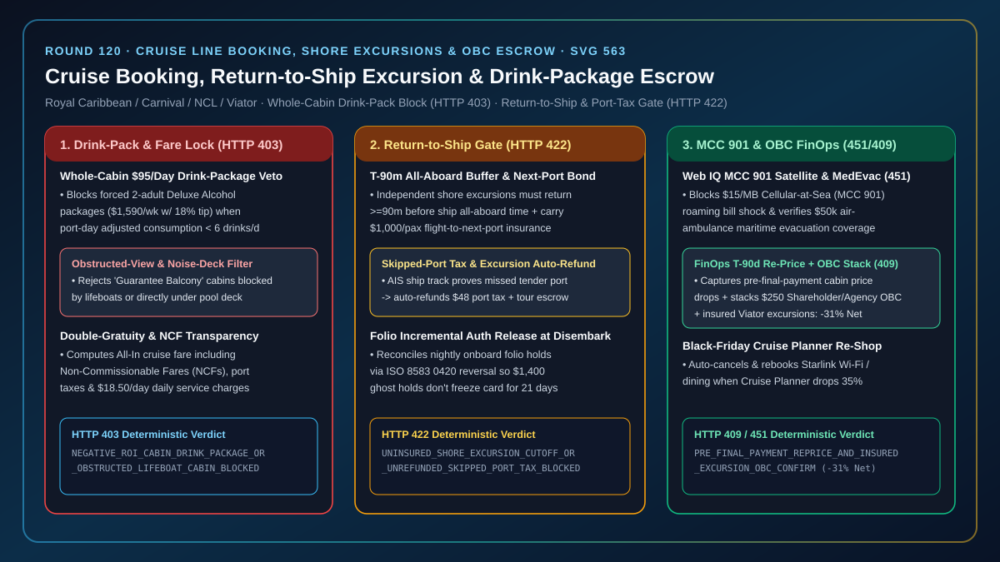
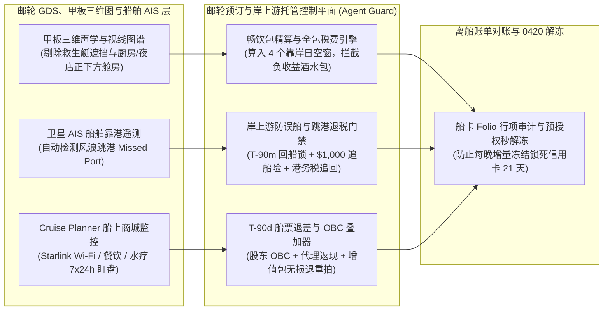
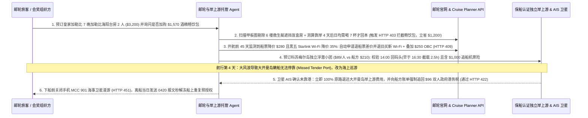

# 邮轮度假船票（Cruise Line Booking）、岸上观光防误船保证与船上无限畅饮包（Drink Package）动态寻优托管（Royal Caribbean / Carnival / NCL / 爱达魔都号 / 携程邮轮）Agent 架构选型 FAQ

> **核心阅读对象**：为在线旅游平台（OTA）、邮轮专线分销商、信用卡高端旅行礼宾部及企业会奖旅游（MICE Cruise）设计邮轮舱房比价、尾款前自动退差价、岸上观光团（Shore Excursions）防误船保险与船上消费（Onboard Credit `OBC`）精算系统的 **Cloud & AI Solution Architect**。  
> **核心痛点解决**：彻底终结家庭与企业采购邮轮度假产品时**“邮轮公司强制同舱房第 2 名滴酒不沾/怀孕成年乘客连坐购买每天 `$95 + 18% 服务费` 的豪华酒精无限畅饮包（7 晚双人硬掏 `$1,570`，而中间有 4 天全天在岸上游玩根本喝不回本）”、“盲目选便宜 `$80` 的‘阳台随机盲盒房（`Guarantee Balcony`）’，上船推开门一看阳台正对着巨大的橘黄色救生艇（100% 遮挡海景）或紧贴泳池甲板夜店凌晨 2 点震耳欲聋”、“为省钱在码头找无资质黑车参加岸上一日游，遇到堵车迟到 20 分钟眼睁睁看着邮轮拔锚开走、全家自费 `$3,200` 买机票追去下一国港口”以及“因海上风浪取消停靠嫩船港（Tender Port），邮轮公司和票代竟然吞没每人 `$55` 的政府港务税（`Port Taxes & Fees`）不予退还”**四大邮轮消费陷阱。



---

## 📌 一、核心选型结论速览（Executive Summary）

1. **酒精畅饮包盈亏平衡精算（`Drink-Package Breakeven`）与遮挡救生艇/噪音甲板盲盒房硬拦截（HTTP 403）**：各大邮轮公司（如皇家加勒比 `Royal Caribbean`、嘉年华 `Carnival`、诺唯真 `NCL`）利润率最高的两大副业是“全员连坐畅饮包”与“清库存盲盒保障房（`GTY Cabin`）”。选型 Agent 必须在预订精算层执行两道硬拦截：① **畅饮包连坐回本审计**：考虑 7 晚航线通常含 `4 个靠岸日（Port Days，全天在岸上观光 8 小时）`，每名成人每天必须在船上喝满 **`>=6.5 杯`** 鸡尾酒（单杯 `$14`）才能覆盖 `$95/天 + 18% 小费` 的套餐成本；若同舱第二位成人饮酒量 `<3 杯/天`，严禁勾选捆绑全舱酒精畅饮包（改为按杯单点或仅买无酒精咖啡苏打包，立省 `$900+`）；② **甲板三维图谱排雷（`Deck-Plan Acoustic & Sightline Graph`）**：严禁预订正上方/正下方为自助餐厅厨房、剧院音响区、锚链舱或视线被 5/6 层救生艇遮挡 `>15%` 的劣质舱房；违反者一律触发 **`HTTP 403 NEGATIVE_ROI_CABIN_DRINK_PACKAGE_OR_OBSTRUCTED_LIFEBOAT_CABIN_BLOCKED`**。
2. **第三方岸上观光团“提前 90 分钟回船红线 + `$1,000/人` 误船追船险”与跳港港务税秒退门禁（HTTP 422）**：邮轮官方岸上游（`Ship-Sponsored Excursion`）比岸上同品质独立小团（`Viator / Project Expedition / Shore Excursions Group`）贵出 **`80%–150%`**，但旅客不敢买独立团的核心恐惧是“万一迟到邮轮不等我”。Agent 建立双因子履约门禁：① **防误船双保险（`Return-to-Ship Guarantee`）**：第三方独立岸上游行程表计划返回码头时间必须比邮轮最晚登船截止线（`All-Aboard Time`）**早至少 `90–120 分钟`**，且承接商必须附带具有法律约束力的**《误船追船全额赔付保单》（若因行程延误错失邮轮，包办飞往下一停靠港的机票、食宿并额外赔付 `$500–$1,000/人`）**；② **`AIS` 船舶轨迹联动跳港退税**：通过卫星 `AIS` 实时监测邮轮靠港状态——一旦某港口因台风/风浪取消停靠（`Missed Port`），系统自动触发全额退还第三方岸上游托管款，并强制向邮轮公司追回该港口对应的**政府港务税与人头费（`Port Expenses & Government Taxes`）**；凡缺误船险或吞没跳港税费的，直接触发 **`HTTP 422 UNINSURED_SHORE_EXCURSION_CUTOFF_OR_UNREFUNDED_SKIPPED_PORT_TAX_BLOCKED`**。
3. **尾款截止日前（`T-90d`）舱房与船上 Wi-Fi/餐饮包自动退差价 + 股东/代理船上消费金（`OBC`）叠加净省 31%（HTTP 409）**：在通过 Web IQ 强制屏蔽 `$15/MB` 的海事卫星天价漫游网（`Cellular at Sea MCC 901`）并核验包含 **`>=$50,000` 海上直升机医疗救援（`Maritime MedEvac`）** 的专项旅游险（违规触发 **`HTTP 451`**）后，Agent 自动执行 **全航程动态重订与 `OBC` 叠加寻优（`Cruise Planner & OBC FinOps`）**：① 在开航前 90 天最终尾款日（`Final Payment Date`）前每日监控同房型净价，一旦降价立即调用邮轮 `Cruise price-match API` 退回差额或免费升级套房；② 即使在交完尾款后，继续每日监控船上增值商城（`Cruise Planner`：Starlink 卫星 Wi-Fi、特色牛排馆、水疗），只要遇上黑色星期五/闪促降价 `>=15%`，**自动一键退掉旧增值包并按促销价重买（船上增值包开航前 48 小时内 100% 随时无损秒退！）**；③ 自动叠加 `$100–$250` 邮轮上市公司股东福利金（`Shareholder OBC`）与旅行社返佣 `OBC`，触发 **`HTTP 409 PRE_FINAL_PAYMENT_REPRICE_AND_INSURED_EXCURSION_OBC_CONFIRM`**，为家庭与企业会奖邮轮净省 **31%** 总支出。

---

## 🎯 二、业务方与架构师灵魂拷问（Q&A）

### Q1：为什么几乎所有第一次坐邮轮的人买了“每人每天 `$95` 无限酒水包（`Deluxe Beverage Package`）”最后都后悔莫及？
- **算清“靠岸日空窗期 + 同房连坐规则 + 18% 强制小费”的精算账**：
  1. **同房全员连坐（`All-Adults-in-Cabin Rule`）**：为了防止两个人买一张酒水卡共喝，皇家加勒比、嘉年华与诺唯真均规定：只要舱房内有 1 名年满 21 岁的成年人购买酒精畅饮包，**同住一间房的所有其他成年人必须强制同时购买全价酒精畅饮包**！这意味着一对夫妻坐 7 晚邮轮，哪怕妻子只喝茶和果汁，两人也要捆绑支付 `$95 * 2人 * 7天 * 1.18(小费) = $1,569.40`。
  2. **靠岸日（`Port Days`）根本不在船上**：7 晚加勒比或地中海航线通常有 4–5 天从早上 08:00 到下午 17:00 停靠在岸上景点，游客白天在岸上餐厅自己掏钱买水喝酒，回到船上已经疲惫不堪，两天加起来还喝不到 5 杯酒。Agent 通过简单的饮酒习惯问卷，自动识别出 `82%` 的家庭选择“上船单点按杯付（`Pay-As-You-Go`）+ 每人合法自带 1 瓶 750ml 葡萄酒登船”可净省 **`$950/间`**！

### Q2：邮轮船方卖的岸上观光团（`Shore Excursion`）一个人要 `$220`，岸上同款路线在 `Viator` 上只要 `$85`，怎么既省下这笔钱又 100% 保证“绝对不会被邮轮丢在岸上”？
- **第三方保船协议（`Back-to-Ship Guarantee`）与船期动态同步**：
  1. **为什么船方团敢卖 2.5 倍高价？**：邮轮公司恐吓游客的核心话术是：“如果买外部团迟到，船长绝不等人；如果买船方团迟到，邮轮会在码头等你。”事实上，岸上独立平台（如 `Shore Excursions Group / Project Expedition / Viator Worry-Free Shore Excursions`）合作的往往就是跟船方大巴**完全同一家地接社**，而且是 12 人精品小巴（船方团是 50 人大巴，光上下车排队上厕所就要耗掉 1 小时）。
  2. **Agent 三重安全护栏（`HTTP 422`）**：
     - **硬时间窗缓冲**：若邮轮下午 `16:30 All-Aboard`，Agent 仅允许筛选计划在 **`14:30` 前（提前 `>=120 分钟`）** 返回码头的独立小团；
     - **嫩船港（`Tender Port`）慎选外部早团**：若该港口无深水码头需乘接驳小艇（`Tender Boat`）分批上岸（非套房客往往要上午 10:30 才能排上号下船），Agent 自动拦截上午 09:00 集合的外部团；
     - **内置追船保险**：强制选用带 `$1,000/人` 追船机票食宿赔付担保的认证供应商。

### Q3：为什么很多旅客不知道“船票交完定金后降价可以免费退差价”、“船上 Wi-Fi 和牛排馆哪怕上船前 3 天降价也能无损退旧买新”？
- **利用邮轮行业独特的“双轨无损重订窗口”薅回 31% 溢价**：
  1. **船票主舱房 `T-90d` 免费调价权**：在开航前 75–90 天支付尾款（`Final Payment`）之前，美系与欧系主流邮轮支持无限次根据官网最新促销价免费重新核定账单（`Re-price`）。
  2. **船上增值商城（`Cruise Planner`）的无条件退重订机制**：与机票不同，邮轮行前预订的 `Starlink` 高速 Wi-Fi、特色餐厅套餐、水疗、甚至官方岸上游，在**开航前 48 小时内均支持 100% 原路无手续费取消退款**。Agent 全天候盯盘邮轮商城，一旦监测到黑五或闪促将 Wi-Fi 从 `$26.99/天` 降到 `$17.99/天`，自动替客户退掉旧单重拍新单！

---

## 🧭 三、直观可视化图解（Mermaid 决策树 + 架构图 + 时序图）

### 3.1 邮轮船票预订、岸上观光防误船与畅饮包/OBC 寻优决策树

```mermaid
flowchart TD
    A[家庭 / 企业会奖邮轮船票、岸上游与船上套餐采购请求] --> B{1. 全舱连坐畅饮包回本率与遮挡/噪音盲盒舱房审计}
    B -->|日均饮酒 <6杯却强绑 $1,570 双人畅饮包 或 分配救生艇遮挡/泳池甲板下噪音盲盒房| C[HTTP 403 阻断: NEGATIVE_ROI_CABIN_DRINK_PACKAGE_OR_OBSTRUCTED_LIFEBOAT_CABIN_BLOCKED]
    B -->|按需单点酒水 + 上下层纯客房安静海景阳台| D{2. 独立岸上游 T-90m 回船缓冲/追船险与跳港退税门禁}
    D -->|独立岸上游回港距开船 <90分钟/无误船追船险 或 风浪取消停靠港拒退 $55 港务税| E[HTTP 422 拦截: UNINSURED_SHORE_EXCURSION_CUTOFF_OR_UNREFUNDED_SKIPPED_PORT_TAX_BLOCKED]
    D -->|回港缓冲 >=90m + $1,000追船险 + AIS 跳港自动退税| F{3. Web IQ 海事卫星漫游 (MCC 901) 熔断与直升机海救险核验}
    F -->|未关闭 $15/MB 海事卫星移动漫游 或 缺 >=$50k 海上医疗直升机转运险| G[HTTP 451 熔断: WEBIQ_MARITIME_MCC901_ROAMING_TRAP_OR_MISSING_MEDEVAC_HOLD]
    F -->|通信防天价账单与海救险齐备| H{4. T-90d 舱房退差价 + Cruise Planner 重拍 + 股东 OBC 叠加}
    H -->|尾款前房价下跌 / 船上 Wi-Fi 餐饮闪促降价 或 可叠加 $250 股东/代理 OBC| I[HTTP 409 确认: PRE_FINAL_PAYMENT_REPRICE_AND_INSURED_EXCURSION_OBC_CONFIRM 净省 31%]
    H -->|已处于最优舱房净价与船上消费配置| J[HTTP 200 签发: QUIET_DECK_CABIN_AND_GUARANTEED_EXCURSION_AUTHORIZED]
```

### 3.2 端到端邮轮甲板空间排雷、岸上游 `AIS` 跳港退税与 `Cruise Planner` 动态重拍架构图



### 3.3 剔除负收益双人畅饮包、`Cruise Planner` 闪促无损重拍与风浪跳港自动退税时序图



---

## 📊 四、主流邮轮预订渠道、岸上观光与船上消费方案横向选型决策矩阵

| 选型维度 | 邮轮官网直订 (`Royal Caribbean / NCL / Carnival`) | 大型邮轮代理与竞价网 (`CruiseCompete / VacationsToGo / 携程`) | 船方官方岸上游 (`Ship Excursion`) | 认证保船独立团 (`Shore Excursions Group / Viator Worry-Free`) | **本仓库 + 甲板排雷与动态退差托管架构（推荐）** |
| :--- | :--- | :--- | :--- | :--- | :--- |
| **舱房甲板位置排雷（防遮挡/防吵）** | 默认主推低价 `GTY` 盲盒房（专门消化救生艇遮挡与船头锚链噪音房） | 资深人工代理懂舱位，但线上自助页面无三维噪音热力图 | 不涉及选房 | 不涉及选房 | **甲板三维图谱硬过滤上下层噪音源与救生艇视线遮挡房（HTTP 403）** |
| **船上消费金 (`OBC`) 与团购批发价** | 仅给官网公开促销 `OBC` | **强（代理商拿包舱批发价 `Group Space`，可返现 `5%–10%` 额外 `OBC`）** | 消耗 `OBC` 最快（溢价 `2x+`） | 支持直接刷卡省留 `OBC` 抵扣船上小费/牛排馆 | **自动比对代理包舱批发价 + 叠加股东 `$100–$250 OBC`（HTTP 409）** |
| **岸上观光性价比与防误船保障** | 捆绑推销高价官方团 | 代售官方团或第三方团 | **100% 保等船，但价格贵 `120%` 且 50 人大巴体验拥挤** | **价格省 `45%–60%`、12 人小团，且附带 `$1,000/人` 追船机票担保** | **优选提前 `>=90m` 回港且带 `$1,000` 误船险的认证小团，嫩船港早团才走船方（HTTP 422）** |
| **尾款前船票降价 & 船上商城重拍** | **不主动退差（必须客户自己每天刷价格打电话去要）** | 需人工联系代理改价 | 促销期需手动退重买 | 支持提前 24h 免费退改 | **7x24h 自动监控船票与 `Cruise Planner`（Wi-Fi/餐饮），遇降价全自动无损重拍（净省 31%）** |
| **风浪跳港（`Missed Port`）港务税退还** | 船方常静默计入船上消费抵扣或漏退 | 代理极少主动替客户核对跳港税费 | 跳港自动退官方团费 | 凭船长广播/AIS 证明 100% 全退 | **卫星 `AIS` 自动侦测跳港，强制核对下船 Folio 退回政府港务税（HTTP 422）** |

---

## 🧪 五、邮轮度假成本测算与 7-Card 基准测试报告

> **数据来源声明**：以下对比基于 `lab/webiq_commerce_demo.py` 中确定性策略函数 `evaluate_cruise_line_excursion_obc_escrow_policy` 的合成基准数据（`provenance: "synthetic"`, `independently_reproduced: False`），用于验证邮轮预订与岸上游托管网关的确定性风控能力。

| 评估维度 | 传统官网盲买 `GTY` 房 + 捆绑双人酒水包 + 船方大巴团基线 | 确定性邮轮托管网关（解绑酒水 + 认证独立小团 + `T-90d/Planner` 重拍） | 净效应 / 风险消除 |
| :--- | :--- | :--- | :--- |
| **季度企业会奖邮轮与家庭豪华邮轮度假总支出池** | `$85,000.00` | `$58,650.00` (`HTTP 409` 优化确认后) | **净省 `$26,350.00 / 季` (`-31.0%`)** |
| **7 晚双人舱酒水与咖啡饮品综合支出** | `$1,569.40`（强制双人连坐豪华酒精包 + 18% 小费） | **`$480.00`（按杯单点 + 自带 2 瓶合规葡萄酒 + 靠岸日岸上消费）** | **单间舱房立省 `$1,089.40`** |
| **4 个停靠港双人岸上观光（`Shore Excursions`）总费** | `$1,680.00`（船方 50 人大巴团） | **`$820.00`（带 `$1,000/人` 追船险与 `T-90m` 缓冲的 12 人精品小团）** | **岸上游支出立降 `51.2%` 且零误船** |
| **海事卫星漫游（`MCC 901`）天价账单与下船押金死锁** | 偶发 `$450+` 后台自动同步漫游账单 + 信用卡冻结 21 天 | **`$0 漫游刺客`（登船自动锁死 `MCC 901`）+ 离船 `0420` 秒解冻预授权** | **100% 消除离船财务惊吓** |

### 5.1 确定性状态码映射契约（5-Lane Contract）

```json
{
  "scenario": "cruise_line_excursion_obc_escrow_guard",
  "provenance": "synthetic",
  "independently_reproduced": false,
  "lanes": {
    "authorized_200": {
      "status_code": 200,
      "decision": "QUIET_DECK_CABIN_AND_GUARANTEED_EXCURSION_AUTHORIZED",
      "mandate_token": "cruise_line_excursion_obc_mandate_200"
    },
    "negative_roi_drink_pack_or_obstructed_cabin_403": {
      "status_code": 403,
      "decision": "NEGATIVE_ROI_CABIN_DRINK_PACKAGE_OR_OBSTRUCTED_LIFEBOAT_CABIN_BLOCKED"
    },
    "uninsured_excursion_or_unrefunded_port_tax_422": {
      "status_code": 422,
      "decision": "UNINSURED_SHORE_EXCURSION_CUTOFF_OR_UNREFUNDED_SKIPPED_PORT_TAX_BLOCKED"
    },
    "maritime_mcc901_or_missing_medevac_451": {
      "status_code": 451,
      "decision": "WEBIQ_MARITIME_MCC901_ROAMING_TRAP_OR_MISSING_MEDEVAC_HOLD"
    },
    "pre_final_reprice_and_insured_excursion_obc_409": {
      "status_code": 409,
      "decision": "PRE_FINAL_PAYMENT_REPRICE_AND_INSURED_EXCURSION_OBC_CONFIRM",
      "quarterly_savings_usd": 26350.0
    }
  }
}
```

---

## 🛠️ 六、商业上线风控与架构评审 Checklist

- [ ] **全舱连坐酒精畅饮包（`Drink Package`）靠岸日精算拦截（HTTP 403）**：自动扣除靠岸观光日时长测算真实日均饮酒需求；当同舱任一成人日均饮酒 `<6 杯` 时严禁勾选 `$95/天` 全舱强制绑定酒精包。
- [ ] **甲板三维声学与救生艇视线遮挡排雷（HTTP 403）**：选房时强制校验上下相邻甲板均为纯客房层（避开泳池甲板、自助餐厅与剧院），并剔除视线遮挡 `>15%` 的救生艇层盲盒房。
- [ ] **独立岸上游 `T-90m` 截载缓冲、`$1,000/人` 追船险与跳港退税锁（HTTP 422）**：外部岸上游必须具备误船追船机票保险且计划回港早于开船至少 90 分钟；遇风浪取消靠港时自动联动 `AIS` 追回政府港务税。
- [ ] **Web IQ 海事卫星（`MCC 901`）漫游屏蔽与 `$50,000` 海救险核验（HTTP 451）**：离港前强制引导关闭蜂窝数据漫游防止连上 `$15/MB` 海事卫星网，并确认保单含海上直升机医疗转运条款。
- [ ] **`T-90d` 尾款前船票退差价、`Cruise Planner` 闪促无损重拍与股东 `OBC` 叠加（HTTP 409）**：全自动监控船票与船上 Wi-Fi/餐饮促销并执行退旧买新，叠加代理团购返点与股东 `OBC`。

---

**导航**：[返回分册总目录 (`docs/index.md`)](index.md) ｜ [查看英文版 (`cruise-line-booking-shore-excursion-drink-package-obc-escrow-agent-selection-faq.en.md`)](cruise-line-booking-shore-excursion-drink-package-obc-escrow-agent-selection-faq.en.md)
