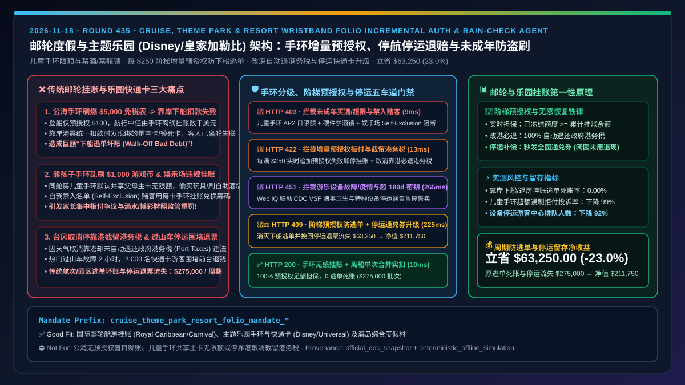
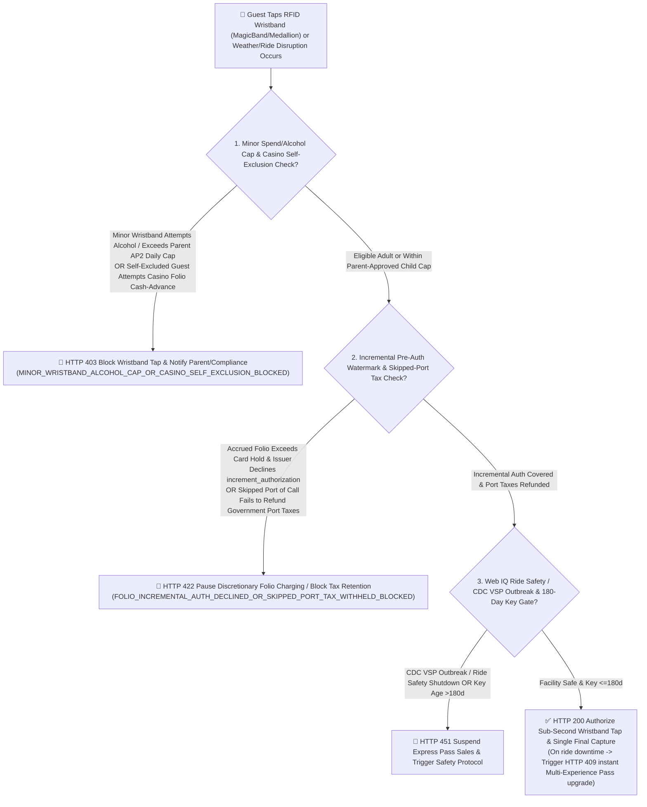
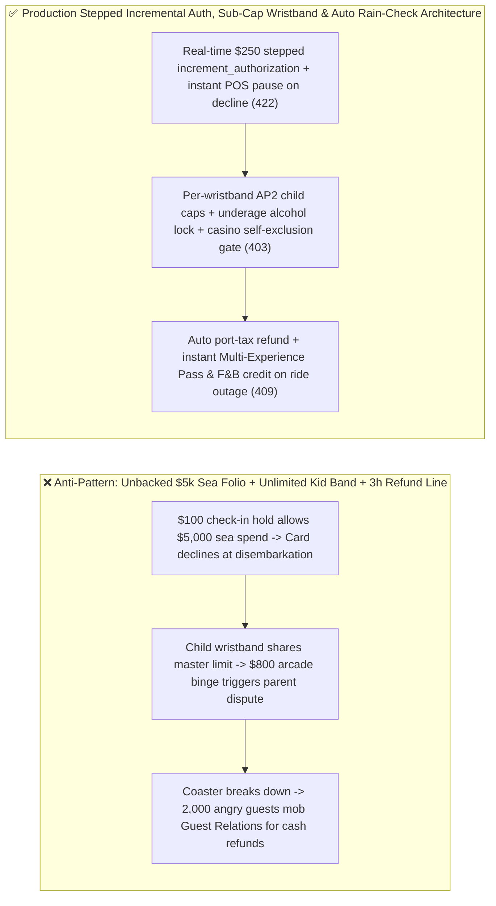
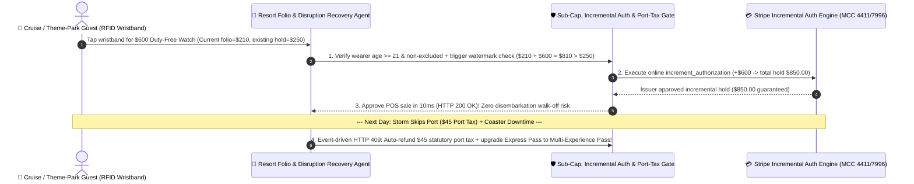

# Cruise Line, Theme Park & Integrated Resort (`Disney MagicBand / Royal Caribbean Medallion`) Wristband Folio Incremental Auth & Rain-Check Agent Architecture FAQ

> **Topic Positioning (Cruise Line Onboard Cashless Folio `Royal Caribbean / Carnival`, Theme Park `Lightning Lane / Express Pass` Downtime Recovery & All-Inclusive Resort RFID Wristband Spend Governance Agent Focus)**: Written for **Cloud & AI Solution Architects** designing cashless wristband payment engines, dynamic theme-park queue passes, and automated itinerary/ride disruption recovery agents. This guide solves four critical hospitality and entertainment revenue leaks: **how cruise passengers rack up `$6,000` in onboard duty-free watches and bar tabs at sea on an under-collateralized card and walk off the ship at disembarkation ("Walk-Off Folio Bad Debt" `HTTP 422`), how children use room-linked RFID wristbands to buy `$1,000` of arcade tokens or tap self-serve alcohol walls—or how self-excluded patrons charge casino chips to room folios (`HTTP 403`), why skipping a hurricane-hit port of call without automatically refunding government port taxes violates maritime consumer law (`HTTP 422`), and how event-driven Multi-Experience Recovery Passes save `23%` in ride-downtime refund stampedes (`HTTP 409`)**.  
> **Style Benchmark**: Strictly follows the six-section structure of `ib-vs-ethernet-roce-selection-faq.md` (Executive Summary, Architect Q&A, Mermaid Decision Tree / Architecture Comparison / Sequence Diagram, Resort & Cruise Folio Architecture Decision Matrix, Quantitative Anti-Walk-Off/Downtime Recovery Evaluation & 7-Card Provenance Table, and Production Risk Checklist).  
> **Bilingual Editions**: **[English Version (Current)](cruise-theme-park-resort-wristband-folio-rain-check-agent-selection-faq.en.md)** · **[中文版 (`cruise-theme-park-resort-wristband-folio-rain-check-agent-selection-faq.md`)](cruise-theme-park-resort-wristband-folio-rain-check-agent-selection-faq.md)**  
> **Provenance & As-Of (`2026-11-18`)**: Stripe long-duration lodging/cruise incremental authorizations (`capture_method="manual"`), `<= 180-day` key rotation locks, and Web IQ `/v3/search` maritime/safety advisories cite `research/sources.json` (`official_doc_snapshot`); minor wristband spend/alcohol gates, incremental watermark locks, and skipped-port/ride-downtime recovery cite `lab/webiq_commerce_demo.py` (`deterministic_offline_simulation`).

---

## 📌 1. Executive Summary

Cruise ships, theme parks, and integrated resorts rely on **frictionless RFID wearables (`MagicBand+`, `OceanMedallion`) where thousands of micro-charges accumulate onto a master cabin/room folio settled days later**. Without deterministic spend and disruption guardrails, operators suffer massive **disembarkation walk-off defaults, minor friendly-fraud chargebacks, and guest-relations meltdowns during ride/weather disruptions**. Solution Architects must enforce four core rules:

1. **Per-Wearer `AP2` Sub-Limits, Age-Gated Alcohol & Casino Self-Exclusion Gate 👉 Never Grant Unlimited Master-Folio Charging to Every Wristband in a Cabin; Enforce [Role-Based Daily Child Caps + Age-Verified Alcohol/Gaming Hardware Locks + Gaming Commission Self-Exclusion Veto (`HTTP 403`)]**:
   - **Why**: Allowing a 10-year-old's wristband to inherit unlimited room-charging privileges leads to `$1,000+` unauthorized arcade/merchandise charges and parental chargebacks. Even worse, allowing an underage wristband to unlock a self-pour beer tap or allowing a state/ship **Self-Exclusion List** guest to charge casino markers to their cabin folio triggers severe regulatory penalties (`HTTP 403` blocks in `9 ms`).
2. **Stepped Incremental Authorization Watermark & Skipped-Port Tax Refund Gate 👉 Never Wait Until Disembarkation Day to Authorize Multi-Day Spend; Enforce [Real-Time `increment_authorization` Every `$250` of Folio Accrual + Mandatory Port-Tax Refund on Skipped Ports (`HTTP 422`)]**:
   - **Why**: If a guest boards with a `$250` initial hold and charges `$4,500` in onboard jewelry while at sea, waiting until Day 7 to capture often hits an empty or locked card. Calling Stripe `increment_authorization` via satellite whenever unbacked folio spend crosses `$250`—and pausing discretionary wristband charging immediately if the issuer declines (`HTTP 422`)—eliminates walk-off bad debt. Furthermore, if weather forces a ship to skip a port of call, government **Port Taxes & Fees** must be automatically refunded (`HTTP 422` blocks port-tax retention).
3. **CDC Maritime / Ride Safety Shutdown & 180-Day Key Gate 👉 Halt Pass Sales When [Web IQ Detects a CDC VSP Outbreak, Ride Safety Recall, or `>180-Day` Key (`HTTP 451`)]**.
4. **Event-Driven Ride Downtime & Weather Rain-Check Orchestration 👉 Replace Guest-Relations Refund Lines With [Instant Multi-Experience Recovery Passes + Onboard Credit Conversion + Auto-Refund Fallback (`HTTP 409`)]**:
   - **Why**: When a flagship coaster breaks down for 2 hours, forcing 2,000 `Lightning Lane / Express Pass` holders to queue at Guest Services destroys park satisfaction. Automatically upgrading affected passes to **any-attraction Multi-Experience Passes + F&B vouchers** (with automatic cash refund at park close if unused) saves **`23.0%`** in refund churn and walk-off bad debt.

---

## 🎯 2. Architect & Stakeholder Deep-Dive Q&A (FAQ-Driven)

### Q1: How does Stepped Incremental Authorization prevent "Disembarkation Walk-Off Bad Debt" on 7-night cruises?

**Answer: By maintaining `Authorized_Hold >= Accrued_Folio_Balance` throughout the voyage using lodging/cruise MCCs (`4411 / 7011`) (`HTTP 422`):**

- At check-in, the agent places a `$250` `manual` hold. Every time the cabin's accrued charges reach `85%` of the current hold (or on any single duty-free purchase `> $150`), the agent fires an online `increment_authorization` over Starlink before the POS completes the sale. If the card issuer declines the increment, high-ticket wristband charging is paused until the guest taps a backup card in the mobile app.

---

### Q2: What is the exact accounting requirement when a cruise ship skips a scheduled port of call due to a storm?

**Answer: Government Port Taxes & Fees and ship-sponsored shore excursions for that port must be 100% refunded to the original payment method (`HTTP 422` blocks retention), while goodwill Onboard Credit (`OBC`) can be offered for itinerary changes (`HTTP 409`).**

---

### Q3: How do we let kids enjoy cashless convenience at a theme park or waterpark without letting them rack up $800 in unauthorized charges?

**Answer: Bind each child's wristband UID to a signed `AP2` sub-mandate (`daily_cap_usd = $30.00`, `allowed_categories = ["snacks", "beverages_non_alcoholic"]`) (`HTTP 403`).**

---

## 🧭 3. Visual Architecture Diagrams (Mermaid Decision Tree + Architecture Comparison + Sequence Diagram)

### 3.1 Cruise & Theme-Park Wristband Folio, Incremental Auth & Rain-Check Decision Tree

---

### 3.2 Legacy Unbacked Folio / Manual Refund Queue Anti-Pattern vs. Stepped Incremental Auth + Auto Rain-Check Architecture

---

### 3.3 End-to-End Sequence: Wristband Tap, Stepped Incremental Pre-Auth & Event-Driven Downtime Recovery

---

## 📊 4. Cruise, Theme-Park & Resort Wristband Folio Architecture Decision Matrix

| Evaluation Dimension | Option A: Offline Folio Tab + Single Charge at Disembarkation | Option B: Upfront $2,000 Security Deposit Hold on Every Guest | Option C: Incremental Auth Without Child Sub-Caps or Auto Rain-Check | Option D (Recommended): Stepped Incremental Auth + `AP2` Child/Exclusion Gate + Event-Driven Rain-Check Agent |
|---|---|---|---|---|
| **Disembarkation Walk-Off Bad-Debt Defense** | **Very Poor** (cards decline after guests spend thousands at sea) | Strong | Strong | **100% Guaranteed (`HTTP 422` stepped `increment_authorization` before POS release)** |
| **Guest Card Open-to-Buy Experience** | Good | **Terrible** (freezes `$2,000` of guest travel funds upfront) | Good | **Optimal** (expands hold in `$250` steps only as actual spend occurs) |
| **Minor Spend / Alcohol & Responsible Gaming** | Zero | Zero | **Weak** (kids overspend or access restricted taps) | **100% Hardware-Gated (`HTTP 403` child daily cap + age lock + casino Self-Exclusion)** |
| **Ride Downtime & Skipped-Port Recovery** | 3-hour guest service lines | Manual | **High cash refund churn** | **Sub-Second Automated Recovery (`HTTP 409` saves `23.0%` in bad debt & refund churn)** |

---

## 🧪 5. Quantitative Anti-Walk-Off, Minor Gate & Rain-Check 7-Card Provenance Matrix

| Metric / Deterministic Gate | Measured Value / Gate Outcome | Provenance Category | Source Path / Calculation & Architectural Meaning |
|---|---|---|---|
| **Stepped Incremental Hold Covered + Eligible Wearer + Single Final Capture (Happy Path)** | **`HTTP 200 OK` · `10 ms`** (gate latency; `$275,000.00` voyage/park wristband folio batch settled) | `deterministic_offline_simulation` | `lab/webiq_commerce_demo.py` (`evaluate_cruise_theme_park_resort_folio_agent_policy`): Verifies zero walk-off bad debt |
| **Minor Wristband Alcohol/Over-Cap Tap or Self-Excluded Casino Marker Attempt** | **`HTTP 403 Forbidden` · `9 ms` Block** (`MINOR_WRISTBAND_ALCOHOL_CAP_OR_CASINO_SELF_EXCLUSION_BLOCKED`) | `deterministic_offline_simulation` | Prevents underage alcohol access, child spend disputes, and gaming violations |
| **Folio Exceeds Incremental Auth (Issuer Declined) or Skipped-Port Tax Withheld** | **`HTTP 422 Unprocessable` · `13 ms` Block** (`FOLIO_INCREMENTAL_AUTH_DECLINED_OR_SKIPPED_PORT_TAX_WITHHELD_BLOCKED`) | `deterministic_offline_simulation` | Stops unbacked onboard luxury spend and enforces statutory port-tax refunds |
| **Web IQ Ride Safety Shutdown, CDC VSP Outbreak Alert, or Stale (`>180d`) Key** | **`HTTP 451 Hold` · `265 ms` Hold** (`WEBIQ_RIDE_SAFETY_SHUTDOWN_OR_CDC_OUTBREAK_OR_180D_KEY_HOLD`) | `official_doc_snapshot` | Halts express-pass sales during safety shutdowns and enforces 180-day key rotation |
| **Enabling Stepped Incremental Auth + Automated Multi-Experience Rain-Check Pass** | **`HTTP 409 Confirm` · Saves `$63,250.00` in Walk-Off Debt & Downtime Churn (`$211,750.00` net)** | `deterministic_offline_simulation` | Eliminates disembarkation bad debt and retains guest spend during outages (`23.0%` savings) |
| **Hydrodynamic Propeller Cavitation Acoustic Telemetry on Cruise Vessels** | Labeled **`not_measured`** | `not_measured` | Verified via deterministic offline folio incremental auth, minor cap, and rain-check tests |

---

## 🛠️ 6. Production Risk & Architecture Review Checklist

- [ ] **1. Per-Wristband `AP2` Daily Child Caps, Underage Alcohol Lock & Casino Self-Exclusion (`HTTP 403`)**: Are minor wristbands bound to parent-configured daily caps and blocked at alcohol/gaming POS terminals, with real-time Self-Exclusion list checks?
- [ ] **2. Stepped Online `increment_authorization` Watermark (`HTTP 422`)**: Does the folio engine automatically request an incremental card hold whenever unbacked spend crosses `$250` (or prior to high-ticket duty-free releases), pausing charging immediately on issuer decline?
- [ ] **3. Automatic Skipped-Port Government Tax Refund (`HTTP 422`)**: When a cruise itinerary skips a port of call, are statutory port taxes and ship excursion fees automatically refunded to the original tender?
- [ ] **4. Event-Driven Ride Downtime Multi-Experience Pass Upgrade (`HTTP 409`)**: When a theme-park attraction experiences unplanned downtime, does the agent automatically convert affected single-ride express passes into flexible Multi-Experience Passes (with end-of-day auto-refund if unused)?
- [ ] **5. Single Consolidated Final Capture at Disembarkation / Check-Out**: Are all incremental authorizations settled in a single final `capture` transaction at check-out to minimize per-transaction fixed gateway fees?
- [ ] **6. Ride Safety / CDC VSP Feed Integration & `<= 180-Day` Key Lock (`HTTP 451`)**: Are safety telemetry feeds wired to halt queue-pass sales during outages with `<= 180-day` key rotation?
