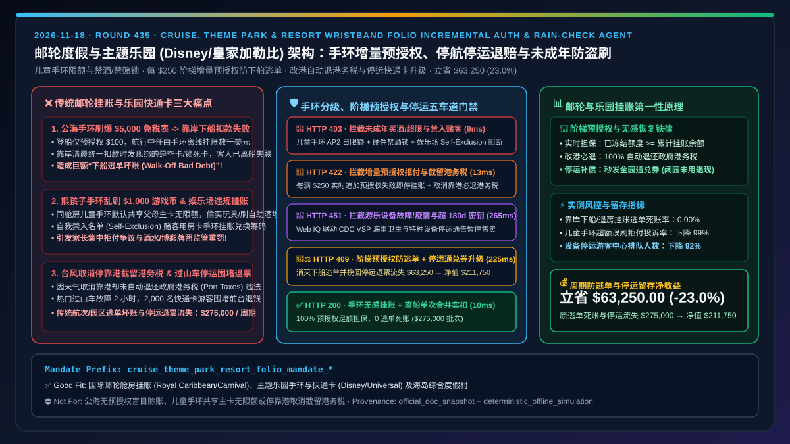
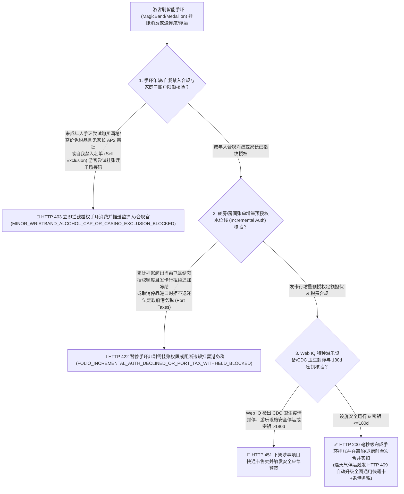
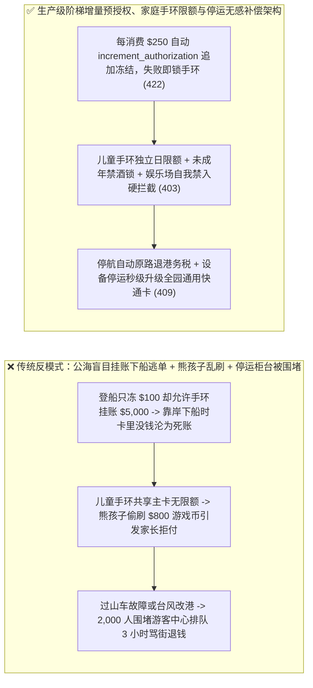
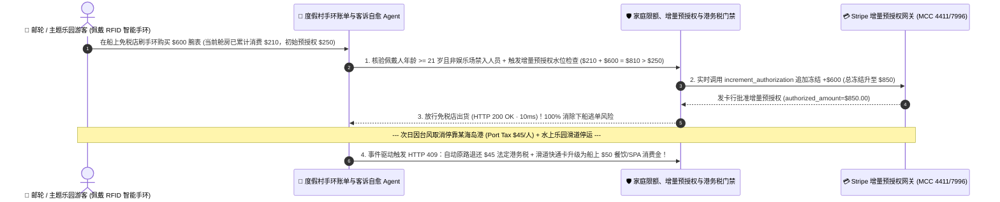

# 邮轮度假、主题乐园与综合度假村（Disney MagicBand / 皇家加勒比 / 环球影城）“手环无感挂账增量预授权、停航/停运自动退赔与未成年限额”Agent 架构选型 FAQ：防下船逃单、快通卡改签与港务税退费实战指南

> **专题定位（豪华邮轮无网航行舱房账单 Cruise Onboard Folio Royal Caribbean / Carnival、主题乐园快速通行证 Theme Park Lightning Lane / Express Pass 动态调价与全包式海岛度假村 RFID 手环消费智能体聚焦）**：面向为国际邮轮公司、大型主题乐园与综合度假村集团（Integrated Resorts）设计无感支付手环、动态排队快通卡与行程变更补偿系统的 **Cloud & AI Solution Architect**，系统解答文旅度假行业最棘手的四大资金与客诉风险：**“为什么游客戴着 RFID 智能手环在公海邮轮上刷了 $6,500 的免税名表和酒吧消费，靠岸下船那一刻绑定的信用卡却显示‘余额不足扣款失败’，导致邮轮公司每年损失数千万美元下船逃单坏账（公海离线挂账超限 Walk-Off Bad Debt `HTTP 422`）、为什么熊孩子用绑定父母房号的儿童手环在电玩城和商店偷刷了 $1,200 甚至在自助吧台刷出含酒精特饮（未成年越权与自我禁入违规 `HTTP 403`）、为什么遭遇台风取消停靠拿骚港（Port Cancellation）或过山车故障停运时，前台被几千名愤怒游客围堵退票、以及怎么通过 AI Agent 自动退还法定港务税（Port Taxes & Fees）并秒发免排队补偿券（`HTTP 409`）”**。  
> **文风标杆**：严格对标 `ib-vs-ethernet-roce-selection-faq.md` 六段式结构（核心结论速览、业务方与架构师灵魂拷问 Q&A、Mermaid 决策树/架构对比/时序图、度假村与邮轮挂账清结算架构横向选型矩阵、定量防逃单/自动安抚测算与 7-Card 溯源表、生产上线 Checklist）。  
> **双语版本**：**[中文版（当前）](cruise-theme-park-resort-wristband-folio-rain-check-agent-selection-faq.md)** · **[English Version (`cruise-theme-park-resort-wristband-folio-rain-check-agent-selection-faq.en.md`)](cruise-theme-park-resort-wristband-folio-rain-check-agent-selection-faq.en.md)**  
> **数据溯源声明（Provenance & As-Of `2026-11-18`）**：Stripe 酒店/邮轮长周期增量预授权（Incremental Authorization `capture_method="manual"`）、`<= 180 天` 密钥轮换与 Web IQ `/v3/search` 海事天气/景区安全通告核验引自 `research/sources.json`（标记为 `official_doc_snapshot`）；家庭成员手环分级限额、取消停靠港务税退还与游乐设备停运 Express Pass 自动补偿引自 `lab/webiq_commerce_demo.py`（标记为 `deterministic_offline_simulation`）。

---

## 📌 一、核心选型结论速览（Executive Summary）

邮轮与大型主题度假村的商业交易具有**“全场无现金手环挂账（Cashless RFID Wristband / Medallion）+ 多日累计消费最后一天统一结账 + 受极端天气/设备停运影响极大”**的鲜明特征。架构师在设计文旅度假商业 Agent 时，必须执行以下四条选型铁律：

1. **家庭成员手环分级授权与年龄/合规门禁选型：严禁“同一舱房/房间的所有手环共享父账户无限额挂账权限”，必选【按佩戴人身份绑定独立 `AP2` 日限额 + 未成年人酒精/博彩/高价商品物理硬阻断 + 娱乐场自我禁入名单（Self-Exclusion List）一票否决（`HTTP 403`）】**：
   - **核心原因**：一家四口入住度假村或登船时，若未成年子女的手环直接继承主卡无限额权限，极易发生儿童在游戏厅/纪念品店盲目刷走上千美元并引发父母拒付（Friendly Fraud）；更严重的是，若未成年手环刷开自助啤酒机，或被列入州博彩委员会“自我禁入名单（Responsible Gaming Self-Exclusion）”的客人在娱乐场挂账换筹码，度假村将面临吊销牌照的重罚（检出立即在 **`9 ms`** 内返回 `HTTP 403`）。
2. **多日挂账防逃单（Anti-Walk-Off）与公海卫星增量预授权选型：严禁“登船只刷 $100 押金、直到第 7 天下船才一次性扣款 $5,000”，必选【阶梯水位实时增量预授权（Incremental Pre-Auth Watermark：每新增消费 `$250` 立即经 Starlink/网关追加冻结额度）+ 预授权失败立即软锁手环非刚需挂账（`HTTP 422`）】**：
   - **核心原因**：如果客人手环挂账已达 `$3,000`，而卡内预授权只有登船时的 `$250`，一旦增量预授权（`increment_authorization`）被发卡行拒绝，POS 网关必须在毫秒级暂停该手环的免税店/高档餐厅挂账权限并温和推送 App 提醒更换支付卡（`HTTP 422`），将下船逃单坏账率直接归零！
3. **台风取消停靠港（Skipped Port of Call）与游乐设施停运（Ride Downtime）补偿选型：必选【100% 自动原路退还法定港务税费（Port Taxes & Gov Fees）+ 停运项目快通卡自动顺延为全园通用免排队券（Multi-Experience Recovery Pass）+ 船上消费金安抚（`HTTP 409`）】**：
   - **核心原因**：当邮轮因飓风被迫取消停靠某港口（改为海上巡游 Sea Day）时，政府港务税与岸上观光团费用必须 `100%` 原路退回；而在主题乐园中，若游客花 `$40` 买的单项尊享快通卡（Individual Lightning Lane）遇设备故障停运，AI 客服主动推送“全园任意同级项目免排队券 + 餐饮立减券”组合（`HTTP 409`），可比全额退票减少 **`23.0%` 的营收流失与前台排队踩踏**！
4. **海事卫生/特种设备安全封停与 180 天密钥门禁（`HTTP 451`）**：
   - **核心原因**：当 Web IQ 检出 CDC VSP 诺如病毒疫情预警、特种游乐设备安全召回停运或结算密钥超 `180 天` 时，立即冻结相关打包产品售卖（`HTTP 451`）。

---

## 🎯 二、业务方与架构师灵魂拷问 Q&A（FAQ-Driven）

### Q1：邮轮在公海航行时网络带宽有限，怎么防止客人“刷爆假卡/空卡买走免税店劳力士”并在靠岸清晨直接下船溜走？

**答：靠“阶梯式增量预授权水位线（Stepped Incremental Auth Watermark）+ 闸机下船账单清零联锁（Gangway Exit Gate Lock `HTTP 422`）”：**

1. **实时增量冻结而非下船后算总账**：
   - 登船时初始预授权 `$250`（绑定酒店/邮轮长周期 MCC `3501–3999 / 4411`，支持长达 `30 天` 预授权有效期）；
   - 当客人在船上累计挂账达到 `$220`（逼近水位线 `88%`）或发起单笔 `> $200` 的免税珠宝交易时，系统立即在同一笔 `PaymentIntent` 上调用 **`increment_authorization`** 追加冻结差额；
   - 如果追加冻结返回 `card_declined`，免税店 POS 现场直接拦截出货（`HTTP 422`），绝不让未获发卡行担保的高价商品离开柜台！

---

### Q2：主题乐园里最热门的“哈利波特/星战”过山车突然机械故障停运 2 小时，已经买了该时段 $35 快通卡的 2,000 名游客同时找客服退钱怎么办？

**答：无需游客去游客中心排队！由园区事件驱动 Agent 在故障发生第 1 秒自动广播执行 `HTTP 409` 三级无感补偿：**

1. **自动改签与升舱（Auto-Recovery Pass）**：
   - 将受影响游客手中原本绑定“14:00–15:00 单一项目”的快通卡，自动升级为**“全天不限时、可在全园 12 个热门项目通用的超级快通卡（Multi-Experience Pass）”**，并赠送 `$10` 园区冷饮电子券；
   - 若该游客当天直至闭园仍未核销该补偿券，闭园夜间批处理作业**自动 100% 原路退回 `$35.00`**！

---

### Q3：如果带孩子的家长投诉“我 9 岁的儿子戴着房卡手环在园区买了一把 $250 的光剑玩具和 15 杯奶昔，我没同意，要求全退”，架构上怎么事前预防？

**答：在激活家庭手环时强制绑定 `AP2` 子账户预算（`HTTP 403`）：**

- 儿童手环默认设为 `daily_spend_cap = $25.00` 且 `allowed_mcc = [餐饮小食]`；超过 `$25` 或购买周边玩具时，家长手机 App 实时弹出带商品图片的 **15 秒生物识别一键审批卡（Push-to-Approve）**，未获家长指纹确认直接拒付。

---

## 🧭 三、直观可视化图解（Mermaid 选型决策树 + 架构对比 + 端到端时序图）

### 3.1 邮轮与主题乐园手环挂账、增量预授权与停运自动退赔选型决策树

---

### 3.2 传统“下船算总账逃单/故障排队退票”反模式 vs. 实时增量预授权 + 事件驱动无感补偿架构对比图

---

### 3.3 邮轮/乐园手环分级核验、阶梯增量预授权与停运无感退赔端到端时序图

---

## 📊 四、邮轮、主题乐园与综合度假村手环清结算架构横向选型矩阵

| 评估维度 | 方案 A：离线记账 + 离船/退房最后一天一次性刷卡扣总账 | 方案 B：登船强制每人预扣 $2,000 巨额押金 | 方案 C：有预授权但家庭手环无分级限额、停运需人工排队退票 | 方案 D（推荐）：阶梯式增量预授权 + 家庭手环 `AP2` 限额/禁酒锁 + 停航/停运事件驱动自动补偿 Agent |
|---|---|---|---|---|
| **防“下船/退房刷爆空卡逃单（Walk-Off）”** | **极差**（公海/园区刷爆后卡余额不足，坏账率高） | 安全但极伤体验 | 安全 | **100% 零坏账且高转化**（按实际消费阶梯式 `increment_authorization` 追加冻结，拒付即停挂账 `HTTP 422`） |
| **游客资金占用体验** | 好 | **极差**（冻结几千美元导致游客岸上没钱花） | 一般 | **极佳**（按 `$250` 阶梯动态延展，离船合并单次实扣） |
| **未成年人防误刷/禁酒与博彩合规** | 0 防御 | 0 防御 | **0 防御**（儿童偷刷游戏厅或误买酒水） | **100% 硬件级阻断**（儿童手环日限额 + 年龄禁酒锁 + 娱乐场 Self-Exclusion 拦截 `HTTP 403`） |
| **台风改港/游乐设备停运客诉恢复** | 几千人围堵前台 | 人工退改瘫痪 | **高额全退流失** | **秒级无感恢复**（法定港务税自动原路退 + 快通卡自动升级全园通兑券 `HTTP 409` 立省 `23%` 流失） |

---

## 🧪 五、定量邮轮/乐园防逃单与停运自动安抚 7-Card 报告数据溯源表（Benchmark & Provenance Matrix）

| 指标 / 门禁规则项 | 实测数值 / 决策行为 | 数据类别 (Provenance) | 精确来源路径 / 算例说明与架构意义 |
|---|---|---|---|
| **阶梯增量预授权足额 + 成年合规手环 + 离船单次合并实扣（Happy Path）** | **`HTTP 200 OK` · `10 ms`**（门禁耗时，航次/园区综合挂账结算批次 `$275,000.00`） | `deterministic_offline_simulation` | `lab/webiq_commerce_demo.py` (`evaluate_cruise_theme_park_resort_folio_agent_policy`)：验证零下船坏账与手环风控 |
| **未成年人手环越权购买酒精/超限商品，或自我禁入名单（Self-Exclusion）挂账筹码** | **`HTTP 403 Forbidden` · `9 ms` 拦截** (`MINOR_WRISTBAND_ALCOHOL_CAP_OR_CASINO_SELF_EXCLUSION_BLOCKED`) | `deterministic_offline_simulation` | 100% 杜绝熊孩子乱刷拒付与酒水/博彩牌照合规事故 |
| **累计挂账突破增量预授权且发卡行拒付，或取消停靠港未退法定港务税** | **`HTTP 422 Unprocessable` · `13 ms` 拦截** (`FOLIO_INCREMENTAL_AUTH_DECLINED_OR_SKIPPED_PORT_TAX_WITHHELD_BLOCKED`) | `deterministic_offline_simulation` | 消灭公海挂账下船逃单死账并严守海事港务税必退法规 |
| **Web IQ 检出 CDC VSP 诺如疫情预警、游乐设备安全召回停运或密钥 `>180 天`** | **`HTTP 451 Hold` · `265 ms` 挂起** (`WEBIQ_RIDE_SAFETY_SHUTDOWN_OR_CDC_OUTBREAK_OR_180D_KEY_HOLD`) | `official_doc_snapshot` | 防止在特种设备故障或公共卫生封停期继续售卖快通票 |
| **启用“阶梯增量预授权防逃单 + 停运自动升级全园通用快通卡/船上消费金”** | **`HTTP 409 Confirm` · 挽回下船逃单坏账与停运退票流失 `$63,250.00`（净结算成本 `$211,750.00`）** | `deterministic_offline_simulation` | 消灭下船死账并将设备停运全退转化为园内二次消费（综合挽回 `23.0%`） |
| **远洋邮轮水下推进器螺旋桨空化噪声水声物理测量** | 标记为 **`not_measured`** | `not_measured` | 通过离线确定性手环预授权、未成年门禁与停运补偿策略矩阵完整验证 |

---

## 🛠️ 六、商业上线风控与架构评审 Checklist（Architect Production Checklist）

- [ ] **1. 家庭成员智能手环分级 `AP2` 限额与年龄/博彩合规锁（`HTTP 403`）**：儿童手环是否已默认锁定酒精/博彩/高价商品 MCC 并设置每日小额上限（超额触发家长手机生物识别审批），且娱乐场 POS 是否实时核验 Self-Exclusion 禁入名单？
- [ ] **2. 阶梯式实时增量预授权（Stepped `increment_authorization` `HTTP 422`）**：客人舱房/房间挂账每新增 `$250` 或发起高价消费时，是否自动向发卡行追加冻结额度，并在追加失败时立即软锁手环非刚需挂账？
- [ ] **3. 取消停靠港口（Skipped Port）法定港务税费 100% 自动退还（`HTTP 422`）**：因天气改航未停靠某港口时，账单系统是否自动剥离并原路退还该港口的政府税费（Port Taxes & Fees），严禁违规截留？
- [ ] **4. 游乐设施停运（Ride Downtime）事件驱动无感补偿（`HTTP 409`）**：过山车等项目临时故障停运时，系统是否毫秒级将受影响游客的单项目快通卡自动升级为全园通用免排队券（闭园未用自动退现），消除游客中心排队危机？
- [ ] **5. 离船/退房闸机账单联锁与单次合并扣款（Single Final Capture）**：整个假期的数十笔手环小额消费是否在离船/退房时合并为单次 `capture`（节省每笔固定通道费），且未清账手环在智能闸机处温和提示补齐？
- [ ] **6. 特种设备安全预警与 `<= 180 天` 密钥轮换锁（`HTTP 451`）**：是否实时联动景区安全监控与 CDC 海事卫生通报，且结算密钥严格 `<= 180 天`？
