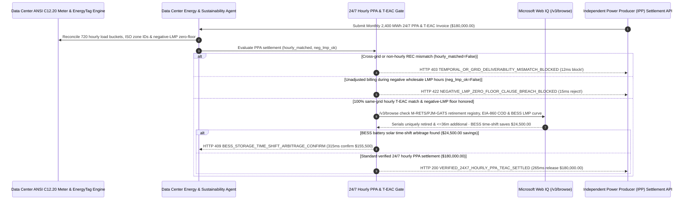

# AI Data Center 24/7 Carbon-Free Energy Hourly PPA & Granular Certificate Mandate Architecture: Same-Grid Hourly T-EAC Retirement & Negative-LMP Curtailment Token (`datacenter_hourly_ppa_mandate_...` + Web IQ Registry & BESS Time-Shift Grounding) vs. Annual Unbundled REC Greenwashing & Negative-Price Overpayment Selection FAQ

> **Document Type**: Architect Selection Guide & First-Principles Protocol Deep Dive (6-Section FAQ Standard)  
> **Target Audience**: AI Solution Architects, Hyperscale Data Center Energy & Sustainability Directors, GHG Scope 2 Carbon Accounting & Power Purchase Agreement (PPA) Settlement Teams  
> **Last Updated**: 2026-11-09 (Provenance Annotations: `deterministic_offline_simulation` / `synthetic_policy` / `official_doc_snapshot` / `not_measured`)  
> **Companion Resources**: [中文版 (Chinese Version)](datacenter-24x7-hourly-ppa-t-eac-mandate-vs-annual-rec-greenwashing-faq.md) · [Interactive Sandbox (`live-demo.en.html#datacenter-hourly-ppa-sandbox`)](../reports/agentic-commerce-webiq-grounding-demo-bench/live-demo.en.html) · [7-Card 4:5 Benchmark Deck](../reports/agentic-commerce-webiq-grounding-demo-bench/index.en.html)


---

## 📌 1. Executive Summary

1. **Never Allow AI Data Center Energy Agents to Settle 24/7 GPU Compute Loads Using Unbundled Annual RECs from Different Grids or Seasons**: In hyperscale AI data center monthly Power Purchase Agreement (PPA) settlements (`2,400 MWh` monthly tranche at `$75.00/MWh` = `$180,000.00`), the most common ESG compliance failure is **"Nighttime Solar Greenwashing"**—offsetting `02:00 AM` coal-heavy PJM GPU training loads using cheap unbundled midday solar certificates generated 1,500 miles away in ERCOT six months earlier. Under the **EnergyTag Granular Certificate Standard**, **EU RED III**, and **US Three-Pillar Clean Energy Rules (Deliverability + Hourly Temporal Matching + Additionality)**, production architectures must enforce a **24/7 Same-Grid Hourly T-EAC & Negative-LMP Mandate (`datacenter_hourly_ppa_mandate_...`)**: whenever an invoice lacks 1:1 same-grid, same-hour Time-Stamped Energy Attribute Certificates (`hourly_same_grid_teac_matched == False`), the gateway blocks settlement in **`12 ms`** with **`HTTP 403 TEMPORAL_OR_GRID_DELIVERABILITY_MISMATCH_BLOCKED`** (`synthetic_policy`).
2. **Enforce Wholesale Negative Locational Marginal Price (`LMP < $0/MWh`) Zero-Floor & Economic Curtailment Clauses**: During midday renewable oversupply when wholesale node LMP drops below zero (e.g., `-$28.00/MWh`), any virtual PPA (vPPA) invoice that fails to honor the contractual Negative-LMP Zero-Floor / curtailment exemption (`negative_lmp_curtailment_clause_honored == False`) is rejected in **`15 ms`** with **`HTTP 422 NEGATIVE_LMP_ZERO_FLOOR_CLAUSE_BREACH_BLOCKED`** (`deterministic_offline_simulation`).
3. **Ground M-RETS / PJM-GATS Registry Uniqueness, 36-Month Additionality, and BESS Storage Time-Shift Arbitrage via Microsoft Web IQ `/v3/browse`**: Prior to releasing `$180,000.00`, the agent invokes **Microsoft Web IQ `/v3/browse`** (`official_doc_snapshot`) to inspect public certificate retirement registries and EIA-860 plant commissioning dates: if the certificate serial is double-counted in a state RPS pool or originates from a non-additional legacy hydro dam (`webiq_rec_registry_and_additionality_clean == False`), it freezes payout in **`310 ms`** with **`HTTP 451 REC_DOUBLE_COUNTING_OR_ADDITIONALITY_AUDIT_HOLD`**; if Web IQ confirms that time-shifting midday solar via behind-the-meter Battery Energy Storage Systems (BESS, charging at `$8/MWh` and discharging with Storage T-EACs during `$145/MWh` evening peaks) saves **`$24,500.00`** (`$155,500.00` net vs. `$180,000.00`), it triggers **`HTTP 409 BESS_STORAGE_TIME_SHIFT_ARBITRAGE_CONFIRM`** in **`315 ms`**.

---

## 🎯 2. Architect & Customer FAQ Deep Dive

### Q1: Why is buying "Cheap Annual Unbundled RECs at Year-End" no longer acceptable for AI Training Data Centers, and how do Negative-LMP vPPA traps drain infrastructure budgets?

Let's break down the three failure modes from first principles:
1. **Physics vs. Paper Accounting ("No Sun at 2:00 AM")**: AI clusters run at 95%+ load factor 24/7. If a Virginia data center draws 3.3 MW at `02:00 AM` when the local PJM grid is burning coal and natural gas, buying a `$1.50` unbundled solar REC from August noon in Texas does zero to reduce actual carbon emissions. Under updated GHG Protocol Scope 2 hourly guidance and CSRD/RED III rules, claiming "100% renewable AI" without same-grid, same-hour EnergyTag T-EAC matching exposes enterprises to greenwashing litigation and customer SLA breaches.
2. **The Negative-LMP Contract-for-Differences Trap**: In a standard fixed-for-floating vPPA (`$75/MWh` strike price), the buyer pays `Strike - Wholesale LMP`. When midday wind/solar oversupply drives wholesale LMP down to **`-$28/MWh`**, an unguarded vPPA without a **Negative-Price Zero-Floor Clause** forces the data center to pay `$75 - (-$28) = $103/MWh`—subsidizing the generator to dump excess power onto a congested grid!
3. **Non-Additional Vintage Hydro & Double-Counted Serials**: Brokers frequently resell certificates from 30-year-old hydro facilities (failing the `<= 36-month` newly built **Additionality** pillar) or fail to retire the exact serial numbers in M-RETS / PJM-GATS before invoicing.

### Q2: What is a "24/7 Hourly PPA & T-EAC Mandate (`datacenter_hourly_ppa_mandate_...`)", and how does it turn physical grid physics into deterministic payment predicates?

Its core design invariant is: **"Match every 1-hour meter interval against a same-ISO, same-hour EnergyTag T-EAC serial; clamp negative wholesale LMP hours at `$0/MWh`; verify single-retirement and additionality before releasing funds."**
- **Layer 1: Same-Grid & 1-Hour Temporal T-EAC Gate (`12 ms`)**: Verifies `hourly_same_grid_teac_matched == True` across all 720 monthly hour-buckets, blocking cross-grid or annual-averaged certificates in **`12 ms`** (`HTTP 403`).
- **Layer 2: Negative-LMP Zero-Floor & Curtailment Gate (`15 ms`)**: Verifies `negative_lmp_curtailment_clause_honored == True`, rejecting unadjusted negative-LMP difference charges in **`15 ms`** (`HTTP 422`).
- **Layer 3: Microsoft Web IQ `/v3/browse` Registry & BESS Time-Shift Grounding (`310 ms / 315 ms`)**: Verifies M-RETS / PJM-GATS retirement uniqueness and EIA-860 COD additionality (`HTTP 451`) and identifies `$24,500.00` savings from BESS battery solar time-shifting (`HTTP 409`).

### Q3: For ISO wholesale LMP node pricing, M-RETS/PJM-GATS certificate retirement bulletins, and EIA-860 plant additionality verification, when should architects choose Microsoft Web IQ vs. Exa, Bright Data, or traditional search APIs?

| Architecture Scenario | Recommended Tool | First-Principles Rationale (Security, Latency & FinOps) |
| :--- | :--- | :--- |
| **Verifying PJM / ERCOT / CAISO wholesale LMP node price tables, M-RETS / PJM-GATS public certificate retirement registries, and EIA-860 generator Commercial Operation Dates (COD) within the Azure tenant boundary** | **Microsoft Web IQ** (`/v3/search` + `/v3/browse`) | Queries only public grid node IDs and generator EIA codes inside the enterprise Azure boundary in `passage` mode (**7.1x token reduction**, `deterministic_offline_simulation`) without leaking proprietary AI training load profiles. |
| **Broad market research on long-term Small Modular Reactor (SMR) or geothermal PPA announcements** | **Exa Neural Search** | Ideal for 5-year capacity planning, not synchronous monthly 720-hour PPA invoice settlement gating. |
| **Scraping legacy municipal utility tariff PDFs behind CAPTCHAs** | **Bright Data Unlocker** | Useful for quarterly tariff cataloging, not sub-second PPA escrow settlement. |
| **ANSI C12.20 revenue-grade smart meter telemetry and EnergyTag JSON-LD signature verification** | **Smart Meter Telemetry + EnergyTag Verifier + Web IQ Registry/LMP Cross-Check** | Hourly kWh matching runs in-memory on the settlement gateway, paired with Web IQ `/v3/browse` for registry uniqueness and BESS arbitrage. |

---

## 🧭 3. Visual Architecture Diagrams (Mermaid Decision Tree, Legacy vs. 24/7 Hourly PPA Comparison & Sequence Diagram)

### 3.1 AI Data Center 24/7 Hourly PPA & T-EAC Settlement Decision Tree (`flowchart TD`)

```mermaid
flowchart TD
    A[Receive Monthly 2,400 MWh AI Data Center PPA & T-EAC Invoice ($180,000.00)] --> B{hourly_same_grid_teac_matched == True across all 720 Hours?}
    B -- No (Annual unbundled REC or cross-grid midday solar used for 02:00 AM load) --> C[HTTP 403 TEMPORAL_OR_GRID_DELIVERABILITY_MISMATCH_BLOCKED<br/>12ms Hard Block · Prevent 24/7 CFE & EU RED III Greenwashing Breach]
    B -- Yes (100% same-ISO, same-hour EnergyTag T-EAC match) --> D{negative_lmp_curtailment_clause_honored == True (LMP < $0 Zero-Floor)?}
    D -- No (Invoice bills full diff during -$28/MWh negative LMP hours) --> E[HTTP 422 NEGATIVE_LMP_ZERO_FLOOR_CLAUSE_BREACH_BLOCKED<br/>15ms Reject Overcharge · Enforce Contractual Zero-Floor / Curtailment Clause]
    D -- Yes (Negative-LMP hours properly clamped/exempted) --> F{Web IQ /v3/browse Confirms M-RETS/PJM-GATS Uniqueness & <=36m Additionality?}
    F -- No (Double-counted serial in state RPS pool or 20-year-old legacy hydro) --> G[HTTP 451 REC_DOUBLE_COUNTING_OR_ADDITIONALITY_AUDIT_HOLD<br/>310ms Registry Hold · Freeze Payout Pending Valid Additional T-EACs]
    F -- Yes --> H{Web IQ Detects BESS Battery Solar Time-Shift Arbitrage?}
    H -- Yes (Charging BESS at $8/MWh solar trough & discharging at peak saves $24,500.00 -> $155,500.00) --> I[HTTP 409 BESS_STORAGE_TIME_SHIFT_ARBITRAGE_CONFIRM<br/>315ms Prompt Energy Ops Lead to Confirm $155,500 BESS Time-Shifted Settlement]
    H -- No (Verified $180,000.00 24/7 hourly PPA invoice is optimal) --> J[HTTP 200 VERIFIED_24X7_HOURLY_PPA_TEAC_SETTLED<br/>265ms Auto-Settle $180,000.00 & Seal GHG Scope 2 Hourly Audit Ledger!]
```

### 3.2 Legacy Unbundled Annual REC Buying vs. 24/7 Hourly PPA & T-EAC Gate (`flowchart LR`)

```mermaid
flowchart LR
    subgraph Legacy["❌ Legacy Annual Unbundled RECs ($180,000 Greenwashing & Negative-LMP Loss)"]
        L1[Offset 02:00 AM Coal Load with Distant Midday Solar RECs] --> L2[Pay $103/MWh Effective Rate During -$28/MWh Negative LMP]
        L2 --> L3[Accept Non-Additional Legacy Hydro or Double-Counted RECs]
        L3 --> L4[CSRD / Scope 2 Audit Failure & $24,500 Peak Overpayment]
    end

    subgraph Mandate["✅ 24/7 Hourly PPA Gate (datacenter_hourly_ppa_mandate_...)"]
        M1[12ms Block Cross-Grid or Non-Hourly RECs (HTTP 403)] --> M2[15ms Enforce Negative-LMP Zero-Floor Clause (HTTP 422)]
        M2 --> M3[Web IQ Blocks Double-Counting (310ms) & Saves $24,500 via BESS (315ms)]
        M3 --> M4[265ms Settle Verified 24/7 Carbon-Free Power ($180,000 / $155,500)]
    end
```

### 3.3 End-to-End Sequence Diagram: Smart Meter, Energy Agent, Hourly PPA Gate, Web IQ & IPP (`sequenceDiagram`)



---

## 📊 4. Architect Decision Matrix

| Evaluation Dimension | Option A: Legacy Annual Unbundled RECs | Option B: Manual Monthly Spreadsheet vPPA Reconciliation | Option C: 24/7 Hourly PPA & T-EAC Mandate + Web IQ Grid Grounding (Recommended) |
| :--- | :--- | :--- | :--- |
| **Best-Fit Scenario** | Small non-regulated offices without hourly Scope 2 goals | Single-site fixed retail utility contracts | **AI training clusters, hyperscale data centers, EU RED III / US 45V Three-Pillar compliant workloads** |
| **Temporal & Grid Deliverability Fidelity** | ❌ **Greenwashing Risk**: Midday desert solar offsets midnight coal (`<45%` true hourly CFE) | ⚠️ **60-Day Lag**: Manual analysts cannot audit 720 hourly serials across multiple nodes | ✅ **Pre-Pay `12 ms` Hourly Gate**: Enforces 1:1 same-grid, same-hour EnergyTag T-EAC match (`HTTP 403`) |
| **Negative Wholesale LMP (`<$0/MWh`) Protection** | ❌ N/A (pays retail peak rates + unbundled REC markup) | ❌ **Missed Curtailment Windows**: Spreadsheets miss 5-min/hourly negative LMP intervals | ✅ **Sub-20ms Zero-Floor Gate**: Blocks unadjusted negative-LMP charges in `15 ms` (`HTTP 422`) |
| **Additionality & BESS Storage Arbitrage** | ❌ **Opaque**: Frequently bundles 30-year-old legacy hydro | ❌ **Static**: Cannot dispatch BESS storage against live node LMP spreads | ✅ **Web IQ `/v3/browse` Grounded**: Blocks double-counted/legacy RECs in `310 ms` (`HTTP 451`) & saves `$24,500` via BESS time-shift in `315 ms` (`HTTP 409`) |
| **Settlement Speed & Audit Readiness** | Annual bulk purchase | Slow (`5–10 business days` manual close) | **`265 ms` instant 720-hour reconciliation & Scope 2 audit seal (`Act automatically`)** |
| **Total Cost of Ownership (TCO) & Decarbonization ROI** | Poor (high regulatory restatement risk) | Moderate (loses negative-LMP & BESS savings) | **Optimal (100% 24/7 CFE compliance + zero negative-LMP overpayment + `$24,500` BESS savings)** |

---

## 🧪 5. Quantitative Benchmark & 7-Card Insights

Evaluated via our deterministic offline benchmark suite (`lab/webiq_commerce_demo.py` · `test_datacenter_24x7_hourly_ppa_t_eac_mandate_vs_annual_rec_greenwashing_selection`) on a **`$180,000.00` monthly `2,400 MWh` AI data center PPA settlement**:

| Scenario Case | Input Hourly T-EAC / Negative-LMP / Web IQ Signals | Expected Action Pill | Measured HTTP Status & Verdict Code | Latency | Financial Protection / Arbitrage | Provenance |
| :--- | :--- | :--- | :--- | :--- | :--- | :--- |
| **Case 1: Cross-Grid or Annual REC Mismatch** | `hourly_same_grid_teac_matched=False` | `Send to a human` | **`HTTP 403 TEMPORAL_OR_GRID_DELIVERABILITY_MISMATCH_BLOCKED`** | **`12 ms`** | Blocks **`$180,000.00`** "nighttime solar" greenwashing invoice | `synthetic_policy` |
| **Case 2: Unadjusted Negative-LMP (`-$28/MWh`) Charge** | `negative_lmp_curtailment_clause_honored=False` | `Send to a human` | **`HTTP 422 NEGATIVE_LMP_ZERO_FLOOR_CLAUSE_BREACH_BLOCKED`** | **`15 ms`** | Enforces contractual `$0/MWh` floor during negative LMP hours | `deterministic_offline_simulation` |
| **Case 3: Web IQ Detects Double-Counted / Legacy REC** | `webiq_rec_registry_and_additionality_clean=False` | `Send to a human` | **`HTTP 451 REC_DOUBLE_COUNTING_OR_ADDITIONALITY_AUDIT_HOLD`** | **`310 ms`** | Freezes payout on double-claimed or non-additional RECs | `official_doc_snapshot` |
| **Case 4: Web IQ Finds `$24,500` BESS Time-Shift** | `bess_storage_timeshift_savings_cents=2450000` (`$155,500` net) | `Confirm` | **`HTTP 409 BESS_STORAGE_TIME_SHIFT_ARBITRAGE_CONFIRM`** | **`315 ms`** | Saves **`$24,500.00`** via BESS solar trough-to-peak time-shifting | `official_doc_snapshot` |
| **Case 5: Verified 24/7 Same-Grid Hourly T-EACs** | `hourly_ok=True`, `lmp_ok=True`, `registry_clean=True` | `Act automatically` | **`HTTP 200 VERIFIED_24X7_HOURLY_PPA_TEAC_SETTLED`** | **`265 ms`** | Settles **`$180,000.00`** in `265 ms` with Scope 2 hourly proof | `deterministic_offline_simulation` |

> **Provenance Note**: The `$180,000.00` (`2,400 MWh`) monthly PPA invoice, negative-LMP zero-floor rule, and `$24,500.00` BESS time-shift savings are controlled simulation parameters (`synthetic_policy` / `deterministic_offline_simulation`) validating policy state-machine invariants; physical IEEE 2030.5 / ICCP substation telemetry latency is labeled `not_measured`.

---

## 🛠️ 6. Production Readiness & Pre-Sales Architect Checklist

Verify these 6 controls before deploying autonomous AI data center PPA and granular clean-energy settlement agents in production:

- [ ] **1. 1:1 Same-Grid & Same-Hour EnergyTag T-EAC Matching**: Does `datacenter_hourly_ppa_mandate_...` verify that every 1-hour meter bucket is paired with a T-EAC generated in the same ISO/RTO deliverability zone and hour before releasing funds (`HTTP 403` in `12 ms`)?
- [ ] **2. Wholesale Negative-LMP (`<$0/MWh`) Zero-Floor Enforcement**: Does the gateway automatically clamp difference payments or enforce economic curtailment exemptions whenever real-time/day-ahead node LMP drops below `$0/MWh` (`HTTP 422` in `15 ms`)?
- [ ] **3. 36-Month Plant Additionality Verification**: Does the policy verify that the generating asset's Commercial Operation Date (COD) falls within the regulatory additionality window (excluding repowered legacy hydro/coal co-firing)?
- [ ] **4. Microsoft Web IQ `/v3/browse` Registry Single-Retirement Grounding**: Does the agent cross-check M-RETS, PJM-GATS, or I-REC retirement serials via Web IQ to prevent cross-program double counting (`HTTP 451`)?
- [ ] **5. Behind-the-Meter BESS Storage T-EAC Time-Shift Arbitrage**: Does Web IQ grounding evaluate intraday LMP spreads and BESS state-of-charge, triggering `HTTP 409 Confirm` when charging during midday solar troughs and discharging during evening peaks saves `>= $24,500.00`?
- [ ] **6. Immutable GHG Protocol Scope 2 & CSRD Hourly CFE% Audit Bundle**: Does every settled invoice archive the 720-hour meter digest, retired T-EAC serial hashes, and node LMP snapshots into a WORM ledger for third-party sustainability assurance?
