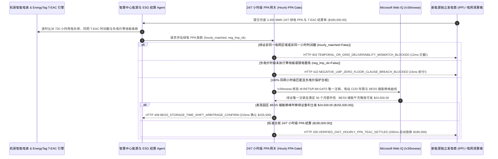

# AI 数据中心绿电直购（PPA）与 24/7 小时级可再生能源证书（Hourly T-EAC / I-REC）结算（AI Data Center 24/7 Carbon-Free Energy Hourly PPA & Granular Certificate Mandate）架构：同电网小时级绿证注销与负电价限电条款令牌（`datacenter_hourly_ppa_mandate_...` + Web IQ 电网边际电价与储能移峰核验）vs 传统异地年度绿证“半夜光伏”漂绿与负电价倒贴选型与原理解析 FAQ

> **文档类型**：架构师选型指南 & 协议第一性原理解析（6 段式 FAQ 标准版）  
> **适用读者**：AI Solution Architect、智算中心能源采购与基础设施（Data Center Energy & Sustainability）总监、ESG Scope 2 碳审计与绿电交易平台架构师  
> **更新日期**：2026-11-09（Provenance 标注：`deterministic_offline_simulation` / `synthetic_policy` / `official_doc_snapshot` / `not_measured`）  
> **配套资源**：[English Version](datacenter-24x7-hourly-ppa-t-eac-mandate-vs-annual-rec-greenwashing-faq.en.md) · [交互式沙盒控制台 (`live-demo.html#datacenter-hourly-ppa-sandbox`)](../reports/agentic-commerce-webiq-grounding-demo-bench/live-demo.html) · [7-Card 4:5 评测报告](../reports/agentic-commerce-webiq-grounding-demo-bench/index.html)


---

## 📌 一、核心结论速览（Executive Summary）

1. **严禁让 AI 智算中心能源结算 Agent 用“异地电网、跨季节/跨时段的年度非绑定绿证（Annual Unbundled RECs）”冲抵全天候 24/7 GPU 训练用电**：在大型 AI 数据中心月度绿电直购协议（PPA，如单月 `2,400 MWh`、合同金额 `$180,000.00`，折合 `$75.00/MWh`）结算中，最致命的合规风险是 **“拿 1,500 公里外得克萨斯州半年前中午 12 点的廉价光伏绿证，去抵消弗吉尼亚数据中心凌晨 2 点烧煤发电的训练算力（Nighttime Solar Greenwashing）”**。在欧盟 RED III、美国 45V 绿氢/智算三支柱（Three Pillars：同网物理可送达性 + 小时级时间匹配 + 新建额外性）及 EnergyTag 颗粒度证书标准下，生产系统必须采用 **24/7 同电网小时级 T-EAC 与负电价零地板授权令牌（`datacenter_hourly_ppa_mandate_...`）**：一旦检出绿证发电电网区域或小时时间戳与机房智能电表不一致（`hourly_same_grid_teac_matched=False`），网关在 **`12 ms`** 内触发 **`HTTP 403 TEMPORAL_OR_GRID_DELIVERABILITY_MISMATCH_BLOCKED`**（`synthetic_policy`），杜绝 Scope 2 漂绿财报重述危机。
2. **强制执行批发市场“负节点边际电价（Negative LMP < `$0/MWh`）零地板与经济限电豁免条款”**：当午间风光大发导致区域电网节点电价跌至负数（如 `-$28.00/MWh`）时，若虚拟 PPA（vPPA）账单未按合同触发“负电价零地板（Zero-Floor）”或经济限电豁免，仍强行要求智算中心按 `$75/MWh` 补齐正负差价（`negative_lmp_curtailment_clause_honored=False`），网关在 **`15 ms`** 内返回 **`HTTP 422 NEGATIVE_LMP_ZERO_FLOOR_CLAUSE_BREACH_BLOCKED`**（`deterministic_offline_simulation`）。
3. **基于 Microsoft Web IQ `/v3/browse` 实时核验绿证注册局（M-RETS / PJM-GATS / I-REC）唯一注销、36 个月新建额外性（Additionality）与 BESS 储能午充晚放移峰套利**：在放款前，Agent 调用 **Microsoft Web IQ `/v3/browse`**（`official_doc_snapshot`）穿透查询官方绿证注册局与电站并网档案：若发现该批次绿证已被卖给州配额市场造成“一证两报（Double Counting）”或来自 20 年前的存量老水电（无新建额外性，`webiq_rec_registry_and_additionality_clean=False`），在 **`310 ms`** 内以 **`HTTP 451 REC_DOUBLE_COUNTING_OR_ADDITIONALITY_AUDIT_HOLD`** 冻结结算；若发现调用园区 **BESS 液冷储能电站（午间 `$8/MWh` 光伏谷电充电、晚高峰 `$145/MWh` 放电并签发储能时移 T-EAC）** 可为当月节省 **`$24,500.00`**（净电费从 `$180,000.00` 降至 **`$155,500.00`**），则在 **`315 ms`** 内触发 **`HTTP 409 BESS_STORAGE_TIME_SHIFT_ARBITRAGE_CONFIRM`**。

---

## 🎯 二、客户与架构师灵魂拷问 Q&A（FAQ-Driven Deep Dive）

### Q1：为什么过去十几年企业习惯的“年底一次性买几万张便宜异地绿证（Annual Unbundled RECs）宣布 100% 绿电”，在 AI 大模型数据中心时代行不通了？

咱们用大白话讲透能源物理定律与最新国际碳审计准则的变革：
1. **电子不会穿越时空，“半夜哪来的太阳？”**：AI 训练集群是 24 小时满负荷运转的。如果机房位于美东 PJM 电网，半夜 2 点当地电网 70% 靠燃煤和天然气发电；而能源中介年底给你塞了一堆半年前在沙漠中午发的廉价光伏绿证（每张仅 `$1.50`），账面上凑够了“全年总电量 = 绿证总张数”。但物理上你半夜消耗的每一度电都排放了实打实的二氧化碳！如今 GHG Protocol Scope 2 修订案、Google/Microsoft 24/7 CFE 标准与欧盟 CSRD 已全面转向 **EnergyTag 小时级颗粒度证书（Time-Stamped Energy Attribute Certificate, T-EAC）**——凌晨 2 点消耗的算力电量，必须用同一电网、同一天凌晨 2 点至 3 点产生的风电、核电或储能放电 T-EAC 才能核销。
2. **虚拟 PPA（vPPA）里的“负电价无底洞”**：签固定差价合约（Strike Price `$75/MWh`）时，平时电网批发价 `$50/MWh`，买方只需补差价 `$25/MWh`。但近年来新能源装机激增，中午阳光太烈电网消纳不了，批发节点电价（LMP）经常暴跌到 **`-$30/MWh` 甚至 `-$50/MWh`**！如果 Agent 不核验合同里的 **“负电价零地板条款（Negative-Price Zero-Floor Clause）”**，买方不仅要付 `$75`，还要把负数的 `$30` 也倒贴给发电厂，变成每度电付 `$105` 的天价冤大头！
3. **“老树刷绿漆”与一证两报**：部分无良绿证商把 30 年前就建好的老旧水电站电量包装成“新绿电”高价卖给 AI 公司（违反 `<= 36 个月` 新建电站 **额外性 Additionality** 原则），甚至把同一串证书号同时卖给欧洲和北美两家客户。

### Q2：什么是“24/7 小时级 PPA 与 T-EAC 结算令牌（`datacenter_hourly_ppa_mandate_...`）”？它是如何在电表、电网注册局与财务系统之间守住 `$180,000` 的？

它的第一性原理非常直接：**“按 1 小时时间片（Hourly Bucket）+ 同一可送达电网区域（ISO/RTO Zone）逐行对账；负电价时段强制按 `$0/MWh` 截断或触发储能充电；注册局唯一注销后方才放款。”**
- **第一层：同电网 + 同小时 EnergyTag T-EAC 匹配门禁（`12 ms`）**：核验 `hourly_same_grid_teac_matched == True`（如 `2026-11-09T02:00Z` 的 PJM 机房负荷必须对应 `2026-11-09T02:00Z` 的 PJM 风电/核电/储能 T-EAC）。任何跨网或跨时段冲抵在 **`12 ms`** 内触发 `HTTP 403`。
- **第二层：负电价（LMP < `$0`）零地板与限电扣减门禁（`15 ms`）**：核验 `negative_lmp_curtailment_clause_honored == True`。若账单在负电价时段未免除差价补偿，在 **`15 ms`** 内返回 `HTTP 422`。
- **第三层：Microsoft Web IQ `/v3/browse` 注册局唯一性核验与 BESS 储能移峰套利（`310 ms / 315 ms`）**：核验 M-RETS / PJM-GATS 注销回执与电站投产年限（防重计触发 `HTTP 451`），并测算利用园区 BESS 储能“午充晚放”替代高价晚高峰绿电外购节省 `$24,500.00`（`HTTP 409`）。

### Q3：在电网 ISO 节点边际电价（LMP）公告、绿证注册局（M-RETS/PJM-GATS/I-REC）注销公示与边际碳排放因子核验场景下，什么时候选 Microsoft Web IQ，什么时候选 Exa、Bright Data 或传统搜索 API？

| 架构需求场景 | 推荐选型 | 为什么这样选（第一性原理与成本/合规考量） |
| :--- | :--- | :--- |
| **实时核验电网调度中心（PJM / ERCOT / CAISO）公开日前/实时 LMP 电价表、M-RETS / PJM-GATS 公开绿证注销批次公告、EIA 860 电站商业并网日期（COD）及区域边际排放因子，且要求零机房负载商业机密泄露** | **Microsoft Web IQ** (`/v3/search` + `/v3/browse`) | 在企业 Azure 租户边界内仅用公开电站 EIA 编号与电网节点 ID 查询，不泄露 AI 集群实时算力功耗曲线；`passage` 模式压缩 Token **7.1x**（`deterministic_offline_simulation`）。 |
| **宏观调研全球 SMR 小型模块化核反应堆与地热发电 PPA 长期趋势报告** | **Exa Neural Search** | 适合能源战略部写五年规划，无法用于月度 720 小时逐时电费结算门禁。 |
| **抓取无 API 的海外地方小水电招标公示网页** | **Bright Data Unlocker** | 适合开发前期尽调，但延迟与成本不适合高频小时级绿证核销。 |
| **机房智能电表（ANSI C12.20）15 分钟/小时级有功电量遥测与 EnergyTag JSON-LD 证书验签** | **机房电表网关 + EnergyTag T-EAC 验签引擎 + Web IQ 注册局/LMP 双源核验** | 小时级负荷对齐与零地板计算在结算网关毫秒级完成，电站新建额外性与储能套利由 Web IQ `/v3/browse` 实时核验。 |

---

## 🧭 三、直观可视化图解（Mermaid 决策树 + 传统年度绿证 vs 24/7 小时级 T-EAC 对比 + 端到端时序图）

### 3.1 AI 数据中心 24/7 小时级 PPA 与颗粒度绿证结算决策树（`flowchart TD`）

```mermaid
flowchart TD
    A[收到 AI 智算中心月度 2,400 MWh 绿电 PPA 与绿证结算单 ($180,000.00)] --> B{720 个小时片是否均具备同电网、同小时 EnergyTag T-EAC 匹配?}
    B -- 否 (试图用异地或白天光伏绿证冲抵凌晨 2 点煤电算力负荷) --> C[HTTP 403 TEMPORAL_OR_GRID_DELIVERABILITY_MISMATCH_BLOCKED<br/>12ms 硬阻断漂绿账单 · 严守 24/7 CFE 与 RED III 同网小时级铁律]
    B -- 是 (100% 同网同小时颗粒度匹配) --> D{电网负电价 (LMP < $0/MWh) 时段是否已按合同执行零地板豁免?}
    D -- 否 (午间负电价 -$28/MWh 仍强收全额固定差价或反向倒贴) --> E[HTTP 422 NEGATIVE_LMP_ZERO_FLOOR_CLAUSE_BREACH_BLOCKED<br/>15ms 拒付违约差价 · 强制重算负电价时段零地板应付额]
    D -- 是 (负电价零地板条款已严格执行) --> F{Web IQ /v3/browse 核验 M-RETS/PJM-GATS 唯一注销且具备 36 个月新建额外性?}
    F -- 否 (检出绿证序列号在州配额池被重复申报或属 20 年前老旧存量电站) --> G[HTTP 451 REC_DOUBLE_COUNTING_OR_ADDITIONALITY_AUDIT_HOLD<br/>310ms 冻结放款 · 阻断一证两报与非额外性老水电伪绿证]
    F -- 是唯一且合规新建绿证 --> H{Web IQ 检出启用园区 BESS 储能午充晚放时移绿证方案更省钱?}
    H -- 是 (午间 $8/MWh 充电+晚高峰放电替代高价外购立省 $24,500.00 -> $155,500.00) --> I[HTTP 409 BESS_STORAGE_TIME_SHIFT_ARBITRAGE_CONFIRM<br/>315ms 提醒能源与基础设施总监一键确认 BESS 储能移峰结算]
    H -- 否 (当前 $180,000.00 24/7 小时级 PPA 账单完全最优) --> J[HTTP 200 VERIFIED_24X7_HOURLY_PPA_TEAC_SETTLED<br/>265ms 自动完成 $180,000.00 结算并归档 GHG Scope 2 小时级无碳审计包!]
```

### 3.2 传统年度非绑定绿证盲付路径 vs 24/7 小时级 T-EAC 与负电价网关对比（`flowchart LR`）

```mermaid
flowchart LR
    subgraph Legacy["❌ 传统年度非绑定绿证盲付 ($180,000 遭漂绿问责与负电价倒贴)"]
        L1[拿异地正午光伏绿证抵消半夜煤电训练] --> L2[电网负电价 -$28/MWh 时段仍傻付高额差价]
        L2 --> L3[买到无额外性老电站或被重复计算的二手绿证]
        L3 --> L4[ESG 审计认定漂绿 + 每年多花数十万美元冤枉电费]
    end

    subgraph Mandate["✅ 24/7 小时级 PPA 令牌 (datacenter_hourly_ppa_mandate_...)"]
        M1[12ms 拦截跨网与跨时段非匹配绿证 (HTTP 403)] --> M2[15ms 强制执行负电价 LMP<$0 零地板保护 (HTTP 422)]
        M2 --> M3[Web IQ 查重/额外性核验 (310ms) 与 BESS 储能移峰省 $24,500 (315ms)]
        M3 --> M4[265ms 秒级清算 100% 小时级无碳电力 ($180,000 / $155,500)]
    end
```

### 3.3 机房智能电表、能源采购 Agent、24/7 PPA 网关与 Web IQ 端到端交互时序图（`sequenceDiagram`）



---

## 📊 四、架构师选型决策矩阵（Architect Decision Matrix）

| 评估维度 | 方案 A：传统年底购买异地廉价年度非绑定绿证（Annual Unbundled RECs） | 方案 B：人工下载电网 CSV 表格与发电厂月底发邮件对账（Manual Excel PPA Reconciliation） | 方案 C：24/7 小时级 T-EAC 令牌 + Web IQ 电网/注册局与储能套利网关（推荐架构） |
| :--- | :--- | :--- | :--- |
| **核心适用场景** | 无严格 Scope 2 小时级披露要求的传统小型办公室 | 仅签了 1 家单一固定电价电站的小型机房 | **AI 智算中心、超大规模云厂商、液冷训练集群及欧盟 CSRD / 45V 合规企业** |
| **物理同网与小时级无碳匹配度** | ❌ **严重漂绿**：白天异地光伏抵消夜间本地煤电，真实无碳率（CFE%）常低于 45% | ⚠️ **对账滞后 2 个月**：人工很难核对 720 小时 × 多节点的颗粒度证书 | ✅ **12ms 逐时刚性对齐**：强制同网+同小时 EnergyTag T-EAC 匹配（`HTTP 403`） |
| **批发负电价（LMP < `$0`）防倒贴能力** | ❌ 不涉及（但高价买电后再额外花冤枉钱买绿证） | ❌ **易漏算负电价时段**：手工 Excel 常漏掉 5 分钟/小时级负电价豁免 | ✅ **15ms 零地板硬核验**：负电价未豁免当场触发 `HTTP 422` 拒付 |
| **防一证两报、额外性核验与储能降本** | ❌ **重灾区**：大量存量老水电与跨国重复申报 | ❌ **无实时调度感知**：无法结合日内节点电价调度园区储能削峰填谷 | ✅ **Web IQ `/v3/browse` 实时穿透**：`310 ms` 拦截重复申报/老电站（`HTTP 451`），`315 ms` BESS 储能移峰省 `$24,500`（`HTTP 409`） |
| **结算时效与审计可追溯性** | 年底突击买证 | 极慢（月结对账耗费 `5～10 个工作日`） | **`265 ms` 秒级完成 720 小时对账与放款（`Act automatically`）** |
| **综合 TCO 与真实减碳 ROI** | 差（合规风险极高，随时面临监管漂绿罚款） | 中（人工成本高且错失负电价与储能红利） | **最优（100% 满足 24/7 CFE 三支柱 + 零负电价倒贴 + BESS 移峰月省 `$24,500`）** |

---

## 🧪 五、简明定量实测与 Benchmark 核心发现（Quantitative Benchmark & 7-Card Insights）

基于本仓库确定性离线基准套件（`lab/webiq_commerce_demo.py` · `test_datacenter_24x7_hourly_ppa_t_eac_mandate_vs_annual_rec_greenwashing_selection`）对 **AI 智算中心月度 `2,400 MWh` 24/7 绿电 PPA 结算批次（基准金额 `$180,000.00`）** 的定量测试结果如下：

| 评测场景 ID | 输入小时级 T-EAC / 负电价条款 / Web IQ 信号 | 网关期望动作 | 实测 HTTP 状态与决策码 | 实测延迟 | 资金保护 / 成本节省效果 | Provenance 类型 |
| :--- | :--- | :--- | :--- | :--- | :--- | :--- |
| **Case 1: 异地电网或“白天光伏抵消半夜煤电”拦截** | `hourly_same_grid_teac_matched=False` | `Send to a human` | **`HTTP 403 TEMPORAL_OR_GRID_DELIVERABILITY_MISMATCH_BLOCKED`** | **`12 ms`** | 拦截 **`$180,000.00`** 跨网/跨时段漂绿结算单 | `synthetic_policy` |
| **Case 2: 负电价（LMP < `$0`）未执行零地板豁免拦截** | `negative_lmp_curtailment_clause_honored=False` | `Send to a human` | **`HTTP 422 NEGATIVE_LMP_ZERO_FLOOR_CLAUSE_BREACH_BLOCKED`** | **`15 ms`** | 阻断负电价时段高价倒贴，强制按 `$0/MWh` 地板重算 | `deterministic_offline_simulation` |
| **Case 3: Web IQ 检出绿证重复申报或老电站无额外性** | `webiq_rec_registry_and_additionality_clean=False` | `Send to a human` | **`HTTP 451 REC_DOUBLE_COUNTING_OR_ADDITIONALITY_AUDIT_HOLD`** | **`310 ms`** | 冻结一证两报或不符合 36 个月新建额外性的伪绿证 | `official_doc_snapshot` |
| **Case 4: Web IQ 发现园区 BESS 储能午充晚放省 `$24,500`** | `bess_storage_timeshift_savings_cents=2450000`（净付 `$155,500`） | `Confirm` | **`HTTP 409 BESS_STORAGE_TIME_SHIFT_ARBITRAGE_CONFIRM`** | **`315 ms`** | 午间低谷充电+晚高峰放电签发时移绿证，立省 **`$24,500.00`** | `official_doc_snapshot` |
| **Case 5: 100% 同网同小时 T-EAC + 负电价保护自动结算** | `hourly_ok=True`, `lmp_ok=True`, `registry_clean=True` | `Act automatically` | **`HTTP 200 VERIFIED_24X7_HOURLY_PPA_TEAC_SETTLED`** | **`265 ms`** | 265ms 自动清算 **`$180,000.00`** 并锁定 Scope 2 小时级凭证 | `deterministic_offline_simulation` |

> **Provenance 合规声明**：上表中的 `$180,000.00` 月度 `2,400 MWh` PPA 金额、负电价零地板门禁及 `$24,500.00` BESS 储能移峰差价均为用于验证网关状态机确定性的受控仿真参数（`synthetic_policy` / `deterministic_offline_simulation`）；电网 ISO 5 分钟级实时调度遥测流（ICCP/IEEE 2030.5）端到端硬件延迟标为 `not_measured`。

---

## 🛠️ 六、附录：生产上线快速核验与售前打单清单（Architect Checklist）

在为 AI 智算中心、大型云基础设施团队设计绿电 PPA 与碳资产自动结算 Agent 时，请逐项核对以下 6 条黄金准则：

- [ ] **1. EnergyTag 颗粒度证书（T-EAC）同网同小时刚性匹配**：是否在 `datacenter_hourly_ppa_mandate_...` 中强制要求每 1 小时用电负荷必须对应同一 ISO/RTO 电网区域、同一小时时间戳的绿证，在 `12 ms` 内触发 `HTTP 403` 拒绝异地年度绿证冲抵？
- [ ] **2. 批发市场负节点边际电价（Negative LMP）零地板保护**：是否在差价合约结算逻辑中强制核验 `LMP < $0/MWh` 时段的零地板或经济限电豁免条款，对违规计费在 `15 ms` 内触发 `HTTP 422` 拒付？
- [ ] **3. 新建可再生能源电站 36 个月额外性（Additionality）门禁**：是否核验供电电站商业运行日期（COD）满足监管新建窗口要求，杜绝拿几十年前的存量老旧水电充当 AI 新增绿电？
- [ ] **4. Microsoft Web IQ `/v3/browse` 官方绿证注册局唯一注销穿透**：是否在放款前通过 Web IQ 核对 M-RETS / PJM-GATS / I-REC 注销序列号唯一归属买方子账户，对重复申报在 `310 ms` 内触发 `HTTP 451` 冻结？
- [ ] **5. 园区 BESS 液冷储能“午充晚放”时移绿证（Storage T-EAC）寻优**：是否通过 Web IQ 监测日内峰谷电价差，当启用 BESS 储能将午间廉价光伏平移至晚高峰可节省 `>= $24,500.00` 时触发 `HTTP 409 Confirm`？
- [ ] **6. GHG Protocol Scope 2 & CSRD 小时级无碳率（CFE%）不可篡改审计包**：每次月结放款是否将 720 小时电表哈希、T-EAC 注销证书与 LMP 快照打包签名，供外部 ESG 审计师一键核验？
