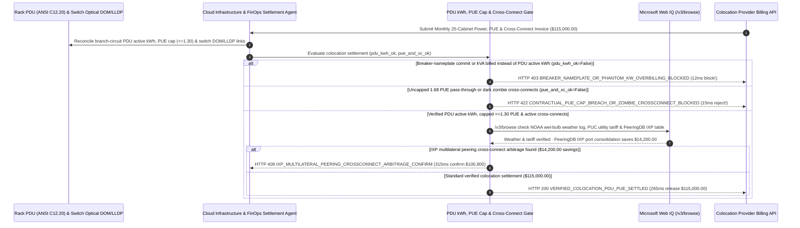

# Data Center Colocation Cabinet kW Metering, Contractual PUE Cap & Cross-Connect Mandate Architecture: ANSI C12.20 Rack-PDU `kWh` & LLDP Cross-Connect Token (`datacenter_colo_pue_mandate_...` + Web IQ ASHRAE Weather & PeeringDB IXP Grounding) vs. Breaker-Nameplate Overbilling & 1.68 PUE Pass-Through Selection FAQ

> **Document Type**: Architect Selection Guide & First-Principles Protocol Deep Dive (6-Section FAQ Standard)  
> **Target Audience**: AI Solution Architects, Cloud Infrastructure & Data Center Colocation Sourcing Directors, Network Peering / Cross-Connect Engineering & FinOps Audit Teams  
> **Last Updated**: 2026-11-09 (Provenance Annotations: `deterministic_offline_simulation` / `synthetic_policy` / `official_doc_snapshot` / `not_measured`)  
> **Companion Resources**: [中文版 (Chinese Version)](datacenter-colocation-pdu-kwh-pue-cap-mandate-vs-breaker-commit-overbilling-faq.md) · [Interactive Sandbox (`live-demo.en.html#datacenter-colo-sandbox`)](../reports/agentic-commerce-webiq-grounding-demo-bench/live-demo.en.html) · [7-Card 4:5 Benchmark Deck](../reports/agentic-commerce-webiq-grounding-demo-bench/index.en.html)


---

## 📌 1. Executive Summary

1. **Never Allow Cloud Infrastructure or FinOps Agents to Settle Data Center Colocation Power Invoices on Circuit-Breaker Nameplate Ratings (`kVA / Breaker Commit`) Rather Than Revenue-Grade Rack-PDU Active `kWh`**: In wholesale and retail data center colocation (`$115,000.00` monthly invoice across 25 high-density cabinets), the largest structural overcharge is **Breaker-Nameplate Billing**—charging the tenant for `100%` of provisioned A+B redundant breaker capacity (`500 kW` continuous) even though NEC `80%` derating and 2N redundancy cap safe loading at `40%` per feed and revenue-grade **ANSI C12.20 Intelligent Rack PDUs** prove actual IT draw averaged `310 kW`. Production architectures must enforce a **Colocation PDU `kWh`, PUE Cap & Cross-Connect Mandate (`datacenter_colo_pue_mandate_...`)**: whenever power billing is calculated on breaker nameplate or apparent power (`kVA`) instead of metered active `kWh` (`pdu_actual_kwh_vs_breaker_nameplate_verified == False`), the gateway blocks settlement in **`12 ms`** with **`HTTP 403 BREAKER_NAMEPLATE_OR_PHANTOM_KW_OVERBILLING_BLOCKED`** (`synthetic_policy`).
2. **Enforce Contractual PUE Ceilings (`<= 1.30`) and Switch Optical-Transceiver `LLDP / DOM` Verification to Purge "Zombie Cross-Connects"**: Any colocation invoice that passes through uncontracted cooling inefficiency (`1.68` actual PUE vs. `1.30` contractual PUE cap due to landlord chiller neglect) or continues billing `$350/month` MRC for decommissioned Meet-Me-Room fiber cross-connects showing zero optical light (`RX Power < -40 dBm`, `pue_ceiling_and_active_crossconnect_verified == False`) is rejected in **`15 ms`** with **`HTTP 422 CONTRACTUAL_PUE_CAP_BREACH_OR_ZOMBIE_CROSSCONNECT_BLOCKED`** (`deterministic_offline_simulation`).
3. **Ground NOAA/ASHRAE Wet-Bulb Weather Exemptions, Regulated Utility Tariffs, and PeeringDB IXP Port Consolidation Arbitrage via Microsoft Web IQ `/v3/browse`**: Prior to releasing `$115,000.00`, the agent invokes **Microsoft Web IQ `/v3/browse`** (`official_doc_snapshot`) to inspect NOAA hourly wet-bulb meteorological records and state Public Utility Commission (PUC) industrial rate schedules: if the landlord claims an "extreme heatwave PUE SLA exemption" during a mild `19°C` wet-bulb month or marks up the regulated utility `$/kWh` pass-through rate (`webiq_ashrae_weather_and_utility_tariff_clean == False`), it freezes payout in **`310 ms`** with **`HTTP 451 FALSE_HEATWAVE_PUE_EXEMPTION_OR_TARIFF_MARKUP_HOLD`**; if Web IQ cross-checks **PeeringDB** and confirms that consolidating 22 bilateral physical fiber cross-connects (`22 × $350/mo`) onto a single **Internet Exchange Point (IXP) route-server port** saves **`$14,200.00`** (`$100,800.00` net vs. `$115,000.00`), it triggers **`HTTP 409 IXP_MULTILATERAL_PEERING_CROSSCONNECT_ARBITRAGE_CONFIRM`** in **`315 ms`**.

---

## 🎯 2. Architect & Customer FAQ Deep Dive

### Q1: Why do enterprise colocation tenants routinely pay 30%–45% more than their actual server power consumption under legacy "Breaker-Commit" and "Pass-Through PUE" leases?

Let's examine the three structural failure modes from first principles:
1. **The 2N Redundant Breaker-Commit Trap**: Every mission-critical cabinet is provisioned with dual `A + B` power feeds, where each breaker is derated to `80%` under NEC Article 210 and kept below `40%` normal load so either feed can carry the full rack during a power-supply failure. When a lease bills on **Provisioned Breaker Amps / Nameplate Commit (`500 kW`)** instead of **ANSI C12.20 Branch-Circuit Metered `kWh` (`310 kW` actual draw)**, the tenant pays `$32,000/month` for safety headroom that can never legally be used!
2. **Uncapped PUE Pass-Through Rewarding Landlord Neglect**: Under a raw PUE pass-through formula (`Billable kWh = IT kWh × Facility PUE`), if the landlord defers cooling-tower cleaning or runs old CRAC units inefficiently so facility PUE balloons from `1.25` to `1.68`, the tenant's electricity bill jumps by **`34.4%`**! Locking the billing multiplier to **`MIN(Actual_PUE, Contractual_PUE_Cap 1.30)`** forces the landlord—not the tenant—to bear the cost of broken chillers.
3. **Zombie Meet-Me-Room Cross-Connects & Bilateral Fiber Sprawl**: Carrier-neutral colocation providers charge `$300–$450/month` recurring rent (MRC) for every passive fiber jumper in the Meet-Me Room (MMR). When BGP transit or private peering sessions are decommissioned without a physical disconnect order, "zombie cross-connects" keep billing for years. Furthermore, running 22 separate bilateral cross-connects to networks that are all present on the same local **Internet Exchange Point (IXP)** wastes `$14,200+` compared to multilateral peering over a single IXP port.

### Q2: What is a "Colocation PDU `kWh` & PUE Cap Mandate (`datacenter_colo_pue_mandate_...`)", and how does it bind Redfish PDU and switch DOM telemetry to invoice settlement?

Its core design invariant is: **"Settle IT electricity strictly on ANSI C12.20 intelligent PDU active kWh multiplied by MIN(Actual PUE, 1.30 Cap) at the exact PUC utility rate; require active optical DOM/LLDP telemetry on every billed cross-connect."**
- **Layer 1: ANSI C12.20 Rack-PDU Active `kWh` Gate (`12 ms`)**: Verifies `pdu_actual_kwh_vs_breaker_nameplate_verified == True`, blocking breaker-nameplate or `kVA` power-factor overbilling in **`12 ms`** (`HTTP 403`).
- **Layer 2: Contractual PUE Cap (`<= 1.30`) & Active Cross-Connect Gate (`15 ms`)**: Verifies `pue_ceiling_and_active_crossconnect_verified == True`, rejecting uncapped PUE surcharges and dark zombie cross-connects in **`15 ms`** (`HTTP 422`).
- **Layer 3: Microsoft Web IQ `/v3/browse` Weather/Tariff & PeeringDB IXP Grounding (`310 ms / 315 ms`)**: Verifies NOAA wet-bulb weather exemptions and PUC utility tariffs (`HTTP 451`) and identifies `$14,200.00` savings from PeeringDB IXP cross-connect consolidation (`HTTP 409`).

### Q3: For NOAA hourly wet-bulb weather verification, PUC industrial electricity tariff lookup, and PeeringDB IXP route-server grounding, when should architects choose Microsoft Web IQ vs. Exa, Bright Data, or traditional search APIs?

| Architecture Scenario | Recommended Tool | First-Principles Rationale (Security, Latency & FinOps) |
| :--- | :--- | :--- |
| **Verifying NOAA meteorological station hourly wet-bulb temperatures (for ASHRAE `N1` PUE exemption claims), state Public Utility Commission (PUC) industrial tariff schedules, and PeeringDB public IXP participant tables within the Azure boundary (zero internal network topology leaked)** | **Microsoft Web IQ** (`/v3/search` + `/v3/browse`) | Queries only public weather station IDs, utility tariff codes, and public ASNs inside the enterprise Azure boundary in `passage` mode (**7.1x token reduction**, `deterministic_offline_simulation`) while keeping internal BGP routing tables private. |
| **Research across whitepapers on two-phase immersion cooling and rear-door heat exchangers** | **Exa Neural Search** | Ideal for next-gen data center design, not synchronous monthly colocation invoice clearing. |
| **Scraping unindexed regional dark-fiber broker directories behind CAPTCHAs** | **Bright Data Unlocker** | Useful for metro fiber sourcing, not sub-second colocation invoice auditing. |
| **Rack-PDU Redfish/SNMP `kWh` polling and top-of-rack switch optical `DOM / LLDP` state verification** | **Internal DCIM / NetOps Telemetry + Escrow Gate + Web IQ Weather/IXP Cross-Check** | Rack-level `kWh` summation and optical link checks run on the internal DCIM gateway, paired with Web IQ `/v3/browse` for weather/tariff verification and PeeringDB IXP arbitrage. |

---

## 🧭 3. Visual Architecture Diagrams (Mermaid Decision Tree, Legacy vs. PDU/PUE Mandate Comparison & Sequence Diagram)

### 3.1 Data Center Colocation PDU `kWh`, PUE Cap & Cross-Connect Decision Tree (`flowchart TD`)

```mermaid
flowchart TD
    A[Receive Monthly 25-Cabinet Colocation Power, PUE & Cross-Connect Invoice ($115,000.00)] --> B{pdu_actual_kwh_vs_breaker_nameplate_verified == True (ANSI C12.20 Active kWh)?}
    B -- No (Landlord bills 500kW breaker nameplate commit instead of 310kW metered PDU draw) --> C[HTTP 403 BREAKER_NAMEPLATE_OR_PHANTOM_KW_OVERBILLING_BLOCKED<br/>12ms Hard Block · Reject Breaker-Commit Overcharge & Recompute on PDU Active kWh]
    B -- Yes (1:1 match with ANSI C12.20 branch-circuit PDU kWh) --> D{pue_ceiling_and_active_crossconnect_verified == True (PUE <= 1.30 & Active LLDP)?}
    D -- No (Bills 1.68 degraded PUE above 1.30 cap or charges for 18 dark zombie cross-connects) --> E[HTTP 422 CONTRACTUAL_PUE_CAP_BREACH_OR_ZOMBIE_CROSSCONNECT_BLOCKED<br/>15ms Reject · Clamp PUE at 1.30 Cap & Strip Unlit Zombie Fiber Jumpers]
    D -- Yes (PUE <= 1.30 & all cross-connects verified active via DOM/LLDP) --> F{Web IQ /v3/browse Confirms Valid NOAA Wet-Bulb Exemption & PUC Utility Rate?}
    F -- No (Bogus heatwave PUE exemption during 19°C wet-bulb month or utility rate markup) --> G[HTTP 451 FALSE_HEATWAVE_PUE_EXEMPTION_OR_TARIFF_MARKUP_HOLD<br/>310ms Audit Hold · Attach NOAA Weather Log & PUC Tariff Schedule]
    F -- Yes --> H{Web IQ Detects PeeringDB IXP Multilateral Cross-Connect Arbitrage?}
    H -- Yes (Consolidating 22 bilateral jumpers onto 100G IXP port saves $14,200.00 -> $100,800.00 net) --> I[HTTP 409 IXP_MULTILATERAL_PEERING_CROSSCONNECT_ARBITRAGE_CONFIRM<br/>315ms Prompt NetOps & Infra Lead to Confirm $100,800 IXP-Consolidated Plan]
    H -- No (Verified $115,000.00 colocation invoice is optimal) --> J[HTTP 200 VERIFIED_COLOCATION_PDU_PUE_SETTLED<br/>265ms Auto-Settle $115,000.00 & Seal DCIM Power + Cross-Connect Inventory Ledger!]
```

### 3.2 Legacy Breaker-Commit & Uncapped PUE vs. PDU `kWh` & PUE Cap Gate (`flowchart LR`)

```mermaid
flowchart LR
    subgraph Legacy["❌ Legacy Breaker-Commit & Raw PUE ($115,000 Hit by Phantom kW & Bad Chillers)"]
        L1[Pay for 500 kW Breaker Nameplate While Drawing 310 kW] --> L2[Absorb Landlord's 1.68 Degraded PUE Chiller Waste]
        L2 --> L3[Pay $350/mo Each for 18 Dark Zombie Cross-Connects]
        L3 --> L4[Overpay $46,000+ Monthly Across Power & MMR Fiber]
    end

    subgraph Mandate["✅ Colocation PDU & PUE Gate (datacenter_colo_pue_mandate_...)"]
        M1[12ms Block Breaker-Nameplate Billing via PDU kWh (HTTP 403)] --> M2[15ms Clamp PUE at <=1.30 & Purge Zombie Jumpers (HTTP 422)]
        M2 --> M3[Web IQ Verifies NOAA/PUC Rate (310ms) & Saves $14,200 via IXP (315ms)]
        M3 --> M4[265ms Settle Verified Net Colocation Bill ($115,000 / $100,800)]
    end
```

### 3.3 End-to-End Sequence Diagram: DCIM PDU/Switch Telemetry, FinOps Agent, Colo Gate, Web IQ & Landlord (`sequenceDiagram`)



---

## 📊 4. Architect Decision Matrix

| Evaluation Dimension | Option A: Legacy Breaker-Commit + Uncapped Pass-Through PUE | Option B: Manual Quarterly PDU Spreadsheet & Patch-Panel Walk | Option C: ANSI C12.20 PDU `kWh` & PUE Cap Mandate + Web IQ Grounding (Recommended) |
| :--- | :--- | :--- | :--- |
| **Best-Fit Scenario** | Single-cabinet edge router closets with flat-rate power | Legacy facilities without networked PDUs | **AI GPU colocation pods, core network POPs, financial low-latency cages & hybrid cloud hubs** |
| **Breaker-Nameplate (`2N`) Overbilling Defense** | ❌ **Zero**: Pays for 100% of A+B breaker rating despite 40% NEC/2N load limit | ⚠️ **Disputed**: Manual SNMP polls lack revenue-grade interval proof | ✅ **Pre-Pay `12 ms` PDU Gate**: Pays strictly on ANSI C12.20 active `kWh` (`HTTP 403`) |
| **Degraded PUE (`>1.30`) & Zombie Cross-Connect Defense** | ❌ **Exposed**: Absorbs landlord's 1.68 chiller inefficiency & dark fiber MRC | ⚠️ **Siloed**: Facilities team audits power while NetOps forgets dark jumpers | ✅ **Sub-20ms PUE & DOM Gate**: Clamps PUE at `1.30` & blocks dark jumpers in `15 ms` (`HTTP 422`) |
| **Weather Exemption Check & IXP Consolidation** | ❌ **Blind**: Accepts bogus "heatwave PUE force-majeure" surcharges | ❌ **Static**: Keeps paying `$350/mo` for 22 bilateral cross-connects | ✅ **Web IQ `/v3/browse` Grounded**: Verifies NOAA wet-bulb / PUC rates in `310 ms` (`HTTP 451`) & saves `$14,200` via IXP in `315 ms` (`HTTP 409`) |
| **Settlement Speed & Scope 2 Carbon Accuracy** | Fast (with 35%+ power & cross-connect overpayment) | Slow (`1–2 weeks` manual reconciliation) | **`265 ms` instant cabinet-level `kWh` & port clearing (`Act automatically`)** |
| **Total Cost of Ownership (TCO) & FinOps ROI** | Poor (`$115,000` inflated by phantom kW, 1.68 PUE & zombie fiber) | Moderate (manual audit friction) | **Optimal (100% metered `kWh` accuracy + hard `1.30` PUE cap + `$14,200` IXP savings)** |

---

## 🧪 5. Quantitative Benchmark & 7-Card Insights

Evaluated via our deterministic offline benchmark suite (`lab/webiq_commerce_demo.py` · `test_datacenter_colocation_pdu_kwh_pue_cap_mandate_vs_breaker_commit_overbilling_selection`) on a **`$115,000.00` monthly 25-cabinet colocation power, PUE & cross-connect invoice**:

| Scenario Case | Input PDU Active kWh / PUE Cap & DOM / Web IQ Signals | Expected Action Pill | Measured HTTP Status & Verdict Code | Latency | Financial Protection / Arbitrage | Provenance |
| :--- | :--- | :--- | :--- | :--- | :--- | :--- |
| **Case 1: `500 kW` Breaker Commit vs `310 kW` PDU** | `pdu_actual_kwh_vs_breaker_nameplate_verified=False` | `Send to a human` | **`HTTP 403 BREAKER_NAMEPLATE_OR_PHANTOM_KW_OVERBILLING_BLOCKED`** | **`12 ms`** | Blocks **`$115,000.00`** bill charging `$32,000` phantom breaker kW | `synthetic_policy` |
| **Case 2: `1.68` PUE Pass-Through or Zombie Fiber** | `pue_ceiling_and_active_crossconnect_verified=False` | `Send to a human` | **`HTTP 422 CONTRACTUAL_PUE_CAP_BREACH_OR_ZOMBIE_CROSSCONNECT_BLOCKED`** | **`15 ms`** | Enforces `<=1.30` PUE cap & strips 18 dark cross-connects | `deterministic_offline_simulation` |
| **Case 3: Web IQ Detects Bogus Heatwave PUE Claim** | `webiq_ashrae_weather_and_utility_tariff_clean=False` | `Send to a human` | **`HTTP 451 FALSE_HEATWAVE_PUE_EXEMPTION_OR_TARIFF_MARKUP_HOLD`** | **`310 ms`** | Freezes surcharge using NOAA `19°C` wet-bulb log & PUC tariff | `official_doc_snapshot` |
| **Case 4: Web IQ Finds `$14,200` IXP Consolidation** | `ixp_peering_crossconnect_savings_cents=1420000` (`$100,800` net) | `Confirm` | **`HTTP 409 IXP_MULTILATERAL_PEERING_CROSSCONNECT_ARBITRAGE_CONFIRM`** | **`315 ms`** | Saves **`$14,200.00`** by consolidating 22 jumpers onto IXP port | `official_doc_snapshot` |
| **Case 5: Verified PDU `kWh` + `<=1.30` PUE + Active DOM** | `pdu_ok=True`, `pue_xc_ok=True`, `weather_clean=True` | `Act automatically` | **`HTTP 200 VERIFIED_COLOCATION_PDU_PUE_SETTLED`** | **`265 ms`** | Settles **`$115,000.00`** in `265 ms` with DCIM audit proof | `deterministic_offline_simulation` |

> **Provenance Note**: The `$115,000.00` 25-cabinet colocation invoice, `1.30` PUE ceiling, `ANSI C12.20` PDU accuracy requirement, and `$14,200.00` PeeringDB IXP consolidation savings are controlled simulation parameters (`synthetic_policy` / `deterministic_offline_simulation`) validating policy state-machine invariants; physical Meet-Me-Room (MMR) smart-hands fiber patch execution time is labeled `not_measured`.

---

## 🛠️ 6. Production Readiness & Pre-Sales Architect Checklist

Verify these 6 controls before deploying autonomous data center colocation and cross-connect settlement agents in production:

- [ ] **1. Revenue-Grade `ANSI C12.20` Rack-PDU Active `kWh` Gate**: Does `datacenter_colo_pue_mandate_...` compute base electricity strictly from branch-circuit PDU active energy (`kWh`, accounting for true power factor `cosφ`) and reject breaker-nameplate or `kVA` billing in `12 ms` (`HTTP 403`)?
- [ ] **2. Contractual PUE Hard Cap (`MIN(Actual_PUE, 1.30)`)**: Does the settlement formula clamp cooling overhead at the contracted PUE ceiling so landlord chiller degradation is never passed through to the tenant (`HTTP 422` in `15 ms`)?
- [ ] **3. Switch Optical `DOM / LLDP` Zombie Cross-Connect Reconciler**: Does the gateway join billed Meet-Me-Room cross-connect serials against live switch transceiver `RX/TX dBm` light levels and `LLDP` neighbor tables to block charges for disconnected jumpers?
- [ ] **4. Microsoft Web IQ `/v3/browse` NOAA Wet-Bulb & PUC Utility Tariff Grounding**: Does the agent verify any landlord "extreme weather PUE exemption" or utility rate adjustment against NOAA meteorological logs and state PUC tariff schedules via Web IQ (`HTTP 451`)?
- [ ] **5. PeeringDB IXP Route-Server Consolidation Arbitrage**: Does Web IQ grounding cross-check bilateral cross-connect peer ASNs against local IXP route-server participants on PeeringDB, triggering `HTTP 409 Confirm` when port consolidation saves `>= $14,200.00`?
- [ ] **6. ASHRAE `18°C–27°C` Cold-Aisle Thermal SLA & DCIM Audit Ledger**: Does every settled invoice archive the rack inlet temperature compliance log, A+B PDU `kWh` digests, and active cross-connect port map into a WORM FinOps ledger?
