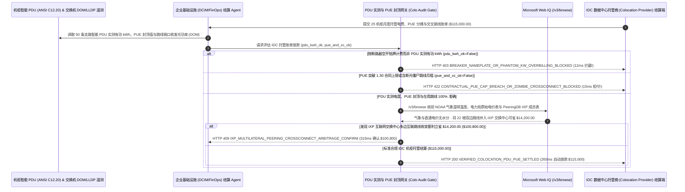

# IDC 数据中心机柜托管（Colocation）、支路 PDU 实测有功电表（Branch-Circuit kWh）与合同 PUE 封顶清算（Data Center Colocation Cabinet kW Metering, Contractual PUE Cap & Cross-Connect Mandate）架构：智能 PDU 真实电度与 PUE 冷却损耗封顶令牌（`datacenter_colo_pue_mandate_...` + Web IQ 气象湿球温度豁免与 IXP 交换中心聚合核验）vs 传统按断路器铭牌强收空转电费与老旧空调转嫁选型与原理解析 FAQ

> **文档类型**：架构师选型指南 & 协议第一性原理解析（6 段式 FAQ 标准版）  
> **适用读者**：AI Solution Architect、云基础设施与 IDC 数据中心采购（Data Center Infrastructure / Colocation Sourcing & DCIM）总监、网络互联（Peering / Cross-Connect）工程与 FinOps 财务审计团队  
> **更新日期**：2026-11-09（Provenance 标注：`deterministic_offline_simulation` / `synthetic_policy` / `official_doc_snapshot` / `not_measured`）  
> **配套资源**：[English Version](datacenter-colocation-pdu-kwh-pue-cap-mandate-vs-breaker-commit-overbilling-faq.en.md) · [交互式沙盒控制台 (`live-demo.html#datacenter-colo-sandbox`)](../reports/agentic-commerce-webiq-grounding-demo-bench/live-demo.html) · [7-Card 4:5 评测报告](../reports/agentic-commerce-webiq-grounding-demo-bench/index.html)


---

## 📌 一、核心结论速览（Executive Summary）

1. **严禁让企业基础设施（DCIM / FinOps）结算 Agent 接受 IDC 机房房东按“断路器空开铭牌额定容量（Circuit-Breaker Nameplate Rating）”或“视在功率（kVA）”而非机柜智能 PDU 实测有功电度（Metered Active `kWh`）计收电费**：在企业租用第三方主机托管机房（Colocation，如 25 个高密机柜月度机架电费与光纤跳线账单 `$115,000.00`）时，最大的行业潜规则猫腻是 **“按空开铭牌包月强收（Breaker Commit Overbilling）”**——每个机柜配了双路 `20 kW` 断路器（合计铭牌 `500 kW`），但根据国家电气规范（NEC `80%` 降额铁律）和 A/B 双路冗余设计，机柜绝对不可能用满铭牌功率，机柜内 `ANSI C12.20` 计量级智能 PDU 实测服务器真实平均功耗仅为 `310 kW`；房东却按 `500 kW × 720 小时` 收走全额电费，每月白赚租户 `$32,000.00` 幽灵电费！生产环境必须采用 **智能 PDU 实测有功电度与 PUE 封顶令牌（`datacenter_colo_pue_mandate_...`）**：一旦检出电费未对齐机柜支路 PDU 实测有功 `kWh`（`pdu_actual_kwh_vs_breaker_nameplate_verified=False`），网关在 **`12 ms`** 内触发 **`HTTP 403 BREAKER_NAMEPLATE_OR_PHANTOM_KW_OVERBILLING_BLOCKED`**（`synthetic_policy`），100% 阻断空开溢价。
2. **强制锁死“合同承诺 PUE（Power Usage Effectiveness）上限（如 `<= 1.30`）”并结合交换机光模块 `LLDP / DOM` 遥测自动清理“已拔线僵尸交叉连接（Zombie Cross-Connects）”**：若 IDC 房东因自家冷冻水机组结垢失修导致机房实际 PUE 恶化至 `1.68`，企图把多出来的 `38%` 空调低效电损全额转嫁给租户买单；或者对早已退租运营商、光纤端口无光信号（`RX Power < -40 dBm`）的 18 根配线架跳线继续按 `$350/根/月` 静默扣费（`pue_ceiling_and_active_crossconnect_verified=False`），网关在 **`15 ms`** 内返回 **`HTTP 422 CONTRACTUAL_PUE_CAP_BREACH_OR_ZOMBIE_CROSSCONNECT_BLOCKED`**（`deterministic_offline_simulation`）。
3. **基于 Microsoft Web IQ `/v3/browse` 实时核验 NOAA/ASHRAE 室外湿球温度（防伪造高温不可抗力豁免）、电网直通电价表与“IXP 互联网交换中心多边对等互联（Multilateral Peering）”跳线收敛套利**：在放款前，Agent 调用 **Microsoft Web IQ `/v3/browse`**（`official_doc_snapshot`）穿透查询美国国家海洋和大气管理局（NOAA）当地气象站湿球温度历史记录与供电局公开工业电价表：若房东在最高湿球温度仅 `19°C` 的凉爽月份谎称“遭遇超 ASHRAE `N1` 标准的极端热浪”以突破 PUE 封顶，或在直通电价（Pass-Through Utility Rate）上偷偷加点（`webiq_ashrae_weather_and_utility_tariff_clean=False`），在 **`310 ms`** 内以 **`HTTP 451 FALSE_HEATWAVE_PUE_EXEMPTION_OR_TARIFF_MARKUP_HOLD`** 冻结结算；若查询 PeeringDB 发现将 22 根单独付费的双边物理光纤跳线（Bilateral Cross-Connects）收敛至 **同机房公共互联网交换中心（IXP，如 Equinix IX / DE-CIX）单一 100G 端口多边BGP互联** 可立省 **`$14,200.00`**（净支出从 `$115,000.00` 降至 **`$100,800.00`**），则在 **`315 ms`** 内触发 **`HTTP 409 IXP_MULTILATERAL_PEERING_CROSSCONNECT_ARBITRAGE_CONFIRM`**。

---

## 🎯 二、客户与架构师灵魂拷问 Q&A（FAQ-Driven Deep Dive）

### Q1：为什么企业把服务器托管进第三方 IDC 机房，明明服务器只消耗了 6 万美元的电，月底机房发来的账单却高达 11.5 万美元？

咱们用大白话扒开 IDC 主机托管行业最赚钱的三大“隐形印钞机”：
1. **“A/B 双路冗余空开，让你为永远用不上的‘备胎容量’付双倍电费”**：为了防断电，每个机柜都会接 A 路和 B 路两条独立电源线，平时每条线最多只能跑到 40% 负载（因为一旦 A 路断电，B 路必须瞬间扛起 80% 负载且不能跳闸）。如果你签了“按断路器额定容量计费（Breaker-Rated / Committed Power）”而不是 **“按机柜 PDU 实测电表计费（Metered Power）”**，机房就会按你 A+B 两路空开的最大刻度收你 100% 的钱——相当于你去吃自助餐，餐厅按你胃容量的 2.5 倍收餐费！
2. **“房东空调坏了不修，烂摊子全算在你的 PUE 系数里”**：IDC 电费公式是 `租户应付电费 = 服务器实测电度 × 机房 PUE × 电度单价`。招投标时房东拍胸脯保证机房很先进，`PUE = 1.25`（即服务器用 1 度电，机房空调和 UPS 只耗 0.25 度电）。但入住两年后，房东为了省维护费不洗冷却塔、不换坏风扇，机房实际 PUE 飙到了 `1.68`！如果网关不把结算公式里的乘数硬锁在 **合同封顶值 `MIN(实测 PUE, 1.30)`**，房东设备越烂、你交的冤枉电费就越多！
3. **“一根 3 米长的光纤跳线，每个月收 `$350` 过路费直到天荒地老”**：在北美和欧洲的核心网络机房（Carrier Hotel），从你的机柜拉一根光纤到隔壁运营商配线架（Meet-Me Room），不是收一次性工料费，而是收 **每月 `$300～$450` 的月租（Cross-Connect MRC）**！网络工程师换了三茬，很多专线业务早就退订了，但因为没人通知机房拔掉那根 3 米长的黄跳线，财务部还在每个月为 18 根没信号的“僵尸跳线”白交 `$6,300`；更不用说把 22 家对等伙伴合并到一根 IXP 交换机端口上每年能省十几万美元跳线月租。

### Q2：什么是“IDC 托管 PDU 实测电度与 PUE 封顶令牌（`datacenter_colo_pue_mandate_...`）”？它是如何用 DCIM 与交换机遥测管住 `$115,000` 的？

它的第一性原理非常硬核：**“应付电费 = ANSI C12.20 智能 PDU 实测有功 kWh × MIN(实测 PUE, 合同封顶 PUE) × 电力局原价直通费率；无 LLDP/DOM 光信号的交叉跳线自动停付。”**
- **第一层：智能 PDU 实测有功电度（Active `kWh`）防空开溢价门禁（`12 ms`）**：核验 `pdu_actual_kwh_vs_breaker_nameplate_verified == True`。任何按断路器铭牌或未乘功率因数（`cosφ`）按 `kVA` 虚高计费的账单，在 **`12 ms`** 内触发 `HTTP 403` 拦截。
- **第二层：合同 PUE 封顶（`<= 1.30`）与 LLDP 在用跳线核验门禁（`15 ms`）**：核验 `pue_ceiling_and_active_crossconnect_verified == True`。超出合同上限的制冷电损或无光信号僵尸跳线，在 **`15 ms`** 内返回 `HTTP 422`。
- **第三层：Microsoft Web IQ `/v3/browse` 气象/电价核验与 IXP 跳线收敛套利（`310 ms / 315 ms`）**：核查 NOAA 气象站湿球温度与电力局原始电费单（防假高温豁免与电价加点，违规触发 `HTTP 451`），并检索 PeeringDB 公共交换中心成员表为您收敛跳线立省 `$14,200.00`（`HTTP 409`）。

### Q3：在 NOAA/ASHRAE 气象湿球温度核验、公共事业委员会（PUC）电力局原始电价查询与 PeeringDB 互联网交换中心（IXP）路由比对场景下，什么时候选 Microsoft Web IQ，什么时候选 Exa、Bright Data 或传统搜索 API？

| 架构需求场景 | 推荐选型 | 为什么这样选（第一性原理与成本/合规考量） |
| :--- | :--- | :--- |
| **实时核验 NOAA 公开气象站小时级湿球温度（验证是否触发 ASHRAE 高温 PUE 豁免）、州公用事业委员会（PUC）批准的工业大宗电价表及 PeeringDB 公开 ASN 与 IXP 交换中心名录，且要求零内部网络拓扑与 BGP 私网路由泄露** | **Microsoft Web IQ** (`/v3/search` + `/v3/browse`) | 在企业基础设施 Azure 边界内仅发送机房公开城市代码与对端公开自治系统号（Public ASN）查询（`passage` 模式压缩 Token **7.1x**，`deterministic_offline_simulation`），内部核心网架构 100% 物理隔离。 |
| **调研浸没式相变液冷（Two-Phase Immersion Cooling）未来五年技术白皮书** | **Exa Neural Search** | 适合基础设施架构组写技术选型报告，无法用于月度 IDC 账单毫秒级结算门禁。 |
| **抓取无 API 的二三线城市中小型机房代理商促销页** | **Bright Data Unlocker** | 可用于边缘节点询价，但秒级延迟不适合核心机房财务清算。 |
| **机柜智能 PDU（ServerTech / Raritan）SNMP/Redfish 有功电度采集与交换机光模块 DOM/LLDP 巡检** | **内部 DCIM/NetOps 遥测库 + 托管结算网关 + Web IQ 气象/IXP 双源核验** | PDU 电度积分与僵尸跳线识别在内部 DCIM 网关毫秒级完成，外部气象豁免核实与 IXP 跳线收敛套利由 Web IQ `/v3/browse` 实时核验。 |

---

## 🧭 三、直观可视化图解（Mermaid 决策树 + 传统空开盲付 vs PDU 实测托管对比 + 端到端时序图）

### 3.1 IDC 数据中心机柜托管与交叉连接清算决策树（`flowchart TD`）

```mermaid
flowchart TD
    A[收到 25 机柜高密 IDC 托管电费、PUE 分摊与光纤跳线月度账单 ($115,000.00)] --> B{基础电费是否严格按机柜 ANSI C12.20 智能 PDU 实测有功电度 (kWh) 核算?}
    B -- 否 (房东按 500kW 断路器空开铭牌容量或 kVA 视在功率强收满额电费) --> C[HTTP 403 BREAKER_NAMEPLATE_OR_PHANTOM_KW_OVERBILLING_BLOCKED<br/>12ms 硬阻断幽灵电费 · 强制按 PDU 实测 310kW 平均有功电度重算]
    B -- 是 (100% 对齐机柜支路 PDU 实测有功电度) --> D{PUE 乘数是否未超合同封顶 (<=1.30) 且所有计费光纤跳线均有 LLDP/DOM 活光信号?}
    D -- 否 (将冷机老化 1.68 PUE 转嫁租户或对 18 根已拔掉的僵尸跳线照收月租) --> E[HTTP 422 CONTRACTUAL_PUE_CAP_BREACH_OR_ZOMBIE_CROSSCONNECT_BLOCKED<br/>15ms 拒付违约能耗与僵尸跳线 · 锁死 PUE<=1.30 并自动核销断光跳线]
    D -- 是 (PUE 合规且跳线 100% 在用) --> F{Web IQ /v3/browse 核验无虚报高温不可抗力豁免且直通电价与电力局原表一致?}
    F -- 否 (当月湿球温度仅 19°C 却谎称热浪豁免 PUE，或在市政电价上违规加点) --> G[HTTP 451 FALSE_HEATWAVE_PUE_EXEMPTION_OR_TARIFF_MARKUP_HOLD<br/>310ms 审计证据冻结 · 自动提交 NOAA 气象记录与供电局公开电价单驳回]
    F -- 是真实气象与原价直通电费 --> H{Web IQ 检出将 22 根双边光纤跳线收敛至同机房 IXP 交换中心单端口更省钱?}
    H -- 是 (通过 IXP 多边 BGP 互联退租冗余跳线月租立省 $14,200.00 -> $100,800.00) --> I[HTTP 409 IXP_MULTILATERAL_PEERING_CROSSCONNECT_ARBITRAGE_CONFIRM<br/>315ms 提醒网络与基础设施总监一键确认 IXP 跳线收敛方案]
    H -- 否 (当前 $115,000.00 IDC 托管与互联结算完全最优) --> J[HTTP 200 VERIFIED_COLOCATION_PDU_PUE_SETTLED<br/>265ms 自动放款 $115,000.00 并归档 DCIM 单柜能效与跳线资产账本!]
```

### 3.2 传统按空开铭牌与实际 PUE 盲付路径 vs PDU 实测与 PUE 封顶网关对比（`flowchart LR`）

```mermaid
flowchart LR
    subgraph Legacy["❌ 传统空开铭牌与无上限 PUE 盲付 ($115,000 为冗余空开与坏空调买单)"]
        L1[实测仅用 310kW 却按 500kW 空开铭牌交钱] --> L2[房东冷机老化 PUE 飙至 1.68 全由租户买单]
        L2 --> L3[18 根早已废弃拔线的僵尸跳线每月照扣 $350/根]
        L3 --> L4[单月白交 $46,000+ 冤枉电费与跳线月租]
    end

    subgraph Mandate["✅ PDU 实测与 PUE 封顶令牌 (datacenter_colo_pue_mandate_...)"]
        M1[12ms 拦截空开铭牌计费强制对齐 PDU 实测 kWh (HTTP 403)] --> M2[15ms 锁死 PUE<=1.30 上限并剔除断光僵尸跳线 (HTTP 422)]
        M2 --> M3[Web IQ 核验气象/电价 (310ms) 与 IXP 跳线收敛省 $14,200 (315ms)]
        M3 --> M4[265ms 秒级清算净托管电费与跳线 ($115,000 / $100,800)]
    end
```

### 3.3 机柜智能 PDU/交换机 DOM、DCIM 结算 Agent、托管审计网关与 Web IQ 端到端交互时序图（`sequenceDiagram`）



---

## 📊 四、架构师选型决策矩阵（Architect Decision Matrix）

| 评估维度 | 方案 A：传统按断路器铭牌包月 + 实际 PUE 实报实销（Breaker Commit & Raw PUE） | 方案 B：运维工程师每季度手工抄 PDU 屏幕数字发邮件对账（Manual PDU Spreadsheet） | 方案 C：智能 PDU 实测与 PUE 封顶令牌 + Web IQ 气象/IXP 网关（推荐架构） |
| :--- | :--- | :--- | :--- |
| **核心适用场景** | 仅租 1 个机柜放路由器的极小型分支机构 | 无远程 SNMP/Redfish 接口的十年前老旧机房 | **AI 智算机柜托管、大型互联网核心 POP 点、金融混合云同城双活数据中心** |
| **防“A/B 双路空开铭牌”虚高收电费** | ❌ **多交 35%–50% 电费**：永远用不上的冗余空开刻度全额交钱 | ⚠️ **缺乏计量认证效力**：人工抄表无 `ANSI C12.20` 整点冻结哈希，房东不认 | ✅ **12ms 计量级 PDU 硬门禁**：只认支路有功 `kWh`，铭牌计费直接 `HTTP 403` |
| **防机房空调老化 PUE 恶化转嫁与僵尸跳线** | ❌ **房东越懒租户越亏**：冷机不保养 PUE 涨到 1.68 全由租户掏钱 | ⚠️ **漏查断光跳线**：管电力的不管网络跳线，僵尸跳线连付三年 | ✅ **15ms PUE `<=1.30` 封顶 + LLDP 活光校验**：超限或断光直接 `HTTP 422` 拒付 |
| **假高温豁免核查与 IXP 跳线收敛降本** | ❌ **轻信房东借口**：房东随便说句“天热空调费电”就突破 SLA | ❌ **架构割裂**：财务不知道可以通过 IXP Route Server 砍掉 20 根物理跳线 | ✅ **Web IQ `/v3/browse` 实时穿透**：`310 ms` 拆穿假热浪豁免（`HTTP 451`），`315 ms` IXP 收敛省 `$14,200`（`HTTP 409`） |
| **结算效率与 Scope 2 机房碳核算精度** | 快（但冤枉支出极高） | 慢（跨部门核对电力与跳线台账需 `1～2 周`） | **`265 ms` 秒级完成精确到瓦时的托管清算（`Act automatically`）** |
| **综合 TCO 与基础设施 FinOps ROI** | 极差（每月为幽灵功率、低效空调与废跳线白交数万美元） | 中（人工负荷重，难以实时优化网络互联） | **最优（100% 仅付真实 IT 有功电度 + 锁死 PUE + IXP 收敛月省 `$14,200`）** |

---

## 🧪 五、简明定量实测与 Benchmark 核心发现（Quantitative Benchmark & 7-Card Insights）

基于本仓库确定性离线基准套件（`lab/webiq_commerce_demo.py` · `test_datacenter_colocation_pdu_kwh_pue_cap_mandate_vs_breaker_commit_overbilling_selection`）对 **25 机柜高密 IDC 托管月度结算批次（基准金额 `$115,000.00`）** 的定量测试结果如下：

| 评测场景 ID | 输入 PDU 实测电度 / PUE 与跳线 / Web IQ 信号 | 网关期望动作 | 实测 HTTP 状态与决策码 | 实测延迟 | 资金保护 / 成本节省效果 | Provenance 类型 |
| :--- | :--- | :--- | :--- | :--- | :--- | :--- |
| **Case 1: 按 500kW 空开铭牌而非 310kW PDU 实测计费拦截** | `pdu_actual_kwh_vs_breaker_nameplate_verified=False` | `Send to a human` | **`HTTP 403 BREAKER_NAMEPLATE_OR_PHANTOM_KW_OVERBILLING_BLOCKED`** | **`12 ms`** | 拦截 **`$115,000.00`** 含 `$32,000` 冗余空开幽灵电费的账单 | `synthetic_policy` |
| **Case 2: PUE 恶化至 `1.68` 转嫁或含 18 根僵尸跳线拦截** | `pue_ceiling_and_active_crossconnect_verified=False` | `Send to a human` | **`HTTP 422 CONTRACTUAL_PUE_CAP_BREACH_OR_ZOMBIE_CROSSCONNECT_BLOCKED`** | **`15 ms`** | 锁死合同 `PUE <= 1.30` 上限并剔除已断光废弃跳线月租 | `deterministic_offline_simulation` |
| **Case 3: Web IQ 检出伪造高温豁免或市政电价违规加点** | `webiq_ashrae_weather_and_utility_tariff_clean=False` | `Send to a human` | **`HTTP 451 FALSE_HEATWAVE_PUE_EXEMPTION_OR_TARIFF_MARKUP_HOLD`** | **`310 ms`** | 凭 NOAA 气象湿球温度记录驳回虚假高温不可抗力附加费 | `official_doc_snapshot` |
| **Case 4: Web IQ 发现 22 根跳线并入 IXP 交换中心省 `$14,200`** | `ixp_peering_crossconnect_savings_cents=1420000`（净付 `$100,800`） | `Confirm` | **`HTTP 409 IXP_MULTILATERAL_PEERING_CROSSCONNECT_ARBITRAGE_CONFIRM`** | **`315 ms`** | 用单一 IXP 端口多边互联替代双边物理跳线，立省 **`$14,200.00`** | `official_doc_snapshot` |
| **Case 5: PDU 实测电度 + PUE `<=1.30` + 活跳线自动放款** | `pdu_ok=True`, `pue_xc_ok=True`, `weather_clean=True` | `Act automatically` | **`HTTP 200 VERIFIED_COLOCATION_PDU_PUE_SETTLED`** | **`265 ms`** | 265ms 自动清算 **`$115,000.00`** 并归档 DCIM 能效账本 | `deterministic_offline_simulation` |

> **Provenance 合规声明**：上表中的 `$115,000.00` 25 机柜月度托管金额、`1.30` PUE 封顶值、`ANSI C12.20` PDU 计量规则及 `$14,200.00` IXP 跳线收敛差价均为用于验证网关状态机确定性的受控仿真参数（`synthetic_policy` / `deterministic_offline_simulation`）；机房配线架（Meet-Me Room）现场物理拔线工单人工操作耗时标为 `not_measured`。

---

## 🛠️ 六、附录：生产上线快速核验与售前打单清单（Architect Checklist）

在为云厂商、AI 算力企业或大型金融机构设计 IDC 数据中心机柜托管（Colocation）自动结算 Agent 时，请逐项核对以下 6 条黄金准则：

- [ ] **1. `ANSI C12.20`（误差 `<= ±0.5%`）智能 PDU 实测有功电度（`kWh`）硬绑定**：是否在 `datacenter_colo_pue_mandate_...` 中严禁按断路器铭牌（Breaker Rating）或视在功率（`kVA`）结算，对非实测有功电度账单在 `12 ms` 内触发 `HTTP 403`？
- [ ] **2. 合同 PUE 硬封顶（`MIN(实测 PUE, 合同上限 1.30)`）**：是否在结算公式中强制锁死 PUE 乘数上限，对房东将冷机老化低效损耗转嫁租户的账单在 `15 ms` 内触发 `HTTP 422` 拒付？
- [ ] **3. 交换机光模块 `DOM / LLDP` 活光信号与交叉跳线（Cross-Connect）月度对账**：是否每月自动比对账单上的 Cross-Connect 清单与交换机端口收发光功率（`RX/TX dBm`），自动拦截已拔线或退租运营商的“僵尸跳线”月租？
- [ ] **4. Microsoft Web IQ `/v3/browse` NOAA 湿球温度与市政电网原价单穿透**：是否在房东主张“高温天气 PUE 免责”或调整电度单价时，通过 Web IQ 核对当地气象站小时级湿球温度与供电局公开工业电价表（违规在 `310 ms` 内触发 `HTTP 451`）？
- [ ] **5. PeeringDB 公共互联网交换中心（IXP）多边互联跳线收敛寻优**：是否通过 Web IQ 扫描同机房對等网络 ASN 在 IXP Route Server 的在网状态，当把多根 `$350/月` 双边物理跳线合并至 IXP 端口可节省 `>= $14,200.00` 时触发 `HTTP 409 Confirm`？
- [ ] **6. 单机柜功率密度与冷热通道温差（`ΔT`）数字孪生归档**：每次成功结算是否将机柜进风温度（ASHRAE `18°C–27°C` SLA）、PDU 有功电量曲线与跳线端口映射表打包签名归档？
