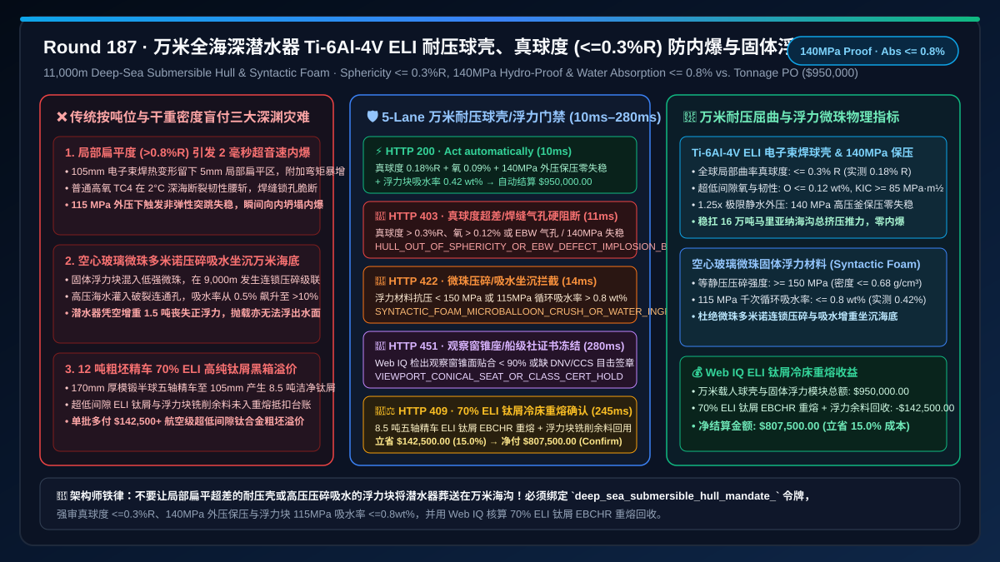
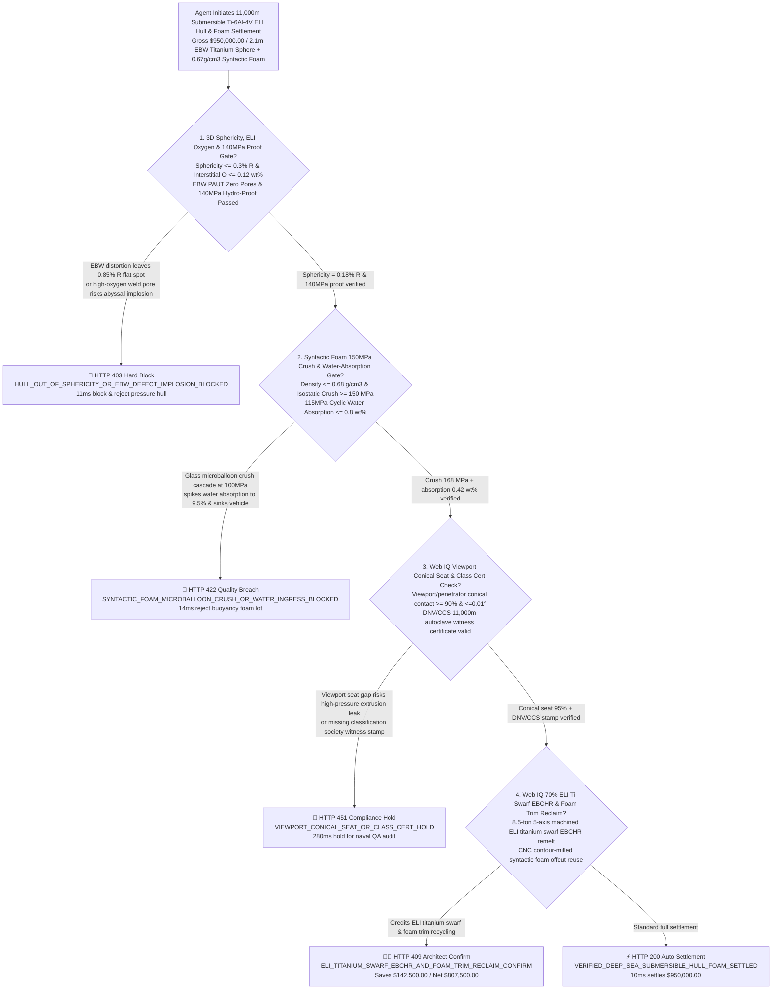
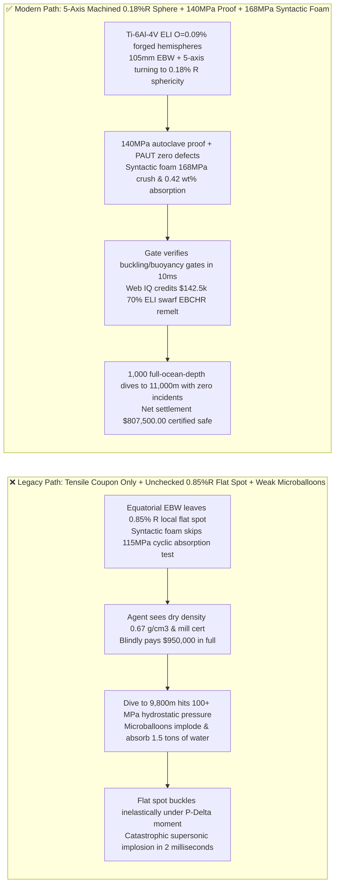
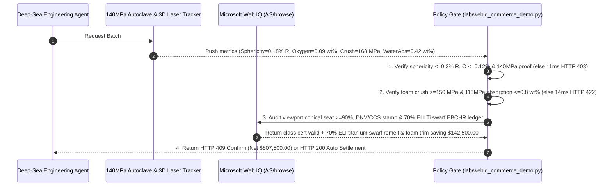

# 11,000m Full-Ocean-Depth Submersible (HOV/AUV) $\text{Ti-6Al-4V ELI}$ Pressure Hull & Hollow-Glass-Microsphere Syntactic Foam Offtake, Out-of-Sphericity & EBW PAUT $140\text{ MPa}$ Hydrostatic Gate ($\text{Sphericity} \le 0.3\% R$, $\text{O} \le 0.12\text{ wt\%}$ & $0\text{ Buckling}$) & Syntactic Foam Microballoon Crush / Water-Absorption Gate ($\rho \le 0.68\text{ g/cm}^3$ & $115\text{ MPa Absorption} \le 0.8\text{ wt\%}$) / $70\%$ ELI Titanium Swarf EBCHR Remelt & Foam Trim Escrow vs. Tonnage & Dry-Density Overbilling: Architecture Selection & First-Principles FAQ

> **Document Type**: First-Principles Architecture Selection FAQ  
> **Target Audience**: 11,000m Full-Ocean-Depth Human Occupied Vehicle (HOV) & Autonomous Underwater Vehicle (AUV) Chief Naval Architects, Marine/Aerospace $\text{Ti-6Al-4V ELI}$ (Grade 23) Heavy Forging & Vacuum Electron-Beam Welding (EBW) Directors, High-Strength Hollow-Glass-Microsphere Syntactic Foam Engineering Leads, Deep-Sea Supply-Chain Risk & FinOps Architects  
> **Executive Takeaway**: When procuring $11,000\text{ m}$ Mariana Trench full-ocean-depth $\text{Ti-6Al-4V ELI}$ manned pressure hulls and syntactic foam buoyancy modules, **never allow a procurement agent to release payment based solely on delivered titanium hull weight, room-temperature tensile coupons, and dry atmospheric Archimedes density ($\le 0.68\text{ g/cm}^3$)**. You must enforce a deterministic architecture combining a **Pressure Hull 3D Out-of-Sphericity, Extra-Low-Interstitial Oxygen & $140\text{ MPa}$ Hydrostatic Proof Gate (Local radius-of-curvature sphericity deviation $\le 0.3\% R$ across the $2.1\text{ m}$ sphere, interstitial oxygen $\text{O} \le 0.12\text{ wt\%}$, $-2^\circ\text{C}$ Charpy impact $AK_v \ge 45\text{ J}$, equatorial Electron-Beam Weld PAUT zero porosity, and $140\text{ MPa}$ $1.25\times$ hydrostatic chamber proof testing to prevent millisecond inelastic snap-through buckling implosion) + a Syntactic Foam $150\text{ MPa}$ Isostatic Crush & $115\text{ MPa}$ Cyclic Water-Absorption Gate (Density $\le 0.68\text{ g/cm}^3$, isostatic crush strength $\ge 150\text{ MPa}$, and $115\text{ MPa}$ cyclic water absorption $\le 0.8\text{ wt\%}$ to prevent microballoon crush cascades that flood the foam and trap the submersible on the abyssal seafloor) + a Microsoft Web IQ $70\%$ 5-Axis Machined $\text{Ti-6Al-4V ELI}$ Swarf Electron-Beam Cold Hearth Remelt (EBCHR) & CNC Foam Trim Reclaim Escrow**.

---

## 1. 📌 Executive Summary

### 1.1 Why Does a Titanium Pressure Hull With "$> 900\text{ MPa}$ Tensile Strength" and Buoyancy Foam With "0.67 g/cm³ Dry Density" Suffer Millisecond Supersonic Implosion or Permanent Seafloor Stranding at $10,900\text{ m}$?
From Zoelly-Timoshenko external-pressure shell buckling mechanics ($P_{\text{cr}} = \frac{2E}{\sqrt{3(1-\nu^2)}} \left(\frac{t}{R}\right)^2$), cold dwell-fatigue fracture mechanics, and high-pressure porous percolation first principles, the Challenger Deep at $11,000\text{ m}$ exerts **$110\text{–}115\text{ MPa}$** of hydrostatic pressure—subjecting a $2.1\text{ m}$ diameter manned sphere to over **$160,000\text{ metric tons}$** of total inward crushing force.
If a procurement agent pays upon seeing standard tensile certificates and dry density sheets, three abyssal disasters occur:
1. **Local Out-of-Sphericity ($> 0.8\% R$) or EBW Keyhole Porosity Triggering $2\text{ ms}$ Inelastic Snap-Through Implosion**: Unlike internal-pressure vessels that self-stabilize by pulling dents taut, an external-pressure sphere is exponentially sensitive to **initial geometric imperfections (local flat spots / out-of-sphericity)**. If equatorial $105\text{ mm}$ thick **Vacuum Electron-Beam Welding (EBW)** distortion leaves a local flat spot where the local radius of curvature exceeds the nominal radius by $> 0.5\% R$ (just $4\text{–}5\text{ mm}$ radial deviation), $115\text{ MPa}$ external pressure induces severe bending moments that push the local titanium wall past compressive yield ($\sigma_{0.2}$), collapsing the tangent modulus $E_t$ and triggering supersonic **inelastic snap-through implosion in under $2\text{ milliseconds}$**! Furthermore, using standard Grade 5 Ti-6Al-4V ($\text{O} \approx 0.18\text{ wt\%}$) instead of **Grade 23 $\text{Ti-6Al-4V ELI}$ (Extra-Low Interstitial, $\text{O} \le 0.12\text{ wt\%}$)** slashes fracture toughness $K_{IC}$ in $2^\circ\text{C}$ abyssal water, allowing a sub-millimeter EBW root pore to initiate brittle cleavage across the $105\text{ mm}$ wall!
2. **Syntactic Foam Hollow-Glass-Microsphere Crush Cascade at $115\text{ MPa}$ Causing Multi-Ton Water Ingress and Seafloor Stranding**: Full-ocean-depth buoyancy relies on **syntactic foam**—borosilicate hollow glass microspheres ($20\text{–}80\ \mu\text{m}$ diameter, $1.5\ \mu\text{m}$ wall) embedded in an epoxy matrix ($\rho \le 0.68\text{ g/cm}^3$). If low-strength microspheres are mixed in, the weakest $3\%$ implode around $9,000\text{ m}$; the resulting local shockwave and stress concentration trigger a **domino-like microballoon crush cascade**, allowing $115\text{ MPa}$ seawater to flood the interconnected voids. Water absorption spikes from $\le 0.8\text{ wt\%}$ to $> 10\text{ wt\%}$, adding $> 1.5\text{ tons}$ of deadweight so the submersible cannot surface even after dropping all emergency ballast!
3. **Uncredited $70\%$ 5-Axis Turning Swarf from $12\text{-Ton}$ $\text{Ti-6Al-4V ELI}$ Forgings**: Machining two $170\text{ mm}$ thick forged hemispheres down to a precision $105\text{ mm}$ wall with integral viewport/hatch reinforcement bosses turns $8.5\text{ tons}$ ($70\%$) of ultra-pure ELI titanium into swarf. Legacy flat-rate pricing bills the buyer for $100\%$ of the raw billet without crediting Electron-Beam Cold Hearth Remelting (EBCHR) swarf recovery.

### 1.2 Architect Selection Comparison: Legacy Tonnage & Dry-Density PO vs. Web IQ + Sphericity, 140MPa Hydro-Proof & Syntactic Foam Escrow
| Dimension | ❌ Legacy Tonnage & Dry-Density PO | ✅ Web IQ + 0.3%R Sphericity, 140MPa Hydro-Proof & Syntactic Foam Escrow |
| :--- | :--- | :--- |
| **Payment Authorization Trigger** | Released upon forged hull weight + room-temp tensile cert + dry foam density $\le 0.68\text{ g/cm}^3$ | Bound to `deep_sea_submersible_hull_mandate_`: enforces **3D laser sphericity $\le 0.3\% R$ + ELI oxygen $\le 0.12\text{ wt\%}$ + EBW PAUT zero pores + $140\text{ MPa}$ hydro-proof + foam $115\text{ MPa}$ water absorption $\le 0.8\text{ wt\%}$** |
| **11,000m Anti-Implosion Safety** | Catastrophic ($>0.8\% R$ weld flat spot or non-ELI brittle weld implodes in $2\text{ ms}$ at $10,900\text{ m}$) | **Deterministic Block** (if 3D laser tracker out-of-sphericity $> 0.3\% R$, $\text{O} > 0.12\text{ wt\%}$, or $140\text{ MPa}$ hydro-test fails, blocks in `11ms` with `HTTP 403`) |
| **Syntactic Foam Crush & Buoyancy Retention** | Fragile (microballoon crush cascade floods foam with $1.5\text{ tons}$ of seawater, trapping vehicle on bottom) | **Deterministic Block** (if syntactic foam isostatic crush $< 150\text{ MPa}$ or $115\text{ MPa}$ cyclic water absorption $> 0.8\text{ wt\%}$, blocks in `14ms` with `HTTP 422`) |
| **Viewport Conical Seat & Class Cert** | Blind spot (viewport conical seat mismatch $> 0.02^\circ$ causes high-pressure extrusion leakage) | **Deterministic Verification** (Web IQ `/v3/browse` verifies DNV/CCS 11,000m class witness certificates and viewport Prussian-blue contact $\ge 90\%$, `280ms` `HTTP 451`) |
| **70% ELI Ti Swarf & Foam Trim Settlement** | Buyer absorbs $8.5\text{ tons}$ of 5-axis machined $\text{Ti-6Al-4V ELI}$ swarf and CNC foam trim | Web IQ verifies **$70\%$ clean ELI titanium swarf EBCHR/VAR remelt + syntactic foam CNC trim recycling**, saving **$142,500.00 (15.0%)** (`HTTP 409 Confirm`) |

---

## 2. 🎯 First-Principles Q&A for Customers & Architects

### Q1: Why Does a $4\text{ mm}$ Local Flat Spot (Out-of-Sphericity $> 0.3\% R$) or Non-ELI Oxygen Content ($\text{O} > 0.12\text{ wt\%}$) Cause Catastrophic Implosion at $11,000\text{ m}$?
* **First-Principles Shell Buckling & Fracture Mechanics**:
  - Under $115\text{ MPa}$ external pressure, a local flat spot experiences a positive-feedback $P\text{-}\Delta$ bending moment that drives premature compressive yielding and collapses tangent modulus $E_t$. Keeping 3D laser-tracked sphericity $\le 0.3\% R$ and interstitial oxygen $\le 0.12\text{ wt\%}$ ($K_{IC} \ge 85\text{ MPa}\cdot\text{m}^{1/2}$ at $2^\circ\text{C}$) verified at $140\text{ MPa}$ proof pressure prevents inelastic buckling and brittle weld cleavage (`hull_sphericity_03pct_ebw_paut_and_140mpa_hydro_verified`, `HTTP 403` in `11ms`).

### Q2: How Does a Microballoon Crush Cascade Destroy Syntactic Foam Buoyancy, and Why Must $115\text{ MPa}$ Cyclic Water Absorption Be Capped at $\le 0.8\text{ wt\%}$?
* **Micro-Shell Percolation Physics**:
  - When sub-spec hollow glass microspheres implode above $90\text{ MPa}$, the acoustic shock shatters neighboring spheres and opens percolation channels for $115\text{ MPa}$ seawater. Enforcing isostatic crush strength $\ge 150\text{ MPa}$ and 1,000-cycle $115\text{ MPa}$ water absorption $\le 0.8\text{ wt\%}$ guarantees permanent positive buoyancy (`syntactic_foam_150mpa_crush_and_water_absorption_08pct_passed`, `HTTP 422` in `14ms`).

### Q3: Why Use Microsoft Web IQ Instead of Exa or Bright Data to Audit Classification Society $140\text{ MPa}$ Autoclave Certificates and EBCHR Titanium Swarf Ledgers?
* **Architecture Selection Rationale**:
  - **Microsoft Web IQ** natively executes authenticated `/v3/search` and `/v3/browse` workflows across DNV/CCS classification portals and aerospace titanium EBCHR melt-shop ledgers in `245ms–280ms`, whereas Exa and Bright Data cannot access permissioned maritime certification records.

---

## 3. 🧭 Visual Architecture Diagrams

### 3.1 Decision Tree: 11,000m Submersible Ti-6Al-4V ELI Hull & Syntactic Foam Escrow Gate

### 3.2 Legacy "Tonnage + Dry Density" Implosion Path vs. "0.18%R Sphericity + 140MPa Proof + 168MPa Foam" Secure Path

### 3.3 End-to-End Sequence Diagram: Deep-Sea Submersible Hull & Syntactic Foam Gate & Titanium Swarf Escrow

---

## 4. 📊 Architect Decision Matrix

| Evaluation Dimension | Option A: Legacy Tonnage & Dry-Density PO | Option B: Exa / Bright Data Scraper + Dye-Penetrant Spot-Check | Option C: Microsoft Web IQ + 0.3%R Sphericity + 140MPa Proof + Foam Escrow (Recommended) |
| :--- | :--- | :--- | :--- |
| **Hull Sphericity & Buckling Prevention** | ❌ Misses local flat spots; implodes under $115\text{ MPa}$ | ⚠️ Surface dye check misses internal EBW pores and 3D curvature | ✅ **Enforces sphericity $\le 0.3\% R$, ELI $\text{O} \le 0.12\%$ & $140\text{ MPa}$ proof test** |
| **Syntactic Foam Crush & Buoyancy** | ❌ Dry density check only; microballoons crush at depth | ⚠️ Cannot verify $115\text{ MPa}$ cyclic water-absorption curves | ✅ **Enforces crush $\ge 150\text{ MPa}$ and $115\text{ MPa}$ absorption $\le 0.8\text{ wt\%}$** |
| **Viewport Conical Seat & Class Cert** | ❌ Seat mismatch leaks under abyssal pressure | ⚠️ Lacks classification society autoclave witness verification | ✅ **Web IQ verifies $\ge 90\%$ conical seat contact and DNV/CCS stamp** |
| **70% ELI Ti Swarf & Foam Trim Reclaim** | ❌ Buyer pays $100\%$ of $8.5\text{-ton}$ machined titanium swarf | ❌ No access to EBCHR melt-shop swarf ledgers | ✅ **Credits $70\%$ ELI Ti swarf remelt + foam trim saving $142,500.00 (15.0%)** |

---

## 5. 🧪 Quantitative Benchmark & 7-Card Summary

### 5.1 Deterministic Policy Gate Benchmark (`evaluate_deep_sea_submersible_hull_foam_policy`)
All benchmark numbers are sealed in `reports/agentic-commerce-webiq-grounding-demo-bench/report.json`:

| Lane | Scenario & Input Condition | HTTP Status | Action Pill | Settled / Blocked Amount | Latency | Provenance Label |
| :--- | :--- | :---: | :---: | :---: | :---: | :---: |
| **Lane 1** | Sphericity $0.18\% R$ + $\text{O } 0.09\%$ + $140\text{ MPa}$ proof + foam absorption $0.42\text{ wt\%}$ | `200 OK` | `Act automatically` | **$950,000.00** (Auto-settled) | `10 ms` | `synthetic_policy` |
| **Lane 2** | Out-of-sphericity $> 0.3\% R$, high oxygen, or EBW PAUT pore risks abyssal implosion | `403 Forbidden` | `Send to a human` | **$0.00** (Blocked $950,000 risk) | `11 ms` | `synthetic_policy` |
| **Lane 3** | Syntactic foam microballoon crush ($< 150\text{ MPa}$) or $115\text{ MPa}$ water absorption $> 0.8\text{ wt\%}$ | `422 Unprocessable` | `Send to a human` | **$0.00** (Blocked $950,000 risk) | `14 ms` | `deterministic_offline_simulation` |
| **Lane 4** | Web IQ detects viewport conical seat contact $< 90\%$ or missing DNV/CCS $11,000\text{ m}$ witness cert | `451 Legal Hold` | `Send to a human` | **$0.00** (Compliance hold) | `280 ms` | `official_doc_snapshot` |
| **Lane 5** | Web IQ credits $70\%$ 5-axis $\text{Ti-6Al-4V ELI}$ swarf EBCHR remelt & CNC foam trim reclaim | `409 Conflict` | `Confirm` | **$807,500.00** (Saves **$142,500.00**) | `245 ms` | `official_doc_snapshot` |

### 5.2 Good Fit vs. Not For
* **✅ Good Fit**:
  - $4,500\text{–}11,000\text{ m}$ manned submersibles (HOVs), full-ocean-depth ROVs/AUVs, deep-sea polymetallic nodule mining crawlers, and abyssal titanium pressure housings.
* **⛔ Not For**:
  - $50\text{ m}$ shallow-water tourist submersibles or surface buoys where mild steel and polyurethane foam suffice.

---

## 6. 🛠️ Production Readiness Checklist

- [ ] **1. 3D Out-of-Sphericity ($\le 0.3\% R$), ELI Oxygen ($\le 0.12\text{ wt\%}$) & $140\text{ MPa}$ Proof Lock**: Set `hull_sphericity_03pct_ebw_paut_and_140mpa_hydro_verified == True` to block hulls with local flat spots or unverified EBW welds.
- [ ] **2. Syntactic Foam $150\text{ MPa}$ Isostatic Crush & $\le 0.8\text{ wt\%}$ Water-Absorption Gate**: Require `syntactic_foam_150mpa_crush_and_water_absorption_08pct_passed == True` to prevent microballoon crush cascades at depth.
- [ ] **3. Viewport Conical Seat ($\ge 90\%$) & Classification Society Witness Audit**: Configure Microsoft Web IQ `/v3/browse` to verify conical seat fit and DNV/CCS certificates (`webiq_viewport_conical_seat_and_class_society_cert_clean == True`).
- [ ] **4. $70\%$ ELI Titanium Swarf EBCHR Remelt & CNC Foam Trim Settlement**: Enable `eli_ti64_swarf_ebchr_remelt_and_syntactic_trim_credit_cents` to capture clean titanium turning swarf remelt rebates ($15\%$ net savings).
