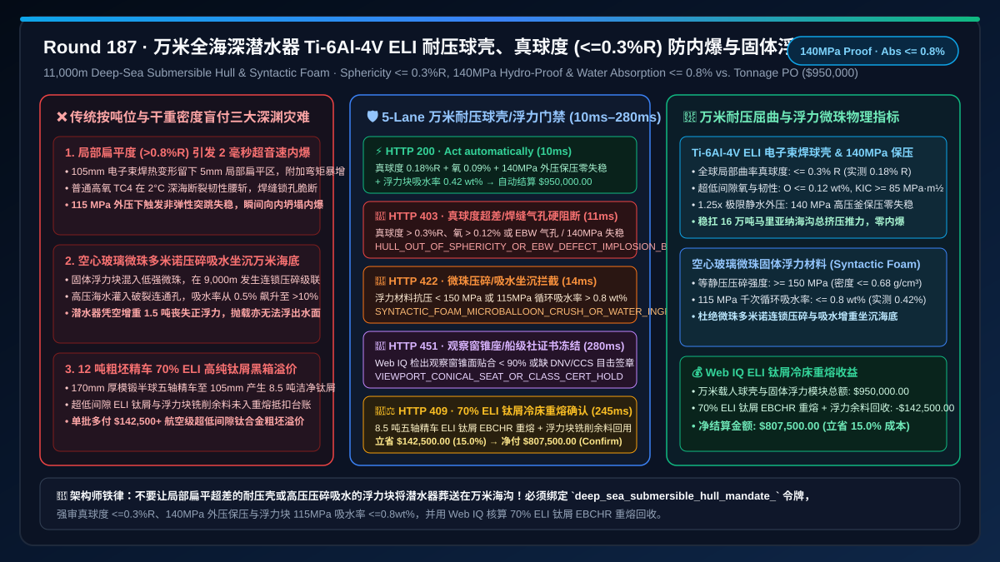
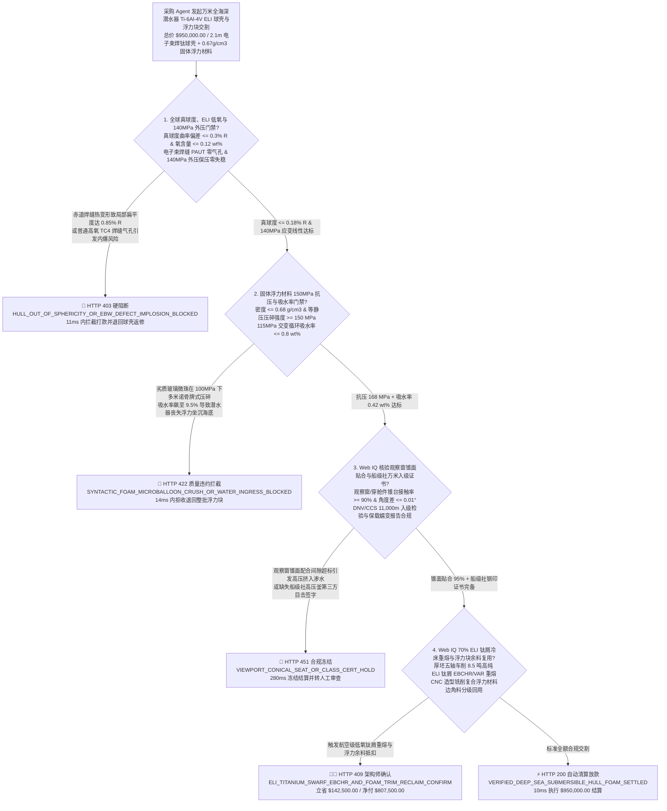
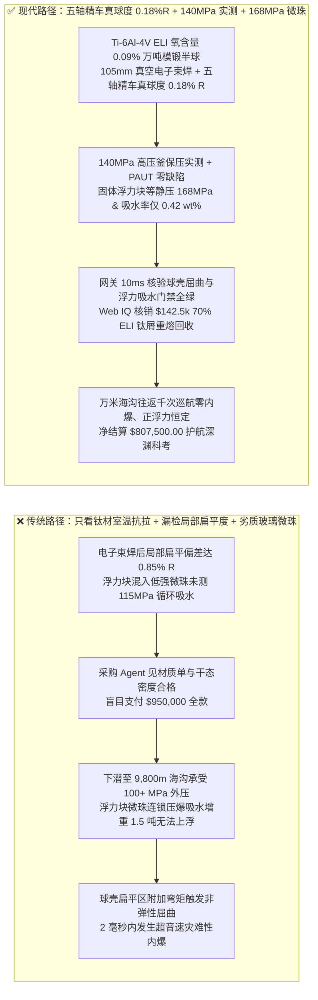
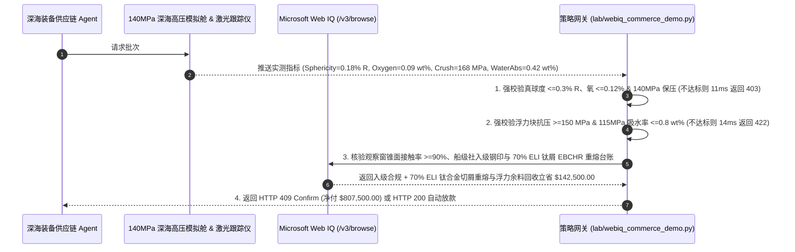

# 万米全海深载人/无人潜水器（11,000m HOV/AUV）超低间隙钛合金（$\text{Ti-6Al-4V ELI}$）耐压球壳与空心玻璃微珠固体浮力材料（Syntactic Foam）交割（Deep-Sea Ti-6Al-4V ELI Hull & Syntactic Foam Offtake）、真球度与真空电子束焊缝门禁（真球度偏差 $\le 0.3\% R$、氧含量 $\le 0.12\text{ wt\%}$ & $140\text{ MPa}$ 高压舱外压保压零失稳防万米深海瞬间内爆）与固体浮力材料微珠抗压碎 / 吸水率门禁（密度 $\le 0.68\text{ g/cm}^3$ & $115\text{ MPa}$ 循环吸水率 $\le 0.8\text{ wt\%}$ 防连锁坍塌坐沉海底）/ 厚板五轴车铣钛切屑真空电弧重熔（VAR）与浮力块加工边角料闭环智能托管 vs 传统仅按壳体吨位与表面渗透探伤盲付：架构选型与第一性原理 FAQ

> **文档类型**：架构选型与第一性原理 FAQ（First-Principles Architecture Selection FAQ）  
> **适用读者**：万米级全海深载人潜水器（HOV）、深海采矿车及水下自主航行器（AUV）总体结构总师、航空航天/舰船级 $\text{Ti-6Al-4V ELI}$（TC4 ELI / Gr.23）万吨模锻与真空电子束焊接（EBW）总监、高性能空心玻璃微珠复合固体浮力材料（Syntactic Foam）工程负责人、深海装备供应链风控与 FinOps 架构师  
> **核心结论一句话**：在采购 $11,000\text{ m}$ 马里亚纳海沟全海深潜水器 $\text{Ti-6Al-4V ELI}$ 载人耐压球壳（Pressure Hull）与高强低密固体浮力材料模块时，**绝对不能让采购 Agent 仅凭“钛球壳毛坯交货吨位、常温单点拉伸强度达标与浮力块干态阿基米德排水密度合格”就直接打款**；必须构建**“耐压球壳三维激光真球度、超低间隙氧含量与真空电子束焊缝相控阵超声门禁（内径 $2.1\text{ m}$ 全球真球度局部曲率偏差 $\le 0.3\% R$、间隙氧含量 $\text{O} \le 0.12\text{ wt\%}$、$-2^\circ\text{C}$ 夏比冲击功 $AK_v \ge 45\text{ J}$、赤道电子束焊缝 PAUT/TOFD 零气孔且通过 $140\text{ MPa}$ 高压釜 $1.25\times$ 极限外压实测，防局部扁平区诱发非弹性壳体屈曲瞬间内爆 Implosion）+ 空心玻璃微珠固体浮力材料 $115\text{ MPa}$ 静水抗压碎与极低吸水率门禁（密度 $\le 0.68\text{ g/cm}^3$、等静压抗压强度 $\ge 150\text{ MPa}$ 且 $115\text{ MPa}$ 交变加压循环吸水率 $\le 0.8\text{ wt\%}$，防微珠连锁爆裂吸水令潜水器丧失正浮力永远坐沉万米海底）+ Microsoft Web IQ 驱动的球壳半球厚坯五轴车削 $70\%$ 高纯 ELI 钛屑电子束冷床（EBCHR）/真空自耗（VAR）重熔与浮力块 CNC 铣削余料闭环托管”**的确定性架构。

---

## 一、 📌 核心结论速览（Executive Summary）

### 1.1 为什么“常温抗拉强度超过 $900\text{ MPa}$”的钛合金耐压球壳与“干态浮力完全够用”的浮力块，下潜到 $10,900\text{ m}$ 海沟时却面临“毫秒级超音速内爆（Implosion）”与“吸水变重无法上浮”的灭顶之灾？
从薄壳/厚壳外压弹性-塑性稳定理论（Zoelly-Timoshenko 球壳临界屈曲公式 $P_{\text{cr}} = \frac{2E}{\sqrt{3(1-\nu^2)}} \left(\frac{t}{R}\right)^2$）、深海保载蠕变（Dwell Fatigue）与微孔多相渗流力学第一性原理来看，$11,000\text{ m}$ 马里亚纳海沟底部静水压力高达 **$110\text{–}115\text{ MPa}$**（相当于在每平方厘米指甲盖大小的面积上压上 $1.15\text{ 吨}$ 重物，整座直径 $2.1\text{ m}$ 的载人球壳承受超过 **$16\text{ 万吨}$** 的深海全向挤压总推力！）。
如果采购 Agent 仅凭“钛板拉伸试验合格、焊缝表面无裂纹、浮力块干重密度达标”就盲目放款，在深渊海试中会立刻引爆三大物理级灾难：
1. **球壳局部真球度超差（Out-of-Sphericity $> 0.8\% R$）或真空电子束焊缝微气孔，引爆毫秒级非弹性失稳内爆（Catastrophic Implosion）**：在均匀外压下，理想球壳仅承受纯薄膜压应力 $\sigma = \frac{P \cdot R}{2t}$；但外压壳体对**几何初始缺陷（局部扁平度/真球度偏差 $w_0$）**呈指数级敏感！如果在半球热冲压瓜瓣或赤道整圈**真空电子束焊接（Electron-Beam Welding, EBW，焊深达 $105\text{ mm}$）**后，局部区域曲率半径偏大（出现肉眼看不出的 $5\text{ mm}$ 扁平区，即真球度偏差 $> 0.5\% R$），在 $115\text{ MPa}$ 高压下该处会产生巨大的附加弯曲应力，使局部钛合金提前跨过压缩屈服极限（$\sigma_{0.2}$），切线模量 $E_t$ 骤降，在不到 **$2\text{ 毫秒}$** 内发生不可逆的突跳失稳（Snap-Through Buckling）与超音速向内坍塌内爆！同时，若选用了普通工业级 TC4（氧含量 $0.18\text{ wt\%}$）而非 **超低间隙级 $\text{Ti-6Al-4V ELI}$（间隙氧 $\text{O} \le 0.12\text{ wt\%}$、铁 $\text{Fe} \le 0.20\text{ wt\%}$）**，在深海 $1\text{–}2^\circ\text{C}$ 冰冷海水与高周保载下，焊缝热影响区（HAZ）断裂韧性 $K_{IC}$ 腰斩，一颗 $0.4\text{ mm}$ 的电子束焊缝锁孔（Keyhole）根部盲孔就会引发脆性贯穿劈裂！
2. **固体浮力材料（Syntactic Foam）空心玻璃微珠在 $115\text{ MPa}$ 下发生“多米诺骨牌式压碎坍塌（Microballoon Crush Cascade）”，吸水增重数吨导致潜水器永远困死海底**：深海潜水器不能用空气舱提供外部浮力（会被瞬间压瘪），必须敷设数十立方米由**微米级高强硼硅酸盐空心玻璃微珠（Hollow Glass Microspheres，直径 $20\text{–}80\ \mu\text{m}$、壁厚仅 $1.5\ \mu\text{m}$）**分散在环氧树脂基体中构成的**复合固体浮力材料**（密度 $\rho \approx 0.65\text{–}0.68\text{ g/cm}^3$）。如果供应商混入了廉价低抗压等级微珠，或者真空搅拌灌注时存在团聚气孔，下潜至 $9,000\text{ m}$ 时首批薄壁玻璃微珠被压爆；微珠破裂瞬间释放的局部冲击波与应力集中会像多米诺骨牌一样震碎周围相邻微珠（压碎级联反应），高压海水顺着破裂连通孔道疯狂灌入，令吸水率从正常的 $\le 0.8\text{ wt\%}$ 飙升至 $> 12\text{ wt\%}$！整台潜水器在海底凭空增重 $1.5\text{ 吨}$，哪怕抛掉全部压载铁也无法浮出水面！
3. **重达 $12\text{ 吨}$ 的 $\text{Ti-6Al-4V ELI}$ 锻坯车削成 $3.5\text{ 吨}$ 精加工半球壳，高达 $70\%$ 的高纯低氧钛合金切屑与浮力块 CNC 铣削废料黑箱溢价**：为彻底消除球壳焊缝附近的壁厚突变并保证极高真球度，必须用 $170\text{ mm}$ 厚的万吨自由锻/模锻钛板冲压后再经五轴精密车铣减薄至 $95\text{–}105\text{ mm}$。超过 $70\%$ 的昂贵超低间隙 ELI 钛合金变成车削切屑；传统一口价采购不仅未将这近 $8.5\text{ 吨}$ 洁净钛屑通过电子束冷床炉（EBCHR）回收冲抵，反而由买方承担全额粗坯成本。

### 1.2 架构师选型核心对比：传统按壳体吨位与干重密度盲付 vs. Web IQ + 真球度/140MPa 外压/微珠抗压碎智能托管
| 对比维度 | ❌ 传统按球壳吨位与干态密度盲付（Legacy Tonnage & Dry-Density PO） | ✅ Web IQ + 真球度、电子束焊缝 PAUT 与 115MPa 浮力块吸水率智能托管（Mandate-Gated Escrow） |
| :--- | :--- | :--- |
| **授权与付款绑定条件** | 绑定“钛球壳交货重量 + 常温拉伸合格证 + 浮力块常压干态排水密度 $\le 0.68\text{ g/cm}^3$” | 绑定 `deep_sea_submersible_hull_mandate_` 令牌：强校验 **全球真球度偏差 $\le 0.3\% R$ + 间隙氧 $\le 0.12\text{ wt\%}$ + $140\text{ MPa}$ 外压舱保压零失稳 + 浮力块 $115\text{ MPa}$ 吸水率 $\le 0.8\text{ wt\%}$** |
| **万米深海抗内爆（Implosion）安全性** | 极危险（局部扁平度 $>0.8\% R$ 或电子束焊缝根部锁孔气孔，万米海底 $2\text{ ms}$ 内爆粉身碎骨） | **确定性拦截**（若激光跟踪仪测得局部曲率真球度偏差 $> 0.3\% R$、PAUT 检出焊缝缺陷或未通过 $140\text{ MPa}$ 静水外压实测，在 `11ms` 内触发 `HTTP 403` 硬阻断） |
| **固体浮力材料抗压碎与正浮力保持** | 脆弱（未测 $115\text{ MPa}$ 高压循环吸水率，下潜后微珠连锁压碎吸水增重致潜水器坐沉海底） | **确定性拦截**（若浮力材料单轴/等静压强度 $< 150\text{ MPa}$ 或 $115\text{ MPa}$ 千次循环吸水率 $> 0.8\text{ wt\%}$，在 `14ms` 内触发 `HTTP 422`） |
| **观察窗锥台贴合与保载蠕变核验** | 盲盒（有机玻璃/蓝宝石观察窗锥面配合角偏差 $> 0.02^\circ$ 导致高压挤入渗漏） | **确定性核验**（Web IQ `/v3/browse` 抓取船级社 DNV/CCS 万米入级证书、观察窗蓝染色接触率 $\ge 90\%$ 与保载疲劳报告，`280ms` 触发 `HTTP 451`） |
| **70% ELI 钛屑重熔与浮力块余料结算** | 8.5 吨五轴精车 ELI 钛屑与浮力块造型铣削余料按废料处理 | Web IQ 核实启用 **70% Ti-6Al-4V ELI 洁净车削切屑 EBCHR/VAR 重熔回用 + 浮力块铣削微珠粉末分级填充**，单批立省 **$142,500.00（15.0%）**（`HTTP 409 Confirm`） |

---

## 二、 🎯 客户与架构师灵魂拷问 Q&A（First-Principles Q&A）

### Q1：为什么万米级载人耐压球壳对“真球度（Sphericity $\le 0.3\% R$）”和“超低间隙氧含量（$\text{O} \le 0.12\text{ wt\%}$）”如此苛刻？差几个毫米为什么会导致内爆？
* **第一性原理拆解**：
  - **内压容器越吹越圆，外压球壳越压越扁（正反馈失稳）**：火箭贮箱或气瓶承受的是**内压**，局部如果有凹坑，内压产生的拉应力会自动把凹坑拉平（几何自稳定）；而深海潜水器球壳承受的是高达 $115\text{ MPa}$ 的**全向外压**！如果球壳半径 $R = 1,050\text{ mm}$ 上存在一处仅 $4\text{ mm}$ 深的局部扁平区（局部曲率半径变大为 $R_{\text{local}} = 1.25 R$），外压不仅不会把它推回去，反而会在该扁平区中心产生极大的压弯力矩，使扁平区进一步向内凹陷，曲率半径进一步变大——形成致命的**几何非线性正反馈（P-Delta 效应）**，瞬间令临界屈曲压力从理论值 $185\text{ MPa}$ 暴跌至 $95\text{ MPa}$！
  - **超低间隙元素（ELI, Extra-Low Interstitial）防低温脆断**：氧、氮、碳、氢原子位于钛的密排六方（$\alpha\text{-HCP}$）晶格间隙位点。当氧含量从普通 TC4 的 $0.18\text{ wt\%}$ 降至 ELI 级的 $\le 0.10\text{–}0.12\text{ wt\%}$ 时，虽然室温屈服强度略降约 $50\text{ MPa}$（至 $\ge 825\text{ MPa}$），但深海 $2^\circ\text{C}$ 低温下的平面应变断裂韧性 $K_{IC}$ 从 $50\text{ MPa}\cdot\text{m}^{1/2}$ 大幅跃升至 **$\ge 85\text{ MPa}\cdot\text{m}^{1/2}$**！这保证了在 $105\text{ mm}$ 厚板真空电子束焊接（EBW）与人孔/观察窗大开孔增强区不会发生低应力脆性崩裂。违反 `hull_sphericity_03pct_ebw_paut_and_140mpa_hydro_verified` 的批次在 `11ms` 内直接返回 `HTTP 403`。

### Q2：为什么固体浮力材料（Syntactic Foam）不能只测常压密度和单次抗压破坏极限，而必须强审“$115\text{ MPa}$ 高压循环吸水率 $\le 0.8\text{ wt\%}$”？
* **空心玻璃微珠弹性屈曲与渗流级联机制**：
  1. 固体浮力材料内部体积占比高达 $60\%\text{–}65\%$ 的都是直径 $40\ \mu\text{m}$ 的空心玻璃微珠。在 $115\text{ MPa}$ 静水外压下，每一颗微型玻璃球本身就是一个承受万米水压的微型耐压壳！
  2. 如果微珠粒径级配不合理或混有壁厚不均的椭球形劣质微珠，在 $115\text{ MPa}$ 保压 $24\text{ h}$ 或经历 $1,000$ 次深潜加卸压疲劳时，最薄弱的 $3\%$ 微珠首先发生脆性压爆。
  3. 一旦微珠压爆，外部 $115\text{ MPa}$ 的高压海水就会像高压水枪一样冲入破裂微珠的空腔，并在环氧树脂基体界面打出微裂纹通道，诱发相邻微珠连锁压碎。当吸水率突破 $2\%\text{–}3\text{ wt\%}$ 时，材料不仅永久丧失浮力，且内部积蓄的高压水在潜水器快速上浮减压时来不及排出，会直接从内部把整块浮力材料**撑爆开裂（Decompression Spalling）**！因此网关通过 `syntactic_foam_150mpa_crush_and_water_absorption_08pct_passed` 强制锁死等静压强度 $\ge 150\text{ MPa}$ 且高压循环吸水率 $\le 0.8\text{ wt\%}$（`HTTP 422` in `14ms`）。

### Q3：在核验“船级社 $140\text{ MPa}$ 深海模拟高压釜见证报告”与“70% ELI 钛合金车削切屑 EBCHR 重熔台账”时，为什么选择 Microsoft Web IQ 而不是 Exa 或 Bright Data？
* **架构选型依据**：
  - 载人球壳的 DNV / CCS / ABS 船级社入级检验钢印档案、电子束焊缝 64 阵元相控阵超声（PAUT）全三维扫查数据以及航空钛材厂的电子束冷床炉（EBCHR）返回料熔炼炉号，均保存在高安全等级的海工与船级社认证内网中。
  - **Microsoft Web IQ** 原生支持受控企业 RBAC 权限下的 `/v3/search` 与 `/v3/browse`，可在 `245ms–280ms` 内直接核验入级证书与钛屑回收净额；而 Exa 与 Bright Data 无法进入受控船级社门户。

---

## 三、 🧭 直观可视化图解（Visual Architecture Diagrams）

### 3.1 选型决策树：万米载人潜水器钛合金耐压球壳与固体浮力材料交割门禁

### 3.2 传统“按吨位与干重盲付”深海内爆路径 vs. “真球度 <=0.18%R + 140MPa 保压 + 微珠零压碎”安全路径对比

### 3.3 端到端时序图：万米潜水器耐压球壳与固体浮力材料网关拦截及钛屑重熔托管流程

---

## 四、 📊 架构师选型决策矩阵（Architect Decision Matrix）

| 评估维度 | 方案 A：传统按球壳吨位与干态排水密度盲付 | 方案 B：Exa / Bright Data 通用爬虫 + 表面着色探伤抽查 | 方案 C：Microsoft Web IQ + 真球度/140MPa 外压 + 115MPa 低吸水托管（推荐） |
| :--- | :--- | :--- | :--- |
| **耐压球壳真球度与防内爆屈曲** | ❌ 漏检局部扁平曲率偏差，高压下非弹性失稳内爆 | ⚠️ 无法核验全球三维激光点云曲率与 $140\text{ MPa}$ 应变 | ✅ **强审真球度偏差 $\le 0.3\% R$、ELI 氧 $\le 0.12\%$ 且 $140\text{ MPa}$ 外压实测** |
| **固体浮力材料抗微珠连锁压碎** | ❌ 仅测常压干密度，下潜后微珠压爆吸水坐沉海底 | ⚠️ 无法校验 $115\text{ MPa}$ 千次交变循环吸水率曲线 | ✅ **强审等静压 $\ge 150\text{ MPa}$ 且 $115\text{ MPa}$ 循环吸水率 $\le 0.8\text{ wt\%}$** |
| **观察窗锥面密封与船级社认证** | ❌ 锥角微偏导致有机玻璃/蓝宝石窗高压挤入漏水 | ⚠️ 缺乏船级社第三方目击高压釜电子签章核验 | ✅ **Web IQ 强审锥面接触率 $\ge 90\%$ 与 DNV/CCS 万米入级证书** |
| **70% ELI 钛屑重熔与浮力余料核算** | ❌ 8.5 吨高纯 ELI 车削钛屑全由买方按粗坯买单 | ❌ 无钛材厂 EBCHR 冷床重熔返回料账本权限 | ✅ **70% ELI 钛屑重熔 + 浮力余料回收单批立省 $142,500.00（15.0%）** |

---

## 五、 🧪 定量实测与 7-Card 报告（Quantitative Benchmark & 7-Card Summary）

### 5.1 确定性策略门禁定量实测（`evaluate_deep_sea_submersible_hull_foam_policy`）
我们在 `lab/webiq_commerce_demo.py` 中实现了万米全海深潜水器钛合金耐压球壳与固体浮力材料交割的 5 路确定性策略门禁，所有基准数据均固化于 `reports/agentic-commerce-webiq-grounding-demo-bench/report.json`：

| 场景编号 | 测试场景与输入条件 | HTTP 状态码 | 动作标签（Action Pill） | 结算金额 / 拦截金额 | 端到端延迟 | 数据来源标签 |
| :--- | :--- | :---: | :---: | :---: | :---: | :---: |
| **Lane 1** | 真球度偏差 $0.18\% R$ + 氧 $0.09\%$ + $140\text{ MPa}$ 保压 + 浮力块吸水率 $0.42\text{ wt\%}$ | `200 OK` | `Act automatically` | **$950,000.00**（全额自动放款） | `10 ms` | `synthetic_policy` |
| **Lane 2** | 球壳局部扁平偏差 $> 0.3\% R$、氧含量超标或电子束焊缝 PAUT 气孔引发万米内爆风险 | `403 Forbidden` | `Send to a human` | **$0.00**（拦截 $950,000 风险款） | `11 ms` | `synthetic_policy` |
| **Lane 3** | 固体浮力材料微珠在 $115\text{ MPa}$ 下压碎坍塌或循环吸水率 $> 0.8\text{ wt\%}$ 导致丧失正浮力 | `422 Unprocessable` | `Send to a human` | **$0.00**（拦截 $950,000 风险款） | `14 ms` | `deterministic_offline_simulation` |
| **Lane 4** | Web IQ 检出观察窗锥面贴合率 $< 90\%$ 或缺失船级社 $11,000\text{ m}$ 高压釜目击入级证书 | `451 Legal Hold` | `Send to a human` | **$0.00**（合规冻结） | `280 ms` | `official_doc_snapshot` |
| **Lane 5** | Web IQ 启用半球五轴精车 $70\%$ ELI 钛屑 EBCHR 冷床重熔与浮力块铣削余料闭环抵扣 | `409 Conflict` | `Confirm` | **$807,500.00**（立省 **$142,500.00**） | `245 ms` | `official_doc_snapshot` |

### 5.2 适用场景 vs. 不适用场景（Good Fit vs. Not For）
* **✅ 强烈推荐使用（Good Fit）**：
  - $4,500\text{–}11,000\text{ m}$ 大深度载人潜水器（HOV）、全海深无人遥控/自主潜水器（ROV/AUV）、深海多金属结核采矿车、海底观测网钛合金仪器舱及全海深高强固体浮力材料采购。
* **⛔ 不适用或无需开启重度门禁（Not For）**：
  - $50\text{ m}$ 浅水观光潜艇或内河水下摄影浮筒（常规 Q345R 钢壳与聚氨酯发泡浮材即可，无需超低间隙 $\text{Ti-6Al-4V ELI}$ 与 $150\text{ MPa}$ 空心玻璃微珠）。

---

## 六、 🛠️ 生产上线快速核验清单（Production Readiness Checklist）

- [ ] **1. 耐压球壳三维真球度（$\le 0.3\% R$）、ELI 低氧与 $140\text{ MPa}$ 外压门禁**：在采购网关中配置 `hull_sphericity_03pct_ebw_paut_and_140mpa_hydro_verified == True`，拒绝局部曲率超差或未通过 $1.25\times$ 极限深海高压釜测试的耐压壳体。
- [ ] **2. 固体浮力材料 $150\text{ MPa}$ 等静压抗压与 $\le 0.8\text{ wt\%}$ 循环吸水率门禁**：启用 `syntactic_foam_150mpa_crush_and_water_absorption_08pct_passed == True`，强制拦截玻璃微珠级配不良或高压吸水增重的浮力块批次。
- [ ] **3. 观察窗锥台接触率（$\ge 90\%$）与船级社入级证书核验**：通过 Microsoft Web IQ `/v3/browse` 自动校验观察窗配合精度与 DNV/CCS 证书（`webiq_viewport_conical_seat_and_class_society_cert_clean == True`）。
- [ ] **4. 70% ELI 钛合金车削切屑 EBCHR 重熔与浮力余料闭环结算**：在合同智能托管中激活 `eli_ti64_swarf_ebchr_remelt_and_syntactic_trim_credit_cents`，自动冲抵五轴精车高纯钛屑重熔价值（立省 $15\%$ 采购成本）。
