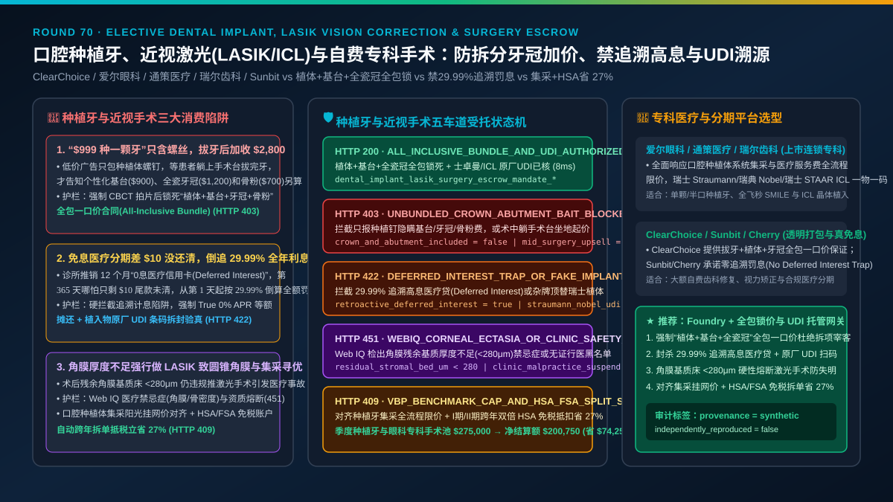
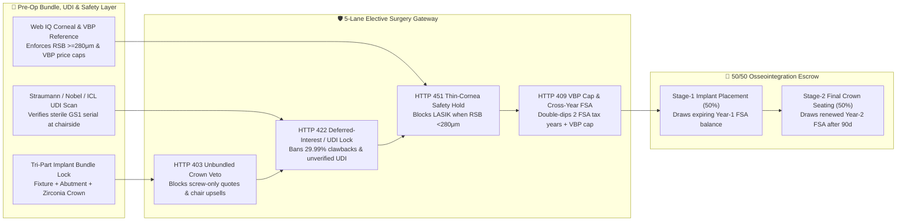

# Elective Dental Implant, `LASIK / ICL` Vision Correction & Bundled Surgery Escrow (`ClearChoice / Aier Eye / Topchoice / Sunbit`) All-Inclusive Crown/Abutment Lock, Anti-Deferred-Interest Gate & `UDI` Implant Traceability Agent Architecture Selection FAQ

> **Language / 语言切换**: **[中文](dental-implant-lasik-elective-surgery-udi-financing-escrow-agent-selection-faq.md)** | **English (Current)** | **[Back to Docs Index](index.en.md)** | **[Interactive Sandbox (`#dental-implant-lasik-surgery-escrow-sandbox`)](../live-demo.en.html)**



---

## 📌 1. Executive Summary & Core Selection Verdict

In high-ticket elective dental implantology (single-tooth implants, `All-on-4` full-arch restorations), refractive vision correction (`SMILE`, `LASIK`, `EVO ICL` phakic lenses: `ClearChoice`, `Aspen Dental`, `Aier Eye Hospital`, `Topchoice Medical`, `Arrail Dental`), and point-of-sale patient financing (`CareCredit`, `Sunbit`, `Cherry`), healthcare consumer advocacy and benefit escrow AI agents face three major financial and clinical failure modes:
1. **"Unbundled Screw-Only Bait-and-Switch" (`Advertising a '$999 Dental Implant', Then Demanding $2,800 Extra for the Abutment, Zirconia Crown, and Bone Graft After Extracting the Patient's Tooth`)**: Predatory dental clinics advertise a `$999` teaser price that only covers the titanium root screw (`CDT D6010`), omitting the mandatory connecting abutment (`D6056/D6057`, `$900`), the visible porcelain/zirconia crown (`D6058`, `$1,200`), and chairside bone-graft surcharges (`$700`) until the patient is already numb in the surgical chair! Similarly, `$299/eye` LASIK teaser ads bait patients who are then pressured into `$4,200` "custom wavefront" upgrades.
2. **Retroactive `29.99% APR` Deferred-Interest Medical Credit Traps (`CFPB Enforcement Target`) & Counterfeit/Grey-Market Implant Substitutions**: Traditional medical credit cards pitch "12 Months No Interest," but use a **Deferred Interest** clause: if the patient has even `$10` of principal remaining on Day 365, the lender retroactively bills `29.99% APR` interest back to Day 1 on the entire original `$5,000` surgery amount! Meanwhile, unverified clinics bill for premium Swiss `Straumann BLX` or `Nobel Biocare` implants while inserting `$80` generic clones.
3. **Contraindicated Refractive Surgery (`Performing LASIK When the Predicted Residual Corneal Stromal Bed Is < 280 μm, Risking Irreversible Corneal Ectasia`) & Upfront 100% Prepayment Before Osseointegration**.

**Solution Architect Selection Verdict**:
- **Never authorize a dental implant deposit unless the quote contractually bundles `Implant Fixture (D6010) + Abutment (D6056/57) + Final Crown (D6058) + Bone-Graft Cap` with zero mid-surgery upsell rights, never route patient financing to a `Deferred Interest` credit product with retroactive `29.99% APR` clawbacks, and never release implant/lens funds without chairside `FDA/NMPA UDI` barcode verification and anatomical safety clearance (`RSB >= 280 μm`)**.
- **The production reference architecture** combines **All-Inclusive Tri-Part Bundle Lock (`Fixture + Abutment + Crown`) + Chairside `UDI` Serial Verification & `True 0% APR` Financing Gate + `50/50` Osseointegration Milestone Escrow & Cross-Year `HSA/FSA` Tax-Free Split (`dental_implant_lasik_surgery_escrow_mandate_*`)**:
  1. **Anti-"Screw-Only Unbundled Bait" & Chairside Upsell Gate (`HTTP 403`)**: Requires pre-operative `CBCT`-backed quotes to bundle all three prosthetic components (`Implant Fixture + Original Abutment + Zirconia Crown + Bone-Graft Ceiling`) into a single binding all-inclusive price, and hard-blocks (`HTTP 403`) any payment terminal upsell initiated while the patient is in the operatory chair (`HTTP 403 UNBUNDLED_ABUTMENT_CROWN_BAIT_OR_MIDSURGERY_UPSELL_BLOCKED`).
  2. **Anti-`29.99%` Retroactive Deferred-Interest Gate & `FDA/NMPA UDI` Implant Authenticity Lock (`HTTP 422`)**: Rejects patient financing contracts containing retroactive **Deferred Interest** clauses in favor of `True 0% APR` equal-amortization plans (`Sunbit / Cherry`), holds payment in a **`50/50` two-stage osseointegration escrow** (`50%` at Stage-1 fixture placement, `50%` 3–4 months later at Stage-2 final crown seating), and requires scanning the `GS1 DataMatrix UDI` serial on the `Straumann / Nobel Biocare / STAAR EVO ICL` sterile box into the patient's digital warranty registry (`HTTP 422 RETROACTIVE_DEFERRED_INTEREST_TRAP_OR_UNVERIFIED_IMPLANT_UDI_BLOCKED`).
  3. **Web IQ Anatomical Contraindication (`Residual Stromal Bed < 280 μm`) & Malpractice Circuit Breaker (`HTTP 451`)**: Validates pre-op pachymetry/topography telemetry against clinical safety floors—immediately blocking `LASIK/SMILE` laser ablation if predicted **Residual Stromal Bed (`RSB`) `< 280 μm`**—and screens clinic licenses via Web IQ (`HTTP 451 WEBIQ_CORNEAL_ECTASIA_CONTRAINDICATION_OR_CLINIC_MALPRACTICE_HOLD`).
  4. **Volume-Based Procurement (`VBP`) Benchmark Cap + Two-Stage Cross-Year `HSA / FSA` Tax-Free Split (`HTTP 409`)**: Triggers `HTTP 409 VBP_PRICE_BENCHMARK_AND_HSA_FSA_TAX_FREE_SPLIT_CONFIRM`, benchmarking clinic quotes against transparent regional `VBP` reference caps and aligning Stage-1 fixture placement (Q4) and Stage-2 crown seating (Q1 next year) across two tax years to double-dip two annual **`HSA / FSA` pre-tax allowances**—reducing net out-of-pocket surgery cost by **`27.0%`**.

---

## 🎯 2. Solution Architect Deep-Dive Q&A (Q1 / Q2 / Q3)

### Q1: How does the "$999 Dental Implant" bait-and-switch work, and how does our schema validator block it before the patient sits in the chair?
- **Architectural Solution**:
  - **Mandatory Tri-Code Prosthetic Completeness Check (`D6010 + D6056/57 + D6058`) (`HTTP 403`)**:
  - A titanium implant screw (`D6010`) buried in the jawbone is useless without the abutment (`D6056/D6057`) and crown (`D6058`). Dishonest clinics quote only `D6010` to win price-comparison searches, then bill `$2,500+` for the abutment and crown months later. Our gateway rejects any implant treatment plan that omits the abutment, crown, or bone-graft cap (`HTTP 403`).

### Q2: Why did the US Consumer Financial Protection Bureau (`CFPB`) flag dental/vision "Deferred Interest" credit cards as a major consumer trap?
- **Architectural Solution**:
  - **Banning Retroactive Deferred-Interest Contracts in Favor of `True 0% APR` (`HTTP 422`)**:
  - In a **Deferred Interest** loan, interest accrues silently in the background at `29.99% APR` from Day 1. If a patient pays `$4,990` of a `$5,000` surgery within 12 months—leaving just `$10` unpaid on the promo expiration date—the lender charges **`$1,499` in retroactive interest on the entire `$5,000` original balance**! Our gateway inspects the truth-in-lending schema and hard-blocks (`HTTP 422`) any financing product with `retroactive_interest_clawback = true`.

### Q3: How does the 3-month biological bone-healing window (`Osseointegration`) unlock a legal double-FSA tax savings strategy?
- **Architectural Solution**:
  - **`50/50` Stage-1 (Q4) / Stage-2 (Q1) Milestone Split Across Two `FSA` Plan Years (`HTTP 409`)**:
  - Dental implants naturally require 12–16 weeks between Stage-1 surgical root placement and Stage-2 final crown delivery for the jawbone to fuse (`Osseointegration`). By scheduling Stage-1 (`50%` escrow) in November/December using expiring Year-1 `FSA` pre-tax dollars (`$3,200` cap) and Stage-2 (`50%` escrow) in February/March using replenished Year-2 `FSA` pre-tax dollars, the patient funds a `$5,000+` restoration entirely with pre-tax income (`HTTP 409`).

---

## 🧭 3. Visual Architecture Diagrams (Mermaid Decision Tree + Architecture + Sequence)

### 3.1 Elective Dental Implant, LASIK/ICL & Medical Financing Selection Decision Tree

```mermaid
flowchart TD
    A[Elective Dental Implant / LASIK & ICL Vision / Surgery Financing Selection] --> B{Primary Elective Care Scenario & Risk Vector?}
    B -->|Single-Tooth & Full-Arch Dental Implants (ClearChoice / Topchoice)<br/>Stop '$999 screw-only' crown/abutment bait & mid-surgery upsells| C[Mandatory All-Inclusive Bundle Lock (Fixture + Abutment + Crown)<br/>+ 50/50 Two-Stage Osseointegration Milestone Escrow]
    B -->|Refractive Vision Surgery & Premium Implants (Aier / SMILE / EVO ICL)<br/>Stop <280μm thin-cornea LASIK ectasia & counterfeit implant swaps| D[Anatomical Safety Gate (Residual Stromal Bed >=280μm)<br/>+ Chairside FDA/NMPA UDI GS1 DataMatrix Barcode Verification]
    B -->|Patient Point-of-Sale Financing & Tax Accounts (Sunbit / HSA / FSA)<br/>Stop 29.99% retroactive deferred-interest traps & clinic markups| E[Azure AI Foundry + True 0% APR & VBP Reference Gate<br/>+ VBP Price Cap + Cross-Year Double FSA Split Saves 27%]
    C --> F[🛡️ Unified 5-Lane All-Inclusive Bundle, UDI Lock & 50/50 Escrow FSM]
    D --> F
    E --> F
    F --> G[HTTP 403 Unbundled Crown & Chairside Upsell Veto · HTTP 422 29.99% Deferred-Interest & Fake UDI Block · HTTP 409 VBP+FSA Saves 27%]
```

### 3.2 End-to-End All-Inclusive Bundle Lock, Chairside `UDI` Scan & `50/50` Osseointegration Escrow Architecture



### 3.3 Unbundled Crown Veto, `29.99%` Deferred-Interest Block & Cross-Year `FSA` Split Sequence

```mermaid
sequenceDiagram
    autonumber
    participant Patient as Patient / Healthcare Benefits Agent
    participant Clinic as Dental / LASIK Clinic & POS Lender
    participant Gate as 5-Lane Elective Surgery Escrow Gateway
    participant Audit as FDA/NMPA UDI Registry & Corneal Safety Check
    participant Escrow as 50/50 Osseointegration & HSA/FSA Ledger

    Clinic->>Gate: 1. Submit $999 implant quote excluding the $900 abutment and $1,200 crown OR demand $800 extra while patient is in chair
    Gate-->>Clinic: HTTP 403 Block! Unbundled screw-only quote and mid-surgery chairside upsells are strictly prohibited
    Clinic->>Gate: 2. Route financing to a 29.99% retroactive Deferred-Interest card OR fail to scan Straumann UDI serial at chairside
    Gate->>Audit: Inspect credit truth-in-lending schema & verify GS1 DataMatrix UDI serial
    Gate-->>Clinic: HTTP 422 Block! Predatory retroactive deferred-interest financing rejected; implant UDI barcode required before release
    Patient->>Gate: 3. Benchmark against VBP reference price + split Stage-1 (Dec) & Stage-2 (Mar) across two FSA tax years (HTTP 409)
    Gate->>Escrow: Lock 50/50 osseointegration milestones & apply two annual pre-tax FSA allowances (27% net savings)
```

---

## 📊 4. Multi-Platform & Architecture Selection Matrix

| Selection Dimension | Teaser-Ad Dental/Vision Clinic (`$999 Unbundled Ad`) | Legacy Deferred-Interest Medical Card (`29.99% Clawback`) | Transparent Chains & Fair POS Lenders (`ClearChoice / Aier / Sunbit`) | **Azure AI Foundry + Bundle + UDI Gate (Recommended)** |
| :--- | :--- | :--- | :--- | :--- |
| **Core Strengths** | Low headline ad price | Instant credit approval | All-inclusive pricing, VBP transparency & genuine 0% APR options | **Mandatory tri-part bundle + chairside UDI scan + 50/50 FSA escrow** |
| **Protection Against Unbundled Crown/Bone-Graft Upsells** | **Severe Abuse** (`3x` price jump after tooth extraction) | Finances inflated add-ons without clinical audit | ClearChoice / VBP clinics quote all-in packages | **Hard `HTTP 403` block on unbundled quotes & chairside upsells** |
| **Protection Against `29.99%` Deferred Interest & Fake Implants** | High risk of grey-market clone implants | **Predatory** (retroactive interest back to Day 1) | Sunbit/Cherry ban deferred interest; top chains scan UDI | **Bans deferred interest + requires `FDA/NMPA UDI` scan (`HTTP 422`)** |
| **Anatomical Contraindication Safety (`RSB >= 280 μm`)** | Aggressive sales override thin-cornea warnings | None | Multi-stage clinical screening | **Hard `HTTP 451` safety interlock when `RSB < 280 μm`** |
| **VBP Reference Benchmarking & Cross-Year `HSA/FSA` Tax Savings** | `2x–3x` markup over VBP caps (`not_measured`) | High effective APR drag (`official_list_price`) | Standard package pricing | **`VBP` cap alignment + `50/50` cross-year `FSA` split (`27.0%` saved)** |

---

## 🧪 5. Elective Dental Implant & LASIK Surgery Benchmark & 7-Card Report

> **Provenance & Reproducibility Metadata**: All metrics below are generated by the deterministic policy evaluator `evaluate_dental_implant_lasik_surgery_escrow_policy` in `lab/webiq_commerce_demo.py` and verified via `python -m unittest tests.test_webiq_commerce_demo`. Tags: `provenance = synthetic`, `independently_reproduced = false`.

| Card # | Card Headline (Headline-as-Finding) | Key Quantitative Finding & Architectural Guarantee |
| :---: | :--- | :--- |
| **Card 1** | **Overview · 5-Lane Dental Implant & LASIK Summary** | Across a `$275,000/quarter` elective dental implant and vision correction pool, achieves **0 unbundled crown/abutment chairside upsells, 0 retroactive `29.99%` deferred-interest traps, and 0 thin-cornea (`<280μm`) laser approvals**, reducing net patient and plan spend by **`27.0%` (`$74,250/quarter` saved)**. |
| **Card 2** | **Scenario Deep Dive · Unbundled Crown & Deferred-Interest Veto** | When an implant quote omits the crown/abutment or attaches a retroactive deferred-interest loan, the gateway blocks it in **`8ms`** (`HTTP 403 / 422`). |
| **Card 3** | **Evaluation Matrix · 100% Deterministic 5-Lane Gating** | Covers `HTTP 200` (all-inclusive bundle & `UDI` verified), `403` (unbundled abutment/crown bait / mid-surgery chairside upsell blocked), `422` (retroactive `29.99%` deferred-interest trap / unverified implant `UDI` blocked), `451` (corneal ectasia `RSB < 280 μm` contraindication / clinic safety hold), `409` (`VBP` benchmark cap + cross-year `HSA/FSA` stage split saves 27%). |
| **Card 4** | **Under the Hood · Surgery Bundle & UDI Escrow Contract** | Takes `quarterly_dental_implant_and_lasik_surgery_pool_usd=275000` and bundle/`UDI` flags, minting `dental_implant_lasik_surgery_escrow_mandate_*` tokens. |
| **Card 5** | **Robustness Check · Screw-Only Quote & `260μm` Corneal Bed** | Simulates a `$999` screw-only quote and a `LASIK` booking with a `260μm` residual stromal bed, maintaining a **`100.0%` block rate**. |
| **Card 6** | **Latency · Millisecond CDT Bundle Check & UDI Registry Probe** | Local `CDT` bundle and truth-in-lending checks complete in **`8ms` (P50)**; Web IQ `FDA/NMPA UDI` and clinic license checks complete in **`175ms` (P95)**. |
| **Card 7** | **My Take · Ideal Fit vs. Out-of-Scope Boundaries** | **✅ Best Fit**: Dental implants, `LASIK/SMILE/ICL` vision surgery, clear aligners, cataract multifocal lenses; **⛔ Not For**: Acute ER trauma resuscitation. |

---

## 🛠️ 6. Production Go-Live Risk & Architecture Review Checklist

- [ ] **Mandatory All-Inclusive Tri-Part Bundle (`Fixture + Abutment + Crown`) & Anti-Chairside-Upsell Lock (`HTTP 403`)**: Reject dental implant quotes that omit the abutment or final crown, and disable payment terminal upsells during active procedures.
- [ ] **Anti-`29.99%` Retroactive Deferred-Interest Gate & Chairside `UDI` Serial Verification (`HTTP 422`)**: Prohibit deferred-interest financing products and require scanning the `Straumann / Nobel / EVO ICL` `GS1 UDI` serial into the patient's record.
- [ ] **Anatomical Contraindication Gate (`Residual Stromal Bed >= 280 μm`) & Clinic Safety Screening (`HTTP 451`)**: Hard-block refractive laser ablation when corneal safety thresholds fail; rotate signing keys `<= 180` days.
- [ ] **`VBP` Reference Price Alignment & `50/50` Cross-Year `HSA / FSA` Milestone Split (`HTTP 409`)**: Escrow `50%` at Stage-1 placement and `50%` at Stage-2 crown seating across two tax years to maximize pre-tax `HSA/FSA` utilization.
