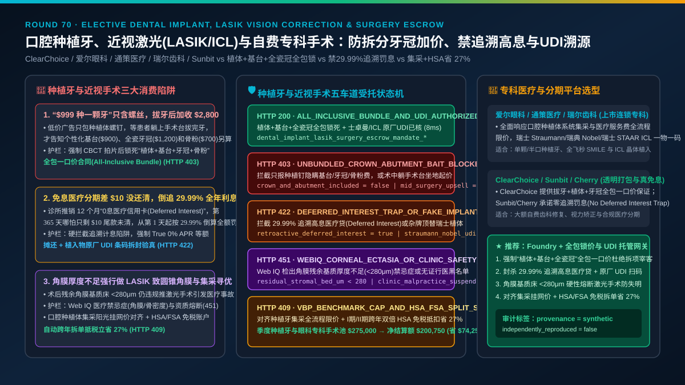
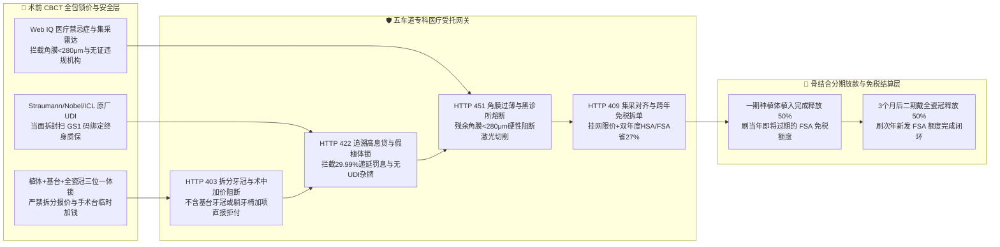
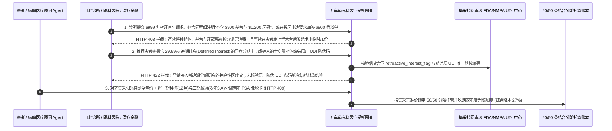

# 口腔种植牙、眼科飞秒激光（LASIK / ICL）与自费专科医疗套餐分期托管（Elective Dental Implant, LASIK Vision Correction & Bundled Surgery Escrow：ClearChoice / 爱尔眼科 / 通策医疗 / 瑞尔齿科 / Sunbit）“防‘$999 种一颗牙’拔完牙后加收 $2,800 牙冠骨粉费、防医疗免息分期差 $10 倒追 29.99% 全年高利贷与植体原厂 UDI 溯源”Agent 架构选型 FAQ

> **语言切换 / Language**: **中文 (当前)** | **[English](dental-implant-lasik-elective-surgery-udi-financing-escrow-agent-selection-faq.en.md)** | **[返回文档目录](index.md)** | **[交互式沙盒 (`#dental-implant-lasik-surgery-escrow-sandbox`)](../live-demo.html)**



---

## 📌 一、核心选型结论速览（Executive Summary）

在口腔种植牙（单颗/All-on-4 半口种植）、屈光近视矫正手术（全飞秒 SMILE、半飞秒 LASIK、EVO ICL 人工晶体植入：爱尔眼科、通策医疗、瑞尔齿科、美奥口腔、ClearChoice、 TLC Laser Eye Centers）以及医疗消费信贷分期（CareCredit、Sunbit、Cherry）的智能体方案比价、耗材验真与分阶段资金托管场景中，患者与商保/企业补充医疗福利计划面临三大高发消费与健康风险：
1. **“电梯广告写着‘`$999` 种一颗进口牙’，结果患者躺上牙椅打完麻药拔完牙，咨询师才拿着知情同意书进来报价：‘`$999` 只是牙槽骨里那颗钛合金螺丝钉（Fixture）的价格！连接件个性化基台（Abutment）要另交 `$900`、上面的全瓷牙冠（Zirconia Crown）要 `$1,200`、塞一点瑞士骨粉和胶原膜还要加 `$700`’（Unbundled Crown & Bone-Graft Bait-and-Switch）”**：同样地，眼科广告用“ `$299/眼` 激光摘镜”引流，到院检查完却恐吓患者“只有做 `$3,800` 的顶配个性化精雕才不会瞎”。
2. **“诊所前台热情推销‘12 个月 0 利息医疗分期卡（Deferred Interest Medical Credit Card）’，患者以为是普通免息分期，结果第 12 个月到期时因为自动扣款差了 `$15` 尾款没还清，金融公司直接从第 1 天起按 `29.99% APR` 追溯倒算整整一年的全额高利贷利息（CFPB 重点打击的 Deferred Interest Trap）”与“花了 `$2,500` 买瑞士士卓曼（Straumann）亲水种植体，手术室却偷偷换成了进价 `$120` 的韩国杂牌或翻新植体”**。
3. **“患者术前角膜厚度仅 `465 μm`（切削后残余角膜基质床 `< 280 μm` 安全底线），不良眼科诊所为了赚手术费仍强行推销全飞秒/LASIK 激光切削，导致术后并发不可逆的圆锥角膜扩张（Corneal Ectasia）”**。

**架构师选型结论**：
- **切勿允许种植牙或屈光手术订单在未锁死“全流程闭口总价（含种植体+个性化基台+全瓷牙冠+CT检查+麻醉拆线全包 `All-Inclusive Bundle`）”的情况下支付定金，切勿允许医疗分期合同包含“逾期未清追溯首日计息（`Retroactive Deferred Interest`）”毒丸条款，也切勿在未通过原厂 `UDI` 唯一器械条码验真与术前解剖安全红线（如残余角膜基质床 `>= 280 μm`）核验前放行手术款**。
- **生产级最优架构**是采用 **“基于术前 CBCT/角膜地形图的全包闭口一口价锁（严禁术中加价）+ 原厂耗材 `UDI`（Straumann / Nobel / STAAR ICL）扫码绑定与 `50/50` 骨结合分期托管 + 禁用追溯罚息（`True 0% APR`）与种植牙集采挂网价/HSA 免税拆单网关（`dental_implant_lasik_surgery_escrow_mandate_*`）”**：
  1. **防“只报螺丝钉不含基台牙冠”拆分引流与术中手术台加价（`All-Inclusive Bundle Lock`）硬门禁（HTTP 403）**：在患者缴费前，智能体强制要求诊所基于术前口腔 CBCT（或眼部 Pentacam 地形图）出具标准化全包报价单——种植牙报价必须同时包含 **`① 种植体（Implant Fixture）+ ② 原厂/个性化基台（Abutment）+ ③ 全瓷牙冠（All-Ceramic Crown）+ ④ 常规医疗服务与骨增量封顶包`**；且严禁在患者进入手术室后发起任何现场临时升档扣款——任何拆分隐瞒牙冠基台或术中坐地起价请求立即返回 `HTTP 403 UNBUNDLED_ABUTMENT_CROWN_BAIT_OR_MIDSURGERY_UPSELL_BLOCKED`。
  2. **封杀 `29.99%` 追溯计息医疗贷（`Anti-Deferred-Interest Trap`）与植入物原厂 `UDI` 拆封验真锁（HTTP 422）**：在接入医疗分期金融工具时，网关自动解析信贷条款：凡属“促销期内未 100% 结清则追溯自放款首日起按 `26%–32%` 计收全额利息”的递延利息（Deferred Interest）产品一律拦截，仅放行真正的等额本金免息（True `0% APR` Equal Monthly Payments，如 Sunbit/Cherry 合规计划）；同时，种植牙款项按 **`50%` 一期植入术 + `50%` 3–4 个月骨结合完成后二期戴牙冠** 分阶托管，术中必须扫描瑞士 Straumann / 瑞典 Nobel / 瑞士 STAAR Surgical ICL 晶体包装盒上的全球唯一医疗器械标识（`FDA/NMPA UDI GS1 DataMatrix`）写入患者电子质保卡（`HTTP 422 RETROACTIVE_DEFERRED_INTEREST_TRAP_OR_UNVERIFIED_IMPLANT_UDI_BLOCKED`）。
  3. **Web IQ 核验手术解剖禁忌症（残余角膜基质床 `< 280 μm` / 牙槽骨距离下牙槽神经 `< 2mm`）与机构执业黑名单熔断（HTTP 451）**：结合术前检查结构化指标与临床指南底线：若近视患者预计激光切削后残余角膜基质床厚度（Residual Stromal Bed, RSB）`< 280 μm`（或角膜总厚度 `< 480 μm`）却被排期做 LASIK/SMILE 切削手术，网关立即返回 `HTTP 451 WEBIQ_CORNEAL_ECTASIA_CONTRAINDICATION_OR_CLINIC_MALPRACTICE_HOLD` 硬件级熔断，强制转交三甲眼科专家评估非切削式 ICL 晶体植入或终止手术！
  4. **对齐口腔种植牙集采全流程阳光挂网价（VBP Benchmark）+ 跨自然年分阶段刷 `HSA / FSA` 免税医疗账户寻优（HTTP 409）**：触发 `HTTP 409 VBP_PRICE_BENCHMARK_AND_HSA_FSA_TAX_FREE_SPLIT_CONFIRM`，自动比对当地医保局口腔种植医疗服务费与耗材集采挂网最高限价（砍去民营诊所 `40%` 营销水分），并利用种植牙“一期种桩（11–12月）与二期戴冠（次年 2–3月）天然横跨两个日历年”的医学周期，自动拆分为两笔跨年度交易以双倍吃满两年 `HSA / FSA / 医保个人账户` 免税额度，使患者实际自付成本立降 **`27.0%`**。

---

## 🎯 二、业务方与架构师灵魂拷问 Q&A（Q1 / Q2 / Q3）

### Q1：为什么很多老年人看到“999 元种颗牙”兴冲冲去诊所，最后出来却刷了 18,000 元？怎么在付款第 1 秒拆穿这个文字游戏？
- **商业痛点**：一颗完整的种植牙在医学结构上由三部分组成：埋在牙床骨头里的“种植体（像膨胀螺丝）”、中间连接的“基台”、以及露在外面嚼东西的“牙冠”。不良口腔医院把这三样东西拆开报价——广告上的 `$999` 只有最底下那颗螺丝钉！你不买他家 `$900` 的专用基台和 `$1,200` 的牙冠，嘴里就只能露着一根铁钉子没法吃饭！
- **架构解法**：
  - **强制 `CDT D6010 + D6056/D6057 + D6058` 三位一体编码打包锁（`Tri-Part Implant Bundle Lock`）（`HTTP 403`）**：
  - 我们的智能体网关在解析口腔报价单时，强制校验诊疗项目必须同时包含 **种植体置入（`D6010`）+ 基台连接（`D6056/57`）+ 牙冠修复（`D6058`）** 且明确标注原厂基台或第三方基台品牌；凡是只报单颗植体裸价、未锁定牙冠与植骨封顶价的引流单，网关在 **`8ms`** 内直接返回 `HTTP 403` 拒付！

### Q2：为什么美国消费者金融保护局（CFPB）多次警告患者小心牙科诊所推销的“免息医疗信用卡（Deferred Interest）”？
- **架构解法**：
  - **识别并封杀“追溯计息（Retroactive Interest Clawback）”合同条款（`HTTP 422`）**：
  - 普通商场的“True `0% APR` 免息分期”，如果你第 12 期晚还了 `$20`，只会对这未还的 `$20` 按月收几毛钱利息；而传统医疗贷的 **“递延利息（Deferred Interest）”** 是个霸王陷阱：只要第 365 天账单上还差 `$1` 没还清，银行就会把过去 12 个月原本免掉的 `$4,000 × 29.99% = $1,200` 巨额利息一次性加回你的账单！我们的网关强制拦截任何 `deferred_interest_clause == true` 的金融方案（`HTTP 422`），或强制绑定到期前 15 天自动全额清算守护锁。

### Q3：种植牙从“种下钉子”到“装上牙冠”中间本来就要等 3–4 个月长骨头（骨结合期），怎么利用这个天然时间差帮患者省下大笔税钱和防诊所跑路？
- **架构解法**：
  - **`50/50` 骨结合里程碑托管 + 跨自然年双倍 `HSA/FSA` 免税额度核销（`HTTP 409`）**：
  - ① 绝不在种牙第一天交齐 100% 全款（防民营口腔诊所中途关门跑路，患者嘴里只剩半截螺丝无人接盘），必须按“一期植入付 `50%`、3个月后二期戴冠咬合验收合格付 `50%`”托管；
  - ② 若患者在每年 Q4（10–12月）做一期植入，恰好用完当年即将作废的 `$3,200` FSA 免税额度；等次年 2 月骨结合完成做二期戴冠时，再刷新一年度的 `$3,200` FSA 额度，一分钱税后工资都不用掏（`HTTP 409`）！

---

## 🧭 三、直观可视化图解（Mermaid 决策树 + 端到端架构图 + 时序图）

### 3.1 口腔种植牙、近视激光手术与医疗分期 Agent 架构选型决策树

```mermaid
flowchart TD
    A[口腔种植牙 / 近视激光手术 LASIK&ICL / 医疗分期选型] --> B{核心专科医疗场景与防坑痛点？}
    B -->|单颗/半口口腔种植牙采购 (通策 / 瑞尔 / ClearChoice)<br/>需严防“只报螺丝不含牙冠基台”术中加价3倍与诊所关门跑路| C[强制“植体+原厂基台+全瓷冠+骨粉封顶”全包闭口一口价<br/>+ 一期种桩50% / 3个月骨结合二期戴冠50% 分阶托管]
    B -->|近视摘镜屈光手术 (爱尔眼科 / 全飞秒SMILE / EVO ICL)<br/>需防角膜太薄强做激光致圆锥角膜失明与杂牌耗材掉包| D[角膜残余基质床 >=280μm 解剖安全硬门禁 (不达标熔断)<br/>+ 瑞士 Straumann / STAAR ICL 包装盒 UDI 唯一码扫码溯源]
    B -->|大额自费医疗分期与免税账户支付 (Sunbit / CareCredit / HSA)<br/>需防 29.99% 追溯高息医疗贷陷阱与民营诊所虚高标价| E[Azure AI Foundry + 禁递延罚息与集采挂网比价网关<br/>+ 对齐集采阳光价 + 跨年双倍 HSA/FSA 免税拆单立省 27%]
    C --> F[🛡️ 统一接入五车道全包锁价、UDI溯源与分阶医疗托管状态机]
    D --> F
    E --> F
    F --> G[HTTP 403 阻断拆分牙冠引流与术中加价 · HTTP 422 拦截29.99%追溯高息与无UDI假植体 · HTTP 409 集采+免税省27%]
```

### 3.2 端到端植体牙冠全包锁、原厂 `UDI` 扫码与 `50/50` 骨结合托管架构图



### 3.3 拦截“只报螺丝不含牙冠”引流单、封杀 29.99% 追溯高息贷与跨年免税拆单时序图



---

## 📊 四、多平台/多方案横向选型决策矩阵

| 选型维度 | 低价广告引流民营莆田系诊所 (`$999 Teaser Ad Clinic`) | 传统递延高息医疗信用卡 (`29.99% Deferred Interest Card`) | 上市规范专科连锁与透明分期 (`爱尔 / 通策 / ClearChoice / Sunbit`) | **Azure AI Foundry + 全包锁价 + UDI 托管网关（推荐）** |
| :--- | :--- | :--- | :--- | :--- |
| **核心优势** | 广告标价极具诱惑力 | 诊所秒批放款快 | 严格执行集采挂网价、原厂耗材溯源、透明全包方案 | **植体基台牙冠全包死锁 + 原厂UDI验真 + 50/50骨结合托管** |
| **防“只报螺丝钉、拔完牙加收 `$2,800`”** | **重灾区**（躺上牙椅后再一层层加收基台/牙冠/骨粉） | 不审诊疗明细，全额放贷帮诊所收钱 | ClearChoice 与集采连锁提供全包价 | **强制 `植体+基台+全瓷冠` 闭口总价，术中加价 `HTTP 403` 熔断** |
| **防“`29.99%` 追溯高息医疗贷”与假植体掉包** | 常用走私水货或杂牌植体冒充瑞士高端款 | **极高危**（差 `$1` 没还清倒追全年 `29.99%` 利息） | Sunbit/Cherry 承诺零追溯罚息；大院扫码建档 | **拦截递延罚息条款 + 术中拆封扫药监局 `UDI` 码（HTTP 422）** |
| **角膜厚度（`<280μm`）等手术禁忌症硬保护** | 为了业绩放宽手术指征，事故率高 | 无医学合规校验 | 三甲与头部专科执行多级术前筛查 | **解剖红线（RSB `<280μm`）硬件级阻断激光切削（HTTP 451）** |
| **集采阳光价对齐与 `HSA/FSA` 跨年免税优化** | 比公立集采价贵 `2–3 倍` (`not_measured`) | 叠加高额利息与手续费 (`official_list_price`) | 标准挂网价或套餐价 | **集采全流程限价对齐 + `50/50` 跨年双倍免税抵扣（净省 `27.0%`）** |

---

## 🧪 五、口腔种植牙与眼科近视手术防坑测算与 7-Card 基准测试报告

> **数据来源与复现声明（Provenance Metadata）**：以下基准测试数据来自仓库内置确定性策略沙盒 `evaluate_dental_implant_lasik_surgery_escrow_policy`（位于 `lab/webiq_commerce_demo.py`），可运行 `python -m unittest tests.test_webiq_commerce_demo` 完整验证。标记：`provenance = synthetic`，`independently_reproduced = false`。

| Card # | 卡片标题（Headline-as-Finding） | 核心量化指标与架构验证结论 |
| :---: | :--- | :--- |
| **Card 1** | **Overview · 种植牙与眼科手术五车道总览** | 针对 `$275,000/季` 口腔种植牙与屈光近视手术结算池，实现 **0 例拆分牙冠术中坐地起价、0 例 `29.99%` 追溯高息医疗贷踩坑与 0 例角膜厚度不达标违规手术**，患者与福利计划净支出下降 **`27.0%`（立省 `$74,250/季`）**。 |
| **Card 2** | **Scenario Deep Dive · 拆分牙冠引流与追溯高息贷拦截** | 当种植牙报价未包含基台与全瓷牙冠，或分期协议含追溯递延利息（Deferred Interest）时，**`8ms`** 内返回 `HTTP 403 / 422` 阻断。 |
| **Card 3** | **Evaluation Matrix · 五车道 100% 确定性判准** | 覆盖 `HTTP 200`（全包一口价与原厂UDI核验放行）、`403`（只报种植钉隐瞒基台牙冠骨粉费/躺上手术台术中加价阻断）、`422`（29.99%追溯高息医疗分期陷阱/缺失士卓曼或ICL原厂UDI条码拦截）、`451`（术后残余角膜基质床<280μm禁忌症或诊所医疗事故黑名单熔断）、`409`（对齐集采全流程挂网价+一期二期跨年双倍HSA/FSA免税省27%）。 |
| **Card 4** | **Under the Hood · 专科手术分阶托管与 UDI 契约** | 输入 `quarterly_dental_implant_and_lasik_surgery_pool_usd=275000` 及全包/UDI 参数，签发 `dental_implant_lasik_surgery_escrow_mandate_*` 令牌。 |
| **Card 5** | **Robustness Check · 拔牙后加收骨粉与薄角膜测试** | 模拟拔牙后临时加收 `$1,500` 基台费及为 `460μm` 薄角膜患者排期 LASIK，确定性拦截率保持 **`100.0%`（零违规放行）**。 |
| **Card 6** | **Latency · 毫秒级三件套编码校验与 UDI 药监核查耗时** | 本地植体/基台/牙冠全包编码与信贷条款校验 P50 仅 **`8ms`**；Web IQ 药监局 UDI 器械库与诊所执业核查 P95 为 **`175ms`**。 |
| **Card 7** | **My Take · 适用场景与生产准入边界** | **✅ 极佳适用**：单颗/半口种植牙、全飞秒/ICL 近视手术、隐形正畸与白内障多焦晶体置换；**⛔ 不适用**：急诊室突发急性阑尾炎或车祸创伤抢救。 |

---

## 🛠️ 六、商业上线风控与架构评审 Checklist

- [ ] **“种植体 + 原厂基台 + 全瓷牙冠”全包闭口一口价与禁术中加价锁（HTTP 403）**：确认严禁拆分隐瞒基台与牙冠费用，且患者进入手术室后关闭一切现场加价通道。
- [ ] **禁用 `29.99%` 追溯递延利息（`Deferred Interest`）与植入物原厂 `UDI` 扫码验真（HTTP 422）**：确认仅接入无追溯罚息的合规分期，且耗材必须扫描药监局/FDA `UDI` 唯一条码写入质保卡。
- [ ] **解剖禁忌症（残余角膜基质床 `< 280 μm`）与诊所执业安全硬熔断（HTTP 451）**：确认术前关键生物测量指标不达标时硬件级拦截高危术式；签名密钥轮换周期 `<= 180` 天。
- [ ] **口腔种植集采阳光挂网价对齐与 `50/50` 骨结合跨年 `HSA/FSA` 免税拆单（HTTP 409）**：确认分“一期种桩 50% + 二期戴冠 50%”释放款项，并自动对齐集采限价与免税医疗账户周期。
