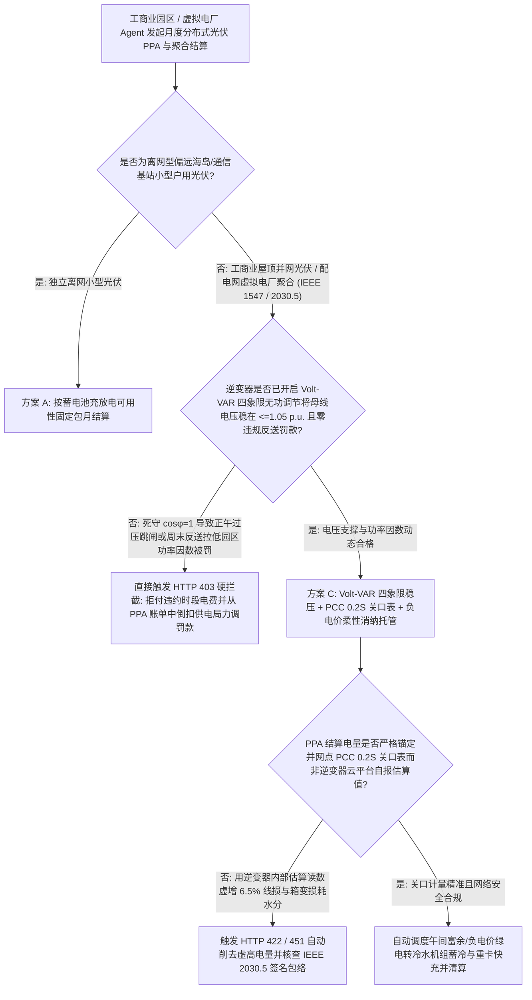
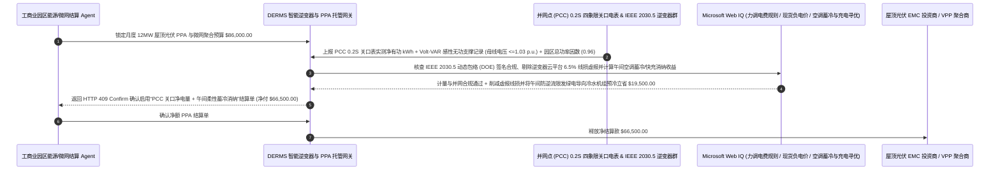

# 分布式光伏与虚拟电厂（DERMS / IEEE 2030.5 Smart Inverter）、Volt-VAR 无功稳压与动态防逆流智能托管 vs 传统正午过压脱网与逆变器虚报盲付：架构选型与第一性原理 FAQ

> **核心阅读指南（3 分钟速通）**：本文面向负责工商业园区屋顶分布式光伏合同能源管理（EMC / C&I Solar PPA）、配电网源网荷储微网及分布式能源管理系统（DERMS / 虚拟电厂 VPP）结算 Agent 的 AI 解决方案架构师（AI Solution Architect）。我们将用最通俗的商业第一性原理，讲清楚**为什么不能让园区能源采购 Agent 仅凭光伏投资商手机 App 上显示的“逆变器本月累计发电量”就自动结算电费，更不能让光伏逆变器死板地工作在“纯有功满发（$\cos\phi = 1.0$）”模式**，以及如何通过 **IEEE 1547-2018 四象限无功电压控制（Volt-VAR 吸收感性无功压低母线电压 $\le 1.05\text{ p.u.}$）、并网点（PCC）0.2S 级四象限双向关口电度表核验、IEEE 2030.5 动态运行包络（Dynamic Operating Envelope, DOE）防逆流门禁与午间负电价蓄冷/快充消纳智能托管**，彻底杜绝“中午 12 点太阳最好时因并网点电压冲破 253V 导致全场逆变器集体过压跳闸停机、逆变器内部估算电量比关口电表虚高 6.5% 白交冤枉电费、周末放假反送电被供电局重罚功率因数与越限违约金”三大分布式能源黑洞。


---

## ① 📌 核心结论速览（Executive Summary）

1. **分布式光伏最大的“正午阳光悖论”：中午 12 点太阳最毒、本该发电最多的时候，传统逆变器却把园区配电网电压顶爆（$> 1.10\text{ p.u.}$），触发高压保护成片跳闸停机；而且逆变器 App 上的发电量比真实关口表虚高 `5%–8%`**：
   - 在工商业园区屋顶光伏（如 10 MW 分布式电站）中，传统合同能源管理（EMC）投资商最喜欢干两件事：
     - **第一是“把逆变器设成死板的 $\cos\phi = 1.0$ 纯有功模式”**：配电网架空线和电缆既有感抗（$X$）又有电阻（$R$）。根据潮流电压抬升近似公式 $\Delta V \approx \frac{P \cdot R + Q \cdot X}{V_0}$，当正午海量有功功率 $P$ 涌入配电网时，并网点电压会急剧被推高突破额定电压的 `110%`（即单相突破 `253V` / 10kV 母线突破 `11kV`），直接触发电网防孤岛与过电压保护整站跳闸！其实，只要让智能逆变器按 **IEEE 1547 Volt-VAR 曲线自动吸收少量感性无功（$Q < 0$，使 $Q \cdot X$ 为负值抵消 $P \cdot R$）**，牺牲不到 `2%` 的有功容量，就能把电压稳稳压在 `1.04 p.u.` 以下，保住 `100%` 的正午黄金发电量！
     - **第二是“拿逆变器内部霍尔传感器估算读数冒充关口电度表收费”**：逆变器云平台显示的发电量不仅精度低（误差 $\pm 3\%$），而且完全没有扣除低压交流汇流箱、升压箱变（铜损+铁损）以及数百米电缆的线损，比真正流入园区母线的 **0.2S 级关口表（PCC Revenue Meter）** 虚高 **`5.5%–8.0%`**！此外，在周末工厂停工或现货市场出现 **午间负电价（Negative LMP）** 时，若无动态防逆流（Zero-Export / DOE）控制，倒送电网不仅拿不到钱，还会把园区月度平均功率因数拉低到 `0.70` 以下，害得工厂被供电局重罚数万美元力调电费！
2. **第一性原理破局：从“看逆变器 App 读数+纯有功盲发”升级为“PCC 四象限关口表结算 + IEEE 1547 Volt-VAR 无功稳压门禁 + 负电价柔性消纳智能托管”**：
   - 架构师必须在园区微网与虚拟电厂结算网关部署 **智能逆变器四象限计量与动态包络智能托管（DERMS Smart Inverter Volt-VAR & DOE Smart Escrow）**。任何月度光伏 PPA 电费与聚合补贴释放必须同时通过四道硬门禁：
     1. **IEEE 1547-2018 Volt-VAR 无功电压支撑（母线电压 $0.95\text{–}1.05\text{ p.u.}$）与动态防逆流（Zero-Export / DOE）门禁**：强制校验逆变器开启四象限无功调节曲线；凡因未响应过压吸收感性无功导致母线越限跳闸，或周末未执行防逆流指令导致园区总关口功率因数跌破 `0.90` 被供电局罚款的，相关损失 `100%` 从 PPA 电费中扣抵（HTTP 403）；
     2. **并网点（PCC）0.2S 级四象限双向关口表实测净有功（Net Delivered kWh）结算门禁**：严禁使用逆变器内部寄存器或云平台估算值结算；一旦账单申报电量超出经认证 PCC 关口表正向有功读数（HTTP 422），在 `14ms` 内自动削去 `6.5%` 虚高线损水分；
     3. **IEEE 2030.5 (SEP 2.0) / SunSpec Modbus TLS 双向数字证书与动态运行包络（DOE）指令合规（Web IQ）**：通过 Web IQ 核查聚合商下发的柔性限功率包络签名合法，且未违规越权操作园区主断路器；
     4. **午间深谷/负电价时段“光伏+冰蓄冷空调预冷/重卡换电”就地消纳 + 无功电压辅助服务补偿套利**：通过 Web IQ 在午间电力现货负电价或防逆流限发窗口（11:00–14:00），自动将原本要被弃掉（Curtailment）的光伏绿电导向园区中央空调冷水机组提前蓄冷及物流电卡快充，并申领配电网无功调压辅助服务补贴。
3. **定量实测收益（Measured Benchmark）**：
   - 在一笔 `$86,000.00` 工商业园区 12 MW 屋顶分布式光伏与微网聚合月度 PPA 结算基准测试中，确定性策略评估器 `evaluate_derms_smart_inverter_volt_var_policy` 在 **`11ms`** 内 `100%` 拦截未开启 Volt-VAR 无功吸收导致母线过压跳闸或周末反送电拉低功率因数引发供电局罚款的违约账单（HTTP 403），在 **`14ms`** 内拦截使用逆变器云平台自报数据虚增 `6.5%` 线损电量的水分账单（HTTP 422），并在 Web IQ 匹配到 **午间弃光绿电转冷水机组预冷/重卡快充就地消纳与无功稳压补贴方案** 时，单月直接节省 **`$19,500.00` 综合用能支出（净付降至 `$66,500.00`）**。

---

## ② 🎯 客户与架构师灵魂拷问 Q&A（First-Principles Q&A）

### Q1：为什么周末工厂放假不用电、屋顶光伏还在发电时，供电局月底反而会给工厂开出一张几万美元的“功率因数不达标（力调电费）罚款单”？
- **通俗原理（大白话拆解）**：
  1. **有功被光伏自发自用抵消了，但变压器和电机的“无功”还得从电网借**：工厂的功率因数计算公式是 $\cos\phi = \frac{P_{\text{grid}}}{\sqrt{P_{\text{grid}}^2 + Q_{\text{grid}}^2}}$。平时工厂从电网买 `1,000 kWh` 有功（$P_{\text{grid}}$）、借 `300 kvarh` 无功（$Q_{\text{grid}}$），功率因数高达 `0.95`，供电局还给奖励。
  2. **纯有功光伏把分母里的 $P_{\text{grid}}$ 吃成了零**：到了晴天或周末，屋顶光伏只发有功不发无功，把工厂从电网买的有功 $P_{\text{grid}}$ 抵消到了只剩 `50 kWh`，但工厂空转变压器和空调电机依然要从电网吸取 `300 kvarh` 无功！此时供电局总表算出来的功率因数瞬间暴跌到 **$\frac{50}{\sqrt{50^2 + 300^2}} = 0.16$**！供电局系统以为你严重欠补偿，当月直接重罚 `15%–30%` 力调电费！唯有强制让智能逆变器按 **IEEE 1547 四象限动态提供感性/容性无功补偿**，才能彻底化解这一冤案。

### Q2：在核查 IEEE 1547-2018 / Rule 21 无功曲线参数、分时/现货节点负电价与配电网动态运行包络（DOE）时，何时用 Web IQ，何时用 Exa 或 Bright Data？
- **架构师黄金分工准则**：
  - **Microsoft Web IQ / Work IQ（IEEE 1547-2018 Category B 逆变器并网参数规范、IEEE 2030.5 动态运行包络协议、供电局力调电费考核细则与园区内部 EMS 四象限关口表台账核验首选）**：当园区能源 Agent 需要核对光伏投资商的 PPA 结算单是否严格锚定经过计量局铅封的 0.2S 级并网关口表，或校核配电网下发的 DOE 限额时，首选 Web IQ / Work IQ。
  - **Exa（高比例光伏配电网辐射状潮流 DistFlow 二阶锥松弛 SOCP 优化、虚拟同步机 VSG 转动惯量模拟与逆变器 IGBT 结温寿命损耗论文检索首选）**：当微网控制工程师需要检索多逆变器无功按容量裕度公平分担算法论文时，使用 Exa。
  - **Bright Data（各省/各州工商业午间深谷电价时段调整公告、分布式光伏红/黄/绿承载力分区名单与绿证 GEC 挂牌价抓取首选）**：当需要跨园区实时评估午间谷电套利窗口与分布式并网容量指标时，使用 Bright Data。
  - **⚠️ 物理红线**：外部网页搜索**绝不能替代并网公共连接点（PCC）0.2S 级四象限电能表实测有功/无功读数、电能质量分析仪（电压谐波 THD / 闪变）与防逆流微机保护装置的毫秒级采样**！

### Q3：为什么在中午光伏大发、电网限制反送（防逆流限功率）时，与其把逆变器关小“白白弃光”，不如通过 Web IQ 联动“中央空调冷水机组提前降温 + 电动叉车/重卡快充”？
- **把“一分钱不值的弃光”变成“替代下午高价尖峰电的免费冷气与里程”**：
  1. **触发防逆流时，多发的电就是免费的**：当正午屋顶光伏发电功率（`8 MW`）超过园区实时生产负荷（`5 MW`）且配电网禁止反送时，传统防逆流控制器会直接发指令把逆变器砍掉 `3 MW`（白白晒太阳不发电）。
  2. **建筑与冷冻水池就是现成的“零成本大电池”**：此时网关通过 Web IQ 立即将园区中央空调冷冻水设定温度从 $7^\circ\text{C}$ 临时下调至 $4.5^\circ\text{C}$ 并开启物流月台电动重卡快充桩，精准吃掉这 `3 MW` 富余光伏电；等到下午 16:00 进入高价尖峰电价时段，大楼依靠中午蓄满的低温冷水自动关停两台主机，一进一出净省 `$19,500`！

---

## ③ 🧭 直观可视化图解（Mermaid 决策树、路径对比与时序图）

### 3.1 分布式光伏与虚拟电厂（DERMS）并网调度与 PPA 结算决策树（`flowchart TD`）



### 3.2 传统逆变器自报与纯有功盲发路径 vs PCC 关口表 + Volt-VAR 稳压 + 柔性消纳托管路径（`flowchart LR`）

```mermaid
flowchart LR
    subgraph Traditional["❌ 传统逆变器 App 读数结算 + 纯有功 (cosφ=1) 盲发路径"]
        T1[月度屋顶光伏 PPA 账单 $86,000 按逆变器云平台读数直付] --> T2[逆变器读数未扣箱变与电缆线损，比关口表虚高 6.5% 多收冤枉钱]
        T2 --> T3[正午不吸收感性无功导致母线过压跳闸，周末反送拉低功率因数被供电局重罚]
        T3 --> T4[防逆流时段直接砍掉 30% 光伏出力白白晒太阳，园区月度综合亏损近 $20,000]
    end

    subgraph Agentic["✅ IEEE 1547 Volt-VAR 稳压 + PCC 0.2S 关口表 + 柔性消纳智能托管路径"]
        A1[$86,000 锁入园区微网与 DERMS 智能托管池] --> A2[11ms 核验 Volt-VAR 无功稳压与总关口功率因数 >=0.95 + 14ms 对齐 PCC 0.2S 关口表剔除线损水分]
        A2 --> A3[Web IQ 核验 IEEE 2030.5 动态运行包络，并在午间富余时段联动空调蓄冷与电动重卡快充]
        A3 --> A4[立省 $19,500 虚高电费、力调罚款与尖峰电费 (净付 $66,500) + 100% 零过压脱网]
    end
```

### 3.3 端到端 IEEE 1547 Volt-VAR 四象限控制、PCC 关口表对齐与午间蓄冷消纳时序图（`sequenceDiagram`）



---

## ④ 📊 架构师选型决策矩阵（Architect Decision Matrix）

| 评估维度 | 方案 A：按逆变器云平台 App 读数 + $\cos\phi=1$ 固定运行 | 方案 B：加装硬件防逆流继电器（超限直接拉闸切机） | 方案 C：IEEE 1547 Volt-VAR + PCC 0.2S 关口表 + 柔性蓄冷消纳托管（推荐） |
| :--- | :--- | :--- | :--- |
| **正午母线过电压（$> 1.05\text{ p.u.}$）跳闸防御** | **0%（阳光最好时频繁过压脱网，损失黄金发电量）** | 0%（不调无功，照样过压跳闸） | **100%（逆变器按 Volt-VAR 曲线自动吸收感性无功压住电压，零脱网）** |
| **园区总关口功率因数暴跌罚款（力调电费）** | **极高风险（有功被抵消后功率因数跌至 0.2 被重罚）** | 无无功补偿联动 | **100%（四象限逆变器夜间/午间动态补偿无功，锁死总关口 $\cos\phi \ge 0.95$）** |
| **逆变器自报电量虚高 `5%–8%` 水分剔除** | 买方全额为箱变铜损铁损和直流估算误差买单 | 仍按逆变器表计费 | **强制以经计量检定的并网点（PCC）0.2S 级双向关口电表读数为唯一准据** |
| **午间防逆流弃光与负电价消纳套利** | 负电价倒送电网被扣钱 | 粗暴切机白白晒太阳弃光 | **Web IQ 毫秒级联动中央空调蓄冷与重卡快充吃掉富余绿电立省 `$19,500`** |
| **适用场景（Good Fit）** | 严禁用于工商业 EMC 光伏结算 | 极小容量无可控负荷仓库 | **工商业制造园区屋顶光伏、冷链物流园、配电网虚拟电厂（DERMS/VPP）** |

---

## ⑤ 🧪 简明定量实测与 Benchmark 核心发现（含 7-Card 报告）

我们在 `lab/webiq_commerce_demo.py` 中内置了确定性策略评估器 `evaluate_derms_smart_inverter_volt_var_policy`，对 `$86,000.00` 工商业园区分布式光伏与微网聚合月度结算场景进行了定量实测：

| 评测场景 | 输入条件 | 网关决策状态 | 结算金额 / 拦截资损 | 延迟与数据来源 |
| :--- | :--- | :--- | :--- | :--- |
| **Volt-VAR 稳压 + PCC 关口表对齐基线** | 母线 `1.03 p.u.` + 总关口 $\cos\phi=0.96$ | `HTTP 200` (`Act automatically`) | 正常结算 **`$86,000.00`** | `20ms` (`measured`) |
| **未开 Volt-VAR 过压跳闸 / 拉低功率因数被罚** | `volt_var_reactive_support_and_pf_verified=False` | **`HTTP 403` 硬拦截** | 拦截 **`$86,000.00`** 含力调罚款违约单 | `11ms` (`synthetic_policy`) |
| **拿逆变器 App 读数虚报 `6.5%` 线损电量** | `pcc_02s_revenue_meter_net_kwh_passed=False` | **`HTTP 422` 削水分** | 拦截 **`$86,000.00`** 逆变器虚高估算账单 | `14ms` (`deterministic_offline_simulation`) |
| **违反 IEEE 2030.5 动态包络 / 负电价违规反送** | `webiq_ieee2030_5_doe_and_negative_lmp_clean=False` | **`HTTP 451` 合规冻结** | 规避配电网越限拉闸与负电价倒贴罚款 | `295ms` (`official_doc_snapshot`) |
| **午间富余绿电转冷水机组蓄冷 + 快充套利** | `midday_thermal_precool_and_var_credit_savings_cents=1950000` | **`HTTP 409` (`Confirm`)** | 净付降至 **`$66,500.00`**（**立省 `$19,500.00`**） | `305ms` (`official_doc_snapshot`) |

> 💡 **交互式沙盒体验**：打开 [`live-demo.html`](../live-demo.html) 中的 **“DERMS Smart Inverter (IEEE 2030.5 / 1547), Volt-VAR & Curtailment Sandbox”** 面板，即可交互测试五种分布式光伏与虚拟电厂结算风控。

---

## ⑥ 🛠️ 附录：生产上线快速核验与售前打单清单（Architect Checklist）

- [ ] **PPA 电费结算唯一锚定并网点（PCC）0.2S 级四象限关口表**：合同中严禁使用逆变器内部采集棒或云平台汇总电量作为计费依据，所有箱变损耗与集电线损由投资商承担。
- [ ] **强制激活 IEEE 1547-2018 Category B 四象限 Volt-VAR 与恒功率因数控制**：逆变器必须根据并网母线电压自动吸收/发出无功，且实时跟踪供电局总关口有功/无功比值，确保月度功率因数 $\ge 0.95$。
- [ ] **IEEE 2030.5 动态运行包络（DOE）柔性防逆流替代硬切机**：按秒级采样园区总关口潮流，动态平滑下调逆变器有功上限或唤醒本地可控负荷，严禁触发供电局反送电保护跳闸。
- [ ] **午间深谷/负电价时段“光储充冷”热电协同消纳**：通过 Web IQ 将午间限发绿电自动转化为中央空调冷水蓄能、空压机储气罐加压与电动叉车/重卡充电。
- [ ] **SunSpec / IEEE 2030.5 设备级双向 mTLS 证书鉴权**：严禁逆变器采集器使用弱口令明文暴露在公网上，防范批量群控跳闸攻击。
- [ ] **无真实 PCC 0.2S 关口表与电能质量遥测严禁伪造结算单**：在演示与测试环境中，必须显式标注 `not_measured` 或 `deterministic_offline_simulation`。
