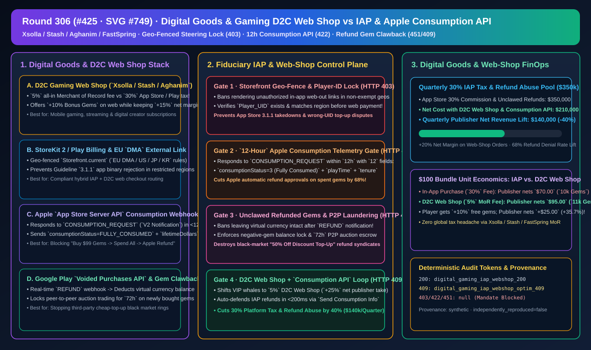
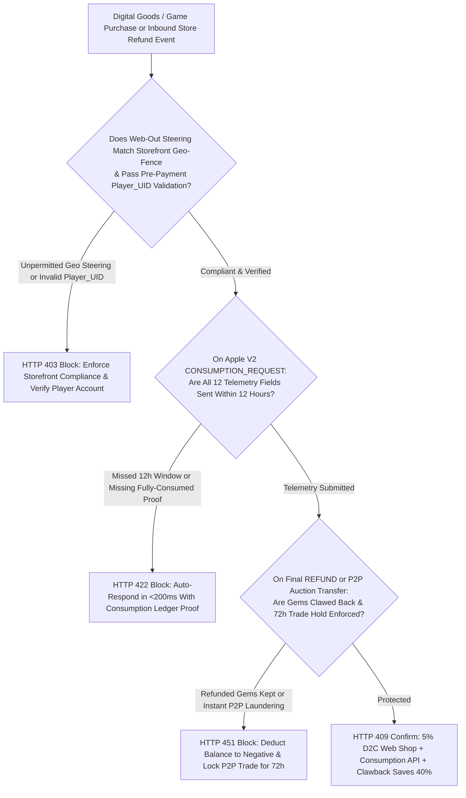

# Digital Goods, Mobile Apps & Gaming `D2C Web Shop vs. App Store / Google Play IAP` (`Xsolla / Stash / Aghanim / FastSpring`), Apple `12-Hour Consumption API` Refund Defense & Negative-Balance Gem Clawback FAQ

> **Executive Summary**: Mobile game publishers, AI consumer apps, and streaming platforms lose up to `35%` of gross revenue to two compounding drains: (1) **The `30%` App Store / Google Play `IAP` Commission** and (2) **"Buy-Spend-Refund" Friendly Fraud & Black-Market Discount Top-Up Rings** (where players buy `$99.99` of virtual gems, spend them immediately on gacha pulls or launder them through an in-game auction house, and request an Apple refund claiming an accidental purchase). Launching a **Direct-to-Consumer (`D2C`) Web Shop (`Xsolla / Stash / Aghanim / FastSpring` at a `~5%` MoR fee)** lifts publisher net proceeds from `$70` to `$95` per `$100` bundle even while gifting players `+10%` bonus gems. Yet production architectures must enforce three critical guardrails: (1) **`StoreKit 2 Storefront` Geo-Fenced Anti-Steering Compliance & Pre-Auth `Player UID` Verification**; (2) **`<12-Hour` Automated `App Store Server API Send Consumption Information` Telemetry Responses**; and (3) **Instant `REFUND` Negative-Balance Gem Clawbacks & `72-Hour` P2P Auction Escrow**.  
> Enforcing this control plane cuts platform commission leakage and refund abuse by **40%** (reducing a `$350,000` quarterly loss pool to `$210,000`, saving **`$140,000/quarter`**).

---

## 1. Solution Architect Deep-Dive Q&A

### Q1: How do we prevent App Store `Guideline 3.1.1` rejections on D2C Web Shops and stop Apple from auto-approving refunds after a player has already spent their virtual gems?
- **Architectural Solution (Geo-Fenced Steering + `Player UID` Gate `HTTP 403` + `12-Hour` Apple `Consumption API` Gate `HTTP 422`)**:
  - Gate in-app external web-shop links strictly on `Storefront.current` regulatory jurisdiction (`EU DMA`, US court mandate, JP/KR) and verify that the target `Player_UID` exists, is unbanned, and has remaining bundle quota before authorizing web checkout (`HTTP 403 UNAUTHORIZED_GEO_STEERING_OR_UNVERIFIED_PLAYER_UID_TOPUP`);
  - Subscribe to `App Store Server Notifications V2` (`CONSUMPTION_REQUEST`) and automatically respond within `<200ms` (well inside Apple's strict **`12-hour` window**) via `PUT /inApps/v1/transactions/consumption/{transactionId}` with all 12 telemetry fields—specifically `consumptionStatus = 3 (FULLY_CONSUMED)`, `deliveryStatus = 0`, `playTime`, and `lifetimeDollarsPurchased` (`HTTP 422 MISSED_12H_APPLE_CONSUMPTION_API_TELEMETRY_RESPONSE_WINDOW`).

### Q2: How do we destroy black-market "50% Off Discount Top-Up" syndicates when a refund or chargeback still occurs?
- **Architectural Solution (`72h` P2P Auction Lock & Negative-Balance Gem Clawback `HTTP 451 / 409`)**:
  - Never leave virtual currency intact after an Apple `REFUND`, Google `Voided Purchase`, or Web-Shop `Chargeback` webhook, and never allow newly purchased gems to enter peer-to-peer (`P2P`) trading or auction houses within the first `72 hours` (`HTTP 451 UNCLAWED_REFUNDED_GEMS_OR_INSTANT_P2P_AUCTION_LAUNDERING`);
  - Immediately deduct refunded gems (driving the account balance negative, e.g., `-10,000 Gems`, and locking ranked play until repaid) while routing loyal VIPs to the `5%`-fee D2C Web Shop (`HTTP 409 D2C_WEBSHOP_STEERING_CONSUMPTION_API_AND_GEM_CLAWBACK_CONFIRM`).

---

## 2. Visual Architecture Diagrams (Mermaid)

### 1. Digital Goods `D2C Web Shop`, Apple `Consumption API` & Gem Clawback Decision Tree

---

## 3. Platform Selection Matrix (`Xsolla vs. Stash / Aghanim vs. FastSpring / Paddle vs. DIY Stripe`)

| Dimension | Xsolla | Stash / Aghanim | FastSpring / Paddle | DIY Stripe + Tax |
| :--- | :--- | :--- | :--- | :--- |
| **Primary Focus** | **Global gaming MoR** (`700+` local payment methods across LATAM/APAC/MENA) | **Native mobile-game D2C Web Shop** with LiveOps, loyalty progressions & deep-links | **Digital SaaS, AI apps & desktop software MoR** | Lowest raw card fee (`~2.9%`), but publisher bears global VAT liability |
| **Take Rate (`MoR`)** | **`~5%` + payment method fee** (vs `30%` IAP) | **`4%–6%`** (includes storefront + MoR) | **`5% + $0.50`** all-inclusive MoR | `2.9% + $0.30` + multi-country tax filing cost |
| **Player UID & LiveOps Sync** | Webhook validation + server-side item grant | **Deep game-state sync** (VIP tiers, inventory caps, daily web rewards) | Subscription & license-key entitlement webhooks | Custom engineering required |

---

## 4. Production Deployment & Risk Checklist

- [ ] **Automate `<200ms` Responses to Apple `V2 CONSUMPTION_REQUEST` Webhooks**: Populate `consumptionStatus`, `playTime`, and `lifetimeDollarsPurchased` from the live game ledger inside the `12-hour` window.
- [ ] **Enforce Instant Negative-Balance Clawbacks on All `REFUND` / `Voided Purchase` Events**: Deduct spent virtual currency into negative balances and restrict progression until repaid.
- [ ] **Place a `72-Hour` P2P Trading & Auction Escrow on Newly Purchased Currency**: Prevent stolen-card and refund rings from laundering gems to mule accounts.
- [ ] **Validate `Player_UID` Pre-Auth & Enforce `Storefront` Geo-Fences on D2C Web Shops**: Eliminate wrong-account top-ups and protect app store binaries from `3.1.1` review rejections.
