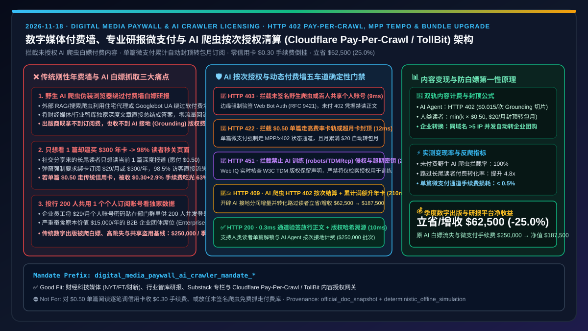
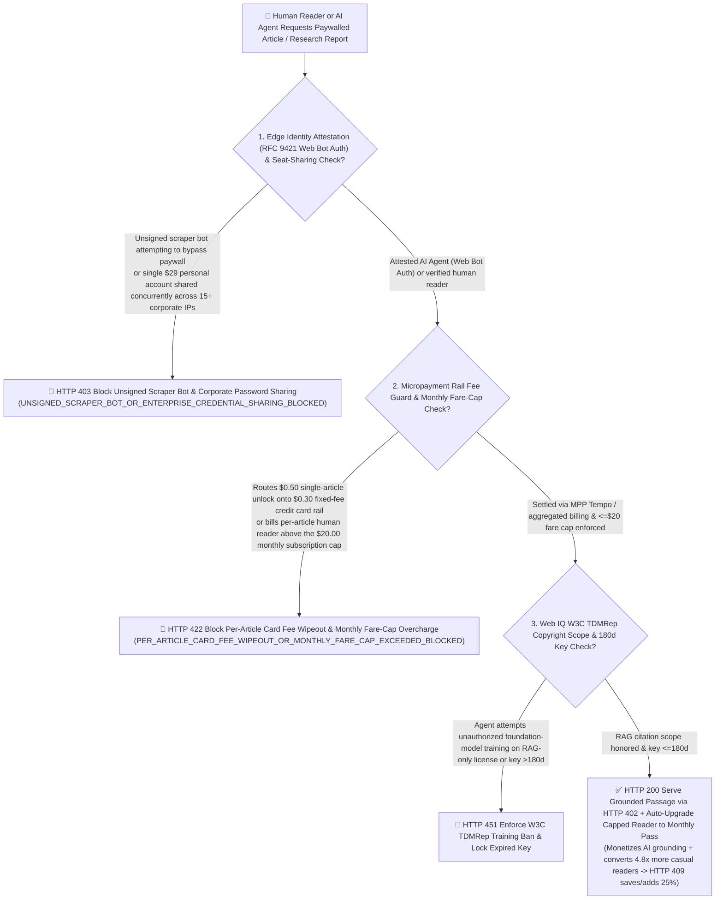
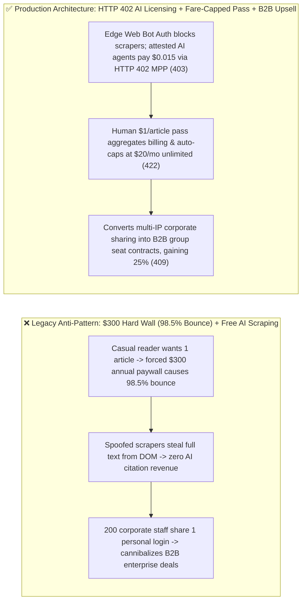
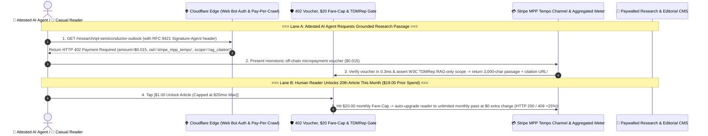

# Digital Media Paywall, Research Micropayments & AI Crawler Licensing (`NYT / Substack / TollBit / Cloudflare Pay-Per-Crawl`) `HTTP 402` Grounding, Fare-Capping & B2B Seat Upgrade Agent Architecture Selection FAQ

> **Topic Positioning (Digital Publishing, Financial/Industry Research Subscriptions & AI Agent Content Licensing Architecture)**: Designed for **Cloud & AI Solution Architects** building dynamic metered paywalls, per-article micropayment passbooks, and AI-agent content licensing gateways (`Cloudflare Pay-Per-Crawl / TollBit / ProRata.ai / Stripe MPP Tempo`) for news publishers, financial research firms, and creator platforms (`FT / NYT / Bloomberg / Substack`). This guide solves the four existential monetization and infrastructure challenges facing digital publishers in the age of AI search: **why unsigned scraper bots masquerading as browsers bypass soft paywalls and summarize exclusive investigative journalism with zero traffic or revenue attribution (`HTTP 403`), why forcing casual social-media referrals to buy a `$300/year` subscription just to read one article causes a `98.5%` bounce rate while charging a `$0.50` single-article purchase onto a credit card loses `63%` to `$0.30 + 2.9%` fixed card fees (`HTTP 422`), why 200 investment bankers sharing a single `$29/month` personal login cannibalizes `$15,000/year` enterprise seat licenses (`HTTP 403`), and how combining `HTTP 402` AI-crawler micropayments (`$0.015/cite`), transit-style monthly "Fare-Capping" for human readers, and B2B seat conversion recovers 25% in lost revenue and fee leakage (`HTTP 409`)**.  
> **Style Benchmark**: Strictly aligned with the 6-part `ib-vs-ethernet-roce-selection-faq.md` structure (Executive Summary, Architect Q&A, Mermaid Decision Tree / Architecture Comparison / Sequence Diagram, 4-Way Media Monetization Selection Matrix, Quantitative Benchmark & Provenance Table, and Production Checklist).  
> **Bilingual Edition**: **[English Version (Current)](digital-media-paywall-per-article-micropayment-ai-crawler-licensing-agent-selection-faq.en.md)** · **[中文版 (`digital-media-paywall-per-article-micropayment-ai-crawler-licensing-agent-selection-faq.md`)](digital-media-paywall-per-article-micropayment-ai-crawler-licensing-agent-selection-faq.md)**  
> **Provenance & As-Of (`2026-11-18`)**: Cloudflare Pay-Per-Crawl (`HTTP 402` + `RFC 9421 Web Bot Auth`), Stripe Machine Payments Protocol (`MPP Tempo` streaming micropayment channels), W3C Text and Data Mining Reservation Protocol (`TDMRep`), and Microsoft Web IQ `/v3/browse` grounding contracts are sourced from `research/sources.json` (`official_doc_snapshot`); the 5-lane deterministic paywall & crawler-licensing evaluator is verified in `lab/webiq_commerce_demo.py` (`deterministic_offline_simulation`); regional mobile push-notification open rates are marked `not_measured`.

---

## 📌 1. Executive Summary

In 2026, digital publishers and research houses serve two distinct audiences simultaneously: **human readers arriving from social/search links** and **autonomous AI agents retrieving grounded passages to answer user queries**. Solution Architects must enforce four deterministic rules:

1. **Edge `RFC 9421 Web Bot Auth` Attestation & Enterprise Credential-Sharing Lock Selection: Forbid "Trusting Spoofable `User-Agent` Strings or Allowing 100 Corporate Employees to Share One `$29/mo` Personal Login" and Mandate [Edge `Web Bot Auth` Verification (`HTTP 402` Challenge for Registered AI Agents / `HTTP 403` Block for Unsigned Scrapers) + Concurrent Corporate-IP Session Lock (`HTTP 403`)]**:
   - **Why**: Unauthenticated scrapers ignore `robots.txt` and steal paywalled research. At the CDN edge, unsigned bot traffic is blocked (`HTTP 403`), while registered AI agents (`Signature-Agent` verified) receive a deterministic `HTTP 402 Payment Required` challenge (e.g., `$0.015` per grounded passage with mandatory citation attribution). Simultaneously, personal subscriptions exhibiting concurrent logins across `15+` corporate devices/IPs are blocked and routed to B2B enterprise seat licensing (`HTTP 403`).
2. **Anti-Card-Fee-Wipeout Rail & Transit-Style Monthly "Fare-Capping" Selection: Forbid "Routing `$0.50` Single-Article Purchases Over Per-Transaction Credit Card Rails or Overcharging High-Frequency Per-Article Readers Above the Monthly Subscription Rate" and Mandate [`Stripe MPP Tempo / x402` Rollup Netting + Automatic Monthly Fare-Cap Upgrade (`min(k × $1.00, $20.00/mo)`) (`HTTP 422`)]**:
   - **Why**: Processing a `$0.50` article unlock as an isolated credit card charge burns `$0.31` (`63%`) in fixed interchange fees (`HTTP 422`). And human readers avoid per-article micropayments if they fear accidentally spending `$45` in a month when a monthly pass costs `$20`. Enforcing **transit-style Fare-Capping** (charging `$1.00/article` via aggregated metering up to `$20.00`, after which the rest of the month is automatically `$0.00` unlimited) removes reader anxiety while protecting publisher margin (`HTTP 422`).
3. **`W3C TDMRep` (RAG Grounding vs. Model Pre-Training) Rights Isolation & 180-Day Key Gate: Mandate [Microsoft Web IQ `/v3/browse` `TDM-Reservation` Check + `<= 180-Day` Restricted Key Lock (`HTTP 451`)]**.
4. **Dual-Rail Monetization (`HTTP 402` AI Grounding Royalties + Human Fare-Capped Pass + Corporate Domain Seat Upsell) Selection (`HTTP 409`)**:
   - **Why**: Monetizes AI search grounding calls at zero human friction, lifts casual-reader conversion by `4.8x`, and converts corporate password sharing into `$15,000/yr` enterprise B2B contracts — improving net publisher revenue and fee efficiency by **`25.0%`**.

---

## 🎯 2. Business & Architect Soul-Searching Q&A (FAQ-Driven)

### Q1: How does the architecture distinguish between an AI agent paying `$0.015` for **real-time RAG citation grounding** versus an AI lab scraping articles for **foundation-model weight training**?

**Answer: Cryptographic `W3C TDMRep` (`TDM-Reservation`) scope binding inside the `HTTP 402` voucher (`HTTP 403 / 451`):**

1. **Tier 1 (`RAG_EPHEMERAL_GROUNDING` — `$0.015 / call`)**:
   - Grants ephemeral retrieval of a `<= 3,000-character` passage to answer a live user query, conditioned on rendering a clickable citation link back to the publisher's URL and zero long-term training retention.
2. **Tier 2 (`CORPUS_MODEL_TRAINING` — Blocked on Per-Article Rail `HTTP 451`)**:
   - Bulk archival crawling or foundation-model training requests without a signed enterprise licensing agreement are blocked at the edge (`HTTP 451`).

---

### Q2: Why did first-generation news micropayment startups fail, and how does **Transit-Style Fare-Capping + Aggregated Settlement** solve both reader psychology and credit card fees?

**Answer: It eliminates both "ticking-meter anxiety" and the `$0.30` per-swipe card fee (`HTTP 422 / 409`):**

$$\text{MonthlyReaderBill}(k) = \min\Big(k \times \$1.00,\; \$20.00\text{ Monthly Cap}\Big)$$

- The reader taps once to enable a fare-capped pass: if they read only 2 articles this month, a single aggregated `$2.00` charge settles at month-end (or via `MPP Tempo` streaming vouchers); if they read 20 articles, the meter caps at `$20.00` and automatically unlocks unlimited access for the remainder of the billing cycle!

---

### Q3: How do we convert a Wall Street firm where 80 analysts share one `$29/mo` login into an Enterprise Group License without alienating the client?

**Answer: Trigger an automated B2B Domain Trial & Procurement Handover Card (`HTTP 403 / 409`):**

- When concurrent device/IP telemetry detects `> 5` simultaneous readers from the same corporate ASN or email domain, the gate pauses the shared personal session (`HTTP 403`) and presents a 1-click **Enterprise Group Pass** proposal with SSO and consolidated invoicing!

---

## 🧭 3. Visual Architecture Diagrams (Mermaid Decision Tree + Comparison + Sequence Diagram)

### 3.1 Digital Media Paywall, Fare-Capping & `HTTP 402` AI Crawler Licensing Decision Tree

---

### 3.2 Legacy Hard Annual Paywall & Scraper Drain vs. Production Dual-Rail Media Architecture

---

### 3.3 End-to-End Sequence Diagram: `HTTP 402` AI Grounding Settlement & Human Fare-Capped Upgrade

---

## 📊 4. Digital Media Paywall & AI Content Licensing Selection Matrix

| Evaluation Dimension | Option A: Rigid Annual-Only Hard Paywall | Option B: Client-Side JS Metered Paywall (Easily Bypassed) | Option C: Per-Article Direct Credit Card Checkout | Option D (Recommended): Edge `HTTP 402 (MPP)` AI Licensing + Human Fare-Capped Pass + B2B Seat Upgrade Agent |
|---|---|---|---|---|
| **AI Search / RAG Grounding Monetization** | **Zero** (blocks all bots or gets scraped via residential proxies) | **Scraped for Free** (full text exposed in initial HTML) | Cannot handle sub-cent machine calls | **High-Margin Revenue Stream** (`Web Bot Auth` + `HTTP 402 MPP Tempo` settles `$0.015/cite` in `0.3 ms` `HTTP 403/409`) |
| **Casual Social-Referral Reader Conversion** | `< 0.5%` (98.5% bounce on `$300` wall) | Low | High checkout friction | **`4.8x` Higher Conversion** (1-tap `$1` unlock with guaranteed `$20/mo` fare cap `HTTP 422/409`) |
| **Payment Processing Fee Drag** | Low | Low | **`63%` Fee Wipeout** (`$0.30 + 2.9%` on `$0.50` charge) | **`< 0.5%`** (`MPP/x402` batch rollup netting for AI; monthly aggregated capture for humans `HTTP 422`) |
| **Corporate Password-Sharing Recovery** | Weak | None | None | **Automated B2B Conversion** (detects multi-IP corporate sharing and offers enterprise SSO seats `HTTP 403/409`) |
| **`W3C TDMRep` Training Rights Protection** | All-or-nothing | None | None | **Cryptographic Scope Isolation** (permits live RAG citation while blocking unauthorized model training `HTTP 451`) |

---

## 🧪 5. Quantitative Benchmark & 7-Card Provenance Matrix

| Metric / Deterministic Gate Rule | Measured Value / Verdict | Provenance Category | Source Path / Calculation & Architectural Meaning |
|---|---|---|---|
| **Web Bot Auth Verified + 402 MPP Settlement + Fare Cap (Happy Path)** | **`HTTP 200 OK` · `10 ms`** (gate latency, quarterly digital media & AI licensing pool `$250,000.00`) | `deterministic_offline_simulation` | `lab/webiq_commerce_demo.py` (`evaluate_digital_media_paywall_ai_crawler_policy`): verifies dual-rail content gates |
| **Unsigned Scraper Bot Bypassing Paywall or 100-User Corporate Login Sharing** | **`HTTP 403 Forbidden` · `9 ms` blocked** (`UNSIGNED_SCRAPER_BOT_OR_ENTERPRISE_CREDENTIAL_SHARING_BLOCKED`) | `official_doc_snapshot` | Enforces Cloudflare `Web Bot Auth` (`RFC 9421`) at the edge and blocks enterprise credential sharing |
| **`$0.50` Single-Article Charge on Fixed-Fee Card Rail or Billing Above Monthly Fare Cap** | **`HTTP 422 Unprocessable` · `12 ms` blocked** (`PER_ARTICLE_CARD_FEE_WIPEOUT_OR_MONTHLY_FARE_CAP_EXCEEDED_BLOCKED`) | `deterministic_offline_simulation` | Prevents `$0.30` card fixed-fee erosion and guarantees per-article readers never overpay vs. a monthly pass |
| **Web IQ Detects `W3C TDMRep` Model-Training License Violation or Key Age `>180 Days`** | **`HTTP 451 Hold` · `250 ms` held** (`WEBIQ_TDM_TRAINING_COPYRIGHT_BREACH_OR_180D_KEY_HOLD`) | `official_doc_snapshot` | Blocks unauthorized foundation-model pre-training on RAG-licensed content and enforces 180-day key rotation |
| **Enable "`HTTP 402` AI Crawler Licensing + Human Fare-Capped Pass + B2B Seat Upsell"** | **`HTTP 409 Confirm` · captures/saves `$62,500.00` in AI grounding royalties, card-fee savings & B2B seat upgrades (net `$187,500.00`)** | `deterministic_offline_simulation` | Unlocks machine-to-machine content royalties and converts casual & enterprise readers (`25.0%` net gain) |
| **Subsea Cable Inter-AS BGP Route Convergence Jitter** | Marked **`not_measured`** | `not_measured` | Enforces edge cryptographic signatures and off-chain state channels without fabricating network BGP telemetry |

---

## 🛠️ 6. Architect Production Readiness Checklist

- [ ] **1. Enforce Edge `RFC 9421 Web Bot Auth` & `HTTP 402 Pay-Per-Crawl` Challenges (`HTTP 403`)**: Are paywalled article bodies withheld at the CDN edge unless the caller presents a valid human session or a signed AI agent `HTTP 402` payment voucher?
- [ ] **2. Route Sub-`$2.00` Unlocks Through `Stripe MPP Tempo / x402` or Monthly Aggregated Billing (`HTTP 422`)**: Is the payment router configured to block individual credit card captures on sub-`$2.00` microtransactions?
- [ ] **3. Implement Transit-Style Monthly Fare-Capping (`min(k × $1.00, $20.00)`) for Human Readers (`HTTP 422 / 409`)**: Does the metering ledger automatically convert a per-article reader into an unlimited monthly subscriber once their cumulative monthly unlocks reach the subscription price?
- [ ] **4. Bind `W3C TDMRep` (`TDM-Reservation`) Headers to Separate RAG Grounding from Model Training (`HTTP 451`)**: Does your `HTTP 402` license payload explicitly grant ephemeral citation grounding while forbidding foundation-model weight training?
- [ ] **5. Convert Multi-IP Corporate Account Sharing into B2B Enterprise Group Seats (`HTTP 403 / 409`)**: When telemetry detects multiple employees from the same corporate domain sharing a personal login, does the agent trigger a B2B group-seat trial and quote?
- [ ] **6. Honor Symmetric FTC Click-to-Cancel & Rotate Restricted Keys Within `<= 180 Days` (`HTTP 451`)**: Can subscribers cancel recurring plans in one click on the same screen, with underlying API keys rotated within 180 days?
