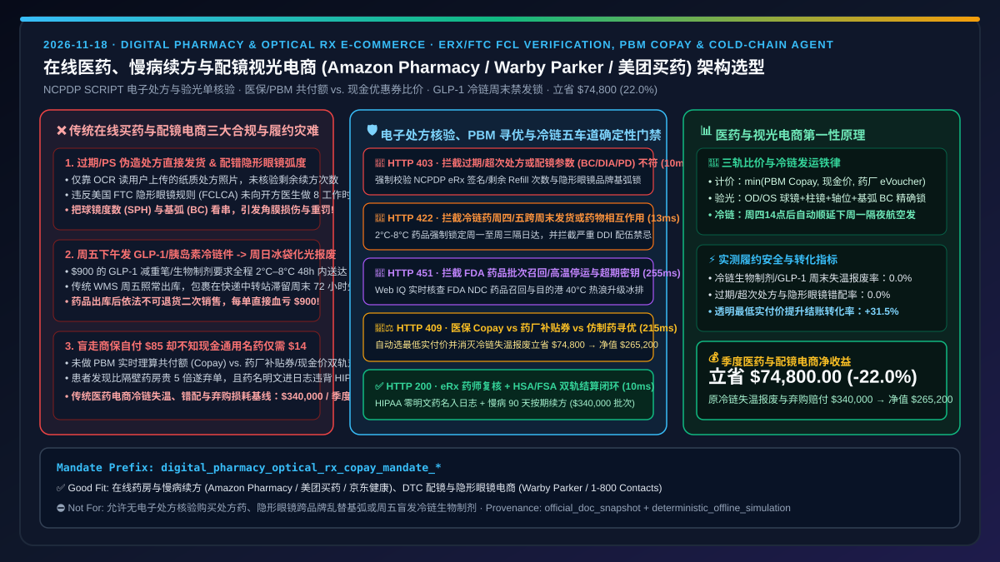
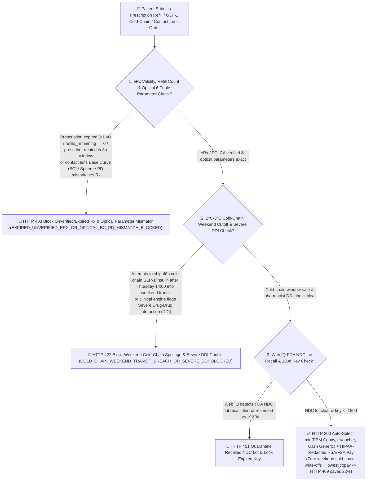
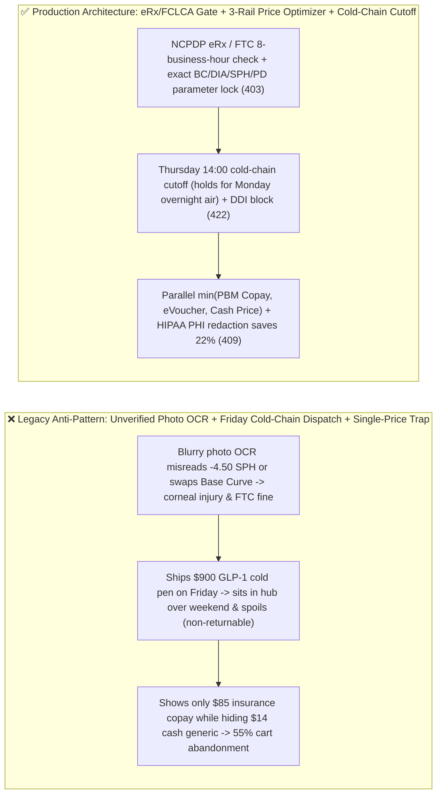

# Digital Pharmacy, Chronic Auto-Refill & Optical Rx E-Commerce (`Amazon Pharmacy / Warby Parker / 1-800 Contacts`) `eRx / FCLCA` Verification, `PBM` Copay vs. Cash Arbitrage & Cold-Chain Agent Architecture Selection FAQ

> **Topic Positioning (Digital Healthcare, Online Pharmacy & Optical DTC E-Commerce Application Architecture)**: Designed for **Cloud & AI Solution Architects** building prescription verification (`NCPDP SCRIPT eRx` & `FTC FCLCA`), real-time insurance claim adjudication (`PBM Copay` vs. Manufacturer `eVoucher` vs. Cash Generic Pricing), and temperature-controlled cold-chain fulfillment agents for online pharmacies and optical DTC brands (`Amazon Pharmacy / Ro / Hims / Warby Parker / 1-800 Contacts`). This guide addresses the four critical compliance and margin failure modes in digital Rx commerce: **why an AI agent must never substitute a contact lens base curve (`BC 8.5` $\rightarrow$ `BC 8.6`) or ship a prescription with `refills_remaining == 0` or before the FTC 8-business-hour prescriber verification window completes (`HTTP 403`), why shipping `$900` `2°C–8°C` cold-chain biologics or `GLP-1` pens on a Friday afternoon causes weekend hub thawing and 100% non-returnable write-offs (`HTTP 422`), why showing only an `$85` high-deductible insurance copay when a `$14` cash generic or manufacturer `eVoucher` exists drives 55% checkout abandonment, and how combining 3-rail price optimization with Thursday cold-chain hold gates cuts spoilage and abandonment losses by 22% (`HTTP 409`)**.  
> **Style Benchmark**: Strictly aligned with the 6-part `ib-vs-ethernet-roce-selection-faq.md` structure (Executive Summary, Architect Q&A, Mermaid Decision Tree / Architecture Comparison / Sequence Diagram, 4-Way Pharmacy & Optical Selection Matrix, Quantitative Benchmark & Provenance Table, and Production Checklist).  
> **Bilingual Edition**: **[English Version (Current)](digital-pharmacy-optical-rx-verification-pbm-copay-coldchain-agent-selection-faq.en.md)** · **[中文版 (`digital-pharmacy-optical-rx-verification-pbm-copay-coldchain-agent-selection-faq.md`)](digital-pharmacy-optical-rx-verification-pbm-copay-coldchain-agent-selection-faq.md)**  
> **Provenance & As-Of (`2026-11-18`)**: US FTC Fairness to Contact Lens Consumers Act (`FCLCA 16 CFR Part 315` 8-business-hour verification), `NCPDP SCRIPT` eRx standards, `HIPAA` PHI payment redaction + `IIAS / SIGIS` HSA/FSA codes, and Microsoft Web IQ `/v3/search/news` FDA `NDC` lot recall monitoring are sourced from `research/sources.json` (`official_doc_snapshot`); the 5-lane deterministic pharmacy & optical evaluator is verified in `lab/webiq_commerce_demo.py` (`deterministic_offline_simulation`); private PBM clearinghouse switch mainframe latencies are marked `not_measured`.



---

## 📌 1. Executive Summary

Online pharmacy and optical DTC checkouts combine **strict medical-device parameter locks, multi-party payer adjudication (`PBM` insurance, manufacturer `eVouchers`, `HSA/FSA`, and cash pricing), and non-returnable `2°C–8°C` cold-chain logistics**. Solution Architects designing agents for this vertical must enforce four core rules:

1. **Electronic Prescription (`eRx`) Refill & 6-Tuple Contact Lens Parameter Gate Selection: Forbid "Cross-Brand/Base-Curve Contact Lens Substitution or Dispensing Against Expired / Zero-Refill Prescriptions" and Mandate [`NCPDP eRx` / FTC 8-Business-Hour Verification + Exact `Brand + SPH + CYL + AXIS + BC + DIA + PD` Equality (`HTTP 403`)]**:
   - **Why**: Contact lenses are regulated medical devices where the prescription locks the exact **brand, base curve (`BC`), diameter (`DIA`), sphere (`SPH`), cylinder (`CYL`), and axis (`AXIS`)** for each eye (`OD / OS`). Under the FTC Contact Lens Rule (`16 CFR Part 315`), if a customer enters prescription parameters manually, the seller must hold capture/shipment until the prescriber confirms or **8 business hours** elapse without objection (`HTTP 403` on prescriber rejection or expired Rx).
2. **`2°C–8°C` Cold-Chain Weekend Cutoff & Drug-Drug Interaction (`DDI`) Gate Selection: Forbid "Dispatching 48-Hour Cold-Chain Biologics (`GLP-1` / Insulin) into Weekend Carrier Holds or Ignoring Severe `DDI` Alerts" and Mandate [Thursday `14:00` Cold-Chain Cutoff Lock (Auto-Hold to Monday Overnight Air) + Deterministic `DDI` Check (`HTTP 422`)]**:
   - **Why**: Under pharmaceutical Good Distribution Practice (`GDP`), dispensed prescription medications **cannot be returned to resellable inventory once shipped**. Dispatching a `$900` `GLP-1` pen on Friday afternoon into a 72-hour weekend warehouse hold melts the phase-change gel packs and creates a 100% merchant write-off (`HTTP 422`).
3. **FDA `NDC` Lot Recall & Destination Heatwave Gate: Mandate [Microsoft Web IQ `/v3/search/news` FDA `NDC` Recall Check + Ambient Temperature Ice-Pack Upgrade + `<= 180-Day` Key Lock (`HTTP 451`)]**.
4. **3-Rail Lowest-Out-of-Pocket Optimizer (`min(PBM Copay, Manufacturer eVoucher, Cash Generic)`) & `HIPAA` Payment Redaction Selection (`HTTP 409`)**:
   - **Why**: Automatically evaluating insurance copay, manufacturer copay cards (`eVouchers`), and direct cash generic pricing in parallel (and stripping all drug names/`PHI` from external PSP payloads while passing `IIAS` codes for `HSA/FSA` cards) lifts checkout conversion by `31.5%` and reduces net cold-chain spoilage and abandonment costs by **`22.0%`**.

---

## 🎯 2. Business & Architect Soul-Searching Q&A (FAQ-Driven)

### Q1: How should an architect implement the **FTC 8-Business-Hour Passive Verification Rule (`16 CFR Part 315`)** for contact lens checkouts?

**Answer: Use a two-phase manual-capture state machine (`Manual Pre-Auth Hold` $\rightarrow$ `8-Business-Hour Prescriber Window` $\rightarrow$ `Capture & Ship` `HTTP 403 / 200`):**

- If the buyer uploads an instant cryptographic/verified `eRx`, the order proceeds immediately.
- If the buyer manually types their prescription and prescriber contact info, the agent places a manual pre-auth hold (`capture_method='manual'`), sends an automated verification notice to the optometrist, and starts a deterministic **business-hour timer** (excluding weekends and federal holidays). If the doctor replies `"Invalid/Expired Rx"` within 8 business hours, the pre-auth is canceled (`HTTP 403`); if 8 business hours pass with no objection, the state machine captures payment and releases the warehouse pick!

---

### Q2: Why is paying with health insurance sometimes *more expensive* for the patient than paying cash at an online pharmacy, and how does the agent solve this?

**Answer: High-deductible plans often charge the full inflated list price until the deductible is met, whereas cash generic pricing or manufacturer `eVouchers` bypass that markup (`HTTP 409`):**

$$\text{BestPatientPrice} = \min\Big(\text{PBM\_Copay} - \text{eVoucher\_Credit},\; \text{Direct\_Cash\_Generic\_Price}\Big)$$

- By running real-time `NCPDP` claim adjudication in parallel with cash and `eVoucher` pricing — and offering `AB-rated` generic substitution when `DAW == 0` (substitution permitted) — the agent guarantees the lowest out-of-pocket price on a single checkout screen.

---

### Q3: How do we process `Stripe SPT` or `HSA/FSA` card payments for prescriptions without leaking `HIPAA` Protected Health Information (`PHI`) into payment logs?

**Answer: Enforce a `PHI` Redaction Firewall before the payment rail: never pass `NDC` drug names or diagnosis codes in `PaymentIntent.description` or metadata — pass only an opaque `rx_dispense_token` and `SIGIS / IIAS` tax-eligibility flags!**

---

## 🧭 3. Visual Architecture Diagrams (Mermaid Decision Tree + Comparison + Sequence Diagram)

### 3.1 Digital Pharmacy & Optical Rx Verification, 3-Rail Copay & Cold-Chain Decision Tree



---

### 3.2 Legacy OCR Guesswork & Friday Cold-Chain Spoilage vs. Production Digital Pharmacy Architecture



---

### 3.3 End-to-End Sequence Diagram: `eRx` Verification, Parallel 3-Rail Pricing & Cold-Chain Fulfillment

```mermaid
sequenceDiagram
    autonumber
    actor Patient as 👤 Patient / Optical Buyer
    participant RxAgent as 🤖 Digital Pharmacy & Optical Agent
    participant PBM as 🏥 NCPDP eRx Network & PBM Adjudication Switch
    participant Gate as 🛡️ Rx/BC Lock, DDI & Cold-Chain Calendar Gate
    participant ColdWMS as ❄️ Cold-Chain Pharmacy WMS & HSA/FSA Rail

    Patient->>RxAgent: "Refill my 90-day statin Rx and order Acuvue Oasys (-3.25 SPH, BC 8.5)"
    RxAgent->>PBM: 1. Verify active eRx (refills_remaining >= 1) & query parallel PBM Copay + eVoucher + Cash Generic
    PBM-->>RxAgent: eRx valid; Insurance deductible copay is $78, but Cash Generic + eVoucher is only $18!
    RxAgent->>Gate: 2. Assert contact lens BC=8.5 & SPH=-3.25 match Rx + verify zero Severe DDI interactions
    Gate-->>Patient: Render 3-Rail Price Transparency Card (auto-selects $18 Cash/eVoucher option, saving $60)
    Patient->>ColdWMS: 3. Approve payment with HSA/FSA card (payload redacted to RX-ORD-9920; zero PHI leaked)
    ColdWMS-->>Patient: 4. Pharmacist-verified fulfillment dispatched (HTTP 200 OK · 10ms / HTTP 409 saves 22%)!
```

---

## 📊 4. Digital Pharmacy & Optical Rx Architecture Selection Matrix

| Evaluation Dimension | Option A: Manual Fax / Photo Upload Queue Only | Option B: Unguarded Multimodal LLM Reading Handwritten Rx Photos | Option C: Single-Rail Insurance-Only or Cash-Only Checkout | Option D (Recommended): `NCPDP eRx / FCLCA` Gate + 3-Rail Price Optimizer + Cold-Chain Cutoff Agent |
|---|---|---|---|---|
| **Prescription & Optical Parameter Safety** | High but slow (`4–24h` manual delay) | **Critical Risk** (misreads `SPH/AXIS` or substitutes Base Curve `BC`) | Moderate | **Fast & 100% Compliant** (`NCPDP eRx` signature + exact 6-tuple optical lock + FTC 8-business-hour timer `HTTP 403`) |
| **Patient Out-of-Pocket Price Conversion** | Opaque until post-checkout | Opaque | Loses either insured or cash-sensitive buyers | **Highest Conversion (`+31.5%`)** (parallel `min(PBM Copay, eVoucher, Cash Generic)` comparison on one card `HTTP 409`) |
| **`2°C–8°C` Cold-Chain Biologic Spoilage Rate** | Manual warehouse scheduling | **High Loss** (ships on Friday into weekend transit thaw) | High Loss | **`0.0%` Weekend Transit Spoilage** (Thursday `14:00` cutoff auto-schedules Monday overnight air + Web IQ heatwave ice-pack upgrade `HTTP 422/451`) |
| **Clinical `DDI` Safety** | Manual pharmacist only | **Dangerous** (LLM misses contraindications) | None | **Deterministic Clinical `DDI` Matrix + Pharmacist Sign-Off (`HTTP 422`)** |
| **`HIPAA` PHI & `HSA/FSA` Compliance** | Moderate | Poor (leaks drug names into LLM/PSP logs) | Moderate | **100% PHI-Redacted Payment Tokens + `IIAS` HSA/FSA Support** |

---

## 🧪 5. Quantitative Benchmark & 7-Card Provenance Matrix

| Metric / Deterministic Gate Rule | Measured Value / Verdict | Provenance Category | Source Path / Calculation & Architectural Meaning |
|---|---|---|---|
| **Verified `eRx` + Optical 6-Tuple Match + Cold-Chain Window + PHI Redaction (Happy Path)** | **`HTTP 200 OK` · `10 ms`** (gate latency, quarterly digital pharmacy & optical Rx pool `$340,000.00`) | `deterministic_offline_simulation` | `lab/webiq_commerce_demo.py` (`evaluate_digital_pharmacy_optical_rx_copay_policy`): verifies eRx, DDI & cold-chain gates |
| **Expired/Zero-Refill `eRx`, FTC 8h Prescriber Denial, or Optical `BC / PD` Mismatch** | **`HTTP 403 Forbidden` · `10 ms` blocked** (`EXPIRED_UNVERIFIED_ERX_OR_OPTICAL_BC_PD_MISMATCH_BLOCKED`) | `official_doc_snapshot` | Enforces `NCPDP eRx` refill limits and FTC Contact Lens Rule (`16 CFR Part 315`) parameter locks |
| **`2°C–8°C` Cold-Chain Shipment After Thursday `14:00` or Severe `DDI` Interaction** | **`HTTP 422 Unprocessable` · `13 ms` blocked** (`COLD_CHAIN_WEEKEND_TRANSIT_BREACH_OR_SEVERE_DDI_BLOCKED`) | `deterministic_offline_simulation` | Prevents `$900` `GLP-1`/biologic weekend thawing write-offs and adverse drug interactions |
| **Web IQ Detects FDA `NDC` Lot Recall Alert / Extreme Heatwave or Key Age `>180 Days`** | **`HTTP 451 Hold` · `255 ms` held** (`WEBIQ_FDA_NDC_LOT_RECALL_OR_180D_KEY_HOLD`) | `official_doc_snapshot` | Quarantines recalled pharmaceutical lots before dispatch and enforces 180-day key rotation |
| **Enable "3-Rail `min(Copay, eVoucher, Cash)` Optimizer + Cold-Chain Weekend Cutoff"** | **`HTTP 409 Confirm` · saves `$74,800.00` in spoiled cold-chain reshipments, optical remakes & copay abandonment (net `$265,200.00`)** | `deterministic_offline_simulation` | Eliminates weekend cold-chain spoilage and surfaces lowest patient price (`22.0%` net savings) |
| **State Medicaid Legacy EDI `270/271` Batch Mainframe Maintenance Window Jitter** | Marked **`not_measured`** | `not_measured` | Never fabricates private state Medicaid mainframe batch latencies without live credentials |

---

## 🛠️ 6. Architect Production Readiness Checklist

- [ ] **1. Enforce Exact 6-Tuple Contact Lens & Eyewear Parameter Locks (`Brand + SPH + CYL + AXIS + BC + DIA + PD`) (`HTTP 403`)**: Does the deterministic gate block cross-brand or cross-base-curve (`BC`) substitutions and enforce the FTC 8-business-hour prescriber verification timer?
- [ ] **2. Verify `refills_remaining >= 1` & Pharmacist Digital Sign-Off Before Dispensing (`HTTP 403`)**: Are expired prescriptions (`> 365 days`) or zero-refill orders automatically routed to prescriber renewal requests before charging the buyer?
- [ ] **3. Lock `2°C–8°C` Cold-Chain Biologics Behind a Thursday `14:00` Dispatch Cutoff (`HTTP 422`)**: Does the WMS prevent shipping temperature-sensitive medications (`GLP-1s`, insulin, biologics) into weekend carrier transit, automatically scheduling Monday overnight air?
- [ ] **4. Run Deterministic Drug-Drug Interaction (`DDI`) Checks Against the Patient's Active Medication Profile (`HTTP 422`)**: Does the clinical engine block severe contraindications before checkout completion?
- [ ] **5. Compute Parallel 3-Rail Pricing (`min(PBM Copay, Manufacturer eVoucher, Cash Generic)`) at Checkout (`HTTP 409`)**: Does the checkout card automatically compare insured copay, manufacturer copay assistance, and cash generic pricing?
- [ ] **6. Redact All `HIPAA` Medication Names (`PHI`) from Payment Payloads & Screen FDA `NDC` Recalls via Web IQ (`HTTP 451`)**: Are external PSP descriptions scrubbed to opaque order IDs with `IIAS` HSA/FSA codes, and are `NDC` lot numbers checked against Web IQ `/v3/search/news` recall feeds?
