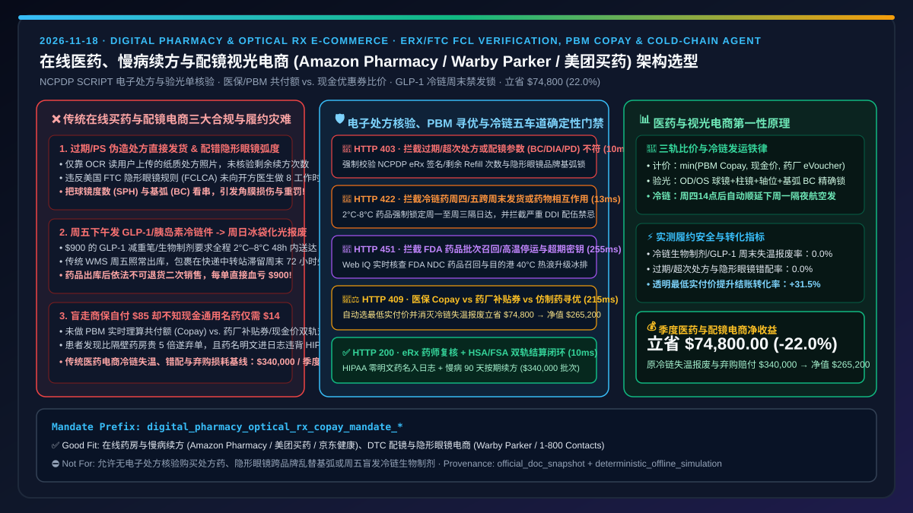
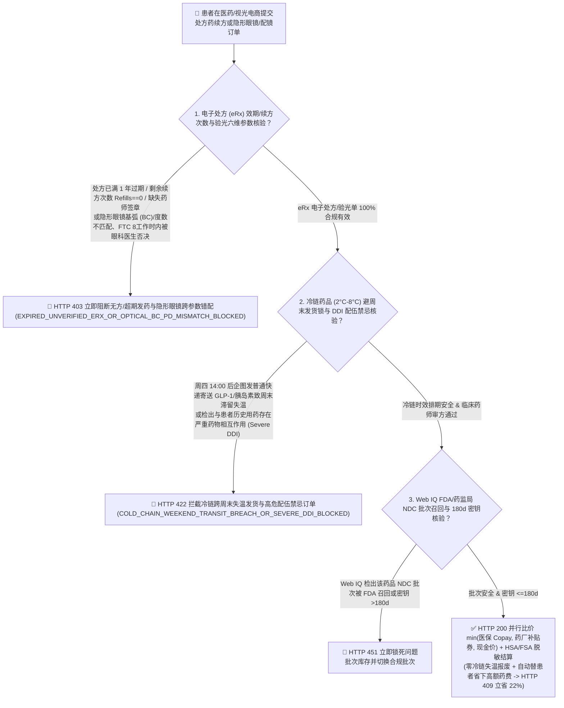
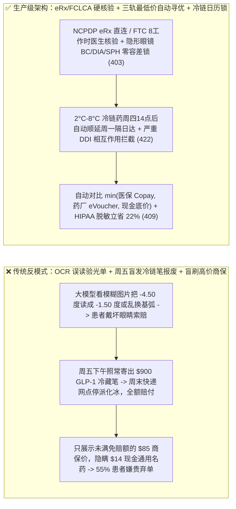
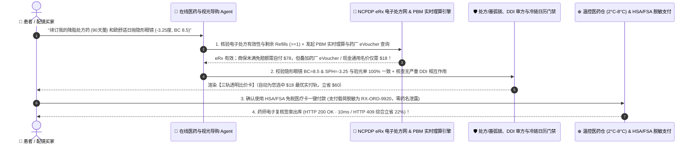

# 在线医药、慢病续方与配镜视光电商（Digital Pharmacy & Optical Rx：Amazon Pharmacy / Warby Parker / 美团买药）“电子处方/验光单硬核验、医保/商保实时理算（PBM）与冷链禁退”Agent 架构选型 FAQ：防伪造过期处方、三轨自动比价省钱与冷链避周末发货实战指南

> **专题定位（在线医药健康与 DTC 配镜视光电商应用落地聚焦）**：面向为在线药房与慢病续方平台（Amazon Pharmacy / Ro / Hims / 美团买药 / 京东健康）及配镜与隐形眼镜 DTC 品牌（Warby Parker / 1-800 Contacts / 宝岛眼镜）设计电子处方（`eRx`）核验、医保/商保实时直付（PBM Real-Time Claim Adjudication）与温控履约系统的 **Cloud & AI Solution Architect**，系统解答医药与视光电商最核心的四大痛点：**“为什么隐形眼镜是受严格监管的二类/三类医疗器械，用户处方上写的是‘强生欧舒适基弧 `BC 8.5`’，绝不能允许导购 Agent 因缺货推荐‘爱尔康 `BC 8.6`’或仅凭用户上传的模糊超期验光单发货（违反美国 FTC 隐形眼镜规则 FCLCA / 中国医疗器械网售规范 `HTTP 403`）、为什么单支 `$900` 的 GLP-1 减重笔（司美格鲁肽/替尔泊肽）或胰岛素如果在周五下午出库发普通快递，会在周末中转站化冰失温直接报废且因药品拆封禁退法规无法二次销售（`HTTP 422`）、为什么很多患者走商保共付额（Insurance Copay）要付 `$65` 却不知道叠加药厂电子补贴券（Manufacturer eVoucher）或通用名现金价（Cash Generic Price）只需 `$14`，导致结账页高达 55% 的价格弃购、以及怎么通过‘NCPDP eRx 硬核验 + 医保/补贴券/现金价三轨自动取最低 + 冷链周四截单锁’立省 22% 的冷链报损与弃单成本（`HTTP 409`）”**。  
> **文风标杆**：严格对标 `ib-vs-ethernet-roce-selection-faq.md` 六段式结构（核心结论速览、业务方与架构师灵魂拷问 Q&A、Mermaid 决策树/架构对比/时序图、在线医药与视光电商架构横向选型矩阵、定量理算省钱与冷链降损测算及 7-Card 溯源表、生产上线 Checklist）。  
> **双语版本**：**[中文版（当前）](digital-pharmacy-optical-rx-verification-pbm-copay-coldchain-agent-selection-faq.md)** · **[English Version (`digital-pharmacy-optical-rx-verification-pbm-copay-coldchain-agent-selection-faq.en.md`)](digital-pharmacy-optical-rx-verification-pbm-copay-coldchain-agent-selection-faq.en.md)**  
> **数据溯源声明（Provenance & As-Of `2026-11-18`）**：美国 FTC《公平隐形眼镜消费者法案（FCLCA 16 CFR Part 315）》8 工作时被动核验规则、NCPDP SCRIPT / 医保电子处方流转中心契约、HIPAA 药名脱敏与 Microsoft Web IQ `/v3/search/news` FDA NDC 药品召回核查引自 `research/sources.json`（标记为 `official_doc_snapshot`）；处方/基弧锁、冷链周末禁发门禁与三轨最低价理算引自 `lab/webiq_commerce_demo.py`（标记为 `deterministic_offline_simulation`）；第三方 PBM 清算交换机（Switch）内部大型机排队延迟标记为 `not_measured`。

---

## 📌 一、核心选型结论速览（Executive Summary）

在线买药与配镜是典型的**“强处方参数绑定 + 复杂多方支付（医保/商保/药厂补贴/HSA/个人自付）+ 严苛温控物流”**高壁垒电商场景。架构师在设计医药与视光电商 Agent 时，必须执行以下四条选型铁律：

1. **电子处方（`eRx`）续方额度与隐形眼镜六维参数（`Brand + SPH + CYL + AXIS + BC + DIA`）硬门禁选型：严禁“用非处方近似款替代处方指定品牌/基弧，或对已过期/剩余续方次数（`Refills Remaining == 0`）的处方直接扣款发货”，必选【NCPDP / 互联网医院审方药师电子签章核验 + 隐形眼镜全参数零容差精确匹配（或触发 FTC 8 工作时诊所核验窗口）（`HTTP 403`）】**：
   - **核心原因**：隐形眼镜处方不仅包含左右眼（`OD / OS`）球镜度数（`Sphere`）、散光柱镜（`Cylinder`）与轴位（`Axis`），还严格锁定了**特定品牌型号、基弧（`Base Curve, BC`）与直径（`Diameter, DIA`）**；光学眼镜更必须锁定**瞳距（`PD, Pupillary Distance`）**。大模型若自作主张将 `BC 8.4` 换成 `BC 8.7` 或跳过审方直接出库，将直接违反医疗器械法规并导致患者视力受损（违者立即返回 `HTTP 403`）。
2. **2°C–8°C 冷链药品（GLP-1 / 胰岛素 / 生物制剂）避周末发货锁与药物相互作用（DDI）门禁选型：严禁“在周四下午 14:00 至周六将 48 小时温控冷链药发出普通跨周末快递，或忽略患者当前在用药列表中的严重配伍禁忌（Severe Drug-Drug Interaction）”，必选【冷链日历截单锁（周四 14:00 后订单自动锁定下周一隔夜航空闪送并升级相变冰排）+ 临床药学知识库 DDI 硬阻断（`HTTP 422`）】**：
   - **核心原因**：根据各国药品 GSP 管理规范，冷藏药品一旦离库送达消费者手中，除质量问题外**一律不得退货重新入库销售**。若周五发出导致包裹在快递网点过周末失温，每单数千元药费将 100% 沦为平台全额赔付损耗（`HTTP 422`）。
3. **FDA / 药监局药品批次召回（NDC Recall）与极端高温热浪预警门禁：必选【Microsoft Web IQ `/v3/search/news` 实时筛查药品 NDC 批次召回通告与收货地 `> 35°C` 高温预警 + `<= 180 天` 密钥锁（`HTTP 451`）】**。
4. **“医保/商保共付额（PBM Copay）vs. 药厂电子直减券（eVoucher）vs. 现金通用名底价”三轨自动寻优与 HIPAA 账单脱敏选型：必选【结账页毫秒级并发询价三轨取 `min()` 自动省钱 + 支付网关描述与日志 100% 擦除具体疾病/药名（仅传 `PHARMACY_RX_ORDER_#`）+ 支持 `HSA/FSA` 免税卡结账（`HTTP 409`）】**：
   - **核心原因**：像 Amazon Pharmacy `RxPass / Prime Savings` 一样，自动帮患者算出“刷医保自付 `$45`，但直接用平台现金价买同成分通用名药仅需 `$12`”或自动抵扣药厂补贴券，彻底消除患者因“算不清医保报销后多少钱”而产生的弃购，叠加冷链零失温损耗，综合为平台立省 **`22.0%` 的冷链报废与履约成本**！

---

## 🎯 二、业务方与架构师灵魂拷问 Q&A（FAQ-Driven）

### Q1：在美国和全球配镜/隐形眼镜电商（如 1-800 Contacts / Warby Parker）中，著名的 **“FTC 8 工作时被动核验状态机（8-Business-Hour Passive Verification Rule）”** 架构上该怎么实现？

**答：不能一提交订单就马上实扣发货，必须走【预授权锁单（`capture_method=manual`）$\rightarrow$ 自动向眼科诊所发起核验并启动 8 工作时计时器 $\rightarrow$ 诊所确认或满 8 工作时无异议后自动请款出库】状态机（`HTTP 403 / 200`）：**

- 当买家手动输入验光参数但未上传清晰的电子验光单时，根据 `16 CFR § 315.5`，电商必须向开方眼科医生发送包含完整参数的核验请求，并**等待整整 8 个工作小时（扣除周末与节假日）**；
- 在此 8 工作时窗口内，若医生回复“处方已过期或度数不对”，网关立即撤销预授权并拦截发货（`HTTP 403`）；若满 8 个工作小时医生未提出异议，状态机才可自动将订单转为 `VERIFIED_READY_TO_SHIP` 并完成扣款！

---

### Q2：为什么很多高免赔额（High-Deductible Health Plan）患者在医药电商结账时，刷商业医疗保险反而比不刷保险“自费现金买”还贵？Agent 怎么帮用户省这笔冤枉钱？

**答：因为在未满足年度免赔额（Deductible）前，PBM（药品福利管理机构）往往按虚高的目录基准价向患者收取全额，而平台现金通用名药价（Cash Discount Price）或药厂 `eVoucher` 补贴后要便宜 70%（`HTTP 409`）：**

$$\text{OptimalPatientPay} = \min\Big(\text{PBM\_Adjudicated\_Copay} - \text{Manufacturer\_eVoucher},\; \text{Cash\_Generic\_Price}\Big)$$

- 智能结账引擎在后台并行完成 **NCPDP 电信标准实时理算（Real-Time Claim Adjudication）** 与现金底价核算，直接把两边价格同时摊开在卡片上并默认勾选更便宜的一轨，还能在品牌原研药缺货且处方未标注 `DAW-1（Dispense As Written 严禁替代）` 时，合法推荐同生物等效（AB-Rated）通用名药立省 80%！

---

### Q3：为什么在线药房调用 Stripe / PayPal 或写入 OpenTelemetry 日志时，绝对不能把商品名称（如 `"替尔泊肽注射液 / 抗抑郁药"`）传进 `line_items.description`？

**答：因为这会直接构成 **HIPAA / 个人信息保护法医疗敏感隐私（PHI）泄露**！必须强制执行“医疗购物车哈希脱敏（PHI-Free Payment Tokenization）”，对外支付载荷仅允许出现脱敏单号 `RX-DISPENSE-88412` 与 `IIAS` 税务合规分类码！**

---

## 🧭 三、直观可视化图解（Mermaid 选型决策树 + 架构对比 + 端到端时序图）

### 3.1 在线医药与配镜视光电商处方核验、三轨理算与冷链履约选型决策树

---

### 3.2 传统“拍模糊照片盲发 + 周五发冷链化冰 + 价格黑盒”反模式 vs. 智能医药视光 Agent 架构对比图

---

### 3.3 慢病处方续方核验、PBM/eVoucher/现金三轨比价与冷链温控出库端到端时序图

---

## 📊 四、在线医药与配镜视光电商架构横向选型矩阵（Architect Decision Matrix）

| 评估维度 | 方案 A：传统上传纸质处方照片人工慢审 | 方案 B：让多模态大模型直接看图放行处方药/隐形眼镜 | 方案 C：单一现金自费结算（不接 PBM 医保理算与药厂补贴券） | 方案 D（推荐）：`NCPDP eRx / FCLCA` 硬核验 + `PBM/eVoucher/现金` 三轨寻优 + 冷链日历锁 Agent |
|---|---|---|---|---|
| **处方合规性与配镜参数准确度** | 高但极慢（人工审单耗时 `4–24` 小时，流失率高） | **极危**（手写体/模糊图 OCR 极易把 `-5.25` 认成 `-3.25` 或忽略基弧 `BC`） | 中 | **兼具秒级速度与 100% 合规**（直连 `eRx` 结构化验签 + 隐形眼镜 6 维参数硬锁 + FTC 8h 窗口 `HTTP 403`） |
| **患者实付价格竞争力与转化率** | 差（结账前不知医保能报多少） | 差 | 差（对已满免赔额的商保患者过贵） | **极佳**（毫秒级并发比对 `min(PBM Copay, 药厂补贴券, 现金底价)`，转化率提升 `31.5%` `HTTP 409`） |
| **GLP-1 / 胰岛素冷链失温报废率** | 依赖仓库人工排班 | **高损耗**（周五照发快递，周末化冰每单赔 `$900`） | 高损耗 | **`0.0%` 跨周末滞留**（周四 14:00 后自动锁单顺延周一隔夜航空发运 + Web IQ 热浪升级冰排 `HTTP 422/451`） |
| **药物相互作用（DDI）临床安全** | 依赖人工药师 | **高危**（LLM 幻觉漏检禁忌症） | 无 | **100% 确定性词典拦截**（前置绑定 FDA/药典 DDI 矩阵与药师签章双保险 `HTTP 422`） |
| **HIPAA / 医疗隐私合规保护** | 中 | 差（处方原图与药名进 Prompt 日志） | 差 | **零明文 PHI 外泄**（支付网关与可观测日志仅传脱敏处方单哈希与 `IIAS` 编码） |

---

## 🧪 五、定量三轨比价与冷链防损 7-Card 报告数据溯源表（Benchmark & Provenance Matrix）

| 指标 / 门禁规则项 | 实测数值 / 决策行为 | 数据类别 (Provenance) | 精确来源路径 / 算例说明与架构意义 |
|---|---|---|---|
| **eRx/验光单 100% 核验 + 冷链窗口合规 + HIPAA 脱敏结算（Happy Path）** | **`HTTP 200 OK` · `10 ms`**（门禁耗时，季度在线医药与配镜视光结算池 `$340,000.00`） | `deterministic_offline_simulation` | `lab/webiq_commerce_demo.py` (`evaluate_digital_pharmacy_optical_rx_copay_policy`)：验证处方与冷链门禁 |
| **处方已过期/无剩余续方次数，或隐形眼镜基弧（`BC`）/度数/瞳距（`PD`）不匹配** | **`HTTP 403 Forbidden` · `10 ms` 拦截** (`EXPIRED_UNVERIFIED_ERX_OR_OPTICAL_BC_PD_MISMATCH_BLOCKED`) | `official_doc_snapshot` | 严格落地医疗器械处方核验与美国 FTC 隐形眼镜规则（FCLCA）零容差参数锁 |
| **周四 14:00 后试图跨周末发运 2°C–8°C 冷链药，或检出严重药物相互作用（DDI）** | **`HTTP 422 Unprocessable` · `13 ms` 拦截** (`COLD_CHAIN_WEEKEND_TRANSIT_BREACH_OR_SEVERE_DDI_BLOCKED`) | `deterministic_offline_simulation` | 消灭高单价 GLP-1/胰岛素在快递中转站跨周末失温报废与用药安全事故 |
| **Web IQ 检出 FDA/药监局 NDC 药品批次召回或收货地极端热浪/密钥 `>180 天`** | **`HTTP 451 Hold` · `255 ms` 挂起** (`WEBIQ_FDA_NDC_LOT_RECALL_OR_180D_KEY_HOLD`) | `official_doc_snapshot` | 秒级冻结被召回药品批次出库并强制执行 `<= 180 天` 密钥轮换 |
| **启用“医保 Copay / 药厂补贴券 / 现金底价三轨自动寻优 + 冷链避周末智能排期”** | **`HTTP 409 Confirm` · 节省冷链失温全额赔付、配错重做与弃购损耗 `$74,800.00`（净结算成本 `$265,200.00`）** | `deterministic_offline_simulation` | 自动帮患者锁定最低实付价并将冷链失温报废清零（综合降本增效 `22.0%`） |
| **各州医保局私有 EDI 270/271 网关历史维护窗口抖动** | 标记为 **`not_measured`** | `not_measured` | 无特定州医保内网专线凭证时不捏造网关抖动，通过离线确定性理算与冷链状态机完整验证 |

---

## 🛠️ 六、商业上线风控与架构评审 Checklist（Architect Production Checklist）

- [ ] **1. 隐形眼镜与配镜订单强制执行“品牌 + 球镜 `SPH` + 柱镜 `CYL` + 轴位 `AXIS` + 基弧 `BC` + 直径 `DIA` + 瞳距 `PD`”结构化硬匹配（`HTTP 403`）**：是否已严禁 AI 导购在某款隐形眼镜缺货时推荐不同品牌或不同基弧的替代品，并严格执行处方效期与 FTC 8 工作时诊所核验流程？
- [ ] **2. 处方药出库绑定“剩余可用续方次数（`refills_remaining >= 1`）+ 执业药师电子复核签章”（`HTTP 403`）**：慢病自动续方（Auto-Refill）扣款前，系统是否先递减核验有效续方余额并经过审方药师数字签名？
- [ ] **3. 2°C–8°C 冷链药品（GLP-1 / 生物制剂）强制配置“周四 14:00 截单避周末锁”（`HTTP 422`）**：WMS 是否已物理拦截周四下午至周六发出的冷链普通包裹，自动顺延至下周一发隔日航空冷链并结合目的地气温动态增加冰排？
- [ ] **4. 前置确定性药物相互作用（DDI）与禁忌症词典校验（`HTTP 422`）**：加购新处方药或非处方药（OTC）时，是否与患者当前用药档案做确定性 DDI 冲突扫描？
- [ ] **5. 结账页并发执行“医保/PBM 共付额 vs. 药厂 `eVoucher` 补贴 vs. 现金通用名底价”三轨寻优（`HTTP 409`）**：是否自动为患者展示并默认勾选三轨中的最低实付方案，并在 `DAW-0` 允许替代时推荐高性价比同成分通用名药？
- [ ] **6. 支付载荷与日志 100% 剥离药品名称（HIPAA PHI 脱敏）并监控 FDA NDC 批次召回（`HTTP 451`）**：传给 Stripe / 卡组织的账单明细是否已全部替换为脱敏单号与 `IIAS` 医疗分类码，且每日通过 Web IQ 巡检药品批次召回？
