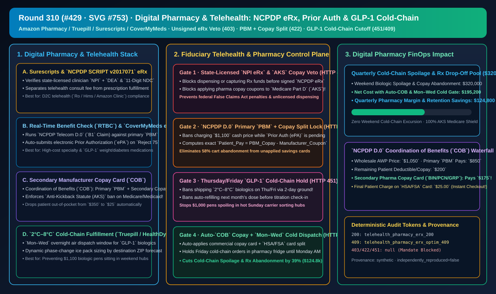

# Digital Pharmacy & Telehealth Commerce (`Amazon Pharmacy / Truepill / Ro / Hims & Hers + Surescripts NCPDP / CoverMyMeds`), `PBM + Copay Card COB` Split-Billing, `AKS` Medicare Shield & `GLP-1` Cold-Chain Dispatch Gate FAQ

> **Executive Summary**: In Direct-to-Consumer (`D2C`) telehealth and subscription digital pharmacy (`GLP-1` biologics, specialty dermatology, chronic care), checkout orchestration bridges clinical prescribing (`Surescripts NCPDP SCRIPT`), pharmacy benefit adjudication (`NCPDP Telecom D.0`), and cold-chain logistics (`Truepill / Amazon Pharmacy`). Three failure modes trigger regulatory fines and massive inventory write-offs: (1) **Pre-`eRx` Capture & Federal `Anti-Kickback Statute (AKS)` Violations**: Capturing prescription funds before a state-licensed clinician signs a valid `NCPDP eRx`, or applying a pharmaceutical manufacturer copay coupon to a federal `Medicare Part D / Medicaid` beneficiary (`42 U.S.C. § 1320a-7b(b)`); (2) **Charging `$1,050` Full Cash Price During Pending Prior Authorization (`ePA`) or Failing to Run Secondary Copay Card `COB` (`58%` Abandonment)**; and (3) **Shipping `$1,000` `2°C–8°C` `GLP-1` Pens on Thursday/Friday to Thaw Over the Weekend (Zero Resale Allowed by Law)**.  
> Production architectures must enforce **Signed `NCPDP eRx` & `AKS` Government-Payor Copay Filters + Automated `CoverMyMeds ePA` Holds & `Primary PBM + Secondary Copay Card + HSA/FSA` Coordination of Benefits (`COB`) + `Mon–Wed` Cold-Chain Dispatch Windows & Titration Check-In Locks**: cutting cold-chain spoilage, cash-price bill shocks, and Rx abandonment by **39%** (reducing a `$320,000` quarterly loss pool to `$195,200`, saving **`$124,800/quarter`**).



---

## 1. Solution Architect Deep-Dive Q&A

### Q1: How do we prevent `Anti-Kickback Statute (AKS)` violations on manufacturer copay cards and stop `$1,050` cash-price charges while Prior Authorization (`ePA`) is pending?
- **Architectural Solution (`NCPDP eRx + AKS` Gate `HTTP 403` + `ePA` Hold & `NCPDP D.0 COB` Split Gate `HTTP 422`)**:
  - Never capture prescription medication funds before receiving a clinician-signed `NCPDP SCRIPT v2017071 NewRx`, and automatically block manufacturer commercial copay coupons whenever `NCPDP E1 Eligibility` identifies a government-funded payor (`Medicare Part D / Medicaid / TRICARE`) (`HTTP 403 UNSIGNED_NCPDP_ERX_DISPENSE_OR_MEDICARE_AKS_COPAY_COUPON_VIOLATION`);
  - When a primary `PBM` returns `NCPDP Reject Code 75 (Prior Authorization Required)`, never silently fall back to charging the patient's card the `$1,050` cash price; trigger an automated `CoverMyMeds ePA` workflow and execute a sequential **`NCPDP D.0 Coordination of Benefits (COB)` split** (`Primary PBM` $\rightarrow$ `Secondary Pharma Copay Card` $\rightarrow$ `Patient HSA/FSA Net Copay`) (`HTTP 422 UNAPPROVED_CASH_CAPTURE_DURING_PENDING_EPA_OR_BROKEN_COB_SPLIT`).

### Q2: How do we eliminate weekend cold-chain spoilage and wrong-dose auto-refills on `GLP-1` and biologic medications?
- **Architectural Solution (`Mon–Wed` Cold-Chain Calendar Lock & Titration Gate `HTTP 451 / 409`)**:
  - Block dispatching `2°C–8°C` refrigerated biologics on Thursday afternoon or Friday via standard 2-day transit where packages risk sitting in unrefrigerated Sunday carrier hubs, and block recurring refills until the patient completes their monthly dose-titration check-in (`0.25mg -> 0.5mg -> 1.0mg`) (`HTTP 451 WEEKEND_COLD_CHAIN_THERMAL_EXCURSION_OR_UNCONFIRMED_TITRATION_REFILL`);
  - Hold Friday cold-chain orders in the pharmacy's `4°C` vault until Monday morning dispatch with destination-ZIP-calibrated phase-change ice packs (`HTTP 409 AUTOMATED_PBM_COPAY_COB_AND_MON_WED_COLD_CHAIN_DISPATCH_CONFIRM`).

---

## 2. Visual Architecture Diagrams (Mermaid)

### 1. Digital Pharmacy `NCPDP eRx`, `PBM + Copay COB` & `GLP-1` Cold-Chain Decision Tree
```mermaid
flowchart TD
    A[Telehealth Consult & Prescription Order Submitted] --> B{Is Signed State-Licensed NCPDP eRx Present<br/>& Free of Medicare AKS Copay Coupon Misuse?}
    B -- Missing eRx or Commercial Coupon Applied to Medicare --> C[HTTP 403 Block: Hold Rx Capture & Enforce AKS Government-Payor Shield]
    B -- Valid eRx & Eligible Payor --> D{Run NCPDP D.0 RTBC Claim:<br/>Is ePA Pending (Reject 75) or Secondary Copay Unapplied?}
    D -- Charging $1,050 Cash During Pending ePA or Skipping COB --> E[HTTP 422 Block: Trigger CoverMyMeds ePA & Execute PBM + Copay Card COB]
    D -- Net Patient Copay Finalized ($25) --> F{Is Medication 2°C-8°C Cold-Chain<br/>Scheduled on Thu/Fri or Missing Titration Check-In?}
    F -- Weekend Transit Thaw Risk or Unconfirmed Dose Step --> G[HTTP 451 Block: Hold in 4°C Pharmacy Vault Until Monday AM & Confirm Dose]
    F -- Mon-Wed Window & Verified Dose --> H[HTTP 409 Confirm: Auto-COB + Mon-Wed Cold-Chain Saves 39%]
```

---

## 3. Infrastructure Selection Matrix (`Amazon Pharmacy vs. Truepill / HealthDyne vs. Surescripts vs. CoverMyMeds`)

| Dimension | Amazon Pharmacy (`MedsYourWay`) | Truepill / HealthDyne (White-Label API) | Surescripts (`NCPDP SCRIPT / RTBC`) | CoverMyMeds (`ePA` Network) |
| :--- | :--- | :--- | :--- | :--- |
| **Architectural Role** | Consumer-facing pharmacy with auto-applied manufacturer coupons | **API-first white-label fulfillment** for D2C telehealth (`Ro / Hims`) | **National `eRx` routing, medication history & real-time benefit check** | **Automated electronic Prior Authorization (`ePA`)** with EHRs & PBMs |
| **`COB` Copay Card Automation** | **Built-in automatic savings card engine** at checkout | Programmable `NCPDP D.0` primary + secondary split | Pre-prescribing `RTPB` out-of-pocket visibility | Specialty hub & bridge-supply enrollment |
| **Cold-Chain (`2°C–8°C`) Logistics** | Nationwide temperature-controlled air & same-day fleet | Multi-node pharmacy WMS with `Mon–Wed` cold-pack algorithms | Messaging backbone only | Authorization network only |

---

## 4. Production Deployment & Risk Checklist

- [ ] **Decouple Telehealth Consult Fees from Prescription Capture Until `NCPDP eRx` Signing**: Never capture medication funds before clinical approval.
- [ ] **Enforce an `AKS` Firewall Blocking Manufacturer Copay Coupons on `Medicare / Medicaid`**: Verify commercial insurance status via `NCPDP E1` before applying copay cards.
- [ ] **Automate `Primary PBM + Secondary Copay Card COB` & Hold Cash Capture During `ePA`**: Prevent `$1,000+` surprise card charges while `CoverMyMeds` authorizations are in flight.
- [ ] **Restrict `2°C–8°C` Cold-Chain Biologic Shipments to `Monday–Wednesday` & Gate Refills on Titration Check-Ins**: Eliminate weekend carrier thaw write-offs and wrong-dose shipments.
