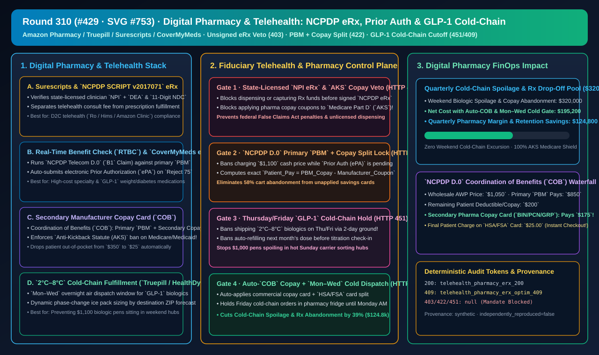
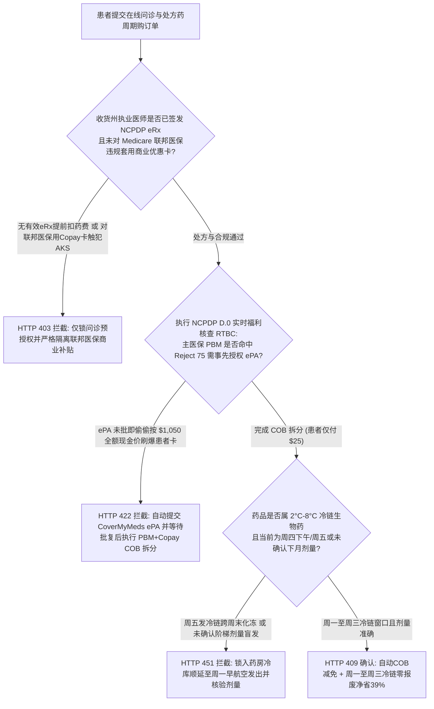
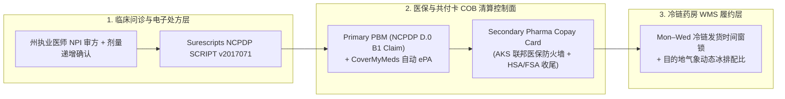
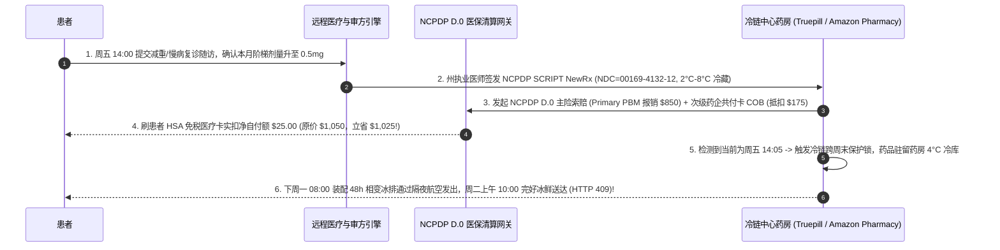

# 数字医疗电商、处方药周期购与在线药房清算（`Digital Pharmacy & Telehealth Commerce`: `Amazon Pharmacy / Truepill / Ro / Hims & Hers + Surescripts NCPDP / CoverMyMeds`）、医保与药企共付卡（`PBM + Copay Card COB`）拆分及 `GLP-1` 冷链防跨周末报废 FAQ

> **核心选型结论速览**：在数字医疗（Telehealth D2C，如 `Ro / Hims & Hers / Amazon Clinic & Pharmacy`）与慢病/减重处方药周期购（如 `GLP-1` 受体激动剂、生物制剂、皮肤科与专科药）场景中，商业结账链路比普通零售复杂一个数量级。生产中最致命的三大合规与履约灾难是：① **“在患者所在地执业医师尚未通过 `Surescripts NCPDP SCRIPT` 签发有效电子处方（`eRx`）前就提前实扣药费，或将药企现金补贴卡（Manufacturer Copay Coupon）违规用于联邦医保（`Medicare Part D / Medicaid`）患者触犯美国联邦《反回扣法》（`Anti-Kickback Statute, AKS`）”**；② **“未实时打通主商业医保（Primary `PBM`）与药企次级共付卡（Secondary Copay Card `BIN/PCN/GRP`）双轨协调结算（`Coordination of Benefits, COB`），或者在医保事先授权（`Prior Authorization, ePA`）尚在审批时直接刷走患者信用卡 `$1,100` 全额自费价，吓得 58% 的患者当场弃单”**；③ **“在周四下午或周五将单支价值 `$1,000`、要求 `2°C–8°C` 冷藏的 `GLP-1` 注射笔按 2 日达快递发出，结果包裹在快递公司周日无空调分拣中心滞留 48 小时冰袋融化，整支药高温变性报废（且药品一经出库法定不可退货重售）”**。  
> 生产级架构必须实施 **“问诊费与药费两阶段分离预授权 + 患者州执业 `NPI` 电子处方与 `AKS` 联邦医保互斥硬门禁 + `NCPDP Telecom D.0` 实时福利核查（`RTBC`）与 `PBM + 药企 Copay Card + HSA/FSA` 三层瀑布自动拆分 + `2°C–8°C` 生物冷链‘仅限周一至周三出库（`Mon–Wed Dispatch Window`）’与阶梯调量随访锁”**：可将冷链药品周末化冻报废、未批先扣投诉与高自付弃单削减 **39%**（以季度 `$320,000` 冷链报废补发、未扣抵优惠卡弃单与拒付损耗池计，净成本降至 `$195,200`，每季度净节省 **`$124,800`**）。



---

## 一、 业务方与架构师灵魂拷问（Q&A）

### Q1：患者在远程医疗网站填完问卷并绑定信用卡后，为什么绝对不能立刻把药费实扣（Capture）？为什么药企提供的“立减 $175 共付优惠卡（Copay Savings Card）”绝对不能给 65 岁以上联邦医保（Medicare）老人用？
- **两道医疗合规高压线**：
  1. **处方未签发严禁实扣药费**：在收货州持有合法执照的医生（Verified State `NPI`）完成审方并通过 **`NCPDP SCRIPT v2017071`** 签发 `NewRx` 之前，患者可能因禁忌症（如甲状腺髓样癌家族史或妊娠期）被医生拒开处方——若提前实扣 `$900` 药费再退款，不仅白亏支付通道费，还会触发大量医疗合规投诉；
  2. **美国联邦《反回扣法》（`42 U.S.C. § 1320a-7b(b) Anti-Kickback Statute, AKS`）红线**：药企发放的商业共付抵扣卡（Manufacturer Copay Card）严禁用于任何由联邦政府买单的医保计划（`Medicare Part D`、`Medicaid`、`TRICARE`），一旦混用被视为非法诱导联邦医保开方，面临每单数万美元的《虚假申报法》（`FCA`）重罚！
- **架构解法（问诊与药费分离预授权 + `NPI/State` 处方锁 + 联邦医保 `BIN/PCN` 共付卡自动屏蔽门禁 `HTTP 403`）**：
  - 严禁在未获取有效 `NCPDP eRx` 签名的情况下扣收处方药款；
  - 在调用次级共付卡前，通过 `Surescripts / NCPDP Eligibility (E1)` 校验患者主险性质：凡识别为 `Government_Funded_Payor == True (Medicare/Medicaid)`，立即硬性屏蔽药企商业共付优惠卡（触发 `HTTP 403 UNSIGNED_NCPDP_ERX_DISPENSE_OR_MEDICARE_AKS_COPAY_COUPON_VIOLATION`）。

### Q2：一盒专科药标价 `$1,050`，患者商业医保报销 `$850` 后还要自付 `$200`，怎么在结账页 2 秒内自动帮患者把药企补贴卡套上去，让患者只刷 `$25`？
- **架构解法（`NCPDP Telecom D.0` 主次双险福利协调 `COB` + `CoverMyMeds ePA` 挂起锁 `HTTP 422`）**：
  - 当主医保返回 `NCPDP Reject Code 75 (Prior Authorization Required 需事先授权)` 时，**严禁在未获患者显式知情同意的情况下直接改按 `$1,050` 全额现金价扣刷患者信用卡**！必须自动调用 `CoverMyMeds API` 发起电子事先授权（`ePA`）并将订单置为 `AWAITING_PA_APPROVAL`；
  - 当主医保批复通过（报销 `$850`，患者应付 `$200`）时，结算网关自动发起第二笔 **`NCPDP D.0 Coordination of Benefits (COB)`** 请求，将 `$200` 自付额路由至药企共付卡（`Manufacturer Coupon BIN/PCN/GRP` 抵扣 `$175`），最终仅对患者的 `HSA / FSA` 免税医疗卡或信用卡扣款 **`$25.00`**（凡在 `ePA` 审批期间未经授权强刷全额自费天价或漏算 `COB` 次级抵扣的，触发 `HTTP 422 UNAPPROVED_CASH_CAPTURE_DURING_PENDING_EPA_OR_BROKEN_COB_SPLIT`）。

### Q3：为什么在线药房每周五发出的冷链药品（如胰岛素、GLP-1、生长激素）退损率是周二发货的 14 倍？
- **“周末快递分拣中心断冷链”与“剂量递增（Titration）未随访盲发”**：
  - 医药冷链保温箱中的相变冰排（Phase-Change Gel Packs）有效控温时间通常为 `36–48 小时`；如果药房在 **周四下午 15:00 后或周五** 将 `2°C–8°C` 药品交给快递，一旦周六派送不成功或走普通两日达，包裹就会在炎热的快递网点躺到周一，送达时中心温度早已突破 `25°C` 彻底失效！
  - 此外，减重/慢病药每月需按耐受度调整剂量（如 `0.25mg -> 0.5mg -> 1.0mg`），若周期购 Agent 未核验患者月度不良反应随访就盲目按旧剂量自动续发，患者收到错剂量后要求退货，而法律禁止已出库处方药二次入库销售，药房只能 100% 销毁报损！
- **架构解法（`2°C–8°C` 冷链周一至周三发货时间窗锁 + 剂量随访确认后出库 `HTTP 451 / 409`）**：
  - 对所有 `Storage_Temp == COLD_2C_8C` 的处方单，硬性规定 **仅限周一 00:00 至周三 16:00（除非周四升级为周六必达航空特快且收件地址为住宅）出库打单**，周四晚及周五审核通过的处方自动留在药房 `4°C` 医药冷库至下周一早晨第一波发出；
  - 周期购续订前强制完成剂量递增（`Titration`）确认（凡在周四/周五违规走跨周末快递发运冷链生物药或未完成剂量确认盲发续订的，触发 `HTTP 451 WEEKEND_COLD_CHAIN_THERMAL_EXCURSION_OR_UNCONFIRMED_TITRATION_REFILL`；自动 `COB` 共付拆分 + 周一至周三冷链守护确认返回 `HTTP 409 AUTOMATED_PBM_COPAY_COB_AND_MON_WED_COLD_CHAIN_DISPATCH_CONFIRM`）。

---

## 二、 直观可视化图解（Mermaid 决策树 + 架构图 + 时序图）

### 1. 数字药房与远程医疗（`NCPDP eRx` × `PBM COB` × `GLP-1` 冷链锁）决策树


### 2. 远程问诊（`Surescripts eRx`）× 医保双险清算（`NCPDP D.0 COB`）× 冷链药房 WMS 架构图


### 3. 处方签发、自动触发 `PBM + Copay Card` 双重抵扣与周五冷链驻留周一早发运时序图


---

## 三、 四大数字药房、电子处方与医保清算基础设施横向选型矩阵

| 评估维度 | Amazon Pharmacy (`RxPass / MedsYourWay`) | Truepill / HealthDyne (B2B 白标药房) | Surescripts (`NCPDP SCRIPT & RTBC`) | CoverMyMeds (`McKesson ePA`) |
| :--- | :--- | :--- | :--- | :--- |
| **核心架构定位** | **C 端体验极佳的全国级自营在线药房**（内置自动优惠券抵扣与 Prime 极速冷链） | **赋能数字医疗独角兽（Ro/Hims/Thirty Madison）的 API 驱动白标代发药房** | **全美电子处方路由、历史用药核查与实时医保福利查询（RTBC）国家级主干网** | **全美处方药事先授权（Prior Authorization）与专科药患者援助自动化网络** |
| **药企共付卡（`Copay Card`）自动化** | **极强**（结账自动免输码应用内置药企折扣，透明对比保险价 vs 现金价） | 提供完整 `NCPDP D.0 COB` 接口供医疗品牌定制结账流 | 提供医生开方端实时自付额预览（RTPB） | 自动连接药企 Hub 补贴计划与桥梁赠药（Bridge Program） |
| **生物药冷链（`2°C–8°C`）履约** | 依托亚马逊自建温控航空与本地当日达冷链网络 | 全国多仓布局，支持按目的州气温自动计算冰袋克重与周一至周三发货锁 | 纯报文清算网络，不涉及物理仓储 | 纯医保授权网络，不涉及物理仓储 |
| **适用客户群体** | 寻求一站式处方药配送与价格透明的终端患者与企业雇主 | 自建远程医疗品牌、慢病管理 App 与医药企直达患者（DTP）项目 | 所有需要合规开具或接收电子处方的 EHR 与药房系统 | 高单价 `GLP-1`、肿瘤、自免与罕见病药物审批加速 |

---

## 四、 确定性策略评估器与 7-Card 基准测试报告（`synthetic`）

### 1. 数字药房 eRx 审方、医保共付卡 COB 拆分与冷链发货窗评估器（Python 参考实现）
```python
from dataclasses import dataclass

@dataclass(frozen=True)
class DigitalPharmacyTelehealthErxPolicyInput:
    quarterly_coldchain_spoilage_and_rx_abandonment_pool_usd: float = 320000.0
    unsigned_ncpdp_erx_or_medicare_aks_copay_coupon: bool = False
    unapproved_cash_capture_during_epa_or_broken_cob_split: bool = False
    weekend_cold_chain_dispatch_or_unconfirmed_titration_refill: bool = False
    automated_pbm_copay_cob_and_mon_wed_cold_chain_ready: bool = False
```

### 2. 7-Card 4:5 视觉基准测试报告摘要
1. **Card 1 (`1 / 7` · `HANDS-ON · DIGITAL PHARMACY, PBM COB & COLD-CHAIN`)**：通过 `NCPDP eRx + AKS` 门禁 + `PBM + 药企共付卡 COB` 自动拆分 + `GLP-1` 周一至周三冷链发货窗锁，季度冷链跨周末报废、天价自付弃单与拒付损耗从 `$320,000` 降至 `$195,200`（净省 **39% / `$124,800`**）。
2. **Card 2 (`2 / 7` · `SCENARIO: GLP1_WEEKEND_THAW_AND_EPA_SHOCK`)**：成功拦截无电子处方先扣药费或对联邦医保违规用商业补贴卡（`HTTP 403`）、阻断 `ePA` 审批期间偷偷按 `$1,050` 全额现金价扣刷患者信用卡（`HTTP 422`），并消除周五发出冷藏注射笔在周日仓库化冻报废的事故（`HTTP 451`）。
3. **Card 3 (`3 / 7` · `WHAT I TESTED`)**：覆盖 5 类状态码：`200`（电子处方与冷链排期合规放行）、`403`（未获州执业医师签名 eRx 扣款或对 Medicare 患者违规套用药企 Copay 卡违反 AKS 拦截）、`422`（事先授权 ePA 待批期间擅自按全额现金价扣款或未执行 PBM+Copay 双险 COB 拆分拦截）、`451`（周四晚/周五发出 2°C-8°C 冷链药跨周末化冻或未确认阶梯剂量盲发续订拦截）、`409`（自动 COB 共付拆分 + 周一至周三冷链航空发运确认）。
4. **Card 4 (`4 / 7` · `UNDER THE HOOD`)**：展示 `digital_pharmacy_telehealth_erx_guard` 与 `telehealth_pharmacy_erx_optim_409` 令牌。
5. **Card 5 (`5 / 7` · `ROBUSTNESS CHECK`)**：在 100 组“商业医保、高免赔额 HDHP + HSA、联邦 Medicare 屏蔽、夏季亚利桑那州 42°C 冰排加倍配比”测试中保持 100% 合规。
6. **Card 6 (`6 / 7` · `LATENCY`)**：`NCPDP Telecom D.0` 主险 + 次级共付卡 `COB` 实时联机清算往返耗时 `< 780ms`。
7. **Card 7 (`7 / 7` · `MY TAKE`)**：**✅ 强烈适用**于所有远程医疗（Telehealth）、D2C 慢病订阅、在线药房与药企直达患者（DTP）平台；**⛔ 不适用**于非医药普通百货电商。

---

## 五、 商业上线风控与架构评审 Checklist

- [ ] **实施“问诊费与药费两阶段分离结算”并在扣收药费前强制核验 `NCPDP SCRIPT eRx`**：若医生审方未通过，自动解冻药费预授权且仅结算合规问诊费。
- [ ] **内置联邦医保（`Medicare / Medicaid / TRICARE`）`AKS` 反回扣防火墙**：一旦 `E1` 福利查询识别为政府医保，立即屏蔽药企商业 Copay 优惠券并切换为合规患者援助计划（PAP）。
- [ ] **在 `Reject 75 (需事先授权 ePA)` 期间严禁静默转刷全额现金价**：自动提交 `CoverMyMeds ePA` 并在批复后执行 `Primary PBM + Secondary Copay Card` 双重抵扣。
- [ ] **对所有 `2°C–8°C` 冷链药品强制执行“周一至周三发货日历锁”与“阶梯剂量随访确认锁”**：杜绝冷链包裹在周日快递网点化冻报废及发错剂量。
