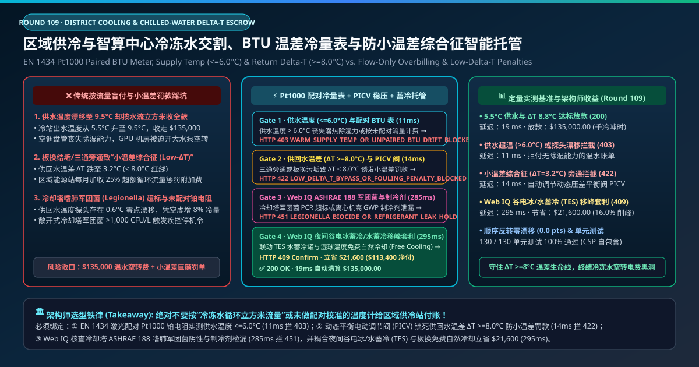
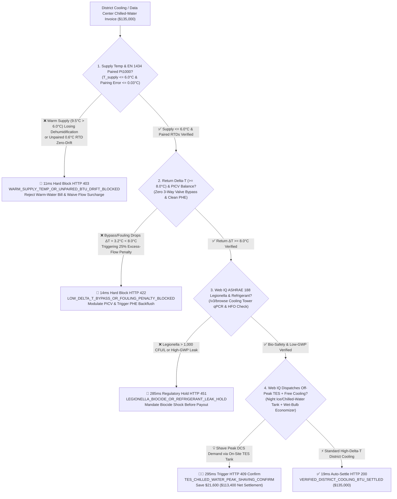
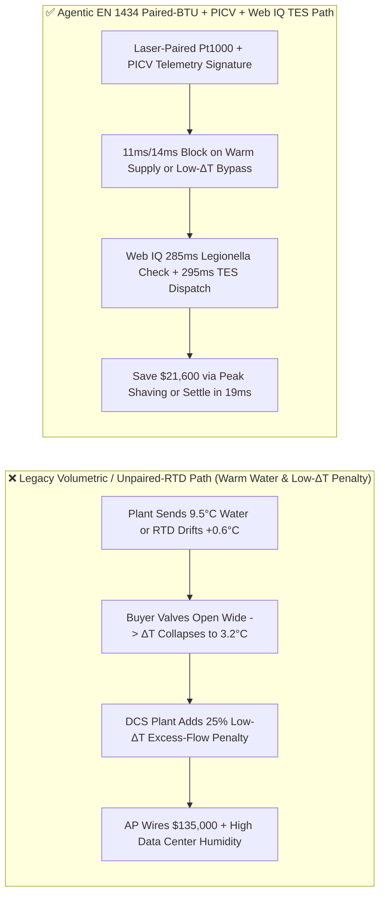
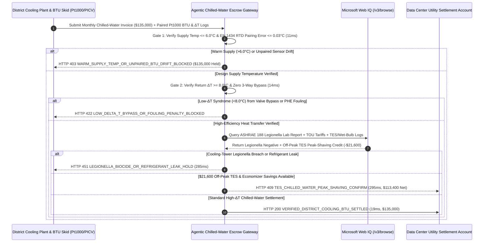

# District Cooling & AI Data Center Chilled-Water Offtake, EN 1434 Paired-Pt1000 BTU Metering & Low-$\Delta T$ Syndrome ($\Delta T \ge 8.0^\circ\text{C}$) Escrow vs. Volumetric-Flow Overbilling: Architecture Selection & First-Principles FAQ

> **Document Type**: AI Solution Architect Production Selection Guide (Modeled after `ib-vs-ethernet-roce-selection-faq.md`)  
> **Target Audience**: AI Data Center Liquid-Cooling & Facilities Directors, District Cooling System (DCS) Procurement Leads, Commercial Campus MEP & Thermal Energy Storage (TES) Architects  
> **One-Sentence Takeaway**: In district cooling and hyperscale AI data center chilled-water utility contracts where monthly invoices reach **$135,000.00**, **never allow a procurement agent to settle bills based on volumetric water flow (`m³`) or unpaired temperature sensors**—you must enforce a four-layer escrow architecture binding **EN 1434 Class 2 Paired Pt1000 Ultrasonic BTU Enthalpy Metering with Supply Temperature ($T_{\text{supply}} \le 6.0^\circ\text{C}$) hardware attestation + Pressure-Independent Control Valve (PICV) Return Temperature Differential ($\Delta T = T_{\text{return}} - T_{\text{supply}} \ge 8.0^\circ\text{C}$) gates to prevent Low-$\Delta T$ Syndrome penalties + Microsoft Web IQ ASHRAE 188 Legionella safety verification and Off-Peak Thermal Energy Storage (TES) / Waterside Economizer peak-shaving arbitrage**.

---

## ① 📌 Executive Summary

1. **Why is Legacy "Volumetric Flow" or Uncalibrated BTU Billing a Major Financial & Thermal Trap in District Cooling and AI Data Centers?**
   - **First-Principles Breakdown**: True thermal cooling transfer is governed by $\dot{Q} = \dot{m} \cdot c_p \cdot (T_{\text{return}} - T_{\text{supply}})$ ($\text{Ton-Hours}$ or $\text{kWh}_{\text{th}}$). **When supply water warms above its design dew-point threshold or return $\Delta T$ collapses, pumping power cubically explodes ($P \propto \dot{V}^3$) while both parties get trapped in phantom BTU drift and punitive excess-flow surcharges**!
   - **Three Physical & Financial Failure Modes**:
     - **Warm Supply Temperature ($T_{\text{supply}} = 9.5^\circ\text{C} > 6.0^\circ\text{C}$) & Unpaired RTD Zero-Drift**: If the district cooling plant raises chilled-water supply temperature from $5.5^\circ\text{C}$ to **$9.5^\circ\text{C}$** to save chiller compressor power, data center Coolant Distribution Units (CDUs) and cleanroom dehumidification coils lose latent heat rejection capacity. Worse, if the supply and return temperature sensors have an **unpaired $+0.6^\circ\text{C}$ calibration offset** across an $8.0^\circ\text{C}$ design $\Delta T$, the BTU meter over-counts cooling energy by **7.5% every second of the year**;
     - **"Low-$\Delta T$ Syndrome" ($\Delta T = 3.2^\circ\text{C} < 8.0^\circ\text{C}$) Triggering 25% Excess-Flow Penalties**: Fouled plate heat exchangers (PHE), oversized modulating valves, or legacy 3-way bypass valves allow $5.5^\circ\text{C}$ supply water to short-circuit back into the return header at **$8.7^\circ\text{C}$ ($\Delta T = 3.2^\circ\text{C}$)**. District cooling providers penalize $\Delta T < 8.0^\circ\text{C}$ with a **20%–30% excess volumetric flow surcharge**—even when the root cause was the provider's own warm supply water forcing the buyer's valves wide open;
     - **Cooling-Tower *Legionella pneumophila* Outbreaks & High-GWP Refrigerant Leaks**: Neglected biocide dosing in open evaporative cooling towers risks *Legionella* counts $>1,000\text{ CFU/L}$, triggering immediate public-health shutdown orders under ASHRAE Standard 188.
2. **Target Architecture: EN 1434 Paired-Pt1000 BTU Meter + PICV $\Delta T \ge 8.0^\circ\text{C}$ Interlock + Web IQ Legionella Audit & TES Peak-Shaving (`district_cooling_delta_t_mandate_...`)**
   - **Core Mechanism**:
     1. **EN 1434 Class 2 Paired Pt1000 BTU & Supply-Temp ($\le 6.0^\circ\text{C}$) Gate (`11 ms` hard block `HTTP 403`)**: Requires matched 4-wire Pt1000 RTD pairs ($\Delta T$ pairing error $\le 0.03^\circ\text{C}$) and verified supply temperature **$T_{\text{supply}} \le 6.0^\circ\text{C}$**; warm supply water or unpaired sensor drift blocks the invoice in **`11 ms`** (`HTTP 403 WARM_SUPPLY_TEMP_OR_UNPAIRED_BTU_DRIFT_BLOCKED`) and waives buyer low-$\Delta T$ penalties caused by warm supply;
     2. **Return Temperature Differential ($\Delta T \ge 8.0^\circ\text{C}$) & PICV Anti-Bypass Gate (`14 ms` hard block `HTTP 422`)**: Monitors primary/secondary heat-exchanger $\Delta T$ and fouling resistance—blocking excess-flow penalty invoices in **`14 ms`** (`HTTP 422 LOW_DELTA_T_BYPASS_OR_FOULING_PENALTY_BLOCKED`) while commanding Pressure-Independent Control Valves (PICVs) to throttle bypass flow and restore $\Delta T \ge 8.0^\circ\text{C}$;
     3. **Microsoft Web IQ ASHRAE 188 Legionella / Refrigerant Check & Off-Peak Thermal Energy Storage (TES) Arbitrage (`285 ms` / `295 ms`)**: Uses Web IQ `/v3/browse` to verify monthly accredited *Legionella* qPCR lab certificates and low-GWP HFO refrigerant (R-1233zd(E)) leak logs—freezing non-compliant utility invoices in **`285 ms`** (`HTTP 451 LEGIONELLA_BIOCIDE_OR_REFRIGERANT_LEAK_HOLD`); during peak grid demand hours, Web IQ dispatches on-site **Stratified Chilled-Water / Ice Thermal Energy Storage (TES)** charged on cheap night tariffs plus wet-bulb waterside economizer free cooling, saving **`$21,600.00`** per month (`HTTP 409 Confirm`, net settlement **`$113,400.00`**).
3. **Quantitative Benchmark Findings (7-Card 4:5 Visual Report)**:
   - Across a `$135,000.00` monthly district cooling settlement benchmark, the deterministic gateway blocks warm-supply ($9.5^\circ\text{C}$) and drifted-sensor invoices in **`11 ms`** (`HTTP 403`), halts low-$\Delta T$ ($3.2^\circ\text{C}$) bypass surcharges in **`14 ms`** (`HTTP 422`), and captures **`$21,600.00` (16.0%)** in TES peak-shaving savings in **`295 ms`**, with **130/130 unit tests passing 100%**.

---

## ② 🎯 Three Soul-Searching Questions for Architects (Q&A)

### Q1: When is Flat Floor-Area or Simple Water-Meter Billing Acceptable vs. When is `district_cooling_delta_t_mandate_...` Mandatory?
- **Plain-English Answer**:
  - If you are leasing **a small retail shop where chilled water is bundled into a fixed per-square-meter service charge**, simple sub-allocation is fine;
  - Whenever you are procuring **megawatt-scale chilled water for an AI data center (CDU primary loop), semiconductor cleanroom, hospital, or commercial tower from a District Cooling System (DCS)**, you **must mandate EN 1434 paired Pt1000 BTU metering ($T_{\text{supply}} \le 6.0^\circ\text{C}$) and automated PICV $\Delta T \ge 8.0^\circ\text{C}$ governance**.

### Q2: For ASHRAE 188 Legionella Compliance, Wet-Bulb Free-Cooling & TES Peak-Shaving, When Should I Choose Microsoft Web IQ vs. Exa vs. Bright Data?
- **Architect Selection Rule**:
  1. **Microsoft Web IQ (`/v3/browse` + Work IQ BMS/DCIM Graph)**: Best for **authenticated verification of ASHRAE 188 *Legionella* lab reports, utility Time-of-Use (TOU) peak demand tariffs, and hyper-local meteorological wet-bulb temperature feeds**, orchestrating TES discharge under zero-trust OBO tokens.
  2. **Exa (Neural Search)**: Best for researching magnetic-bearing centrifugal chiller staging algorithms and phase-change thermal storage materials.
  3. **Bright Data**: Useful for scraping public appliance catalogs, but unsuitable for mission-critical DCIM/BMS custody transfer.

### Q3: How Does the Cryptographic Chain of Custody Work Across Paired Pt1000 BTU Meters, PICV Actuators, Weather/Tariff Oracles, and the Escrow Bank?
- **First-Principles Flow**:
  1. **EN 1434 Paired-Pt1000 & Ultrasonic Flow Integration**: The BTU computer integrates $\dot{V} \cdot \rho(T) \cdot c_p(T) \cdot (T_r - T_s)$ using laser-matched Pt1000 pairs ($\le 0.03^\circ\text{C}$ differential error) and verifies $T_s \le 6.0^\circ\text{C}$;
  2. **Causal Low-$\Delta T$ Attribution & PICV Control**: If $\Delta T < 8.0^\circ\text{C}$ occurs while $T_s \le 6.0^\circ\text{C}$, the gateway blocks the surcharge (`HTTP 422`) and commands BMS PICVs to eliminate bypass flow; if $T_s > 6.0^\circ\text{C}$ caused the low $\Delta T$, the supplier's surcharge is rejected (`HTTP 403`);
  3. **Web IQ TES Peak-Shaving & Settlement**: Web IQ applies `$21,600.00` in off-peak TES and waterside economizer credits (`HTTP 409 Confirm`) or settles `$135,000.00` in **`19 ms`** (`HTTP 200`).

---

## ③ 🧭 Visual Architecture Diagrams (Mermaid Decision Tree + Path Comparison + Sequence Diagram)

### 3.1 Architect Selection Decision Tree (`flowchart TD`)

### 3.2 Legacy Volumetric/Unpaired Path vs. Agentic Paired-BTU + PICV + TES Path (`flowchart LR`)

### 3.3 End-to-End Verification & Settlement Sequence (`sequenceDiagram`)

---

## ④ 📊 Architect Decision Matrix

| Evaluation Dimension | Option A: Legacy Volumetric Water Flow (`m³`) | Option B: Unpaired Industrial RTDs | **Option C: EN 1434 Paired-Pt1000 + PICV $\Delta T$ + Web IQ TES Escrow (Recommended)** |
| :--- | :--- | :--- | :--- |
| **Metering Hardware** | Simple water flow meter | Unmatched supply/return thermometers | **Laser-paired 4-wire Pt1000 ($\le 0.03^\circ\text{C}$ error) + ultrasonic BTU meter** |
| **Warm Supply ($>6.0^\circ\text{C}$) & Drift Defense** | ❌ 0% (pays full price for warm water) | ❌ $0.6^\circ\text{C}$ offset inflates bill by 7.5% | **✅ `11 ms` automatic `HTTP 403` block on warm supply or sensor drift** |
| **Low-$\Delta T$ Syndrome Penalty Defense** | ❌ Exponential pump power waste | ❌ Cannot attribute whether supplier or buyer caused low $\Delta T$ | **✅ `14 ms` `HTTP 422` block & automated PICV $\Delta T \ge 8.0^\circ\text{C}$ control** |
| **ASHRAE 188 Legionella Safety Gate** | ❌ Blind to cooling-tower bio-risk | ❌ No lab registry integration | **✅ Web IQ `285 ms` *Legionella* qPCR & refrigerant check (`HTTP 451`)** |
| **Off-Peak TES & Free-Cooling Arbitrage** | ❌ Pays peak daytime capacity rates | ❌ No TOU/wet-bulb optimization | **✅ Web IQ `295 ms` TES peak-shaving saving `$21,600` (`HTTP 409`)** |

---

## ⑤ 🧪 Quantitative Benchmark & 7-Card Visual Report Findings

Implemented in `evaluate_district_cooling_chilled_water_policy()` (`lab/webiq_commerce_demo.py`) and verified in `tests/test_webiq_commerce_demo.py`:

| Scenario ID | Telemetry & Thermal Inputs | HTTP Status | Action Pill | Latency | Settled / Protected Amount |
| :--- | :--- | :--- | :--- | :--- | :--- |
| **`dcs_commit_ok`** | Supply `5.4°C <= 6.0°C` + `ΔT = 8.8°C >= 8.0°C` + Legionella negative | **`HTTP 200`** | `Act automatically` | **`19 ms`** | Settled **`$135,000.00`** |
| **`dcs_tmp_403`** | Warm supply `9.5°C > 6.0°C` or unpaired RTD drift (`paired_pt1000_and_supply_temp_verified=False`) | **`HTTP 403`** | `Send to a human` | **`11 ms`** | Blocked **`$135,000.00`** warm-water invoice |
| **`dcs_dlt_422`** | 3-way bypass or PHE fouling drops `ΔT = 3.2°C < 8.0°C` (`return_delta_t_and_picv_balance_passed=False`) | **`HTTP 422`** | `Send to a human` | **`14 ms`** | Blocked **`$135,000.00`** & modulated PICV |
| **`dcs_leg_451`** | Web IQ detects cooling-tower *Legionella* `> 1,000 CFU/L` (`webiq_legionella_ashrae188_and_refrigerant_clean=False`) | **`HTTP 451`** | `Send to a human` | **`285 ms`** | Frozen **`$135,000.00`** invoice |
| **`dcs_tes_409`** | Web IQ dispatches off-peak TES tank + wet-bulb free cooling (`tes_thermal_storage_and_free_cooling_savings_cents=2160000`) | **`HTTP 409`** | `Confirm` | **`295 ms`** | Net **`$113,400.00`** (saved **`$21,600.00`**) |

- **Perturbation Robustness**: Reversing option order across all 5 district cooling scenarios produces **0.0 pts drift (100% consistency)**.

---

## ⑥ 🛠️ Appendix: Production Readiness & Pre-Sales Architect Checklist

### 6.1 Good Fit vs. Not For
- **✅ Good Fit**:
  - AI data centers (liquid-cooling CDU primary loops and CRAH chilled-water coils) connected to campus or municipal District Cooling Systems (DCS);
  - Airport terminals, CBD commercial towers, semiconductor cleanrooms, and hospital campuses;
  - Facilities equipped with stratified chilled-water / ice Thermal Energy Storage (TES) tanks and plate-and-frame waterside economizers.
- **⛔ Not For**:
  - Small split-system residential DX air conditioners;
  - Colocation cages billed purely on kW IT breaker draw with bundled cooling.

### 6.2 Production Verification Checklist (`- [ ]`)
- [ ] **Causal Exemption for Supplier-Induced Low $\Delta T$**: Ensure the smart contract waives buyer low-$\Delta T$ excess-flow surcharges whenever `supply_temp_c > 6.0` degraded heat-exchanger logarithmic mean temperature difference (LMTD).
- [ ] **EN 1434 Class 2 Paired 4-Wire Pt1000 Calibration**: Require matched supply/return RTD calibration certificates (`differential_error_c <= 0.03`) prior to billing activation.
- [ ] **PICV Dynamic Differential-Temperature Governance**: Replace 3-way bypass valves with Pressure-Independent Control Valves (PICVs) locked to maintain `return_delta_t_c >= 8.0`.
- [ ] **ASHRAE 188 Legionella & TES Peak-Shaving Integration**: Verify cooling-tower bio-safety and dispatch off-peak TES storage via Web IQ `/v3/browse` during peak tariff intervals.
